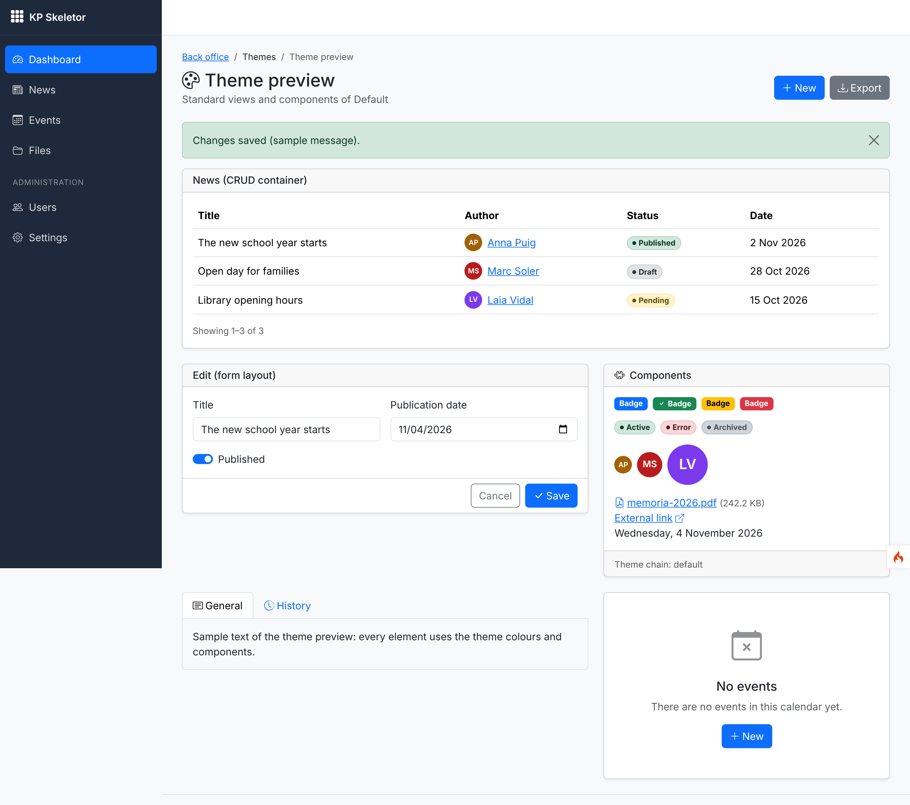
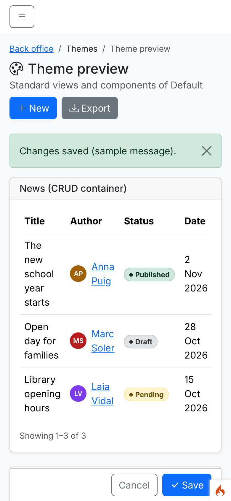
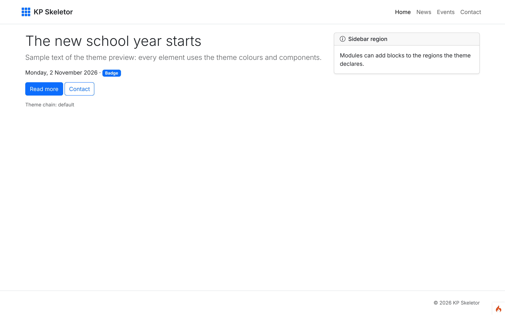
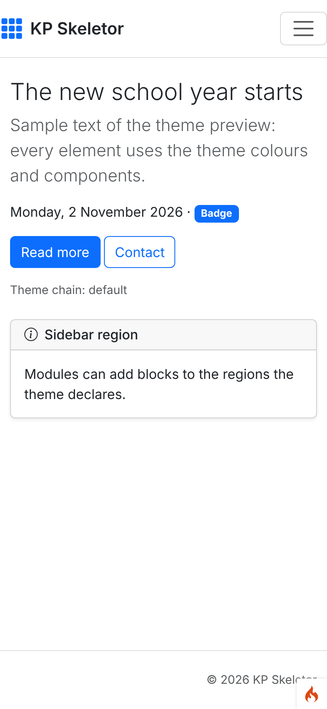
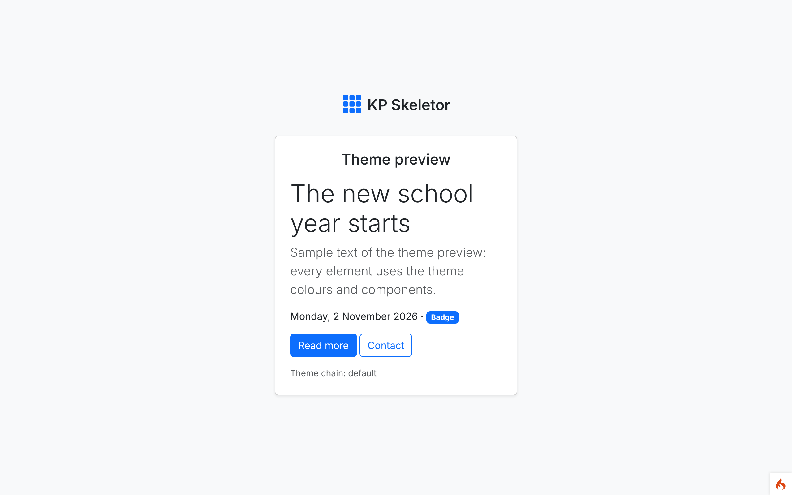
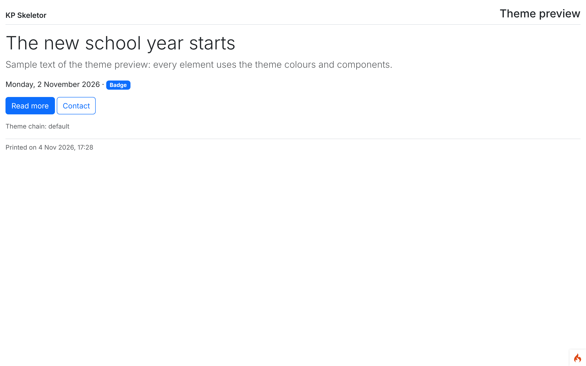
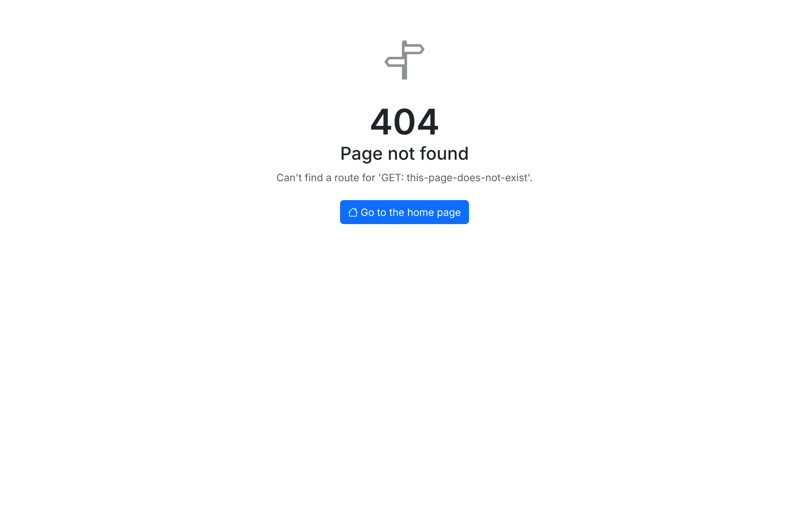
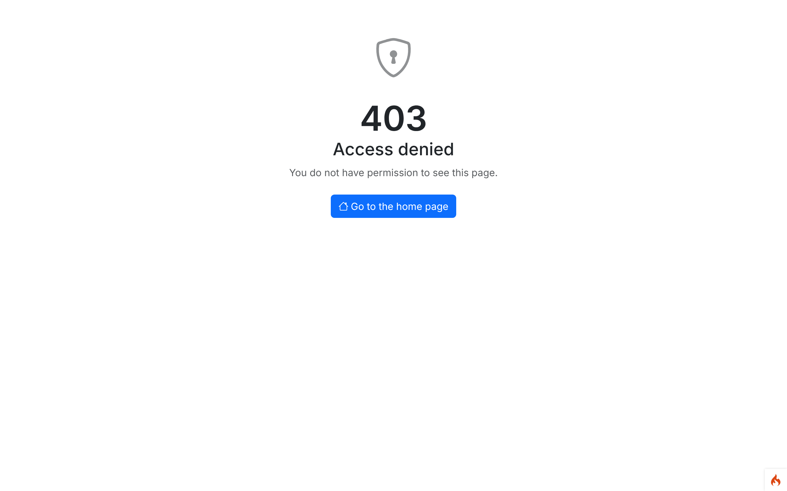
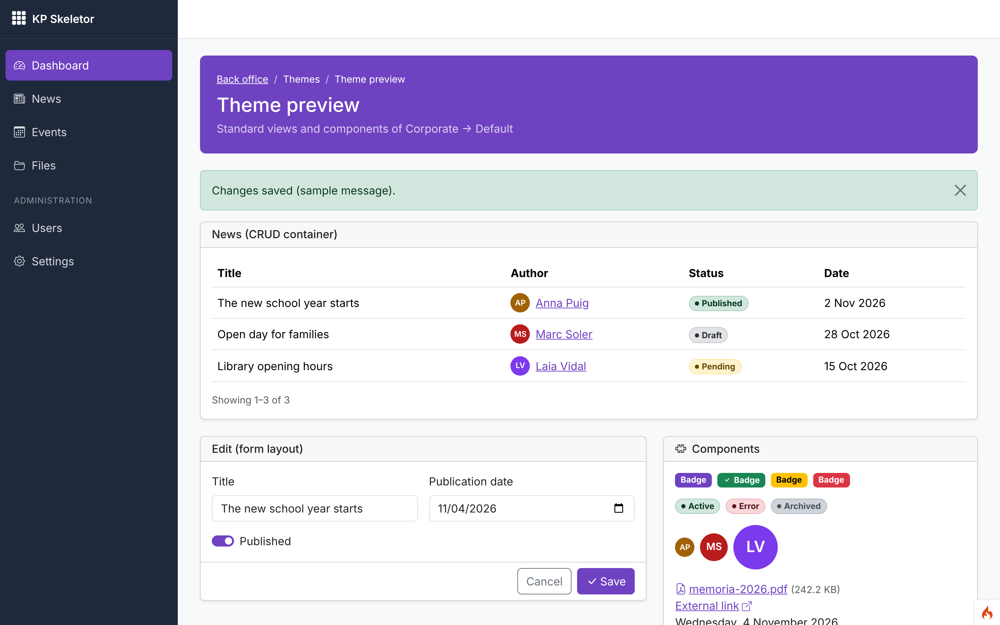
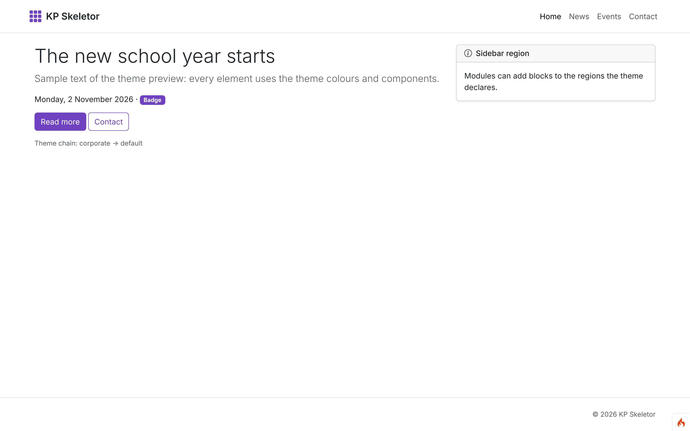

# Session 03 — Themes and standard views

Branch: `claude/tender-ride-z9y4vv` (assigned by the environment) · Pull request: [SIENSIS/kpskeletor#6](https://github.com/SIENSIS/kpskeletor/pull/6) "Session 03: Themes and standard views" · Date: 2026-11-04

## What was built

- **Theme system:** themes in `themes/<slug>/` with a manifest `Themes\<Studly>\Theme` (name,
  version, author, parent, layouts, regions, menu locations, styles/scripts, options declared like
  settings). Child themes inherit everything from their parent chain and override only what they
  need.
- **View resolution:** active theme override → parent theme override → module view → Core
  standard view, through `theme_view()` / `ThemeManager` / `ViewResolver`; modules never
  hard-code a theme path.
- **Settings `Theme.backend` and `Theme.public`** (back office and public site can use different
  themes), with a logged fallback to `default` when the selected theme is missing or broken.
- **Default theme** (Bootstrap 5.3): layouts `backend` (sidebar that becomes an offcanvas below
  992 px, top bar, page header, flash messages, footer), `public` (header with the `primary`
  menu location, content with an optional sidebar region, footer, SEO meta, cookie notice
  option), `auth` (centered card with the logo), `blank` and `print`. Every colour is a CSS
  custom property; options: logo, primary colour, sidebar colour, font, footer text, cookie notice.
- **Standard views and components** (Core, overridable): page header with breadcrumbs and actions,
  breadcrumbs, CRUD container, form layout (CSRF included), empty state, tabs, card, 403/404/500
  pages; `ui_badge()`, `ui_status()`, `ui_avatar()`, `ui_date()`, `ui_link()`,
  `ui_file_link()`, `ui_user_link()`, `ui_pagination_info()`.
- **Vendored Bootstrap 5.3.8 and Bootstrap Icons 1.13.1** in `public/assets/vendor/` with
  `vendor.json` (version, licence, source, SHA-256 per file).
- **`make:theme <Name> [--parent=default|<slug>|none]`**.
- Themed error pages: the 404, the production 500 and the 403 of the `can:` filter (JSON when the
  client asks for it).
- Theme preview pages for theme authors (development only, off by default).

## How it was built

### Design

`ThemeManager` (service `theme`) knows the current area (`public` by default; `BackendController`
switches to `backend`), reads `Theme.<area>` and builds the chain (`ThemeRegistry::chain()`:
active theme first, loops and depth > 5 refused). `ThemeRegistry` loads `themes/<slug>/Theme.php`
and registers the theme's namespace (`tasks-demo` → `Themes\TasksDemo`) with the autoloader on
demand, so no folder is scanned per request (D-03-01). `ViewResolver` turns a view name into the
namespaced name CodeIgniter's `view()` renders, following the order above.

Theme options merge along the chain (`ThemeOptions`), saved values are read with
`service('settings')->get('Theme.<key>', 'theme:<slug>')` (D-03-02, decided), and colour options with
`css` become `--bs-primary`/`--bs-primary-rgb` in one nonce'd `<style>` (only validated hex values).
The default theme's CSS points Bootstrap's compiled component colours (buttons, pagination,
nav pills, form checks, focus rings) back at the variables, so changing `--bs-primary` recolours
everything.

Assets: `ThemeManager::styles()/scripts()` lists the root theme's first and resolves each
declared file from the theme that declares it (a child's `css/theme.css` never hides the
parent's). `ThemeAssetPublisher` mirrors `Assets/` to `public/themes/<slug>/` from
`modules:sync` (step 7) and `make:theme` (D-03-03).

`modules:sync` now validates every theme (`ThemeValidator`) together with the manifests: any
error stops the sync before anything is written.

### Main files

| File | Role |
|---|---|
| `modules/Core/Theme/ThemeManifest.php` | Base class of theme manifests |
| `modules/Core/Theme/ThemeRegistry.php`, `ThemeNotFoundException.php` | Slugs, namespaces, chains |
| `modules/Core/Theme/ThemeManager.php`, `ViewResolver.php`, `Regions.php` | Active theme, resolution, regions, assets |
| `modules/Core/Theme/ThemeOptions.php` | Options, saved values, CSS variables |
| `modules/Core/Theme/ThemeValidator.php`, `ThemeAssetPublisher.php`, `ThemeGenerator.php`, `Templates/` | Validation, publishing, `make:theme` |
| `modules/Core/Theme/ErrorPage.php` | Themed 403/404/500 with a plain fallback |
| `modules/Core/Helpers/theme_helper.php`, `ui_helper.php` | `theme_*()` and `ui_*()` helpers (autoloaded) |
| `modules/Core/Views/components/*`, `errors/*`, `preview/*` | Core standard views |
| `modules/Core/Controllers/BackendController.php`, `FrontendController.php` | Area, layout, breadcrumbs, page header, flash, SEO meta, regions |
| `modules/Core/Controllers/ThemePreview.php`, `modules/Core/Config/Routes.php` | Theme preview (dev only) |
| `modules/Core/Config/Theme.php`, `app/Config/Theme.php`, `modules/Core/Config/Services.php` | Settings defaults, `theme` service |
| `modules/Core/Commands/MakeTheme.php` | `make:theme` |
| `themes/default/` | Default theme (manifest, layouts, partials, CSS, ca/es/en) |
| `public/assets/vendor/` | Bootstrap, Bootstrap Icons, `vendor.json` |

### Tables, routes, permissions, settings, commands

- No new tables, permissions or events.
- Routes: `GET theme-preview` and `GET theme-preview/(:segment)` (404 unless development and
  `theme.preview = true`, D-03-05, decided).
- Settings: `Theme.backend`, `Theme.public` (default `default`), `Theme.fallback`,
  `Theme.preview` (config only); theme options `Theme.<option>` in context `theme:<slug>`.
- Command: `make:theme <Name> [--parent=…]`; `modules:sync` validates themes and publishes their
  assets; `--name=value` options now work in the module commands (D-03-09).

## Decisions and deviations

- **D-03-01** Theme slug ↔ `Themes\<Studly>` namespace registered on demand; `Themes\` removed
  from `composer.json` (Composer warned about the lower-case folders).
- **D-03-02 (decided)** Theme option values stored as `Theme.<option>` with context
  `theme:<slug>`.
- **D-03-03** Theme assets published by `modules:sync`/`make:theme` until `assets:publish`
  (session 04).
- **D-03-04** Error pages in the `blank` layout; `can:` 403 themed or JSON.
- **D-03-05 (decided)** Theme preview URL `/theme-preview/<layout>` (development only, off by
  default).
- **D-03-06** Manifest "assets" as `$styles`/`$scripts` (`vendor:` prefix for vendored files).
- **D-03-07** Site name from `Core.app.name` until the Settings session (deviation).
- **D-03-08** `BackendController::render()` adds layout, breadcrumbs and page header.
- **D-03-09** `--name=value` options accepted (fixes `modules:sync --demo=A,B` from session 02).
- `.gitignore`: `vendor/` anchored to `/vendor/` so `public/assets/vendor/` is committed.
- HTML attributes are escaped with `esc()` (HTML context; every attribute is double-quoted).

## How to try it

```bash
cp env .env          # CI_ENVIRONMENT = development, database, app.baseURL
echo "theme.preview = true" >> .env
php spark modules:sync                  # validates themes, publishes public/themes/default
php spark serve
# http://localhost:8080/theme-preview            back office with every component
# http://localhost:8080/theme-preview/public     public layout (also auth, blank, print)
# http://localhost:8080/theme-preview/errors-403 error pages; any unknown URL shows the 404
php spark make:theme Corporate          # child of default
# themes/corporate/Theme.php: public array $options = ['primaryColor' => ['default' => '#6f42c1']];
# themes/corporate/Views/components/page_header.php: your own header
php spark modules:sync
# http://localhost:8080/theme-preview?theme=corporate   (or theme.backend = corporate in .env)
```

Console output of `make:theme`:

```
$ php spark make:theme Corporate
Theme corporate created in ROOTPATH/themes/corporate.
Next: override views in themes/corporate/Views, then select it with the setting Theme.backend or Theme.public (.env: theme.backend = corporate).
$ php spark make:theme Corporate
The theme corporate already exists.
$ php spark make:theme Other --parent=missing
The parent theme "missing" does not exist.
$ php spark modules:sync
corporate: theme assets published (1 file(s) changed).
Modules synchronised.
```

## Tests and checks

```
$ vendor/bin/phpunit
OK (156 tests, 596 assertions)          # 107 before this session

$ vendor/bin/phpstan analyse
[OK] No errors

$ vendor/bin/php-cs-fixer fix --dry-run --diff
Found 0 of 168 files that can be fixed

$ php spark modules:sync
Nothing to do: every module is up to date.
```

New tests: `ThemeRegistryTest` (slugs, chains, loops, missing parents, path tricks),
`ViewResolverTest` (resolution order for standard and module views, rendered content),
`ThemeManagerTest` (settings per area, fallback, assets order, regions, **a child of the default
theme overriding one view and one colour while inheriting the layouts, partials and CSS**, every
layout renders without inline scripts, handlers or `style=""`), `ThemeOptionsTest` (inheritance,
saved values, CSS injection refused), `ThemeValidatorTest`, `ThemeGeneratorTest` (generator,
`make:theme`, publisher), `UiComponentsTest` (escaping, allowed values, safe URLs, CSRF in
forms), `ErrorPagesTest` (themed pages, fallback, `can:` HTML/JSON, preview 404 outside
development), `VendorAssetsTest` (`vendor.json` checksums), theme language files in ca/es/en.

## Screenshots

Taken with Playwright against `php spark serve` (development, `theme.preview = true`), device
scale factor 2 (`screenshots.json`). The small flame at the bottom right is CodeIgniter's
debug toolbar (development only). There is no demo data yet: the preview pages use sample text.


*01 — Back-office layout with every standard view: page header with breadcrumbs and actions, flash message, CRUD container with statuses, avatars and dates, form layout, components card, tabs and empty state.*


*02 — The same screen at 390 px: the sidebar becomes an offcanvas (menu button), actions wrap, no horizontal scroll.*


*03 — Public layout: header with the `primary` menu location, content and the sidebar region, footer.*


*04 — Public layout at 390 px: collapsed menu, sidebar region below the content.*


*05 — Authentication layout: centered card with the site logo.*


*06 — Print layout: no navigation or scripts, site name and title on top, print date at the bottom.*


*07 — A real unknown URL renders the theme's 404 page (the route message is shown only outside production).*


*08 — The 403 page (the same view the `can:` filter returns).*


*09 — A child theme made with `make:theme Corporate` that overrides one view (`components/page_header`) and one colour (`primaryColor` = #6f42c1): the layout, sidebar, components and CSS all come from `default`.*


*10 — The same child theme on the public layout: buttons, links and badges follow the new primary colour without copying any CSS.*

## Known issues

- `CanFilterTest::testGuestIsForbidden` fails when run alone (it needs the settings table that
  an earlier test migrates); it passes in the full suite. Pre-existing from session 01/02.
- `CI_ENVIRONMENT` in `.env` wins over phpunit's value (session 02 note): with a development
  `.env`, rendered views carry debug comments; tests strip or decode them.
- The cookie notice cannot remember its dismissal yet, the sidebar does not remember its state and
  there is no dark mode: front-end session 04.
- The demo child theme `corporate` was only created for the screenshots and is not committed.

## Notes for the next session

- Session 04: fold `ThemeAssetPublisher` into `assets:publish` (hashes, asset manifest); add the
  nonces to the `<script src>` tags of `partials/scripts.php`; the CSP check must accept the one
  nonce'd `<style>` of `partials/head.php` (D-00-25); light/dark values for theme options
  (`primaryColor` dark variant, `logoDark`), theme switch in the top bar, remember the sidebar and
  the cookie notice.
- Session 08: fill the `sidebar` region of the backend layout (`.sidebar-nav .nav-link`,
  `.nav-heading` are styled) and the `primary`/`footer` menu locations (`data-menu-location`).
- Session 09: `setLayout(theme_layout('backend'), 'content')` + `setLayoutData(['breadcrumbs' => …])`
  and `showTitle(false)` with a `pageHeader`; wrap kpcrudy with `components/crud_container` if useful.
- Session 14: Settings UI for `Theme.backend`, `Theme.public` and the theme options
  (`ThemeManager::options()->definitions()`, stored per D-03-02); site name replaces `Core.app.name`.
- D-03-02 and D-03-05 were decided by the owner as proposed (`deploy/decide.md`).
