# Session 04 — Front-end assets, JavaScript, CSP, dark mode, responsive and PWA

Branch: `claude/funny-goldberg-9n764h` (assigned by the environment) · Pull request: [SIENSIS/kpskeletor#7](https://github.com/SIENSIS/kpskeletor/pull/7) "Session 04: Front-end assets, JavaScript, CSP, dark mode, responsive and PWA" · Date: 2026-11-04

## What was built

- **Asset pipeline:** `php spark assets:publish [--watch] [--check]` copies the Core's, every
  module's and every theme's `Assets/` to `public/assets/core/`, `public/assets/modules/<name>/`
  and `public/themes/<slug>/` (CodeIgniter Publisher; never PHP/HTML; stale copies removed) and
  writes an **asset manifest** with hashes. `asset('core::js/app.js')` returns versioned URLs
  (`core::`, `<module>::`, `theme::`, `vendor::`). In development, edited sources are republished
  on the next page load.
- **Import map** printed by every layout (with the nonce) listing every published JS file with its
  hashed URL (`core/…`, `<module>/…`, `theme/…`), so imported modules are cache-busted too.
- **Core JavaScript** (native ES modules, no bundler): `app.js`, `components.js`
  (`data-component` + dynamic `import()`, JSON data blocks, late-added elements), `config.js`,
  `http.js` (same-origin fetch, CSRF header, JSON errors → toasts), `ui/` (toast, modal,
  confirm + `data-confirm`, sidebar, tabs-memory, theme-switch, cookie-notice), `forms/`
  (dirty-guard, date; editor and file-picker stubs), `theme-mode.js`, `pwa.js`.
- **Strict CSP with nonces on every response** (enforced by default, report-only switch through
  `.env`), module sources from the manifest's `$csp`, and a **CI check** (`php spark csp:check`)
  that the project's views contain no inline scripts, handlers or styles.
- **Light / dark / auto mode** without a flash, a switch in the back-office top bar and in the
  public header, dark-mode values for theme options (`primaryColorDark`, `logoDark`) and options
  to force a mode or hide the switch.
- **Responsive layout:** offcanvas sidebar on phones, icon-only bar on tablets, full sidebar on
  desktops with a remembered toggle; shortened breadcrumbs, full-screen modals and 44 px touch
  targets on phones; no horizontal scroll at 360, 768 and 1200 px.
- **Minimal PWA** (setting `Core.pwa`, off by default): `/manifest.webmanifest`, `/sw.js` (caches
  nothing), PNG icons 192/512 generated with GD from the logo and regenerated when it changes.
- **Demo page** `/theme-preview/components` (development, `theme.preview = true`).

## How it was built

### Design

`AssetPublisher` (`modules/Core/Frontend/`) lists the sources (module folders by glob, themes
from `ThemeRegistry`), copies each with CodeIgniter's `Publisher` (only changed files), removes
copies with no source (and folders of removed modules/themes) and writes
`public/assets/manifest.json` (`<owner>::<path>` → URL + 12-hex SHA-256). `AssetManifest`
(service `assets`) reads it once per request; in development (`assets.devRefresh`) it first
republishes when a source is newer than the manifest. `ImportMap` turns the manifest's `js/`
files into specifiers; the theme's files follow the active chain (child wins). `ThemeManager`
asset URLs use the manifest hashes. `ThemeAssetPublisher` (session 03) is folded into the new
publisher and removed.

The layouts (`themes/default/Views/partials/head.php`, `scripts.php`) print
`theme_mode()->attributes()` on `<html>`, `core::js/theme-mode.js` before the stylesheets, then
before `</body>` the theme scripts, the `kp-config` JSON block (base URL, locale, `Core.js.*`
texts), the import map and `core/app.js` — all with the CSP nonce.

CSP: CodeIgniter's policy, enabled and tightened in `app/Config/ContentSecurityPolicy.php`;
nonces come from `csp_script_nonce()`/`csp_style_nonce()`. Module `$csp` declarations are stored
by `modules:sync` (declaration kind `csp`) and added by the global `cspmodules` filter.
`CspViewScanner` strips PHP blocks from each view and checks scripts, styles, handlers, `style=`
and `javascript:` URLs.

Colour mode: `ThemeMode` — theme `forceMode` › user preference (hook for the Users session) ›
`kp_theme` cookie › `defaultMode`. `ThemeOptions` prints dark-mode option values under
`[data-bs-theme=dark]` and a lighter primary (`--kp-primary-light-rgb`) for links on dark
backgrounds.

### Main files

| File | Role |
|---|---|
| `modules/Core/Frontend/AssetPublisher.php`, `AssetManifest.php`, `ImportMap.php` | Publishing, manifest, import map |
| `modules/Core/Helpers/asset_helper.php` | `asset()`, `import_map()`, `page_config_json()`, `pwa_*()` |
| `modules/Core/Commands/AssetsPublish.php`, `CspCheck.php` | `assets:publish`, `csp:check` |
| `modules/Core/Assets/js/**` | Core ES modules; `Assets/pwa/sw.js` |
| `app/Config/ContentSecurityPolicy.php`, `app/Config/App.php`, `modules/Core/Filters/ContentSecurity.php` | Strict CSP, module sources |
| `modules/Core/Frontend/CspViewScanner.php` | View check |
| `modules/Core/Frontend/ThemeMode.php`, `modules/Core/Theme/ThemeOptions.php` | Colour mode, dark values |
| `modules/Core/Frontend/Pwa.php`, `modules/Core/Controllers/Pwa.php` | PWA manifest, icons, worker |
| `themes/default/Views/partials/{head,scripts,theme_switch,cookie_notice,brand}.php`, `layouts/*`, `Assets/css/theme.css` | Layout integration, dark mode, responsive CSS |
| `modules/Core/Views/preview/components.php`, `Assets/js/demo/showcase.js` | Demo page |
| `app/Views/home.php` | Themed home page (replaces CodeIgniter's welcome page) |
| `docs/frontend.md` | Developer documentation |

### Tables, routes, permissions, settings, commands

- Tables: none (module CSP sources use `module_declarations`, kind `csp`).
- Routes: `GET manifest.webmanifest`, `GET sw.js`, `GET pwa/icon-(192|512).png` (404 while
  `Core.pwa` is off); `GET theme-preview/components`, `theme-preview/ping`,
  `theme-preview/ping-error` (development + `theme.preview` only).
- Filters: global `cspmodules`.
- Settings: `Core.pwa` (bool, false), `Core.pwaStart` (`public`/`backend`); config
  `assets.devRefresh`; theme options `primaryColorDark`, `logoDark`, `defaultMode`, `forceMode`,
  `modeSwitch`. Declaring Core settings adds the generated permission `settings.core`.
- Cookies (preferences, no personal data, SameSite=Lax): `kp_theme`, `kp_sidebar`, `kp_cookies`.
- Commands: `assets:publish [--watch] [--check]`, `csp:check`; `modules:sync`, `modules:enable`
  and `make:theme` publish assets.
- CI: `php spark csp:check` and `assets:publish && assets:publish --check` after the tests.

## Decisions and deviations

- **D-04-01** front-end classes in `modules/Core/Frontend/` (not `Core/Assets/`); `ThemeAssetPublisher` removed.
- **D-04-02** development rule: republish stale assets on the next request (instead of serving sources).
- **D-04-03** manifest keys `<owner>::<path>`, reserved owners `core`/`theme`/`vendor`, bare specifiers only.
- **D-04-04** CSP details (`*-attr 'none'`, `img-src data:`, no built-in report endpoint).
- **D-04-05** module `$csp` stored as declarations and applied by the `cspmodules` filter.
- **D-04-06** colour mode stored in the `kp_theme` cookie until the user profile exists; new theme options.
- **D-04-07** sidebar breakpoints (offcanvas < 768 px, icon-only 768–1199 px) and `kp_sidebar` cookie.
- **D-04-08** PWA settings, icons in `writable/pwa/`, no-cache worker, `settings.core`.
- **D-04-09** CSRF meta tags only when a session already exists (no session for anonymous visitors).
- **D-04-10** CodeIgniter's welcome page replaced by a themed home page; `error_400` style removed; debug page nonce'd (only `csp:check` exception).
- Deviations: the user profile does not store the colour mode yet (Users session); the WCAG AA
  axe test of the specification is not part of this session (session 35, quality).
- Gap fixed from session 03: `public/assets/core/` and `public/assets/manifest.json` added to `.gitignore`.

## How to try it

```bash
cp env .env
# .env: CI_ENVIRONMENT = development, app.baseURL = 'http://localhost:8080/',
#       database.default.DBDriver = SQLite3, database.default.database = database.db, theme.preview = true
php spark modules:sync          # migrations, declarations, assets:publish
php spark serve
# http://localhost:8080/theme-preview/components   components demo (toast, confirm, modal, JSON, forms)
# http://localhost:8080/theme-preview              back office: resize to 360/768/1200 px, toggle the sidebar
# http://localhost:8080/                           public home; use the ◐ switch for light/dark/auto
php spark assets:publish --watch   # edit modules/Core/Assets/js/*.js and reload
php spark csp:check
curl -sI http://localhost:8080/nope | grep Content-Security-Policy
# PWA (no Settings screen yet): run service('settings')->set('Core.pwa', true) once (e.g. from a
#      temporary controller), then open /manifest.webmanifest, /sw.js, /pwa/icon-512.png
```

No demo users or data exist yet (authentication arrives in session 05).

## Tests and checks

```
$ vendor/bin/phpunit
OK (181 tests, 830 assertions)          # 156 before this session

$ vendor/bin/phpstan analyse
[OK] No errors

$ vendor/bin/php-cs-fixer fix --dry-run --diff
Found 0 of 186 files that can be fixed

$ php spark csp:check
No inline scripts, handlers or styles in the project views.

$ php spark assets:publish --check
The published assets are up to date.

$ php spark modules:sync        # development .env with SQLite
Modules\Core: 6 migration(s) run.
Core 0.1.0 installed.
7 permission(s) added to the catalogue.
...
Modules synchronised.
```

New tests: `AssetPublisherTest` (sources, allowed extensions, stale and orphan removal, reserved
owners, single owner, `--check`, staleness, **the import map changes when a file changes**),
`FrontendAssetsTest` (the real sources publish cleanly; every JS import is a bare specifier
resolved by the import map; no `eval`/`innerHTML`; `asset()`; layouts print the mode script before
the CSS, the nonce'd import map before the module, the config block), `ContentSecurityPolicyTest`
(strict header with matching nonces, report-only, module sources filtered, manifest
declarations, project views clean, scanner rules), `ThemeModeTest` (choice order, attributes,
switch, dark option values, cookies read by the server, cookie notice remembered), `PwaTest` (404
while off, manifest, no-cache worker, icon sizes, icon regenerated when the logo changes, unsafe
logo paths refused). Updated: `ThemeManagerTest`, `ThemeOptionsTest`, `CatalogueBuilderTest`, `ThemeGeneratorTest`
(publisher test moved to `AssetPublisherTest`).

Browser check (Playwright, Chromium, CSP enforced, development with the debug toolbar): every page
of the table below loads with **no console errors and no CSP violations** (the only console line
is the demo's intentional HTTP 422), `data-component` elements mount, toasts/confirm/modal/JSON
requests work, the switch persists the mode across reloads, and `scrollWidth − clientWidth = 0`
at 360, 768 and 1200 px in light and dark. `deploy-status/screenshot.mjs` now fails a capture on
horizontal overflow or a CSP violation and supports `click` steps.

## Screenshots

Taken with Playwright against `php spark serve` (development, `theme.preview = true`), device
scale factor 2 (`screenshots.json`). The flame at the bottom right is CodeIgniter's debug toolbar
(development only). No demo data exists yet: the preview pages use sample text.

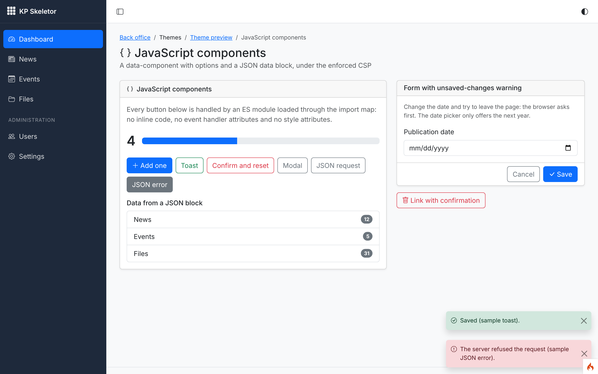
*01 — `/theme-preview/components`: a `data-component` mounted from the import map, its JSON data block rendered as a list, the progress width set through the CSSOM, a success toast and a JSON error from `core/http.js` shown as a danger toast.*

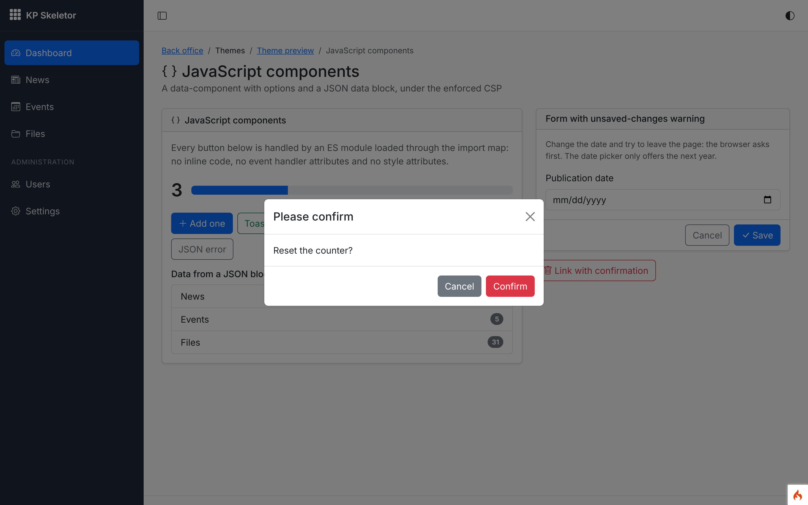
*02 — `confirm()` with the theme's Bootstrap modal (keyboard focus on the confirm button).*

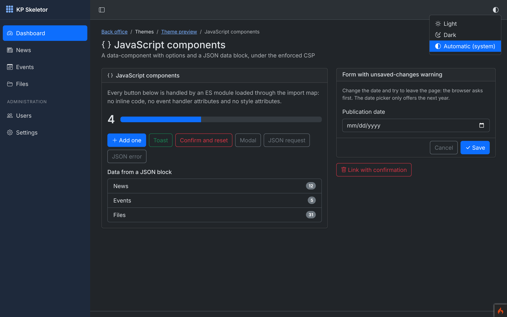
*03 — The same page in dark mode (system preference), with the light/dark/auto switch open; links use the lightened primary colour.*

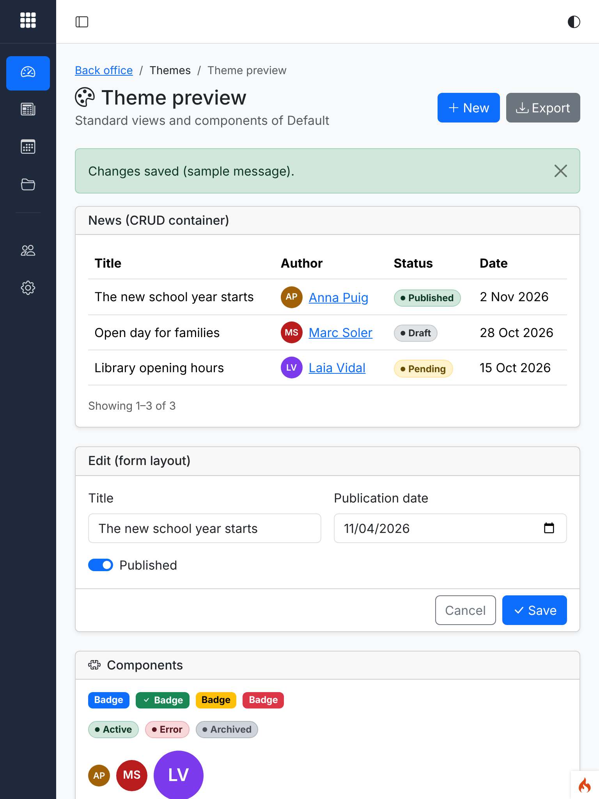
*04 — Back office at 768 px: the sidebar becomes an icon-only bar.*

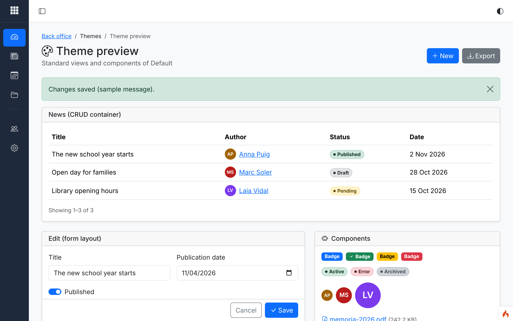
*05 — Desktop after pressing the sidebar toggle: icon-only, remembered in the `kp_sidebar` cookie for the next page.*

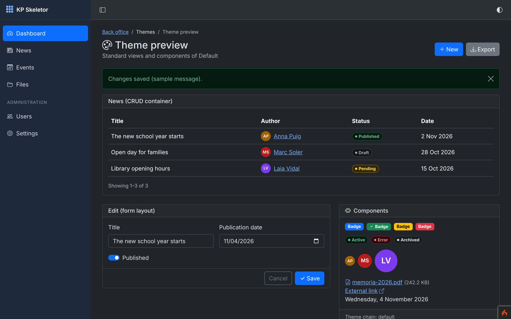
*06 — Back-office standard views in dark mode.*

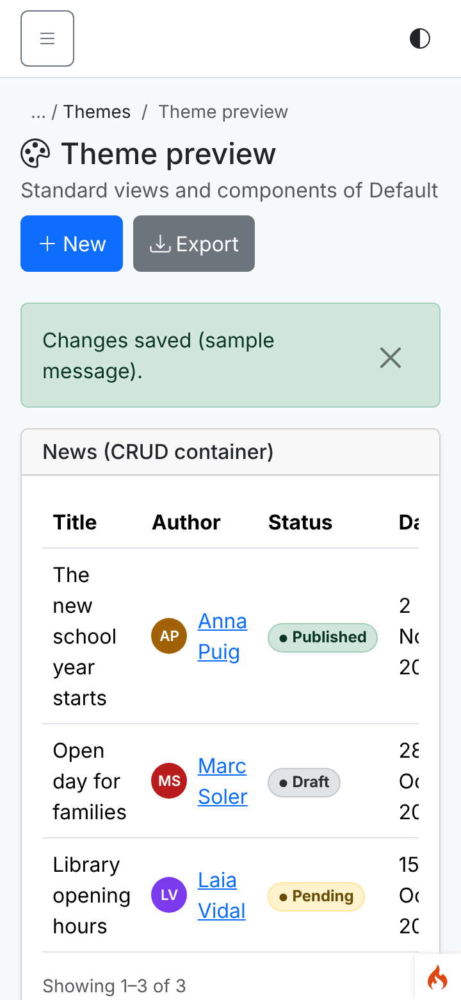
*07 — Back office at 360 px: offcanvas menu button, compact top bar, no horizontal scroll.*

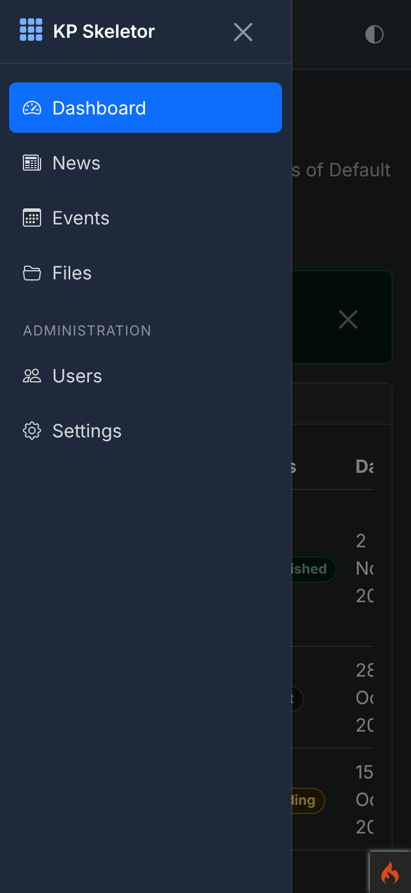
*08 — The offcanvas sidebar open on a phone, dark mode.*

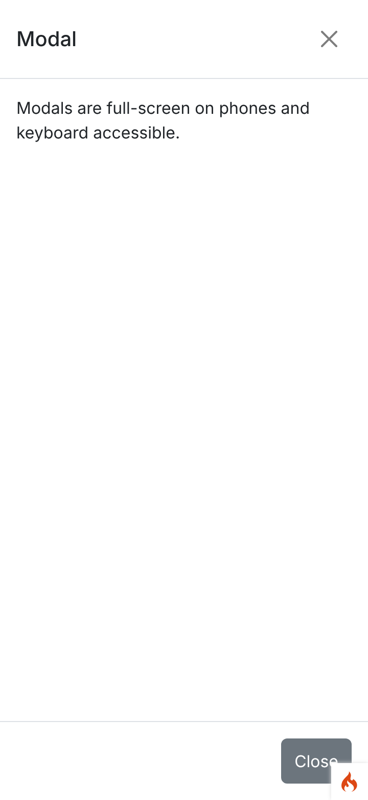
*09 — Modals are full-screen on phones.*

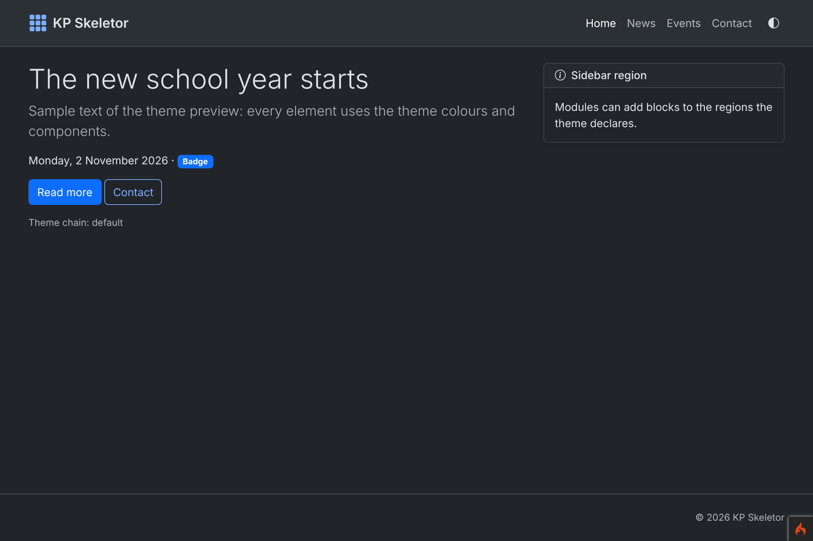
*10 — Public layout in dark mode with the switch in the header.*

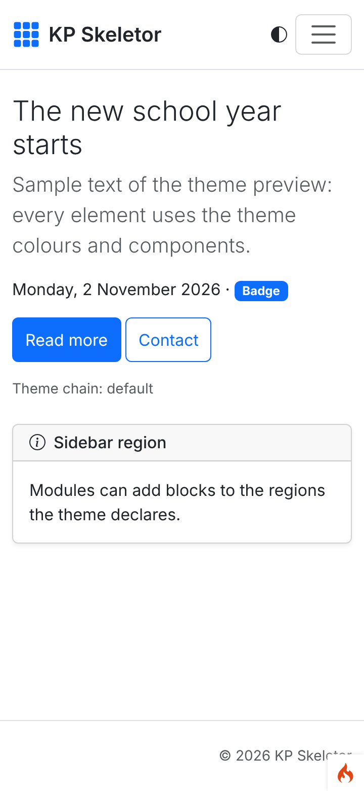
*11 — Public layout at 360 px: switch and menu toggler in the header, sidebar region below.*

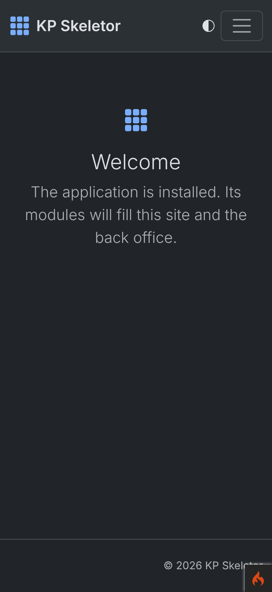
*12 — The new themed home page (replaces CodeIgniter's welcome page) on a phone in dark mode.*

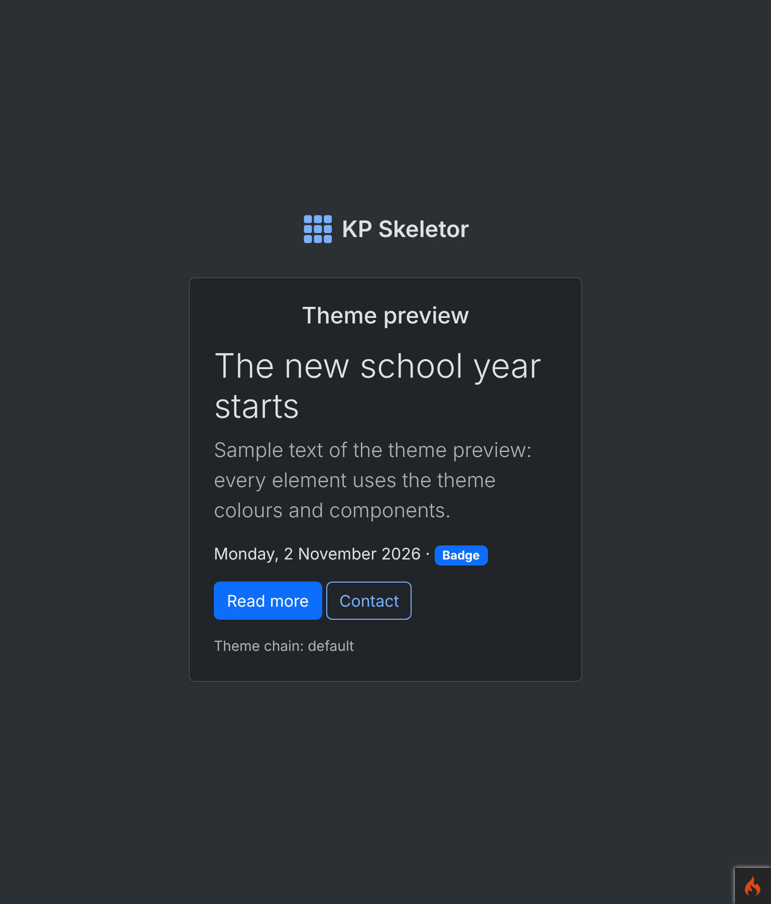
*13 — Authentication layout in dark mode at 768 px.*

## Known issues

- The colour-mode choice of logged-in users is stored in the cookie, not yet in their profile
  (the Users module plugs a preference reader into `ThemeMode`).
- `CodeIgniter`'s development error page keeps its "arguments" toggles as `onclick` handlers:
  under the CSP they are inert (the page is styled and readable). Development only.
- No automated WCAG/axe contrast test yet (specification: quality session).
- The PWA can only be switched on through the settings service until the Settings screen
  (session 14); `Core.pwa` has no screenshot because it is off by default (covered by `PwaTest`).
- `CanFilterTest::testGuestIsForbidden` still needs the full suite (session 03 note).
- `modules:sync` needs a configured database (as before); the cloud setup script stops when
  Composer cannot download `phpstan/phpstan` (see the session 00 note: seed its zip into
  Composer's cache under `files/phpstan/phpstan/<sha1 of the dist URL>.zip`).

## Notes for the next session

- Session 05 (auth): auth pages use the `auth` layout, which already prints the switch-free
  colour mode, CSRF meta tags (a session exists) and `core/app.js`; use `data-confirm`,
  `form_layout` with `dirtyGuard`, and `core/http.js` for any fetch.
- Session 08: menus render in the `sidebar` region with `<a class="nav-link"><i class="bi …"></i><span class="nav-text">Label</span></a>` (the icon-only bar hides `.nav-text`; add `title`); `Config\SecurityHeaders` replaces `secureheaders`; Settings › Security extra CSP origins can reuse `ContentSecurity::apply()`.
- Session 09: kpcrudy's nonce'd blocks are allowed (D-00-24); wire `kpcrudy:confirm` to `core/ui/confirm.js` (`ui/kpcrudy-confirm.js`).
- Session 14: Settings UI for `Core.pwa`, `Core.pwaStart` and the new theme options.
- Session 15 (Users): store the colour mode in the profile and pass a preference reader to `ThemeMode` (ThemeManager::mode()).
- Sessions 20/23: fill `core/forms/editor.js` and `core/forms/file-picker.js`; vendored libraries must work under the enforced CSP (`style-src-attr 'none'`).
- Modules: put JS in `modules/<Name>/Assets/js/`, import with `core/…` / `<module>/…`, reference files with `asset('<module>::…')`; see `docs/frontend.md`.
