# Session 05 — Authentication (Shield) and session hardening

Branch: `claude/confident-turing-bbgi7g` (assigned by the environment) · Pull request: "Session 05: Authentication (Shield) and session hardening" · Date: 2026-11-05

## What was built

- **Login** with email and password, "remember me", optional local captcha, **logout** (POST
  with confirmation page), **magic-link login** and **password reset** by email.
- **No enumeration:** identical generic answers for unknown accounts, also in timing.
- **Rate limits:** failed logins per IP and per account (429 + `Retry-After`), email links per IP
  (429) and per account (silent).
- **Hardened sessions:** HTTPS-only cookies in production, HttpOnly, SameSite=Lax; id regenerated
  on login, logout, unlock, password change and privilege changes; **absolute lifetime** (12 h)
  that ends the session; **remember-me** capped at its own lifetime (14 days); optional **idle
  lock** screen; **"my sessions"** with remote logout and API-token revocation; password change
  or reset ends every other session and revokes the app tokens; **new-device email**.
- **Profile** (`backend/profile`): name, email, language, time zone, colour mode, birth date and
  password change (also the forced-reset screen).
- **Groups** `superadmin`, `admin`, `editor`, `user`; superadmins bypass `can:`; reserved-group
  rules.
- Global **CSRF** protection on every POST (except `api/*`).

## How it was built

### Design

Shield provides users, identities, password hashing, remember-me and the session authenticator.
The Auth module (`modules/Auth/`) adds its own controllers on Shield's API (Shield's reveal
accounts and keep magic-link tokens in clear, D-05-01) and one global filter, `authsession`
(`Filters/AuthSession.php`), that runs before every request:

1. `AuthPolicy::apply()` copies the stored `Auth.*` settings into `config('Auth')` (minimum
   password length, remember-me on/off and length) — Shield reads that object directly;
2. remember-me tokens older than `Auth.rememberLifetime` are deleted before Shield can use them
   (Shield extends them on every use);
3. the tracked row of the session (`user_sessions`, found by the hash of a random token kept in
   the PHP session) decides: ended remotely → logged out; older than `Auth.absoluteLifetime` →
   the PHP session ends (remember-me may re-create it, tracked as "remembered"); flagged after a
   privilege change → id regenerated; idle longer than `Auth.idleTimeout` → lock screen;
4. the user's language is applied.

Shield's `login`/`logout` events (`Config/Events.php` → `LoginListener`) start/end tracking,
recognise the device (`DeviceRecognizer`, hashed `kp_device` cookie) and restore the colour mode.

### Main files

| File | Role |
|---|---|
| `app/Config/Auth.php`, `app/Config/AuthGroups.php` | Shield config with the skeleton defaults and the Auth settings' defaults; the four groups |
| `app/Config/Cookie.php`, `Session.php`, `Filters.php`, `App.php` | Secure cookies in production, `regenerateDestroy`, 12 h storage; global `csrf` and `authsession`; `session` + `forcereset` on `backend/*`; `supportedLocales` |
| `modules/Auth/Config/{Module,Routes,Events,Registrar}.php` | Manifest (resources, grants, settings), routes, event listeners, filter aliases |
| `modules/Auth/Controllers/*` | `LoginController`, `MagicLinkController`, `ResetPasswordController`, `CaptchaController`, `LockController`, `ProfileController`, `SessionsController` |
| `modules/Auth/Services/*` | `AuthPolicy`, `LoginThrottle`, `Captcha`, `LinkTokens`, `SecurityMailer`, `SessionTracker`, `DeviceRecognizer`, `DeviceName`, `PasswordChanger`, `GroupRules`, `LoginListener` |
| `modules/Auth/Filters/*` | `AuthSession` (`authsession`), `ForcePasswordReset` (`forcereset`) |
| `modules/Auth/Views/*`, `Assets/js/captcha.js` | Auth-layout and back-office views, emails, captcha reload component |
| `modules/Core/Filters/Can.php`, `Controllers/BackendController.php` | Superadmin bypass |
| `themes/default/Views/partials/user_menu.php` | Profile, my sessions and logout in the top bar |
| `docs/auth.md`, `modules/Auth/CLAUDE.md` | Documentation |

### Tables, routes, permissions, settings

- Tables (one migration each): `user_profiles` (user, name, locale, timezone, theme mode,
  avatar, birth date), `user_sessions` (user, token hash, IP, user agent, remembered, remember
  selector, regenerate flag, created, last seen, ended, reason), `known_devices` (user, device
  hash, user agent, IP, first/last seen). Shield's tables as shipped.
- Routes: `login`, `logout`, `login/magic-link`, `login/verify-magic-link`, `reset-password`,
  `reset-password/new`, `auth/captcha`, `auth/lock`, `backend/profile`,
  `backend/profile/password`, `backend/profile/sessions`, `…/sessions/(:num)/revoke`,
  `…/sessions/revoke-others`, `…/tokens/(:num)/revoke`.
- Permissions: `auth-profile.view|edit`, `auth-sessions.view|revoke` (every group), `settings.auth`.
- Settings: `Auth.minimumPasswordLength` (8), `absoluteLifetime` (720 min), `idleTimeout`
  (0 = off), `rememberLifetime` (14 days), `captcha` (off), `newDeviceNotice` (on),
  `loginAttemptsPerIp` (10), `loginAttemptsPerAccount` (5), `loginLockMinutes` (15),
  `emailLinksPerIp` (10/h), `emailLinksPerAccount` (3/h).
- Events: listens to Shield's `login`/`logout`; triggers `passwordChanged`.
- Commands: none new; demo users with `php spark modules:demo Auth`.

## Decisions and deviations

- **D-05-01** own login/magic-link/reset controllers; hashed single-use link tokens.
- **D-05-02** `user_sessions` tracking, remote logout deletes the session's remember-me token,
  remember-me capped from its creation.
- **D-05-03** interim `AuthGroups` matrix (personal screens for every group) until session 07;
  superadmin bypass; `GroupRules`.
- **D-05-04** names, units and defaults of the `Auth.*` settings; floors in `AuthPolicy`.
- **D-05-05** personal API tokens marked `secret2 = 'personal'`; all others are app tokens.
- **D-05-06** global CSRF and `authsession`; `session` + `forcereset` on `backend/*` until the
  `backend` chain of session 07; logout is a POST.
- **D-05-07** login lands on `backend/profile` until the dashboard; colour mode copied to
  `kp_theme`; user language applied; `supportedLocales = en, ca, es`.
- **D-05-08** new-device notice not sent for an account's first device.
- Deviations: security events are written to the application log (activity log in session 12);
  the avatar field waits for the file picker (session 23); Shield's logout deletes all the user's
  remember-me tokens (kept as is). Gaps fixed: two Core tests assumed Core was the only module.

## How to try it

```bash
bash deploy/setup.sh               # or composer install (see Known issues)
cp env .env                        # CI_ENVIRONMENT = development, SQLite (see session 04 report)
php spark modules:sync
php spark modules:demo Auth        # answer y
php spark serve
```

- http://localhost:8080/login — `superadmin@example.com`, `admin@example.com`,
  `editor@example.com`, `usuari@example.com`, password `Demo-kpskeletor-2026`.
- Profile: http://localhost:8080/backend/profile · My sessions: …/backend/profile/sessions
  (log in from a second browser to see two sessions and log one out).
- Emails: in development the mail goes nowhere unless `email.*` is configured in `.env`; tests
  capture them.
- Captcha / idle lock: `php deploy-status/05-auth/settings.php captcha 1`,
  `php deploy-status/05-auth/settings.php idleTimeout 1` (clear with no value).
- Screenshots: `node deploy-status/05-auth/screenshots.mjs`.

## Tests and checks

```
$ vendor/bin/phpunit
OK (251 tests, 1223 assertions)          # 181 before this session; modules/Auth: 70 tests

$ vendor/bin/phpstan analyse
[OK] No errors

$ vendor/bin/php-cs-fixer fix --dry-run --diff
Found 0 of 238 files that can be fixed

$ php spark csp:check
No inline scripts, handlers or styles in the project views.

$ php spark assets:publish --check
The published assets are up to date.

$ php spark modules:sync           # fresh SQLite database
Modules\Core: 6 migration(s) run.
Modules\Auth: 3 migration(s) run.
Auth 0.1.0 installed.
Auth: default grants applied (8 added).
Modules synchronised.
```

Auth tests: `LoginTest` (generic messages, CSRF, 429 per IP and per account, banned, logout,
guest redirect), `CaptchaTest` (off/404, hashed, single use, enforced in testing and
development), `PasswordPolicyTest` (setting copied and enforced, floor, local validators,
manifest defaults), `MagicLinkTest`, `ResetPasswordTest` (sessions ended, app tokens revoked,
personal kept), `SessionLifetimeTest` (absolute lifetime with and without remember-me, the
remember-me cap, remote logout, regeneration after privilege change, idle lock),
`SessionsScreenTest` (forged ids and forged POSTs refused, `can:` on every route), `ProfileTest`,
`DeviceRecognizerTest`, `GroupRulesTest`, `AuthConfigTest`, `AuthMigrationsTest` (up/down/up).

## Screenshots

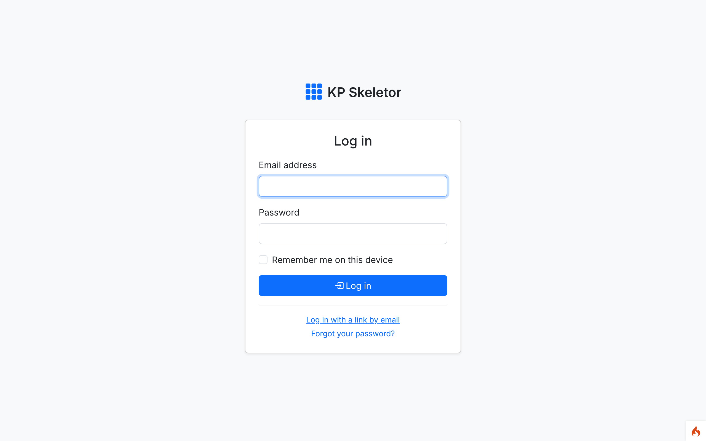
*01 — Login in the theme's auth layout (guests still see the default English locale until session 31).*

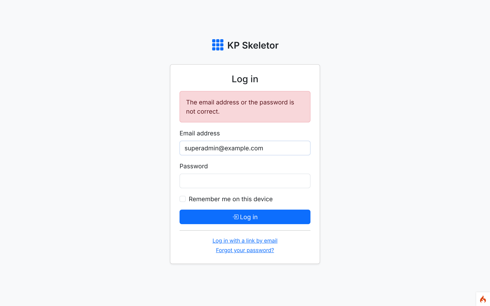
*02 — A wrong password gets the same message as an unknown account.*

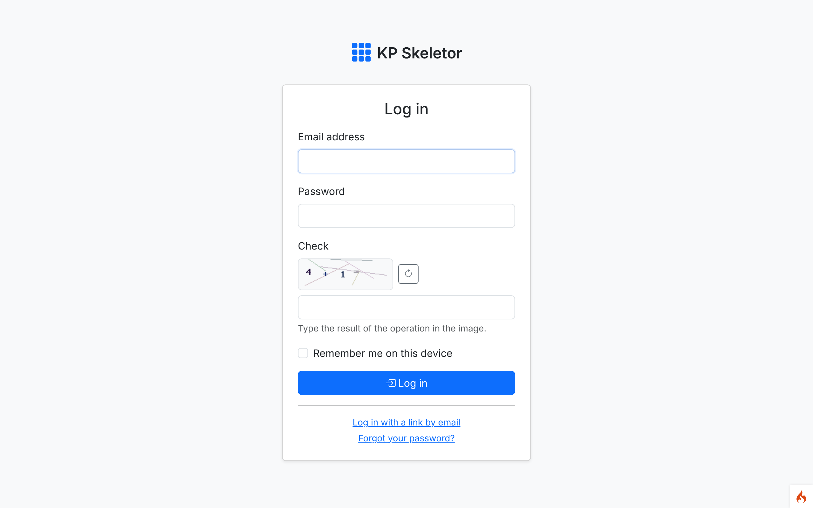
*03 — Login with the local arithmetic captcha (`Auth.captcha` on).*


*04 — Magic-link request.*

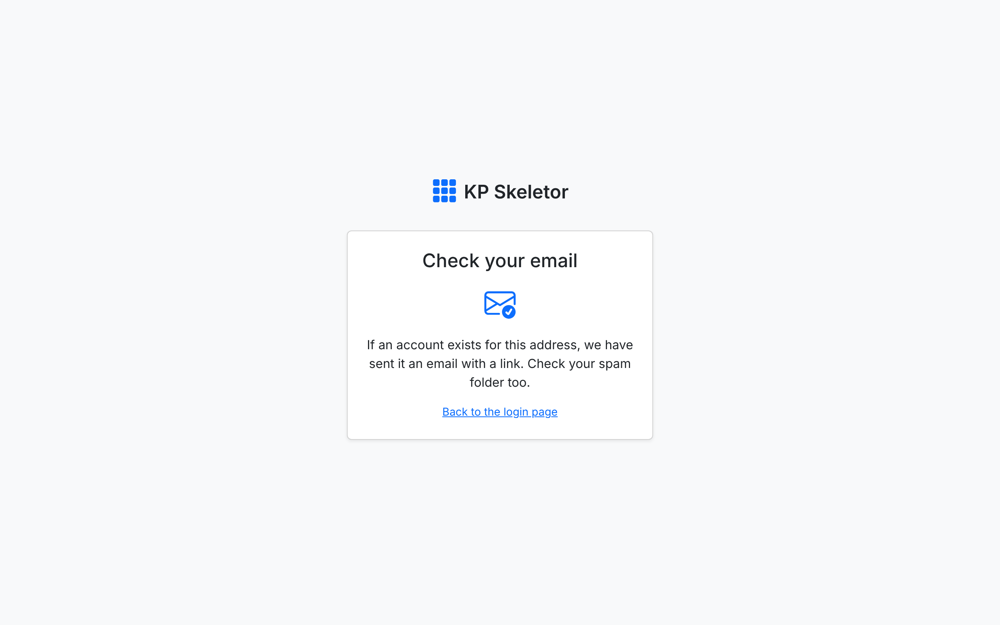
*05 — The same answer whether the account exists or not.*

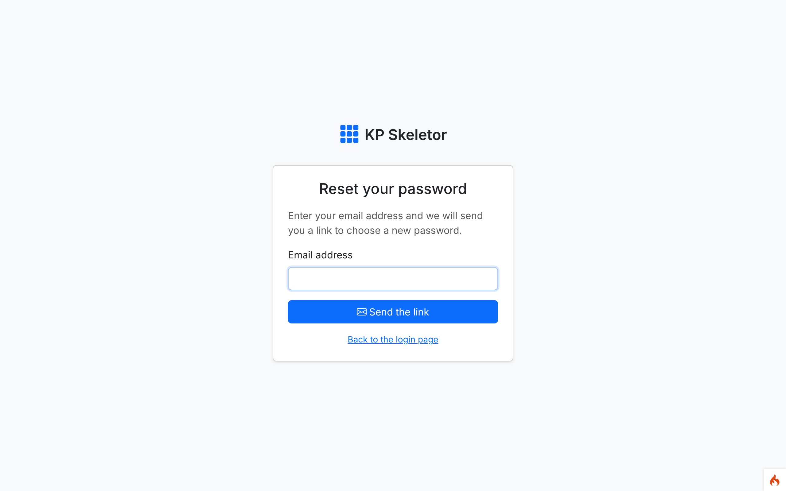
*06 — Password-reset request.*

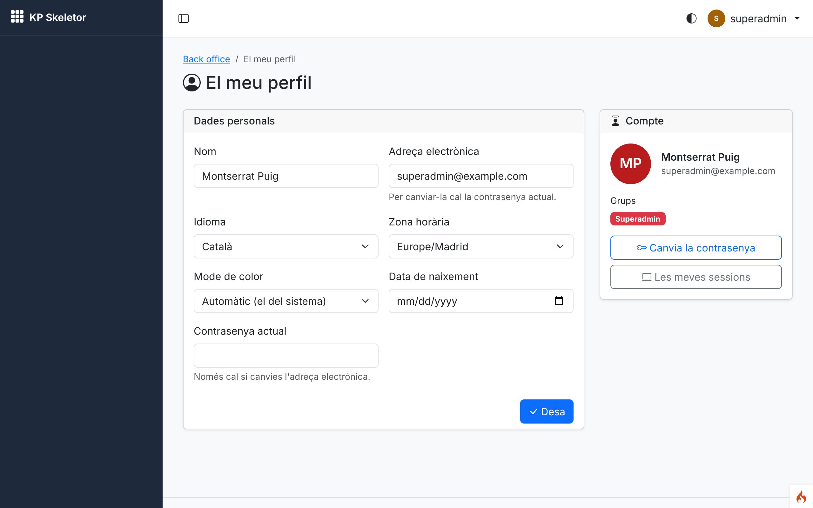
*07 — Profile of the superadmin (Catalan, from the profile's language).*

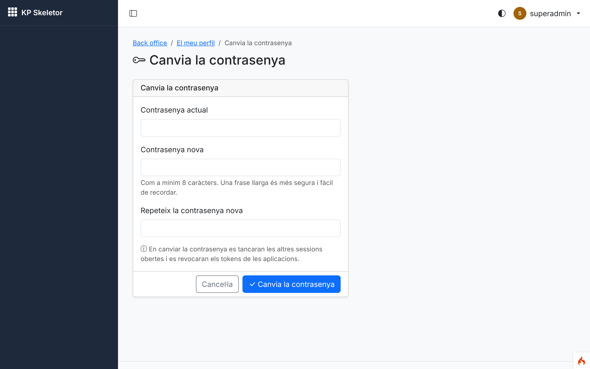
*08 — Password change; it ends the other sessions.*

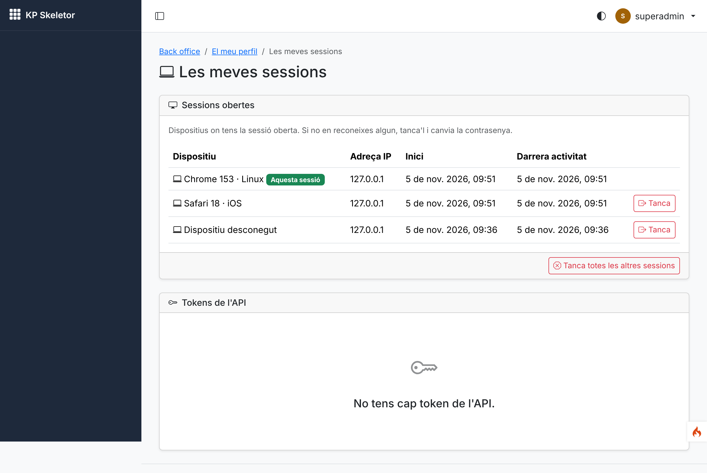
*09 — My sessions: this session, a phone and an older session, with remote logout.*

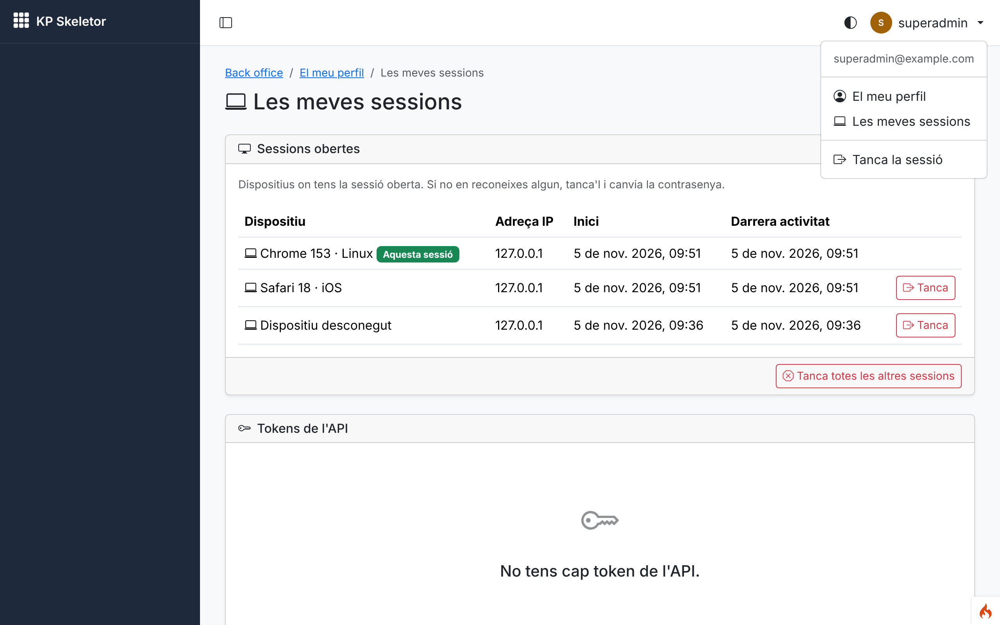
*10 — Top-bar user menu with profile, sessions and logout.*

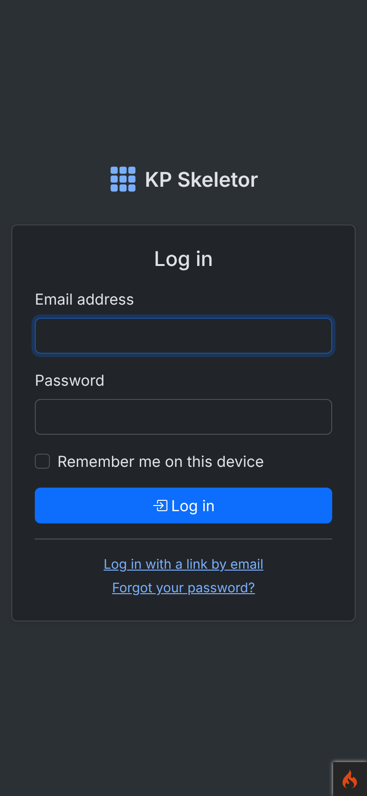
*11 — Login at phone width in dark mode.*

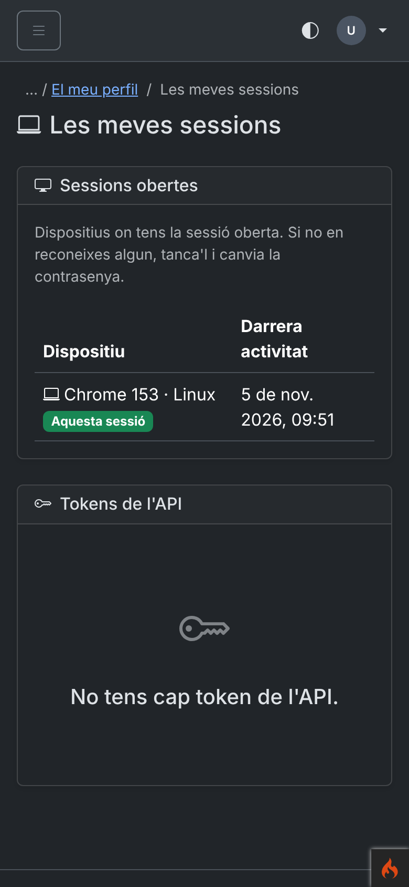
*12 — My sessions at phone width in dark mode (columns collapse).*

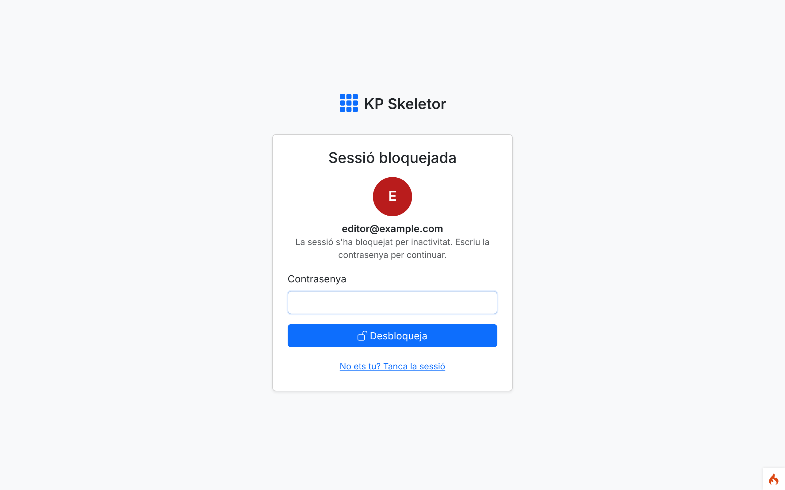
*13 — Idle lock screen after `Auth.idleTimeout` (1 minute for the capture).*

## Known issues

- Guests see the default locale `en` (session 31 sets Catalan as default and negotiation).
- The breadcrumb root "Back office" comes from the Core text in the default locale.
- Auth feature tests migrate every namespace per test (~1 s each); the suite takes ~1 min.
- `deploy/setup.sh` still needs the phpstan zip seeded into Composer's cache in this cloud
  environment (see session 04).

## Notes for the next session

- Session 06: set `UserTwoFactorAction` as Shield's `login` action; the login and magic-link
  controllers already redirect to `auth-action-show` when an action is pending, and
  `authsession` skips pending sessions; reauth must also apply to sessions re-created by
  remember-me (`user_sessions.remembered = 1`). Theme Shield's action views (`Config\Auth::$views`).
- Session 07: replace the interim `AuthGroups::$permissions/$matrix`; fold `session` +
  `forcereset` into the `backend` chain; use `GroupRules`/`SessionTracker::privilegesChanged()`
  for escalation rules and regeneration; `RoutesSecurityTest` must accept the Auth routes.
- Session 10: mark personal tokens with `secret2 = 'personal'` (`PasswordChanger::PERSONAL_TOKEN`).
- Session 12: replace `log_message()` security entries with the activity log.
- Session 14: Settings › Security for the `Auth.*` settings (rules already in the manifest).
- Session 15: Users module assigns groups through `GroupRules`; read the colour mode from
  `user_profiles.theme_mode` in `ThemeMode`.
