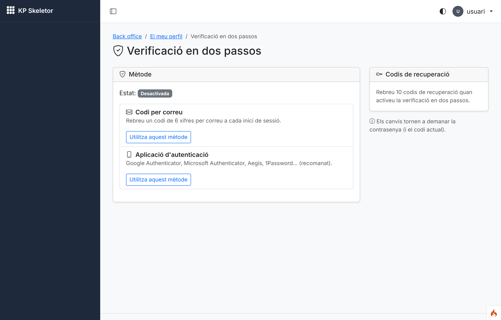
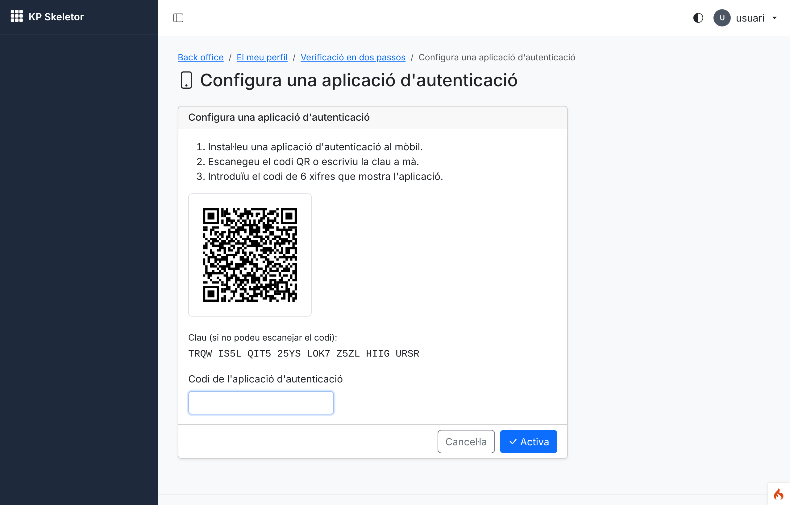
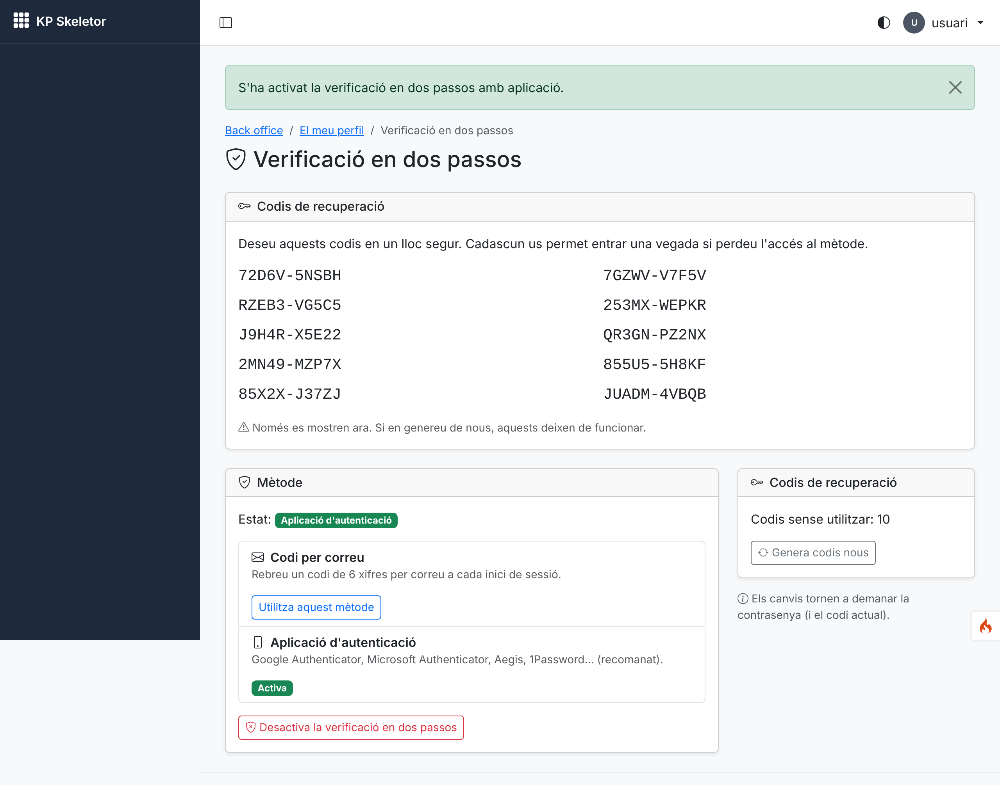
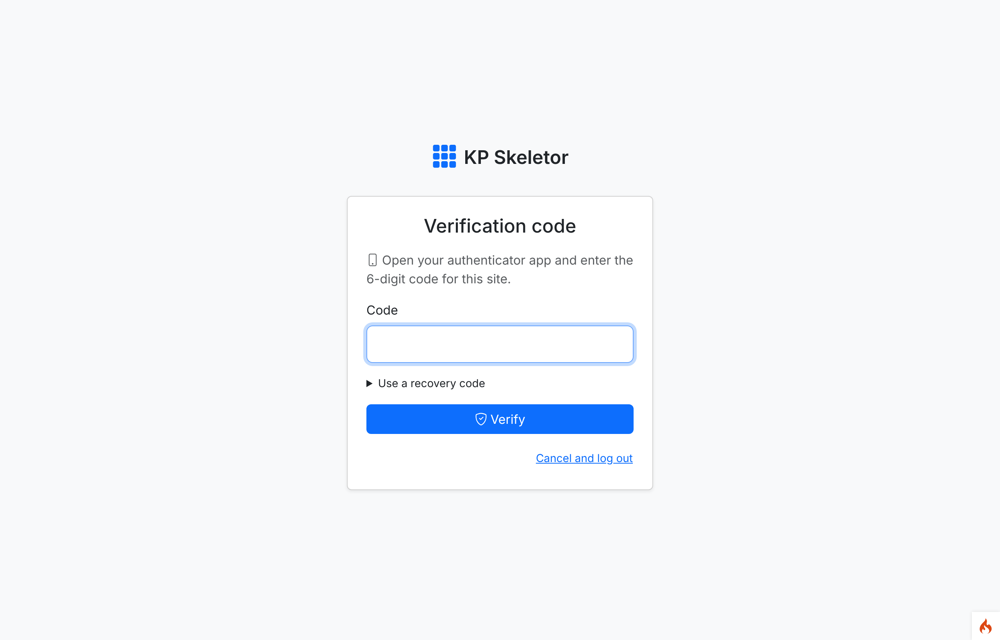
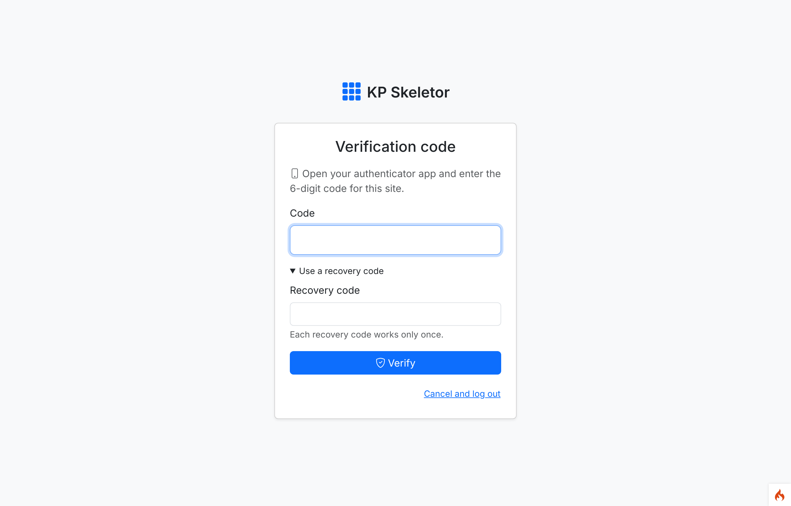
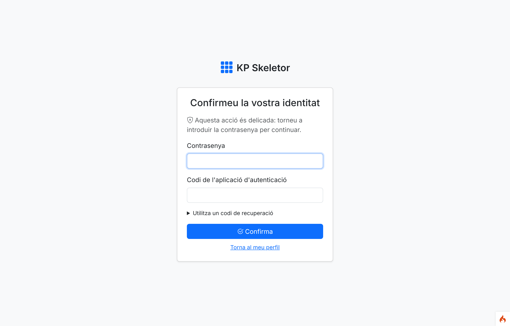
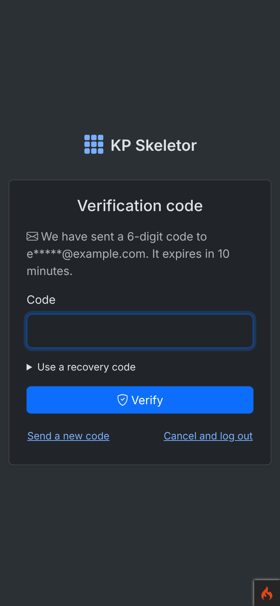
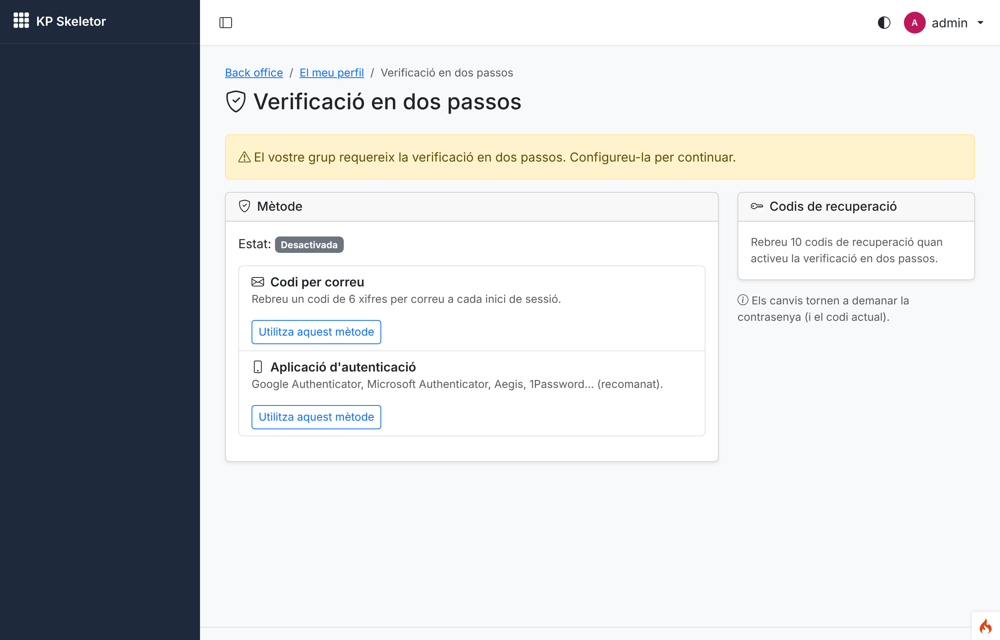

# Session 06 — Two-factor authentication and re-authentication

Branch: `claude/ecstatic-davinci-goi31r` (assigned by the environment) · Pull request: [SIENSIS/kpskeletor#10](https://github.com/SIENSIS/kpskeletor/pull/10) "Session 06: Two-factor authentication and re-authentication" · Date: 2026-11-05

## What was built

- **Two-factor authentication chosen per user** in the profile: none, **code by email** or
  **authenticator app** (TOTP, RFC 6238: Google/Microsoft Authenticator, Aegis, 1Password…).
- **Login step** for password and magic-link logins of users with 2FA: the code of their method,
  or a **recovery code**; "send a new code" (email), "cancel and log out". Wrong codes count as
  failed logins; past the limit the pending login ends.
- **App enrolment:** QR code drawn locally as SVG (always on white) plus the key in text; the
  secret is saved (encrypted) only after a valid code.
- **Codes:** ±1 time step of drift accepted, a code is never accepted twice; email codes hashed,
  10-minute lifetime, single use, sent inline through `SecurityMailer`.
- **Recovery codes:** 10 single-use codes, stored as hashes, shown once, regenerable.
- **Group policy** (`Auth.twoFactorPolicy`): a user of a `required` group without 2FA can only
  reach the set-up screen after logging in, and cannot turn 2FA off.
- **Admin reset** service (`TwoFactor::reset()`): logged, fires `twoFactorReset` (the hook for the
  notification of session 11; the Users screen of session 15 will call it).
- **Re-authentication ("sudo mode"):** `reauth` filter and `BackendController::requireReauth()`,
  15-minute window (`Auth.reauthMinutes`) asking the password and, with 2FA, a code (or a
  recovery code); a session re-created by remember-me (or after the absolute lifetime) starts
  without it. The profile's 2FA changes are the first routes protected by it.
- **Remember-me hardening:** for users with 2FA the remember-me token is issued only after the
  code (Shield issued it with the password alone).

## How it was built

### Design

- Shield has one global `login` action. `Config\Auth::$actions['login']` is
  `Modules\Auth\Authentication\UserTwoFactorAction`, which implements Shield's
  `ConditionalActionInterface`: it applies only to users with a 2FA method, so Shield completes
  other logins directly. It creates a pending identity `kp_2fa` (10 minutes) whose `name` is the
  method, `secret` a random nonce and, for email, `secret2` the SHA-256 of the code. Once a code
  is verified (email hash, TOTP or recovery code), `Session::checkAction($identity, nonce)`
  completes the login and fires Shield's `login` event (session tracking, device notice…).
- Its routes keep Shield's names (`auth-action-show|handle|verify`, already used by the
  session-05 controllers) at `auth/a/*`, served by `TwoFactorController` (theme auth layout; 404
  unless a login is pending with this action).
- `TwoFactor` holds each user's method (`user_two_factor`), the TOTP secret encrypted with CI4
  Encryption (base64), and the last accepted time step, updated with a conditional `UPDATE` so a
  code works once even with two simultaneous requests. Without `encryption.key` the app method
  is unavailable (never stored in clear).
- `Totp` wraps `spomky-labs/otphp` (6 digits, 30 s, SHA-1, 160-bit secrets; a PSR clock on
  `Time::now()` so tests can freeze time) and `chillerlan/php-qrcode` (SVG as a `data:` image,
  allowed by the CSP's `img-src data:`, no inline styles in the page).
- `SessionAuthenticator` (Shield's `Session` subclass, `Config\Auth::$authenticators['session']`)
  adds `rememberVerifiedUser()`: the login form does not ask Shield to remember a user with 2FA;
  the action issues the token after the code.
- `Reauth` keeps `{user, at}` in the PHP session. `LoginController` marks a password login and
  `LoginListener` turns it into a fresh confirmation when the `login` event fires (after the 2FA
  step); magic links, remember-me and the idle lock do not count (D-06-04, decided by the owner: option A). Login and logout
  forget the confirmation.
- `RequireReauth` (`reauth`): a GET is remembered and sent to `auth/reauth`, which returns to it;
  other methods are never replayed (the user confirms and repeats; the Referer is the return path
  when it is internal); JSON → 401 with the URL; guests → login. `BackendController::requireReauth()`
  runs the filter registered as `reauth` (no module named in the Core) and denies if it is missing.
- `ForceTwoFactor` (`force2fa`, `backend/*` after `forcereset`): reads the group policy
  through `AuthPolicy::twoFactorRequiredFor()`.

### Main files

- `modules/Auth/Authentication/UserTwoFactorAction.php`, `SessionAuthenticator.php`
- `modules/Auth/Services/TwoFactor.php`, `Totp.php`, `RecoveryCodes.php`, `EmailCodes.php`,
  `Reauth.php`; `AuthPolicy.php` (policy, window), `LoginListener.php`
- `modules/Auth/Filters/RequireReauth.php`, `ForceTwoFactor.php`; `Config/Registrar.php`
- `modules/Auth/Controllers/TwoFactorController.php`, `ReauthController.php`,
  `TwoFactorSettingsController.php`; `LoginController.php`, `MagicLinkController.php`
- Views `two_factor.php`, `reauth.php`, `two_factor_settings.php`, `two_factor_app.php`,
  `emails/two_factor_code.php`; profile link
- `modules/Core/Controllers/BackendController.php` (`requireReauth()`)
- `app/Config/Auth.php` (action, authenticator, settings defaults), `app/Config/Filters.php`
  (`force2fa`), `composer.json` (`spomky-labs/otphp ^11.3`, `chillerlan/php-qrcode ^5.0`,
  pre-approved by D-00-34)

### Tables, routes, permissions, settings

| Table | Columns |
|---|---|
| `user_two_factor` | user_id (unique, FK users), method `email`/`totp`, totp_secret (encrypted), totp_last_step, enabled_at, updated_at |
| `user_recovery_codes` | user_id (FK), code_hash (SHA-256), used_at, created_at |

| Route | Filters |
|---|---|
| `GET auth/a/show`, `POST auth/a/verify`, `auth/a/handle`, `auth/a/cancel` | public; 404 without a pending 2FA login |
| `GET/POST auth/reauth`, `POST auth/reauth/send-code` | public; the controller requires a logged-in user |
| `GET backend/profile/two-factor` | `can:auth-profile.view` |
| `POST …/two-factor/email`, `GET/POST …/two-factor/app`, `POST …/two-factor/disable`, `POST …/two-factor/recovery-codes` | `can:auth-profile.edit`, `reauth` |

No new permissions (the screens belong to `auth-profile`). New settings (Auth 0.2.0):
`Auth.reauthMinutes` (int, 15, 1–240) and `Auth.twoFactorPolicy` (json, group → `required` |
`optional`, default `{}`). New filter aliases `reauth`, `force2fa`. Events: `twoFactorChanged`
(user, method), `twoFactorReset` (user, admin id).

## Decisions and deviations

- **D-06-01** (accepted): email codes through the Core action, not Shield's `Email2FA` class
  (hashed code, `SecurityMailer`, 10-minute expiry, no "type your email" step).
- **D-06-02** (accepted): tables, TOTP parameters, QR as `data:` SVG, recovery-code format.
- **D-06-03** (accepted): remember-me issued only after the 2FA step; remember-me logins skip the
  code (trusted device) but not re-authentication.
- **D-06-04 (decide; decided by the owner after the session: option A, as built):** a password login (with its 2FA step) counts as re-authentication;
  magic links and remember-me do not. Built so it can change in one line.
- **D-06-05** (accepted): interim settings for the group policy and the window until the
  `groups` table (session 15).
- **D-06-06** (accepted): `auth/reauth`, POSTs not replayed, JSON 401, `requireReauth()` through the
  filter alias.
- **Deviation:** the 2FA admin reset has a service and an event but no screen yet (Users, session
  15); its notification is wired in session 11 and its activity-log entry in session 12 (both
  `log_message()` for now).
- **Fixed gap from session 05:** the Auth feature tests left a logged-in session behind, which made
  `Core\BaseModelTest` fail when an Auth test ending logged in ran last; `AuthTestCase::tearDown()`
  now clears the session and Shield's authenticator.

## How to try it

```bash
composer install                   # see Known issues if phpstan/phpstan cannot be downloaded
cp env .env                        # then: CI_ENVIRONMENT = development, SQLite (session 04 report)
php spark key:generate             # encryption.key: needed by the authenticator-app method
php spark modules:sync
php spark modules:demo Auth        # answer y
php spark serve
```

- http://localhost:8080/login — `usuari@example.com` / `Demo-kpskeletor-2026` (also superadmin@,
  admin@, editor@).
- Profile › **Verificació en dos passos**: http://localhost:8080/backend/profile/two-factor —
  choose "Code by email" or "Authenticator app" (scan the QR with any app), keep the recovery
  codes, log out and log in again.
- Email codes: in development the mail goes nowhere unless `email.*` is configured; use the app
  method, a recovery code, or configure a local SMTP catcher.
- Re-authentication: http://localhost:8080/auth/reauth (or wait 15 minutes and change the 2FA).
- Group policy (until Settings › Security in session 14): set `Auth.twoFactorPolicy` to
  `{"admin":"required"}` with `setting('Auth.twoFactorPolicy', ['admin' => 'required'])`.

## Tests and checks

```text
$ vendor/bin/phpunit
OK (292 tests, 1513 assertions)          # 251 before this session; modules/Auth: 111 tests

$ vendor/bin/phpstan analyse
[OK] No errors

$ vendor/bin/php-cs-fixer fix --dry-run --diff
Found 0 of 258 files that can be fixed

$ php spark csp:check
No inline scripts, handlers or styles in the project views.

$ composer audit
No security vulnerability advisories found.

$ php spark modules:sync           # fresh SQLite database
Core 0.1.0 installed.
Auth 0.2.0 installed.
12 permission(s) added to the catalogue.
Modules synchronised.
```

`permissions:check` and `security:check` do not exist yet (sessions 07 and 30).

New tests:

- `TwoFactorLoginTest` (17): user without 2FA, **email code login** (hash stored, back office
  closed while pending, wrong code, success, re-auth opened), email code expiry, new code replaces
  the old one, **app login**, **no reuse** (same code twice, an earlier step), **drift ±1** (and ±2
  refused), secret encrypted (160 bits), **recovery code** once (case-insensitive) and with the
  email method, too many wrong codes end the login, cancel, 404 without a pending login,
  **magic link + 2FA** (not a re-authentication), admin reset (event), **remember-me only after
  the code** (and an admin reset of a pending login gives no session), remember-me after the code.
- `TwoFactorSettingsTest` (9): enable email (codes shown once), enable the app (QR `data:` SVG,
  nothing saved before a valid code), no app without encryption key, disable and regenerate codes,
  **group policy forces set-up** and forbids turning it off, optional group not forced, changes
  need recent re-authentication, **forged POST without CSRF**, 403 without `auth-profile.edit`.
- `ReauthTest` (14): password login opens the window for 15 minutes (expires at 15:01), setting
  respected, confirmation with the password returns to the page, **2FA users must also type a
  code**, emailed code (single use), recovery code, **session re-created by remember-me still
  requires it**, also **after the absolute lifetime**, POST not replayed and JSON 401, external
  return paths ignored, guests to login, too many failures end the session, logout forgets it,
  `requireReauth()` helper.
- `AuthMigrationsTest` (up/down/up with the two new tables), `AuthConfigTest` (`force2fa`, the
  login action and the new defaults).

## Screenshots

Taken with Playwright against `php spark serve` with the demo data (development, SQLite), device
scale factor 2; script in `screenshots.mjs` (it enrols a TOTP secret and computes the codes with
otphp). No CSP violations and no horizontal overflow.


*01 — Profile › Two-factor authentication, off (Catalan, the user's language).*


*02 — Authenticator-app enrolment: local SVG QR code on white, the key in groups of four, the confirmation code.*


*03 — App enabled: the 10 recovery codes are shown once.*


*04 — Login step with the app code (guests still see the default English locale until session 31).*


*05 — The same step with "Use a recovery code" open.*


*06 — Re-authentication: password and the authenticator-app code (a recovery code also works).*


*07 — Login step of the email method on a phone in dark mode (masked address, "send a new code").*


*08 — The `admin` group requires 2FA: after logging in, the admin only reaches the set-up screen.*

## Known issues

- Guests (login and 2FA step) still see the default locale `en` (session 31).
- Emails are not delivered in development without `email.*` in `.env`; the email method needs it
  to be usable outside the tests.
- The group policy and the re-authentication window have no settings screen until session 14.
- `composer install` in this cloud environment still needs the phpstan workaround of session 04
  (seed Composer's cache with the `phpstan/phpstan` zip; a shallow `git fetch --depth 1` of the
  locked commit is enough). New packages were installed with `--prefer-source`.

## Notes for the next session

- **D-06-04** was decided with `deploy/decide.md` (option A: a password login counts as
  re-authentication); nothing else is open.
- Protect sensitive routes with `'filter' => ['can:…', 'reauth']` (permission matrix, groups,
  individual permissions, impersonation, 2FA reset, personal tokens, backups, modules, security
  settings) or `$this->requireReauth()` (`docs/auth.md`).
- Session 07: include `force2fa` in the `backend` filter chain (it runs after `forcereset`).
- Session 10: kpapy's 2FA providers read `(new TwoFactor())->method($id)`; the TOTP check is
  `TwoFactor::verifyTotp()` (keeps the no-reuse rule).
- Session 11: notify on `twoFactorReset`. Session 12: activity entries for `twoFactorChanged`,
  `twoFactorReset`, re-authentication and wrong codes. Session 15: reset row operation, policy
  column in `groups`, refuse `reauth` while impersonating.
