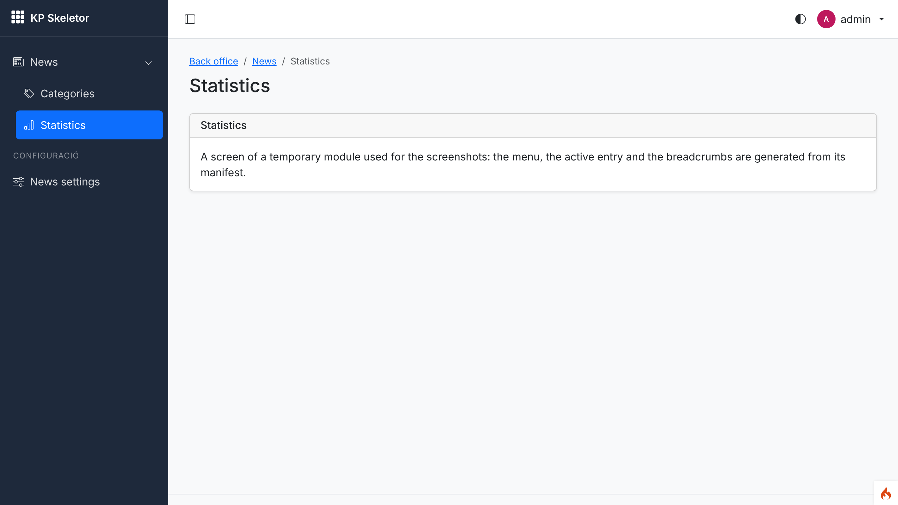
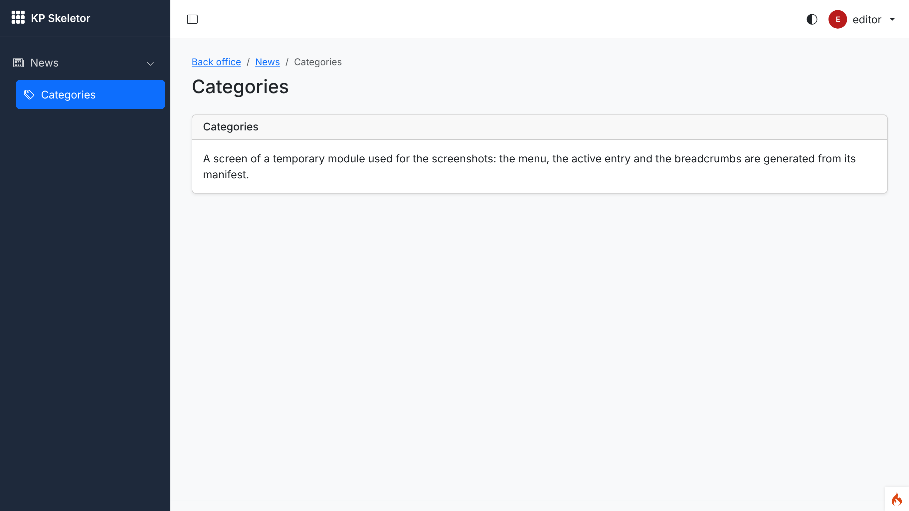
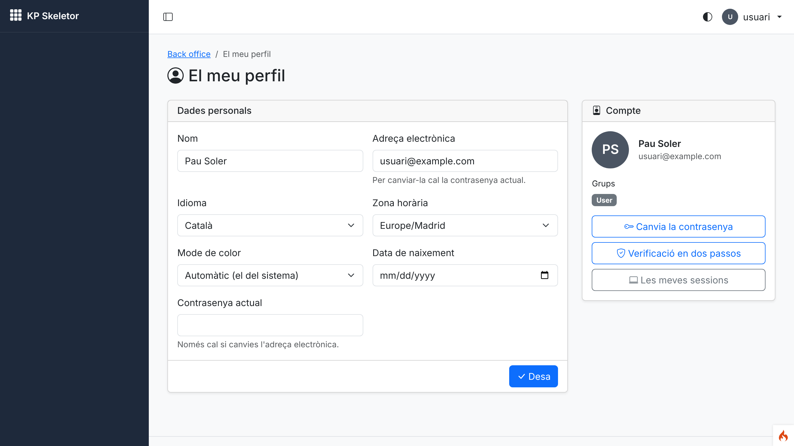
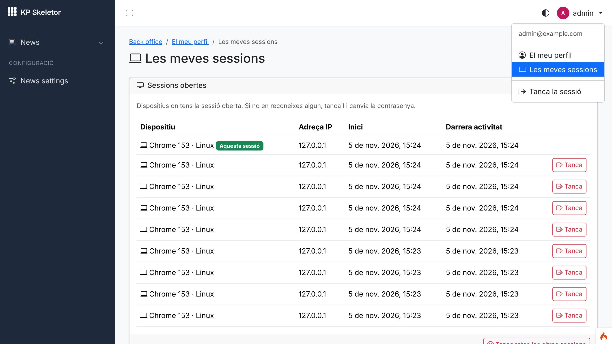
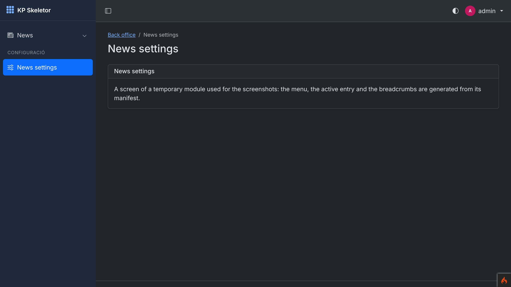
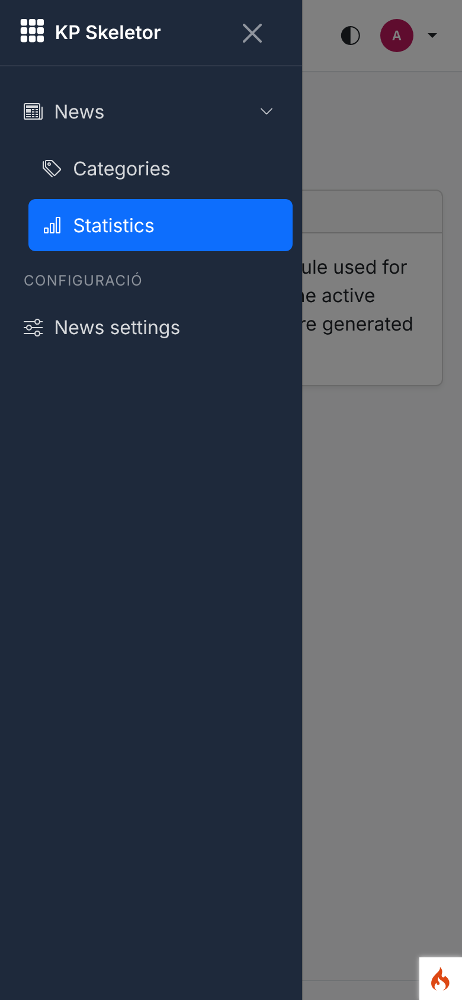
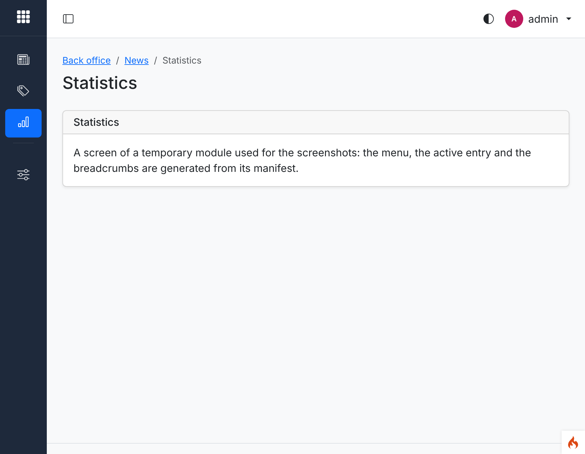

# Session 08 — Back-office menus and the security baseline

Branch: `claude/pensive-volta-9ttaws` (assigned by the environment) · Pull request: PR_LINK "Session 08: Back-office menus and the security baseline" · Date: 2026-11-05

## What was built

- **Generated back-office menu**: every enabled module's `$menu` entries become the sidebar
  (zone `sidebar`, plus the `settings` zone under a heading) and the top-bar user menu (zone
  `user`), nested by `parent`, sorted by `order`, and **filtered by permission**: a user only sees
  entries they can open; a parent they cannot open stays as a group only while it has visible
  children. The current page is highlighted (its group opens) and the breadcrumbs of screens
  without their own come from the same tree. Cached per group set.
- Auth's profile and "my sessions" moved into the generated user menu (zone `user`).
- **Security headers on every response** (also 404/500 error pages): HSTS (production, ≥ 1 year),
  `Referrer-Policy: strict-origin-when-cross-origin`, `nosniff`, `X-Frame-Options: DENY`,
  `Cross-Origin-Opener-Policy`, `Permissions-Policy` (camera, microphone, geolocation… off),
  configurable in `Config\SecurityHeaders` / `.env`; CodeIgniter's `secureheaders` is gone.
  HTTPS forced in production (`forceGlobalSecureRequests`).
- **Rate limits**: a service with named limits whose values are Core settings (back office, API
  per token and IP, feeds, uploads, public forms, widgets) and a `ratelimit` filter; the
  `backend` chain now limits requests per user. Past the limit: **429** with `Retry-After` (themed
  page or JSON).
- **`safe_redirect()`**: redirects that come from the request only go to the site itself.
- **`OutboundClient`**: HTTPS-only calls to allow-listed hosts, refusing private/loopback/
  link-local addresses after DNS and on every redirect (connection pinned to the checked
  address), with timeouts, a size limit and logging. The mail service refuses SMTP hosts outside
  the same allow-list.

## How it was built

### Design

- **Menus.** `MenuDefinitions::of($manifest)` normalises each entry at `modules:sync`
  (`resource` → route named after the permission prefix and `.list`/`.view`; key
  `<Module>.<resource>` or the route name; `parent` resolved to a key) and `DeclarationRegistry`
  stores it as kind `menu` (cache scope `menus`). `MenuBuilder::tree($user)` reads the entries of
  enabled modules, resolves routes (`route_to()`), checks `Authorization::for($user)->can()`,
  nests, cuts cycles, sorts and caches the result per `cacheKey($user)` (groups + individual
  permissions). `zone()` marks the active entry (route name, else the longest matching path) and
  opens its ancestors; `trail()` gives the breadcrumbs. `GrantManager` now invalidates `menus`.
- **Headers.** `SecurityHeaders` is a **required** after filter (runs even when no route
  matches); `SecureExceptionHandler` wraps CodeIgniter's exception handler so error responses
  get the same headers. Headers a controller already set are kept.
- **Rate limits.** `RateLimiter` wraps CodeIgniter's Throttler (token bucket in the cache);
  `LIMITS` maps names to settings, periods and defaults; subjects are hashed. `RateLimit` filter:
  `ratelimit:<limit>` (default `backend`), per user or per IP; its class closes the `backend` alias.
- **Outbound.** `OutboundClient::request()` loops over hops: `check()` (scheme, port, user info,
  allow-list, DNS, `IpGuard::isPublic()` for **every** address) → `OutboundTransport::send()` to the
  pinned address → follow `Location` by hand. `CurlTransport` uses `CURLOPT_RESOLVE`,
  HTTPS-only protocols, certificate checks, no automatic redirects, a write callback that aborts
  past `maxBytes`, and no environment proxy. `OutboundAllowList` merges `Config\Outbound`,
  `.env` `outbound.hosts`, enabled modules' `$outboundHosts` (kind `outbound`) and
  `Core.outboundHosts`.

### Main files

- `modules/Core/Menus/{MenuDefinitions,MenuBuilder,MenuEntry}.php`, `Helpers/menu_helper.php`
  (`backend_menu()`, `backend_menu_trail()`), `Registry/DeclarationRegistry.php` (kinds `menu`,
  `outbound`), `Controllers/BackendController.php` (breadcrumbs), `Permissions/GrantManager.php`
- `themes/default/Views/partials/{sidebar_menu,sidebar_menu_items,user_menu}.php`,
  `layouts/backend.php`, `Assets/css/theme.css`
- `app/Config/SecurityHeaders.php`, `modules/Core/Filters/SecurityHeaders.php`,
  `modules/Core/Http/SecureExceptionHandler.php`, `app/Config/{Filters,Exceptions,App}.php`
- `modules/Core/Security/{RateLimiter,SafeRedirect}.php`, `Filters/RateLimit.php`,
  `Helpers/redirect_helper.php`, `Views/errors/429.php`, `Theme/ErrorPage.php`
- `app/Config/Outbound.php`, `modules/Core/Http/{OutboundClient,OutboundAllowList,OutboundTransport,CurlTransport,OutboundResponse,OutboundException,IpGuard}.php`,
  `modules/Core/Mail/GuardedEmail.php`, `app/Config/Services.php` (`email`)
- `modules/Auth/Config/Module.php` (`$menu`), language files (ca/es/en)
- Docs: `docs/menus.md`, `docs/security.md`, `docs/outbound-requests.md` (new), `docs/themes.md`,
  `docs/rbac.md`, `CLAUDE.md`, `docs/decisions.md`

### Tables, routes, permissions, settings, filters

- No new table or migration (declarations go to `module_declarations`).
- No new route or permission. Filter aliases: `securityheaders` (required after), `ratelimit`;
  `secureheaders` removed; the `backend` chain gains `RateLimit`.
- Settings (Core): `rateLimitBackend` 300, `rateLimitApiToken` 120, `rateLimitApiIp` 60,
  `rateLimitFeeds` 60, `rateLimitUploads` 100, `rateLimitForms` 10, `rateLimitWidgets` 120,
  `outboundHosts` (JSON list, default `[]`).
- No new spark command.

## Decisions and deviations

- **D-08-01** menu keys, zones, rendering and breadcrumbs; **D-08-02** headers on every response
  (required filter + exception handler, COOP, controller headers kept); **D-08-03** rate-limit
  service and setting names (Auth keeps its `LoginThrottle`); **D-08-04** `OutboundClient` details
  (port 443, `*.domain` entries, pinning, no proxy by default, `GuardedEmail`); **D-08-05** what
  `safe_redirect()` accepts. All accepted proposals; no open decision.
- **Deviation:** outbound requests, rate-limit hits and refused SMTP hosts go to the application
  log until the activity log (session 12).
- **Deviation:** `app.allowedHostnames` stays empty; the installer (session 18) writes it.
- Earlier work touched: `AuthConfigTest` expects `RateLimit` in the `backend` chain; the user menu
  partial reads the generated `user` zone instead of hard-coded links (`Core.user.profile`/
  `sessions` keys removed).

## How to try it

```bash
cp env .env    # CI_ENVIRONMENT = development, database.default.DBDriver = SQLite3, database = database.db
php spark key:generate
php spark modules:sync
php spark modules:demo Auth        # answer y
php spark serve                    # http://localhost:8080/login
```

- Log in as `usuari@example.com` / `Demo-kpskeletor-2026`: the user menu (top right) lists
  "El meu perfil"/"Les meves sessions" from Auth's manifest, the current one highlighted.
- The sidebar stays empty until a module declares sidebar entries (Dashboard 16, News 17). To see
  it now, add a `$menu` to a test module (the screenshots used a temporary `MenuDemo` module that
  was not committed: resources posts/categories/stats/options, `editor` granted only posts and
  categories `list`).
- Headers: `curl -sI http://localhost:8080/login`, also on a 404 (`/nope`).
- Rate limit: save `setting('Core.rateLimitBackend', 2)` (e.g. `php spark shell`… or a test) and
  reload a back-office page three times → 429.

## Tests and checks

```text
$ vendor/bin/phpunit
OK (420 tests, 1909 assertions)          # 335 before this session

$ vendor/bin/phpstan analyse
[OK] No errors

$ vendor/bin/php-cs-fixer fix --dry-run --diff
Found 0 of 305 files that can be fixed

$ php spark csp:check
No inline scripts, handlers or styles in the project views.

$ php spark permissions:check
Permissions OK: 12 permission(s) in the catalogue, 43 route(s) checked.

$ php spark assets:publish --check
The published assets are up to date.
```

New tests (85):

- `MenuBuilderTest` (9): definitions from a manifest (crud `.list`, page `.view`, parents, zones,
  second zone); guests; **filtered by permission**; **parent without visible children or
  permission hidden, kept as a group with visible children**; order, zones, superadmin;
  **disabled modules and missing routes hidden**; **active entry and breadcrumbs** (path and route
  name); **cache per group set, invalidated by grant changes, individual permissions change the
  key**; cycles and missing parents.
- `BackendMenuTest` (2, Auth): the real layout's user menu is generated and marks the current page;
  an entry disappears when the group loses its permission.
- `SecurityHeadersTest` (8): **headers on the home, login and back-office responses**; **error
  responses** through `SecureExceptionHandler`; **HSTS only in production, ≥ 1 year**, `hsts`
  true/false; configurable values and controller headers kept; `secureheaders` not used; cookie
  and HTTPS defaults.
- `RateLimitTest` (6): named limits and settings; capacity floor and unknown limits; manifest
  defaults equal `LIMITS`; **back-office requests limited per user → 429 + Retry-After**; JSON
  answer and per-IP counting for guests; alias.
- `SafeRedirectTest` (17): **external `return` URLs refused** (other hosts, `//`, backslashes,
  `javascript:`, `data:`, user info, control characters), own hosts and paths accepted, helper
  fallback.
- `OutboundClientTest` (43): pinned allowed request; **refused: plain HTTP, other schemes, hosts
  outside the list, suffix tricks, private IP after DNS, one loopback among several addresses,
  IPv4-mapped private, unresolvable, other port, user info**; allow-listed literal IPs still must
  be public; **redirects re-checked (private, HTTP, other host)** and 303 → GET; too many
  redirects; **oversize response**; allow-list sources and wildcards; `IpGuard` table (20
  addresses); relative locations; **SMTP host outside the allow-list not sent**.

## Screenshots

Taken with Playwright against `php spark serve` (development, SQLite, Auth demo data) at device
scale factor 2, with a temporary `MenuDemo` module (not committed) so the sidebar has entries. The
demo users' profiles use Catalan, so Core/Auth texts are Catalan and the demo module's labels
English.


*01 — admin: "News" with Categories and Statistics, and the `settings` zone; Statistics active, its group open; breadcrumbs "Back office / News / Statistics" come from the menu.*


*02 — editor (only `posts.list` and `categories.list`): Statistics and News settings are not shown.*


*03 — `usuari@example.com`: no module entries in the sidebar (nothing they can open); only the profile.*


*04 — the user menu is the generated `user` zone (Auth's manifest); "Les meves sessions" is marked as the current page.*


*05 — dark mode, the `settings` zone entry active.*


*06 — phone width (390×844): the menu in the offcanvas sidebar.*


*07 — tablet width: icon-only bar (labels in `.nav-text` are hidden; group toggles hidden).*

Headers of a live response (development, so no HSTS):

```text
$ curl -s -o /dev/null -D - http://localhost:8080/nope
HTTP/1.1 404 Not Found
Referrer-Policy: strict-origin-when-cross-origin
X-Content-Type-Options: nosniff
X-Frame-Options: DENY
Cross-Origin-Opener-Policy: same-origin
Permissions-Policy: accelerometer=(), autoplay=(), camera=(), display-capture=(), geolocation=(), gyroscope=(), magnetometer=(), microphone=(), midi=(), payment=(), usb=()
Content-Security-Policy: base-uri 'self'; … frame-ancestors 'none'; … script-src 'self' 'nonce-…'; …
```

## Known issues

- The sidebar is empty until modules declare sidebar entries (sessions 16/17).
- `CurlTransport` is exercised only through a fake transport (tests never use the network); the
  production values of HSTS and `forceGlobalSecureRequests` are tested through the config logic.
- `composer install` here still needed the phpstan cache workaround of session 04.

## Notes for the next session

- Session 09: give each CRUD resource a `$menu` entry; the route must be named after the resource
  (`news-posts`) for the menu to find it; return URLs with `safe_redirect()`.
- Session 10: `apiToken`/`apiIp` limits through `RateLimiter`; `auth/token` per IP and account with
  Auth's `LoginThrottle`.
- Session 12: activity entries instead of `log_message()` in `OutboundClient`, `RateLimit`,
  `GuardedEmail`.
- Session 14: Settings › Security for `Core.rateLimit*` and `Core.outboundHosts` (+ reauth).
- Session 16: `widgets` limit for async widget URLs; Session 13: `uploads` limit.
- Session 21: customisations refer to the keys of `MenuDefinitions` (`<Module>.<resource>` or route).
- Session 30: `security:check` should flag `securityHeaders.hsts = false`, an empty
  `allowedHostnames` and `forceGlobalSecureRequests = false` in production.
