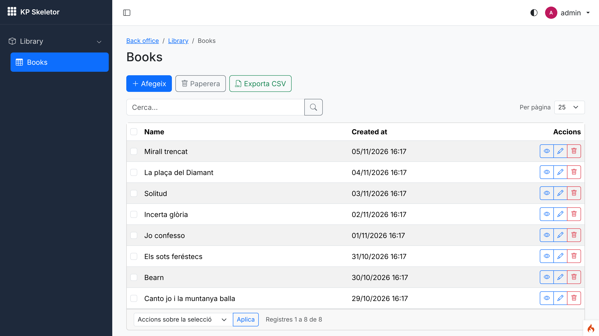
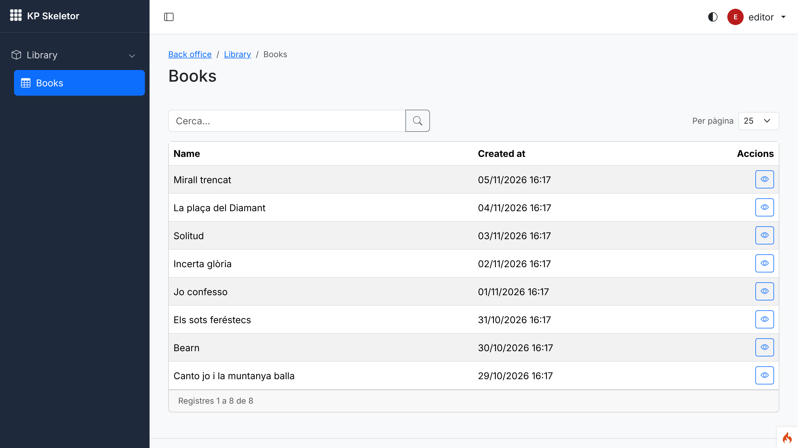
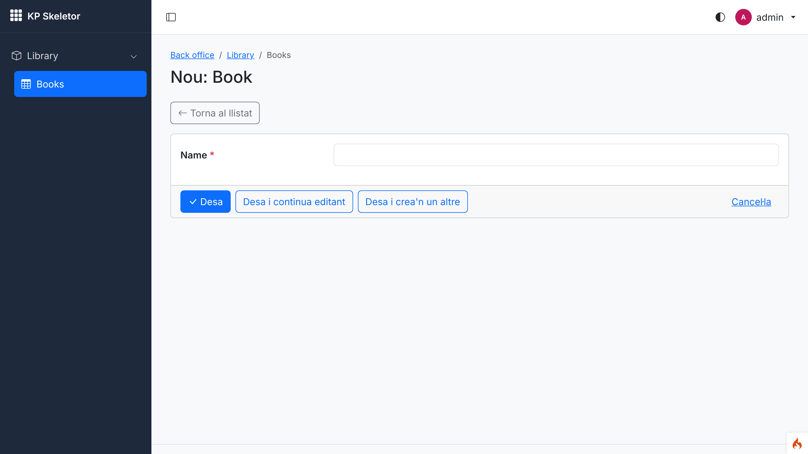
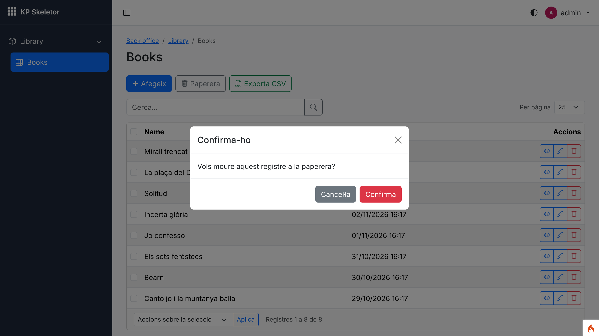
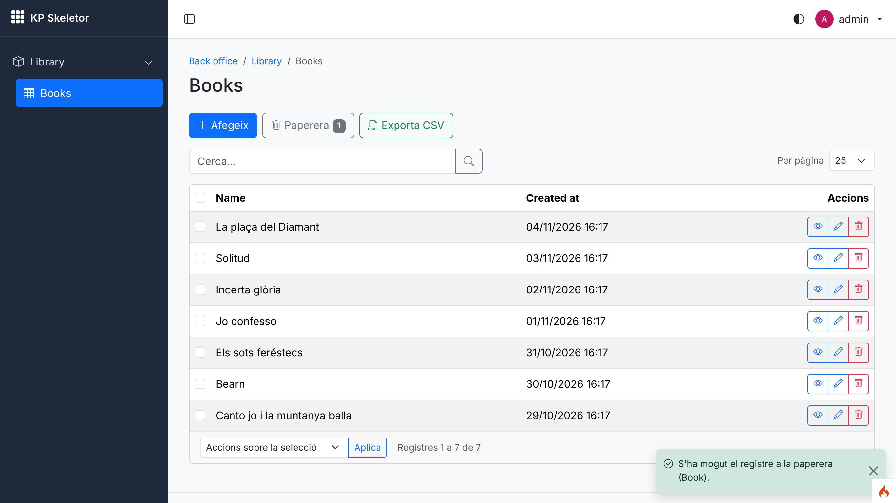
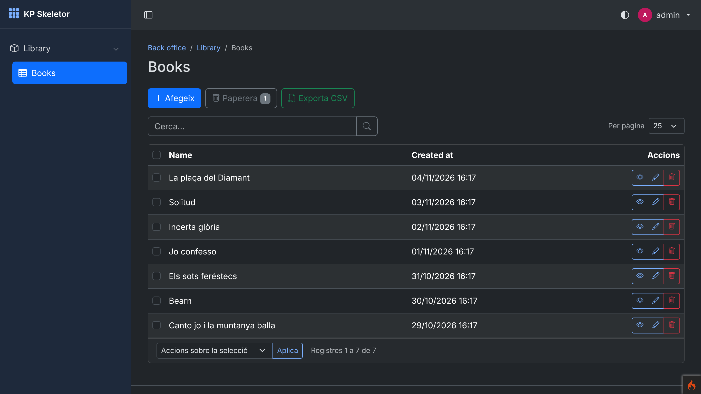
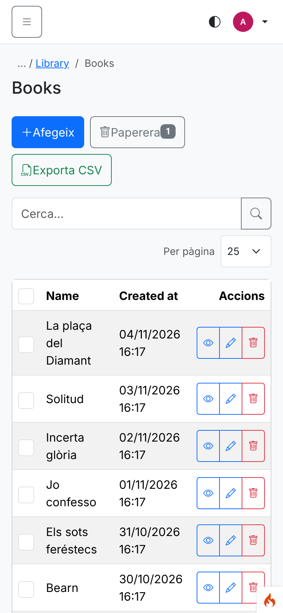

# Session 09 — kpcrudy integration

Branch: `claude/determined-pasteur-d6pdme` (assigned by the environment) · Pull request: [SIENSIS/kpskeletor#13](https://github.com/SIENSIS/kpskeletor/pull/13) "Session 09: kpcrudy integration" · Date: 2026-11-05

## What was built

- **Every CRUD is a kpcrudy `Crud` inside the theme**: the back-office layout (section mode), a
  page header built from the CRUD title and the menu breadcrumbs, messages as **toasts**, and
  kpcrudy's confirmations in the **theme's modal**. Light/dark and phone width work unchanged.
- **Permissions through the central RBAC**: `Config\Kpcrudy` selects `CrudPermissions` with deny
  by default, so every operation is `<resource>.<operation>` of the catalogue; ids in URLs are
  masked.
- **`CrudFactory`**: `CrudFactory::routes()` (filters `backend` + `can:<resource>.list`, route
  name = resource) and `CrudFactory::make()` / `BackendController::crud()` / `renderCrud()`.
- **`app.maskKey`**, shared by kpcrudy and kpapy; production refuses web requests without it.
- **`php spark make:module <Name> --crud=<table>`**: migration, `crud` resource, grant, menu and
  language keys, then the real `kpcrudy:make` output rewritten to `CrudFactory`.
- **`php spark permissions:check` checks every CRUD**: made with the factory, routed for its
  resource, and asking only about operations its manifest declares.
- **Acceptance criterion 4** proven on a sample CRUD (read-only user, forged POSTs, a custom
  operation, a hidden field, `where()`).

## How it was built

### Design

- `app/Config/Kpcrudy.php` extends the library config: `bootstrap5`, layout = the active theme's
  `backend` layout (constructor, `theme_layout()`), `layoutSection = 'content'`,
  `showTitle = false`, `flashKeys` success→`success`, danger→`error`, warning→`warning`,
  info→`info`, `permissionResolver = CrudPermissions`, `denyByDefault = true`, `maskIds = true`,
  `maskKey` = `app.maskKey`, local Bootstrap URLs, `uploadPath = writable/kpcrudy-unused-uploads`.
  `app/Config/Kpapy.php` only shares the key (session 10 completes it).
- `Modules\Core\Security\MaskKey` reads `Config\App::$maskKey`; `modules/Core/Config/Events.php`
  (`pre_system`, web requests only) refuses an empty key in production and a short key anywhere.
- `Modules\Core\Crud\CrudFactory`: validates resource names, `make()` sets the resource and
  layout (and records CRUDs while `inspect()` is on), `routes()` wraps `Crud::routes()`.
  CodeIgniter runs a filter alias once per request, so `backend` is never doubled on `backend/*`.
- `BackendController::crud()` / `renderCrud()` (layout data: breadcrumbs; throws
  `CrudInspection` while inspecting). `flash()` accepts `info`.
- Theme: `partials/page_top.php` builds the header from `$title` + `$breadcrumbs`;
  `partials/flash.php` wraps the alerts in the `core/ui/flash` component (toasts; alerts without
  JS); `core/ui/confirm.js` handles `kpcrudy:confirm` (`bindKpcrudyConfirmations()` in `app.js`).
- `Modules\Core\Crud\CrudAuditor` (in `PermissionAudit`): every kpcrudy route (the `kpcrudy`
  route option) must carry the factory's name and `can:`; its action runs with a GET web request,
  no user and inspection on; the CRUD found is compared with the catalogue
  (`CrudPermissions::undeclared()`).
- `make:module --crud`: `ModuleGenerator` templates take `{{table}}`, `{{migrationClass}}` and the
  CRUD blocks from `CrudScaffold::templateValues()`; `MakeModule` runs `php spark migrate -n` and
  `php spark kpcrudy:make` as child processes (kpcrudy reads its options from the command line),
  then `CrudScaffold::rewriteRoutes()` / `rewriteController()`.

### Main files

- `app/Config/{Kpcrudy,Kpapy,App}.php`, `phpunit.xml.dist` (test-only `app.maskKey`)
- `modules/Core/Crud/{CrudFactory,CrudInspection,CrudAuditor}.php`,
  `modules/Core/Security/MaskKey.php`, `modules/Core/Config/Events.php`,
  `modules/Core/Controllers/BackendController.php`, `modules/Core/Permissions/PermissionAudit.php`
- `modules/Core/Commands/MakeModule.php`, `modules/Core/Modules/{CrudScaffold,ModuleGenerator}.php`,
  `modules/Core/Modules/Templates/*`, `modules/Core/Language/{ca,es,en}/Core.php` (`make.*`)
- `themes/default/Views/partials/{page_top,flash}.php`,
  `modules/Core/Assets/js/ui/{flash,confirm}.js`, `modules/Core/Assets/js/app.js`
- Tests: `tests/_support/Crud/` (test-only "Sample" module), `tests/feature/Crud/`,
  `modules/Core/Tests/{KpcrudyIntegrationTest,CrudScaffoldTest}.php`
- Docs: `docs/cruds.md` (new), `docs/security.md`, `docs/rbac.md`, `docs/commands.md`,
  `docs/library-requests.md`, `docs/decisions.md`, `CLAUDE.md`

### Tables, routes, permissions, commands, settings

- No new table, route, permission or setting in the Core.
- New `.env` key `app.maskKey` (`Config\App::$maskKey`).
- Command option `make:module <Name> --crud=<table>`; `permissions:check` gains the CRUD check.
- New front-end component `core/ui/flash`; new flash key `info`.

## Decisions and deviations

- **D-09-01** where `app.maskKey` lives; web requests refused in production without it, `spark`
  not blocked (the installer must generate it).
- **D-09-02** page header from the CRUD title, `flashKeys` → toasts (new `info` key), confirm
  modal; the `crud_container` component is not used (the CRUD markup is already a card).
- **D-09-03** `CrudFactory` details and how `permissions:check` inspects CRUDs.
- **D-09-04** `make:module --crud` runs `kpcrudy:make` in a child process and rewrites its output
  (strict types, `final`, return type, no upload field types).
- **D-09-05** the sample CRUD is a test-only module in `tests/_support/Crud/`.
- All accepted proposals; no open (decide) entry.
- Gaps filed in `docs/library-requests.md`: `kpcrudy:make` options only from the command line;
  no way to describe a CRUD without running it; `Crud` requires an `IncomingRequest`.
- Earlier work touched: module templates (migration file/class name now from the table when
  `--crud` is used; unchanged otherwise), the theme's flash partial (toasts).

## How to try it

```bash
cp env .env   # CI_ENVIRONMENT = development, database.default.DBDriver = SQLite3, database = database.db
php -r "echo bin2hex(random_bytes(32)), PHP_EOL;"   # put it in .env as app.maskKey
php spark key:generate
php spark modules:sync
php spark modules:demo Auth          # answer y
php spark make:module Library --crud=library_books
php spark modules:sync
php spark permissions:check
php spark serve                      # http://localhost:8080/backend/library/books
```

Log in as `admin@example.com` / `Demo-kpskeletor-2026` (full CRUD). To see the read-only view,
grant the `editor` group only `library-books.list` and `library-books.show` (no screen until
session 15: the screenshots used a temporary command calling `GrantManager::setGroupGrants()`).
Delete `modules/Library` and run `php spark modules:sync --prune` afterwards.

Console output of the run used for the screenshots:

```text
$ php spark make:module Library --crud=library_books
Module Library created in ROOTPATH/modules/Library.
Creating the table library_books (php spark migrate -n Modules\Library)…
Writing the CRUD with php spark kpcrudy:make 'library_books' '--namespace' 'Modules\Library' '--extends' 'Modules\Core\Controllers\BackendController' '--controller' 'Books' '--route' 'backend/library/books' '--as' 'library-books' '--filter' 'backend'…
CRUD library-books created: ROOTPATH/modules/Library/Controllers/Books.php (route backend/library/books).
Next: php spark modules:sync, then adapt the CRUD in ROOTPATH/modules/Library/Controllers/Books.php (fields, relations, hideFields(), where()) and its tests.

$ php spark permissions:check
Permissions OK: 22 permission(s) in the catalogue, 48 route(s) checked.
```

The generated controller after the rewrite:

```php
final class Books extends BackendController
{
    public function index(): ResponseInterface|string
    {
        $crud = $this->crud('library-books');
        $crud->setTable('library_books')
            ->setSubject('Book', 'Books')
            ->columns(['id', 'name', 'created_by', 'updated_by', 'created_at', 'updated_at'])
            ->fields(['name', 'created_by', 'updated_by'])
            ->displayAs([...]);

        return $this->renderCrud($crud);
    }
}
// Config/Routes.php
\Modules\Core\Crud\CrudFactory::routes($routes, 'library-books', 'backend/library/books', '\Modules\Library\Controllers\Books::index');
```

(The first generated manifest excluded the trash operations; `permissions:check` reported
`library-books asks about operations the manifest does not declare: purge, restore, trash`
because the template table has `deleted_at`. The template now excludes only `import`.)

## Tests and checks

```text
$ vendor/bin/phpunit
OK (449 tests, 2136 assertions)          # 420 before this session

$ vendor/bin/phpstan analyse
[OK] No errors

$ vendor/bin/php-cs-fixer fix --dry-run --diff
Found 0 of 320 files that can be fixed

$ php spark csp:check
No inline scripts, handlers or styles in the project views.

$ php spark permissions:check
Permissions OK: 12 permission(s) in the catalogue, 43 route(s) checked.

$ php spark assets:publish --check
The published assets are up to date.
```

New tests (29):

- `SampleCrudTest` (11, acceptance criterion 4): **read-only user sees no add/edit/delete/
  publish/export buttons**; **every write URL and the custom operation refused**; **forged POSTs
  (add, edit, delete, publish, bulk delete) change nothing**; the custom operation works with its
  permission and its message uses the layout's flash key; **author field hidden from list,
  details, form and export, and a forged value not saved**, shown with the permission;
  **`where()` limits "my notes" even with a forged id**; **ids masked, real ids not found**;
  guests redirected to login, users without `list` get 403; route filters and name; factory.
- `CrudAuditorTest` (5): the sample CRUDs pass; **an undeclared custom operation is reported**;
  CRUDs outside the factory are reported; `permissions:check` includes it; **an undeclared
  operation fails loudly at run time**.
- `KpcrudyIntegrationTest` (10): config values; local assets and non-public upload path; **both
  libraries share `app.maskKey`**; **production refuses an empty key, any environment a short
  one**; the `env` template; factory routes (backend, can, extra filters, name); inspection;
  page header from the CRUD title; flash messages → toast component; `kpcrudy:confirm` handler.
- `CrudScaffoldTest` (3): names from the table and `kpcrudy:make` arguments; **real kpcrudy
  generator output rewritten** (factory, renderCrud, strict, final, return type, no upload
  fields, valid PHP); module templates with the `crud` resource (valid manifest, ca/es/en keys).

## Screenshots

Taken with Playwright against `php spark serve` (development, SQLite, Auth demo data) at device
scale factor 2, with a module generated by `make:module Library --crud=library_books` (not
committed; its controller shows only `name` and `created_at`, eight sample books). The demo
users' profiles use Catalan, so kpcrudy's and the Core's texts are Catalan and the generated
labels English.


*01 — admin: the CRUD inside the back-office layout; page header "Books" and breadcrumbs from the menu; add, trash, export and row actions.*


*02 — editor with only `library-books.list` and `.show`: no add, trash, export, bulk or write buttons, only "details".*


*03 — the add form in the layout.*


*04 — deleting asks with the theme's modal (`kpcrudy:confirm`), not `window.confirm()`.*


*05 — after confirming: kpcrudy's message arrives through `flashKeys` and is shown as a toast.*


*06 — dark mode.*


*07 — phone width (390×844): no horizontal page scroll; the table wraps its cells.*

## Known issues

- kpcrudy's responsive list options (priority columns, card view, "⋯" menu) are still missing
  (library request from the plan); on phones the button icons touch their labels.
- `permissions:check` runs CRUD actions without a user: operations a CRUD only adds for some
  users are not seen there (the run-time check still catches them outside production).
- `make:module --crud` needs the configured database (it migrates the new table) and the table
  must not exist yet; the generated controller lists every column (a starting point).
- Language labels of a generated CRUD are the English key in the three languages (to translate).

## Notes for the next session

- Session 10 (kpapy): complete `app/Config/Kpapy.php` (resolver `CrudPermissions`,
  `denyByDefault`, `uploadPath` non-public); it already reads `app.maskKey` through `MaskKey`.
  Same resource names as the CRUDs.
- Every module CRUD: `CrudFactory::routes()` + `$this->crud()` + `$this->renderCrud()`
  (`docs/cruds.md`); declare custom operations and permissions checked in code as `extra`;
  `unset*()` what the resource excludes; copy `tests/feature/Crud/SampleCrudTest.php`.
- Session 12: `afterWrite()` hooks for the activity log on module CRUDs.
- Session 15: the group permissions screen (no UI to grant yet); Users/Groups CRUDs.
- Session 18: the installer writes `app.maskKey`.
- Session 23: the file picker field for CRUDs (`callbackField()`).
