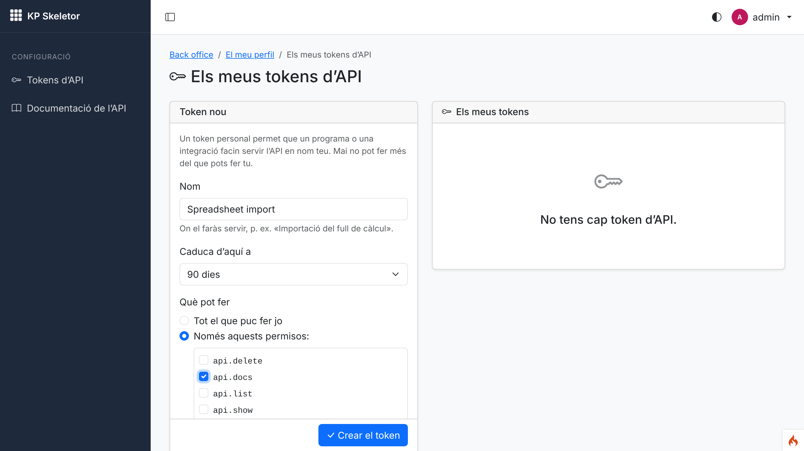
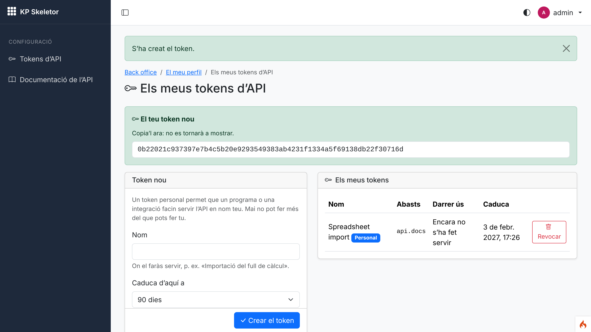
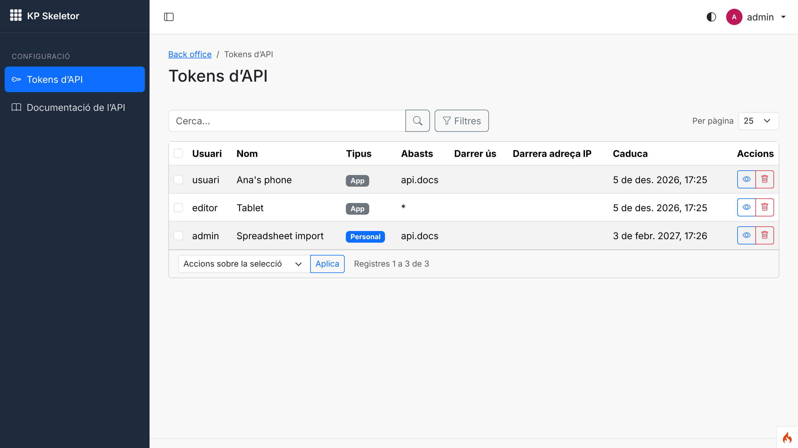
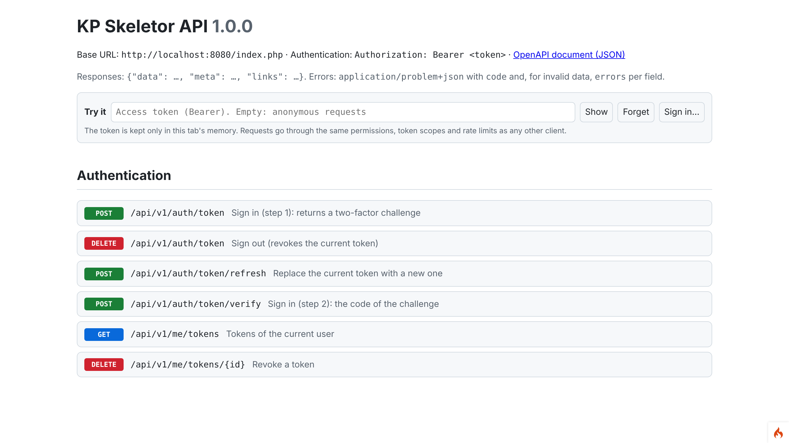
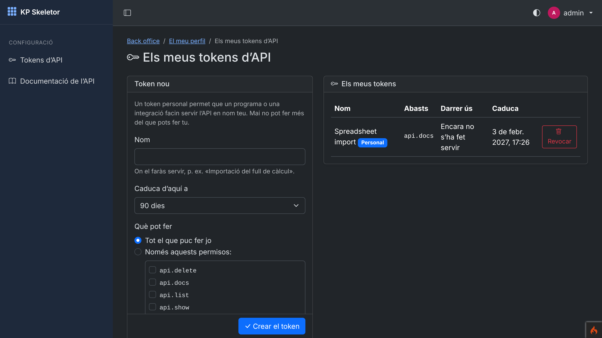
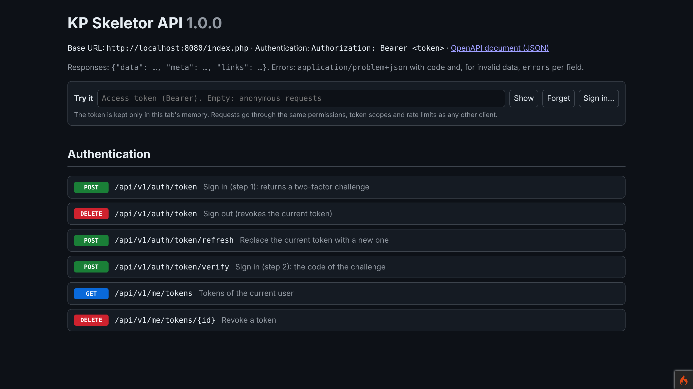
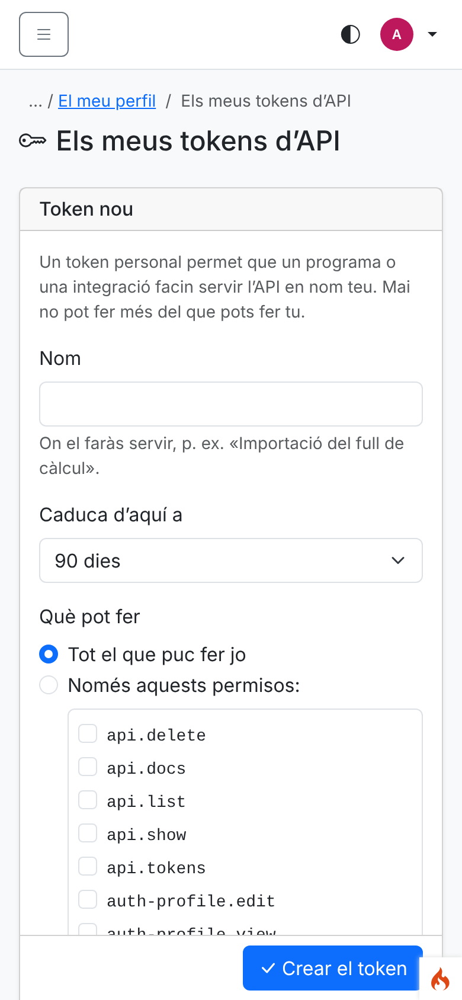
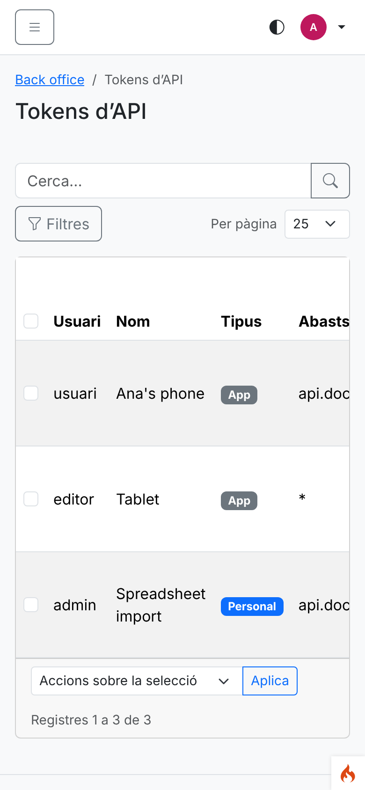
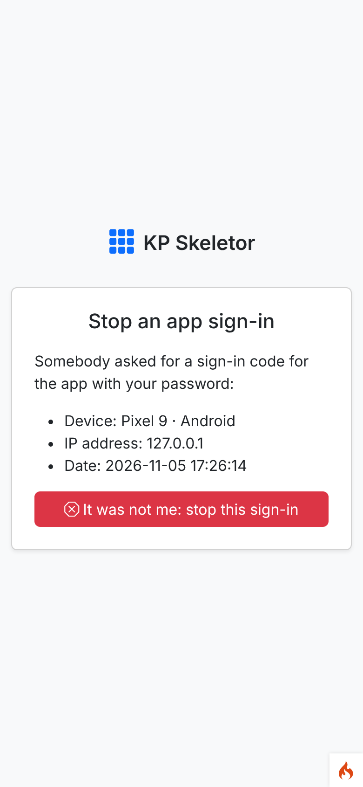
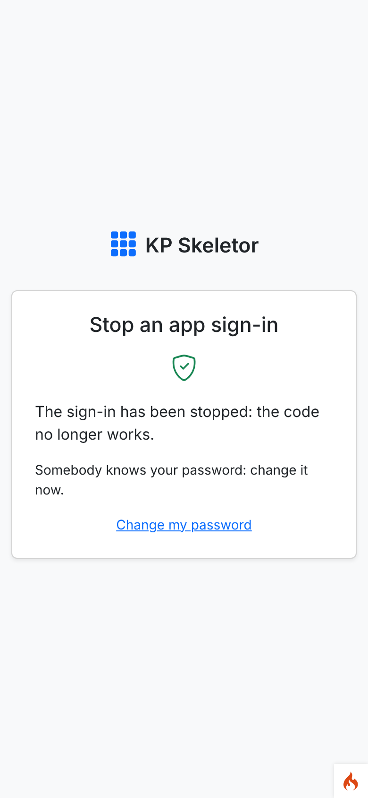

# Session 10 — kpapy integration and API authentication

Branch: `claude/tender-galileo-i38wrh` (assigned by the environment) · Pull request: [SIENSIS/kpskeletor#14](https://github.com/SIENSIS/kpskeletor/pull/14) "Session 10: kpapy integration and API authentication" · Date: 2026-11-05

## What was built

- **The API core** in a new core module **Api** (cannot be disabled): kpapy configured with the
  Core's shared resolver (`CrudPermissions`, deny by default) and the shared `app.maskKey`, so a
  grant and a masked id mean the same in the back office and the API.
- **App login with a second factor**: `POST api/v1/auth/token` → `POST api/v1/auth/token/verify`.
  Authenticator-app users type their app code (or a recovery code); everybody else, **including
  users without 2FA, gets a code by email** that names the device, IP and time and links to a page
  to stop the sign-in. Refresh and logout. kpapy's `web` method is not used.
- **Personal tokens** in the profile (`My API tokens`): name, scopes (all or chosen from the
  user's own permissions), expiry; re-authentication before creating; the secret shown once; last
  use and **last IP** listed; revoke.
- **Every user's tokens** for administrators (kpcrudy CRUD): list, details, revoke.
- **`GET api/v1/me`**, `GET/DELETE api/v1/me/tokens`.
- **Documentation page** with "Try it" at `backend/api/docs` (`api.docs`) and the OpenAPI 3.1
  document; public at `api/v1/openapi.json` only with the setting `Api.publicSpec`.
- Cross-cutting: problem+json in the client's language, rate limits per token and IP from the
  Core settings, CORS closed (setting `Api.corsOrigins`), ETags and `If-Match` (412), no session
  ever started by the API.
- `permissions:check` also checks every manifest `$api` entry against the routes.

## How it was built

### Design

- `app/Config/Kpapy.php`: `maskIds`, `maskKey` (= kpcrudy's), `permissionResolver =
  CrudPermissions`, `denyByDefault`, `authenticator = Modules\Api\Auth\TokenAuthenticator`,
  `twoFactorMethods = ['totp', 'email']` with the Api module's providers, 10-minute challenges with
  5 attempts, `requireHttps`, CORS empty, `uploadPath = writable/kpapy-unused-uploads`,
  `docsInProduction`/`docsTryIt` true (the page is behind `can:api.docs`). The constructor reads
  `Core.rateLimitApiToken`, `Core.rateLimitApiIp`, `Api.appTokenDays` and `Api.corsOrigins`
  (only `http(s)://host` origins, never `*`).
- `Modules\Api\TwoFactor\TotpProvider` extends kpapy's: enabled when Auth's `TwoFactor::method()`
  is `totp`; verification by `TwoFactor::verifyTotp()` (step never reused, web and API share it)
  or `RecoveryCodes::consume()`. `EmailCodeProvider`: every user with an email; the code is issued
  by kpapy's `Challenges` (HMAC stored) and sent by Auth's `SecurityMailer`
  (`Views/emails/login_code.php`); recovery codes accepted for users with 2FA.
- `Modules\Api\Controllers\LoginController` extends kpapy's: wrong passwords counted in Auth's
  `LoginThrottle` (429 while blocked, shared with the web form), `403 password-reset-required`,
  personal tokens not refreshable (`403 personal-token`). Its routes are registered by the module
  (same paths as `AuthRoutes::register()`).
- `LoginDenyController`: `GET auth/api-login/<challenge>` shows device/IP/time, the `POST` (CSRF,
  `ratelimit:forms`) closes the challenge (`Challenges::deny()`), then suggests changing the
  password.
- `TokenAuthenticator` extends kpapy's Shield authenticator and writes the token's last IP to
  `api_token_ips` when it changes. `Services\PersonalTokens` (create with escalation check,
  list, revoke, personal marker `secret2 = 'personal'`).
- `Filters\ApiLocale` (`apilocale` on `api/*`) negotiates `Accept-Language`; the global
  `authsession` filter now skips `api/*` (it opened a session on API calls).
- `Core`: `ModuleToggler::CORE_MODULES` gains `Api`; `PermissionAudit` runs `ApiRouteChecker`
  with the loaded routes.

### Main files

- `app/Config/{Kpapy,Filters}.php`
- `modules/Api/`: `Config/{Module,Routes,Registrar}.php`, `Controllers/{LoginController,
  LoginDenyController,Me,Docs,PersonalTokens,Tokens}.php`, `TwoFactor/`, `Auth/`, `Filters/`,
  `Services/`, `Models/`, `Views/`, `Language/{ca,es,en}/Api.php`, `CLAUDE.md`
- `modules/Core/{Modules/ModuleToggler,Permissions/PermissionAudit,Registry/ApiRouteChecker}.php`
- Tests: `modules/Api/Tests/*`, `tests/_support/Api/SampleNotesApi.php`
- Docs: `docs/api.md` (new), `docs/security.md`, `docs/commands.md`, `docs/decisions.md`,
  `docs/library-requests.md`, `docs/specification.md` (core modules), `CLAUDE.md`

### Tables, routes, permissions, settings

- Table `api_token_ips` (token id, user id, address, time). kpapy's `kpapy_login_challenges` (already migrated by `modules:sync`).
- Routes: `api/v1/auth/token` (POST, DELETE), `api/v1/auth/token/verify`, `api/v1/auth/token/refresh`,
  `api/v1/me`, `api/v1/me/tokens`, `api/v1/me/tokens/{id}`, `api/v1/openapi.json`;
  `auth/api-login/{challenge}` (GET, POST); `backend/profile/api-tokens` (+ POST, `…/{id}/revoke`),
  `backend/api/tokens` (kpcrudy), `backend/api/docs`, `…/openapi.json`, `…/try-it.js`.
- Permissions: `api.list`, `api.show`, `api.delete`, `api.docs`, `api.tokens` (admin `api.*`, editor `api.tokens`).
- Settings: `Api.publicSpec` (false), `Api.corsOrigins` ([]), `Api.appTokenDays` (30).
- Filter alias `apilocale`. Commands: none new (kpapy's `kpapy:token`, `kpapy:openapi`, `kpapy:routes`).

## Decisions and deviations

- **D-10-01** the API core is a core module `Api` (settings `Api.*` need a module of that name; the
  Core must not read Auth's 2FA data); admin token permissions `api.list/show/delete`.
- **D-10-02** methods `totp` then `email` (users with email 2FA and without 2FA alike); deny link
  without login.
- **D-10-03** limits and CORS from settings; Auth's `LoginThrottle` on the API login; password
  reset and personal-token refresh refused.
- **D-10-04** no session on `api/*`, `Accept-Language` negotiation, contents of `me`.
- **D-10-05** personal token scopes/expiries, `api_token_ips`, admin list as a CRUD.
- All accepted proposals; no open (decide) entry.
- Earlier work touched: `authsession` global filter now `except api/*` (AuthConfigTest updated);
  five tests that counted Core+Auth permissions/grants updated for the new module.
- Library requests: custom login controller in `AuthRoutes::register()`, scope check on
  `me/tokens`, custom endpoints in OpenAPI, token marker/last IP.

## How to try it

```bash
php spark modules:sync              # installs Api (migration, permissions, grants)
php spark modules:demo Auth         # demo users, password Demo-kpskeletor-2026
php spark serve
```

- `admin@example.com`: `http://localhost:8080/backend/profile/api-tokens` (create a token),
  `/backend/api/tokens`, `/backend/api/docs` (Try it).
- A token from the console: `php spark kpapy:token editor@example.com --name Test --scopes api.docs --days 7`.
- App login: `curl -X POST localhost:8080/api/v1/auth/token -H 'Content-Type: application/json' -d '{"email":"usuari@example.com","password":"Demo-kpskeletor-2026","device_name":"Phone"}'`
  (the code goes by email: configure `email.*` in `.env`, or read it in the tests).

Console output of this run:

```text
$ curl -s localhost:8080/api/v1/me -H "Authorization: Bearer <token>"
{"data":{"id":"WUaf-p_uFvrxbN1d8Q","username":"editor","email":"editor@example.com","name":"Laia Ferrer","locale":"ca","timezone":"Europe/Madrid","theme_mode":"auto","avatar_url":null,"groups":["editor"],"two_factor":null,"token":{"name":"Report demo","scopes":["api.docs"],"expires_at":"2026-11-12T17:26:30+00:00"}},"links":{"self":"http://localhost:8080/index.php/api/v1/me"}}
$ curl -s localhost:8080/api/v1/me -H 'Accept-Language: ca'
{"type":"about:blank","title":"Cal autenticació","status":401,"code":"unauthorized"}
$ curl -s -X POST localhost:8080/api/v1/auth/token -H 'Content-Type: application/json' -d '{"email":"usuari@example.com",…}'
{"data":{"challenge":"c2274ffb…","method":"email","expires_in":600,"message":"We have sent a sign-in code to your email."}}
$ curl -s -X POST localhost:8080/api/v1/auth/token/verify -d '{"challenge":"…","code":"123456"}'
{"type":"about:blank","title":"Invalid or expired code","status":422,"detail":"The code is not valid or has expired.","code":"invalid-code"}
```

## Tests and checks

```text
$ vendor/bin/phpunit
OK (492 tests, 2383 assertions)          # 449 before this session

$ vendor/bin/phpstan analyse
[OK] No errors

$ vendor/bin/php-cs-fixer fix --dry-run --diff
Found 0 of 345 files that can be fixed

$ php spark csp:check
No inline scripts, handlers or styles in the project views.

$ php spark permissions:check
Permissions OK: 18 permission(s) in the catalogue, 69 route(s) checked.

$ php spark assets:publish --check
The published assets are up to date.

$ php spark modules:sync
Nothing to do: every module is up to date.
```

New tests (43):

- `AppLoginTest` (13): **a user without 2FA gets a token only with the emailed code** (email names
  device, IP, deny link; wrong code 422); emailed code single use; too many wrong codes close the
  challenge; email 2FA + recovery code; **authenticator app** (no email sent); **a TOTP code never
  twice**; recovery code once; wrong passwords generic, problem+json and **throttled with the web
  login**; password reset required; refresh and logout; personal tokens not refreshable; **deny
  link stops the sign-in**; forged deny POST refused (CSRF).
- `ApiResourceTest` (11): **a list-scoped token gets 403 on writes**; **superadmin tokens limited
  by scopes**; scopes never add permissions; a web grant applies to the API; **same masked id in
  web and API**; problem+json (404, 422, 401) translated by `Accept-Language`; ETag/304 and
  `If-Match` 412; **429 per token** with `Retry-After`; 429 on the login per IP; CORS closed and
  **no session cookie**; CORS origins from the setting (never `*`).
- `TokenScreensTest` (12): secret shown once, token personal, last IP; **creation needs
  re-authentication**; **scopes limited to the user's permissions** and offered expiries; users
  without `api.tokens` refused (forged POST); revoke only own tokens; personal marker; admin list
  and revoke; non-admins refused (forged POST); **docs only with `api.docs`**; `Api.publicSpec`;
  `me` (masked id, no secrets, 401); `me/tokens`.
- `ApiModuleTest` (7): manifest valid and core module; migration up/down/up; shared resolver and
  mask key; secure defaults; settings → limits; **every real `api/v1/` route has kpapy, the login
  filter only on `auth/token*`**; `$api` entries must match a route.

## Screenshots

Taken with Playwright against `php spark serve` (development, SQLite, Auth demo data) at device
scale factor 2. The demo users' profiles are Catalan; kpapy's documentation page is in English.


*01 — admin: "My API tokens", a new token limited to `api.docs`, 90 days.*


*02 — after re-authentication (the login opened the window): the secret shown once, the token listed as personal.*


*03 — Settings › API tokens: every user's tokens (kpcrudy), kind, scopes, expiry; details and revoke.*


*04 — the documentation page with "Try it" (token or app sign-in).*


*05 — "My API tokens" in dark mode.*


*06 — the documentation page follows the system dark mode.*


*07 — phone width (390×844).*


*08 — the admin list at phone width.*


*09 — the link of the sign-in code email: device, IP, time and "It was not me".*


*10 — the sign-in stopped; the code no longer works.*

## Known issues

- `GET api/v1/me` is not in the OpenAPI document (kpapy documents resources and its own auth
  routes; library request).
- Any valid token can list and revoke its user's tokens through `me/tokens` (kpapy's controller
  does not check scopes; it can only remove access; library request).
- The scope list in "My API tokens" is long for administrators (one checkbox per permission);
  session 15 may group it by resource.
- In development, CodeIgniter's debug toolbar (Shield collector) starts a session on API calls;
  production and tests never do.
- Logins, refusals and token changes go to the application log until the activity log (session 12).

## Notes for the next session

- Session 11: notify on `kpapy.auth.denied` if wanted; security emails stay in `SecurityMailer`.
- Session 12: activity entries for `kpapy.auth.login/failed/logout/denied` (events fired), token
  creation/revocation (`PersonalTokens`, `Tokens::afterDelete`), API writes (`afterWrite()`).
- Session 14: Settings › Security for `Api.publicSpec`, `Api.corsOrigins` (validate full
  origins), `Api.appTokenDays`.
- Session 17+: module API resources: `Resource::routes(..., ['filter' => 'kpapy'])` in the
  module's `Routes.php`, `setResource('<module>-<resource>')`, an `$api` manifest entry; tests from
  `modules/Api/Tests/ApiResourceTest.php`.
- Session 26: Core endpoints; extend `CrudAuditor`-style checks to API resources.
