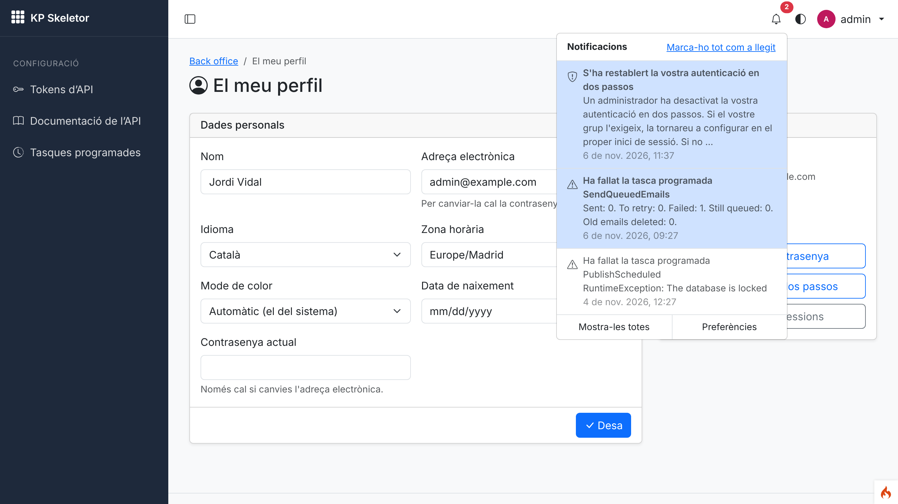
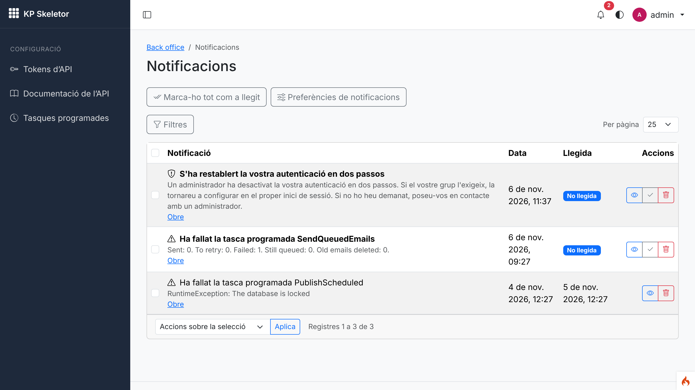
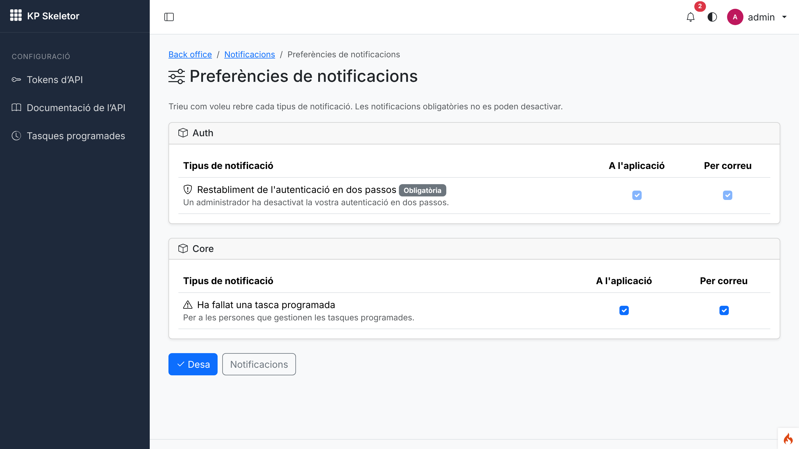
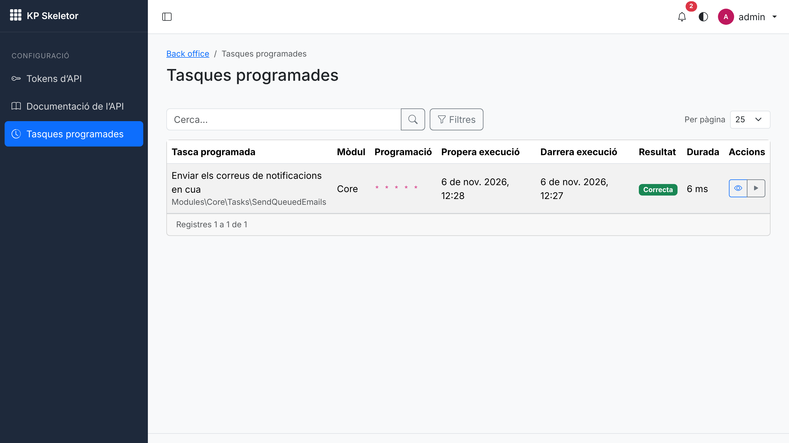
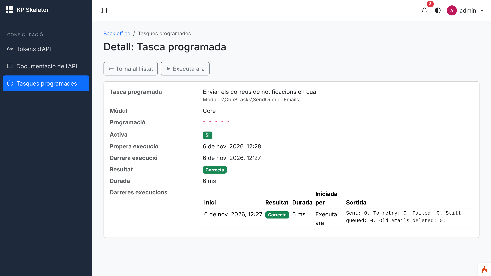
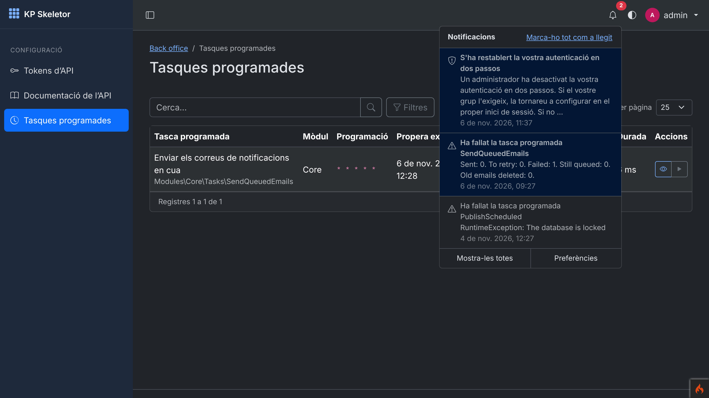
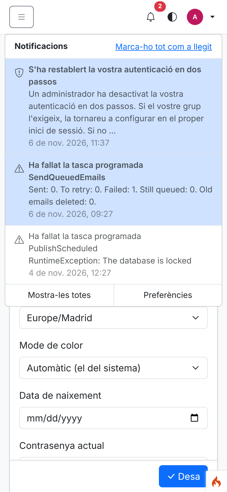
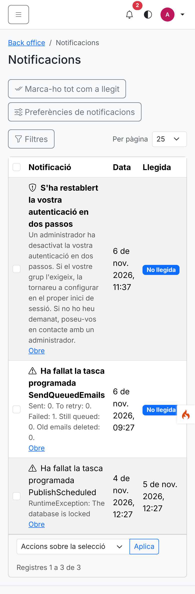
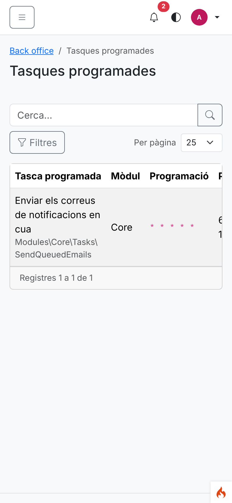
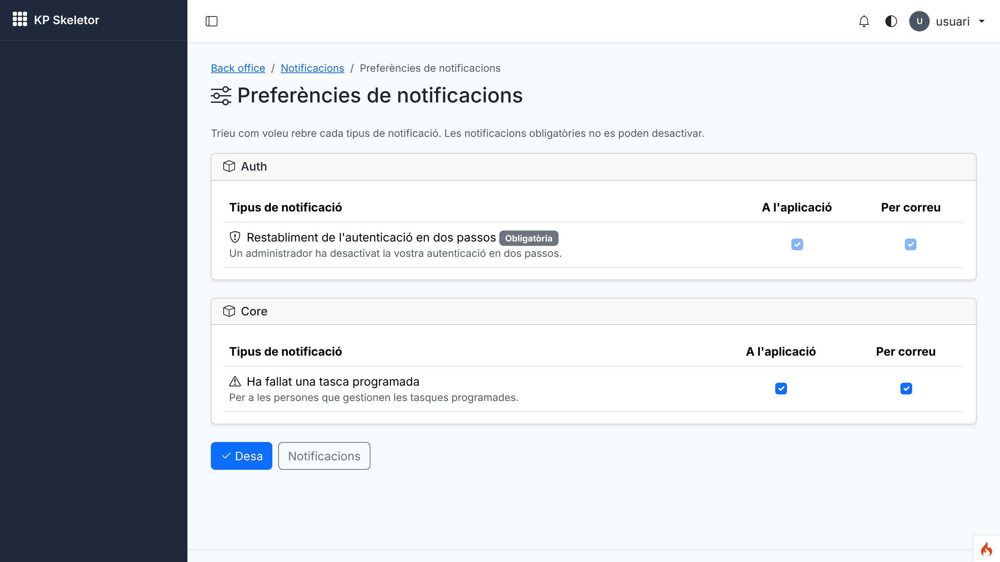

# Session 11 — Notifications and scheduler

Branch: `claude/charming-edison-f3elks` · Pull request: [SIENSIS/kpskeletor#15](https://github.com/SIENSIS/kpskeletor/pull/15) · Date: 2026-11-06

## What was built

- **Notifications** for every module: notification types declared in the manifest, sent with
  `notify()`, `notifyGroup()` and `notifyPermission()`; channels **in the application** (the bell)
  and **email** (queued, sent by a scheduled task, never inline); per-user preferences per type;
  mandatory types.
- **Bell** in the back-office top bar: unread count, the latest notifications, "mark all as
  read", links to the full list and the preferences. Works without JavaScript too.
- **Notifications list** (kpcrudy, own records only): show, delete, mark one / selected / all as
  read; **preferences** page.
- **Scheduler**: one cron entry `php spark schedule:run`; scheduled tasks declared in the
  manifest (`TaskInterface`, schedule helpers, `withoutOverlapping()`, `onlyInEnvironment()`);
  `schedule:run [--task=…] [--force]`, `schedule:list`; a **scheduled tasks screen** with the last
  run, result, duration, the latest runs with their output and **Run now**; failures logged and
  notified to the scheduler's managers; tasks of disabled modules skipped; **poor man's cron**
  for hosts without cron (setting, off by default).
- The Core's first scheduled task: **Send the queued notification emails** (every minute).
- **2FA reset → notification** (session 06's `twoFactorReset` event): the user always gets a
  mandatory notification and email, in their language.

## How it was built

**Scheduler** (`modules/Core/Scheduler/`)

- `CronExpression`: five fields with lists, ranges, steps, names and macros; Vixie's
  day-of-month OR day-of-week rule; `matches()` and `next()`.
- `Schedule`: helpers `cron()`, `everyMinute()`, `everyMinutes(n)`, `hourly()`, `hourlyAt(m)`,
  `daily('HH:MM')`, `weekly(day, time)`, `monthly(day, time)`; options `withoutOverlapping(min)`,
  `onlyInEnvironment(...)`.
- `TaskInterface` (`name()`, `schedule()`, `run(): TaskResult`), `TaskResult`
  (success/failure/skipped + output), `TaskRun` (summary).
- `ScheduledTasks`: keeps `scheduled_tasks` in line with the declarations (`DeclarationRegistry`):
  inserts new tasks with their first `next_run_at`, recalculates changed schedules, marks tasks
  of disabled modules or unloadable classes inactive; atomic `claim()` of a slot
  (`UPDATE … WHERE next_run_at = <old>`), database locks (`locked_until`, `lock_owner`).
- `TaskRunner`: `runDue()` / `runNow()`; captures what tasks print; records `task_runs` (latest 50
  per task); failure → log + `ScheduledTaskFailed` to the holders of `schedule.list`.
- Commands `Commands/ScheduleRun.php`, `Commands/ScheduleList.php`; filter
  `Filters/PoorMansCron.php` (after filter in the `backend` chain, shutdown function with
  `fastcgi_finish_request()`).
- `Tasks/SendQueuedEmails.php`; the `make:module` stub `Tasks/<Name>Task.php` now implements
  `TaskInterface`.

**Notifications** (`modules/Core/Notifications/`)

- `NotificationType` (abstract: `title()`, `description()`, `icon()`, `defaultChannels()`,
  `mandatory()`, `render(): NotificationMessage`, `emailSubject()`, `emailView()`),
  `NotificationMessage` (title, body, internal path only).
- `Notifier` (service `notifications`; helpers in `Helpers/notification_helper.php`): recipients
  (users, ids, groups, permission holders through `Authorization::for()`), banned users skipped,
  only types of enabled modules, channels from preferences or defaults, mandatory types.
- `Channels/DatabaseChannel`, `Channels/EmailChannel` → `Mail/MailQueue` (claim per row, 5
  attempts with 5/10/20/40-minute waits, pruning after 30 days, through GuardedEmail).
- `RecipientLocale`: the Auth module registers the profile locale; emails are rendered in it.
- `Inbox`: one user's unread count, latest, mark read (always limited to the user).
- Views: `Views/emails/notification.php`, `Views/notifications/preferences.php`,
  `Views/schedule/runs.php`; theme partial `themes/default/Views/partials/notifications_bell.php`;
  ES module `modules/Core/Assets/js/ui/bell.js`.

**Tables** (Core, one migration each, `down()` implemented): `notifications`,
`notification_preferences`, `mail_queue`, `scheduled_tasks`, `task_runs`.

**Routes and permissions**

| Route | Filter |
|---|---|
| `backend/notifications` (kpcrudy) | `can:core-notifications.list` (+ resolver per operation) |
| `GET backend/notifications/bell`, `GET backend/notifications/open/{id}`, `POST backend/notifications/read-all` | `can:core-notifications.list` |
| `GET/POST backend/profile/notifications` | `can:core-notifications.list` |
| `backend/schedule` (kpcrudy, `run` operation) | `can:schedule.list` (+ `schedule.show`, `schedule.run`) |

New permissions: `core-notifications.list|show|delete` (every group), `schedule.list|show|run`
(admin: `schedule.*`). Menus: "Notifications" in the user menu, "Scheduled tasks" in Settings.
New setting `Core.poorMansCron` (bool, false). Auth declares the notification type
`TwoFactorReset` and listens to `twoFactorReset`.

**Docs:** `docs/scheduler.md`, `docs/notifications.md`, `docs/commands.md` (Scheduler),
`docs/auth.md`, `CLAUDE.md` (convention line), `modules/Auth/CLAUDE.md`.

## Decisions and deviations

All recorded as **Accepted (proposal)**, none needs the owner (no public convention changed):

- **D-11-01** The notification type contract (class name as key, data stored, rendered when read).
- **D-11-02** The email channel: `mail_queue`, `SendQueuedEmails`, retries, recipient's language.
- **D-11-03** Recipients, preferences and mandatory types.
- **D-11-04** Notification screens, URLs and the bell (`open/{id}` is a GET that marks as read).
- **D-11-05** Scheduler semantics: `next_run_at` + atomic claims, DB locks, history of 50 runs,
  resource `schedule`.
- **D-11-06** Poor man's cron after the response.

Deviations / notes:

- The plan named a `Lock` class; the lock lives in `ScheduledTasks::lock()/unlock()` (columns of
  `scheduled_tasks`), no separate class.
- The bell shows absolute localised dates: CodeIgniter ships no Catalan strings for
  `Time::humanize()` (it fell back to English).
- Eight earlier tests that count the Core's permissions, grants, tasks, migrations or the
  `backend` filters were updated to the new values.

## How to try it

```bash
bash deploy/setup.sh                 # cloud: PHP, Composer, dependencies
cp env .env                          # CI_ENVIRONMENT = development, SQLite database.db, app.maskKey
php spark modules:sync               # 5 new Core migrations, permissions, grants, declarations
php spark modules:demo Auth --force  # demo users, password Demo-kpskeletor-2026
php spark schedule:list
php spark schedule:run               # what cron runs every minute
php spark schedule:run --task=SendQueuedEmails --force
php spark serve
```

- `http://localhost:8080/backend/schedule` as `admin@example.com`: the scheduled tasks, the eye
  icon for the latest runs, ▶ for "Run now".
- Notifications: they appear when something sends them (a failing scheduled task, an admin 2FA
  reset — the reset screen arrives in session 15). From a script:
  `notifyGroup('admin', new \Modules\Core\Notifications\Types\ScheduledTaskFailed(['class' => 'Demo', 'output' => 'Example']))`.
  The screenshots used three rows inserted the same way `notify()` writes them.
- Bell in the top bar; `backend/notifications`; `backend/profile/notifications`.
- Cron line for a server: `* * * * * cd /path/to/project && php spark schedule:run >> /dev/null 2>&1`.

Console output:

```
$ php spark schedule:run --task=SendQueuedEmails --force
Success  Send the queued notification emails (7 ms)
    Sent: 0. To retry: 0. Failed: 0. Still queued: 0. Old emails deleted: 0.

$ php spark schedule:list
| Scheduled task                      | Module | Schedule  | Next run            | Last run                      | Notes |
| Send the queued notification emails | Core   | * * * * * | 2026-11-06 12:28:00 | 2026-11-06 12:27:15 (Success) |       |

$ php spark schedule:run --task Nope
The scheduled task "Nope" does not exist or its module is disabled.
```

## Tests and checks

```
vendor/bin/phpunit                       OK (554 tests, 2704 assertions)   [start of session: 492 tests]
vendor/bin/phpstan analyse               [OK] No errors
vendor/bin/php-cs-fixer fix --dry-run    Found 0 of 389 files that can be fixed
php spark permissions:check              Permissions OK: 24 permission(s) in the catalogue, 82 route(s) checked.
php spark csp:check                      No inline scripts, handlers or styles in the project views.
php spark assets:publish --check         The published assets are up to date.
php spark modules:sync                   Nothing to do: every module is up to date.
```

New tests:

- `modules/Core/Tests/CronExpressionTest.php` — fields, steps, names, macros, the day rule, next
  runs, leap days, invalid expressions and helper arguments, options.
- `modules/Core/Tests/SchedulerTest.php` — first slot, run records and output, missed runs once,
  no double runs, failure isolated + notified to `schedule.list` holders only, overlapping lock
  (skipped, expired lock, released), disabled modules, other environments, run now, history
  limit, removed/changed tasks.
- `modules/Core/Tests/NotifierTest.php` — notify/groups/permissions routing, banned and duplicate
  recipients, preferences, mandatory types, undeclared and disabled types, queue sent by the task,
  retries and final failure, recipient's language, internal links only.
- `modules/Core/Tests/PoorMansCronTest.php` — off by default, once a minute, in the chain.
- `tests/feature/Notifications/NotificationScreensTest.php` — bell in the layout and its JSON,
  open, someone else's notification, mark all (form and JSON), preferences, forged requests
  without the permission.
- `tests/feature/Scheduler/ScheduleScreenTest.php` — **a task run from `schedule:run` shows its
  last run and output in the screen**, run now, forged run without `schedule.run`, 403s,
  command errors.
- `modules/Auth/Tests/TwoFactorResetNotificationTest.php` — the reset notifies the user
  (mandatory, in Catalan).
- `modules/Core/Tests/CoreMigrationsTest.php` — up/down/up with the five new tables.

## Screenshots

Taken with Playwright (`screenshots.cjs` in this folder) against `php spark serve`
(development, SQLite, Auth demo data, three sample notifications for `admin@example.com`) at
device scale factor 2. The demo users' profiles are Catalan. The script fails on CSP violations,
horizontal scroll and menus leaving the screen.


*01 — The bell open: unread notifications highlighted, "mark all as read", links to the list and the preferences.*


*02 — The notifications list (own records only): unread badges, show, mark as read, delete, bulk actions.*


*03 — Preferences by module; the 2FA reset is mandatory (disabled checkboxes).*


*04 — Scheduled tasks: schedule, next and last run, result, duration, view and "Run now".*


*05 — A scheduled task's detail with its latest runs and their output.*


*06 — The bell in dark mode.*


*07 — The bell on a phone (390×844): full-width panel under the top bar.*


*08 — The notifications list on a phone.*


*09 — The scheduled tasks screen on a phone.*


*10 — A plain user's preferences (with the new breadcrumbs). Every type of the enabled modules is listed, including the managers' "A scheduled task failed" (known issue); the same user gets 403 on the scheduled tasks screen.*

## Known issues

- **Existing installations do not get the Core's new default grants** (`core-notifications.*`,
  `schedule.*`): default grants are applied once per module (D-02-04) and the Core was already
  installed. Fresh installs are fine; a development database from an earlier session must be
  recreated (or the grants given with `GrantManager` / the matrix of session 15).
- In development without `email.*` in `.env` the queued emails fail (`mail()` unavailable) and are
  retried, then marked failed; the failure notifies the scheduler's managers.
- With `php spark serve` / mod_php the poor man's cron makes that one request wait for the tasks.
- `ui_date($date, 'relative')` has the same English fallback for Catalan (`Time::humanize()`);
  not used by this session.
- The preferences list every type of the enabled modules to every user, including types only
  sent to managers (e.g. "A scheduled task failed").

## Notes for the next session

- **Session 12 (activity):** add activity entries for: "run now" (`TaskRunner::runNow()` source
  `manual`, user id), scheduled task failures, notification preference changes, and keep the
  `log_message()` calls of `MailQueue`. Purging the activity log is a natural scheduled task.
- Any module: declare `$tasks` / `$notifications`, then `php spark modules:sync`; send with
  `notifyPermission()` from tasks (no session). Patterns: `docs/scheduler.md`,
  `docs/notifications.md`, tests with `Tests\Support\Scheduler\DeclaresFixtures`.
- Session 14: Settings UI for `Core.poorMansCron`. Session 15: the 2FA reset row operation
  (the notification is already wired), and the matrix to grant `schedule.*` to other groups.
- Session 16: a "Scheduled tasks" widget (failing tasks) can read `scheduled_tasks.last_status`.
- Session 26: `api/v1/notifications` on top of `Inbox` (list, unread count, mark one/all).
