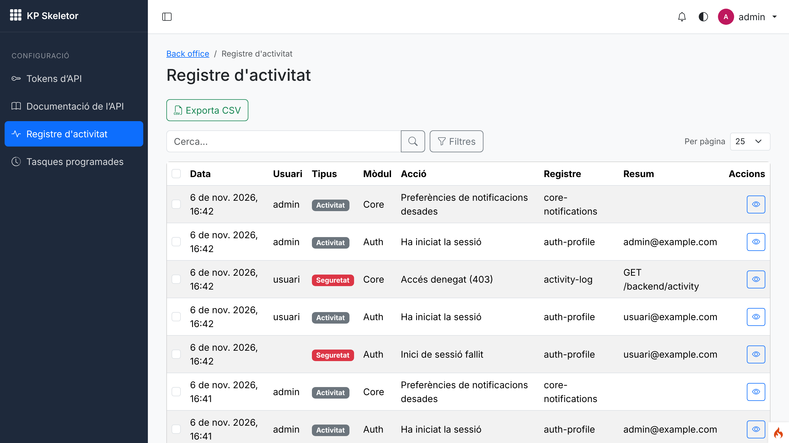
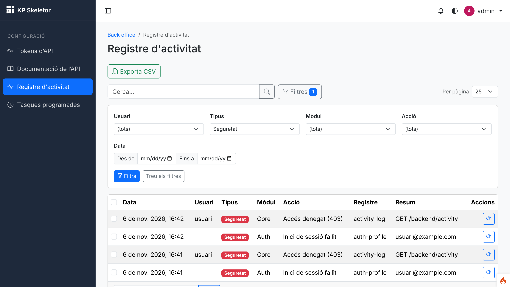
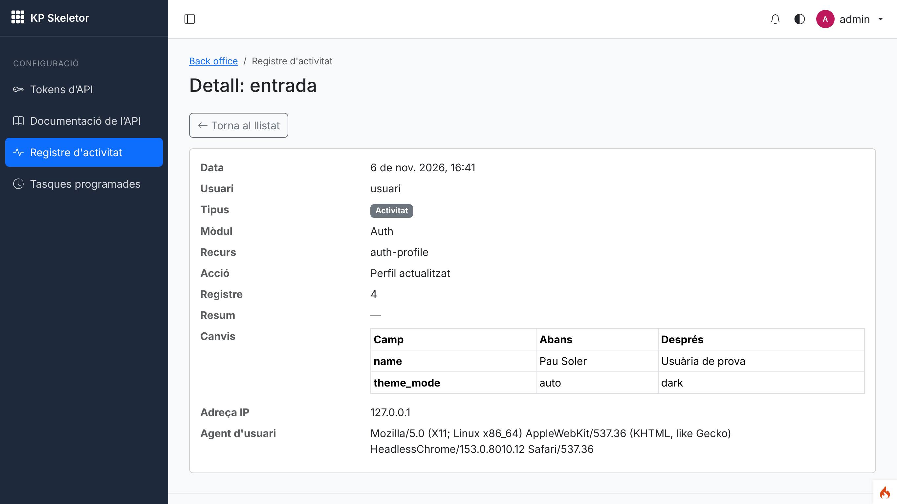
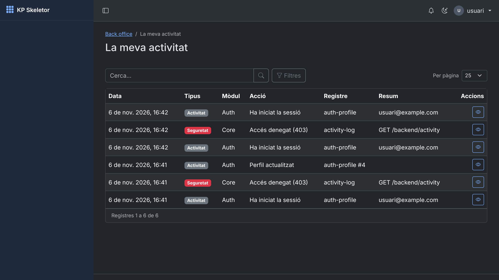
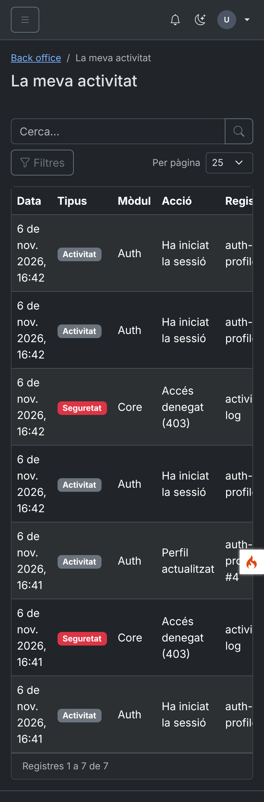
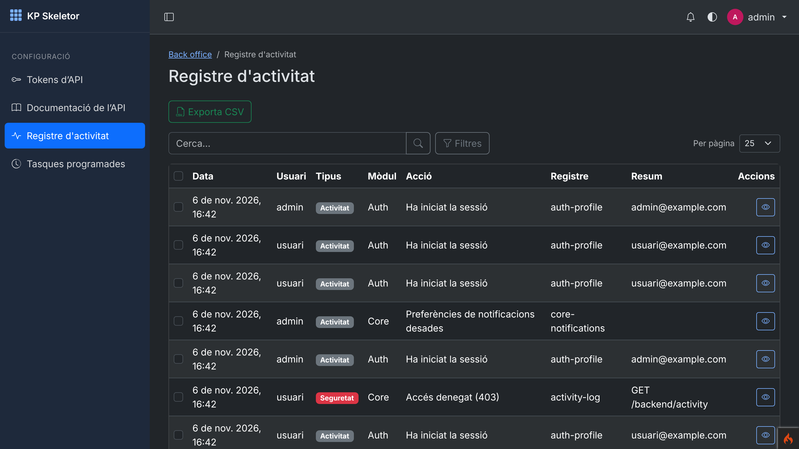

# Session 12 — Activity log and Activity module

Branch: `claude/trusting-curie-sqluwo` · Pull request: [SIENSIS/kpskeletor#16](https://github.com/SIENSIS/kpskeletor/pull/16) · Date: 2026-11-06

## What was built

- An **append-only activity and security log** (`activity_log`) written by the Core: who did what
  (user, module, resource, action, record), a one-line summary, the masked before/after changes,
  the type (`activity` / `security`), IP address, user agent and date.
- **Every kpcrudy CRUD logs by itself**: inserts, updates (changed fields only), deletes,
  restores, bulk actions, imports, POST custom operations and CSV exports, with the right user
  and module, without code in the modules.
- **Security events**: failed logins (password, 2FA codes, recovery codes, re-authentication, app
  logins), throttling (login and rate limits), 403s from `can:`, re-authentication, password,
  email and 2FA changes, grants and user permissions, token creation/revocation, a token used from
  a new IP, denied app logins, refused outbound requests.
- Every write of sessions 05–11 that used `log_message()` now writes an entry (logins/logouts,
  profile, sessions, groups, modules, demo data, grants, "run now", task failures, notification
  preferences, tokens, outbound requests).
- **Secrets masked** by key (`/pass|pwd|secret|token|key|csrf|otp/i`, any depth); **log-injection
  safe** (values stored as data, single-line summary; the file log escapes line breaks).
- **Retention**: `Core.activityRetentionDays` (365) and the daily Core scheduled task
  `PurgeActivityLog` (chunked).
- The **Activity module**: "Activity log" (`backend/activity`: filters by user, type, module,
  action and date range, search, CSV export, details with a before/after table) and "My
  activity" (`backend/activity/mine`, every user, own entries only); IP addresses and user agents
  only with `activity-log.network`.

## How it was built

- **Core** (`modules/Core/`):
  - `Activity/ActivityLogger.php` (service `activity`; `log()`, `security()`, `crudWrite()`,
    `diff()`, `moduleOf()`, `typedEmail()`, `clean()`), `Activity/SecretMasker.php`;
  - helpers `activity_log()` / `security_log()` (`Helpers/activity_helper.php`, autoloaded);
  - `Crud/AuditedCrud.php` (extends `Kpcrudy\Crud`: `callHook()`, `addOperation()`,
    `addBulkAction()`, `exportOperation()`, `skipActivity()`), made by `CrudFactory::make()`;
  - `Log/SafeLogger.php` (the `logger` service in `app/Config/Services.php`);
  - `Tasks/PurgeActivityLog.php`; setting `activityRetentionDays` in the manifest;
  - migration `2026-11-07-000001_CreateActivityLog` (indexes on `created_at`,
    `(user_id, created_at)`, `(type, created_at)`, `(module, action)`);
  - entries from `Filters/Can.php` (403), `Filters/RateLimit.php`, `Permissions/GrantManager.php`,
    `Modules/ModuleToggler.php`, `Demo/DemoDataManager.php`, `Scheduler/TaskRunner.php`,
    `Http/OutboundClient.php`, `Mail/GuardedEmail.php`, `Controllers/NotificationPreferences.php`.
- **Auth**: login/logout (`LoginListener`), failed logins (`LoginController`), throttling
  (`AuthController::tooManyAttempts()`), 2FA (`UserTwoFactorAction`, `TwoFactor`,
  `TwoFactorSettingsController`), re-authentication, password (`PasswordChanger`), profile and
  email (`ProfileController`), sessions and tokens (`SessionsController`), groups (`GroupRules`),
  remember-me (`AuthSession`).
- **Api**: `Config/Events.php` (kpapy `kpapy.auth.challenge|login|logout|failed|denied`),
  `PersonalTokens`, `Tokens`, `TokenAuthenticator` + `TokenIpModel::record()` (new IP).
- **Activity** (`modules/Activity/`): manifest (resources `activity-log` with `network`,
  `activity-mine`), `Config/Routes.php` (two `CrudFactory::routes()`, "mine" first),
  `Controllers/Activity.php`, languages, tests, `CLAUDE.md`.
- Action labels: `<Module>.activity.<action>` in each module's language file, then
  `Activity.actions.<action>` (generic CRUD actions).
- Permissions: `activity-log.list|show|export|network` (admin `activity-log.*`),
  `activity-mine.list|show` (every group). 30 permissions in the catalogue.
- Docs: `docs/activity.md` (new), `docs/cruds.md`, `docs/security.md`, `docs/specification.md`,
  `CLAUDE.md`, `docs/decisions.md`, the Auth/Api/Activity `CLAUDE.md` files.

## Decisions and deviations

- **D-12-01** (accepted): the Core writes the log; each module logs its own events (Auth's and
  Api's listeners live in those modules, not in the Core's `Events.php` as `docs/plan.md` said).
- **D-12-02** (accepted): `AuditedCrud`, a Core subclass of kpcrudy's `Crud`, instead of a
  `afterWrite()` hook (kpcrudy keeps a single one).
- **D-12-03** (accepted): action codes + language labels, summary as data, which events are
  `security`.
- **D-12-04** (decided by the owner as proposed with `deploy/decide.md`): the retention setting `Core.activityRetentionDays`
  (365 days, purged daily by the Core even while the Activity module is disabled).
- **D-12-05** (accepted): a failed login keeps the typed name only if it is an email; IP/user
  agent hidden on both screens without `activity-log.network`.
- Deviations: CRUD token revocation writes two entries (the `delete` and the `token_revoked`
  security entry); kpcrudy refuses forbidden operations inside a CRUD with "not found" or a
  redirect (not 403), so only `can:` denials are `forbidden` entries; six tests that count the
  Core's permissions/grants/tasks/migrations/CRUDs updated. Error-level `log_message()` calls stay
  in the file log.

## How to try it

```bash
php spark modules:sync
php spark modules:demo Auth     # demo users, password Demo-kpskeletor-2026
php spark serve
```

- <http://localhost:8080/backend/activity> as `admin@example.com` (filters, export, details).
- <http://localhost:8080/backend/activity/mine> as `usuari@example.com`; the same user gets a
  `forbidden` entry when opening `/backend/activity`.
- `php spark schedule:run --task=PurgeActivityLog --force` purges entries older than the
  retention.

## Tests and checks

- `vendor/bin/phpunit`: **OK (577 tests, 2844 assertions)** (23 new: `ActivityLoggerTest`,
  `ActivityScreensTest`, `ActivityEventsTest`, plus the migration up/down/up).
- `vendor/bin/phpstan analyse`: **[OK] No errors**.
- `vendor/bin/php-cs-fixer fix --dry-run --diff`: **0 of 407 files** to fix.
- `php spark permissions:check`: **Permissions OK: 30 permission(s) in the catalogue, 90
  route(s) checked.**
- `php spark csp:check`: no inline scripts, handlers or styles. `assets:publish --check`: up to
  date.
- `php spark security:check` does not exist yet (session 30).

## Screenshots

Taken with `node deploy-status/12-activity/screenshots.cjs` against `php spark serve` with the
Auth demo data; the script first produces real activity (a failed login, logins, a 403, a profile
change, notification preferences).


*01 — The activity log for an administrator: date, user, type (security entries in red), module,
action, record and summary.*


*02 — The same list filtered to security entries (failed login, 403).*


*03 — Details of a profile change: the before/after table, IP address and user agent (shown to
holders of `activity-log.network`).*


*04 — "My activity" for an ordinary user: own entries only, no user, IP or user agent column.*


*05 — "My activity" at phone width (dark mode chosen in that user's profile); the table scrolls
inside its card.*


*06 — The activity log in dark mode.*

## Known issues

- Existing installations get the new Core grants only for new modules (grants are applied once
  per module): the Activity module is new, so `modules:sync` applies its grants; recreate
  development databases for anything else.
- At phone width the CRUD table scrolls horizontally inside its card (kpcrudy has no responsive
  list options yet, known issue 09).
- The filter options for module and action are read with `DISTINCT` on each page load (indexed;
  fine for large logs, but not cached).
- Settings changes (session 14), refused uploads (13) and refused packages (29) are not logged
  yet: those sessions add them with `security_log()` / `activity_log()`.
- `composer install` again needed the `phpstan/phpstan` zip seeded into Composer's cache (known
  issue 04).

## Notes for the next session

- Log new actions with `activity_log('<Module>', '<code>', [...])` and refusals with
  `security_log()`, labels in `<Module>.activity.<code>` (`ca`, `es`, `en`); never
  `log_message()` for audit. CRUDs log by themselves (`AuditedCrud`); use `skipActivity()` only
  for view-state operations.
- Session 13: refused uploads → `security_log('Core', 'upload_refused', …)`. Session 14:
  settings changes (masked by key) and `Core.activityRetentionDays` in the Settings UI.
  Session 15: impersonation start/end, bans, forced resets. Session 16: a security-events widget
  can read `activity_log`. Session 29: refused packages.
- D-12-04 was decided as proposed (`Core.activityRetentionDays`); nothing is open.
