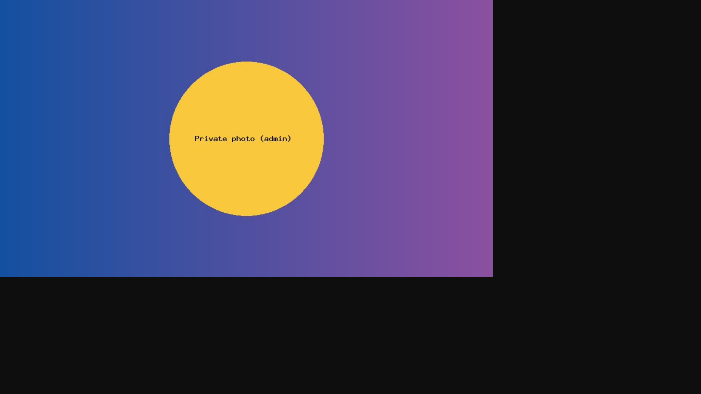
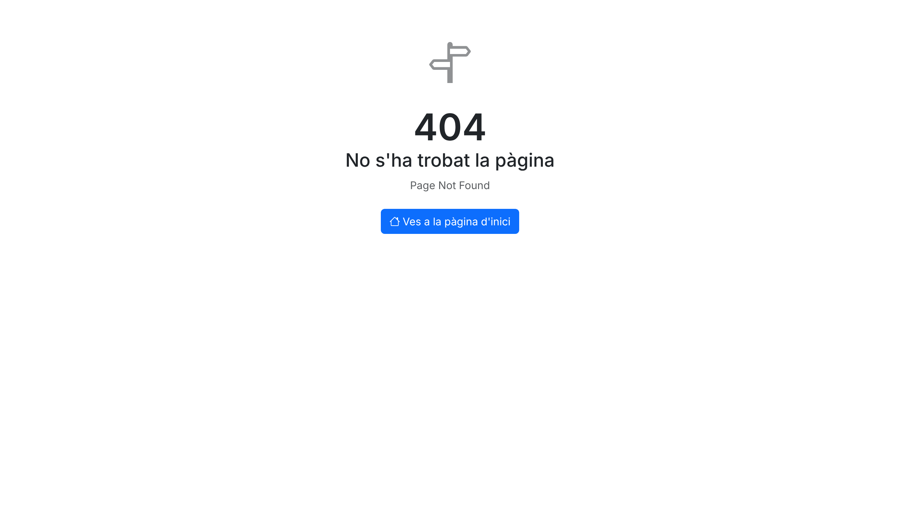
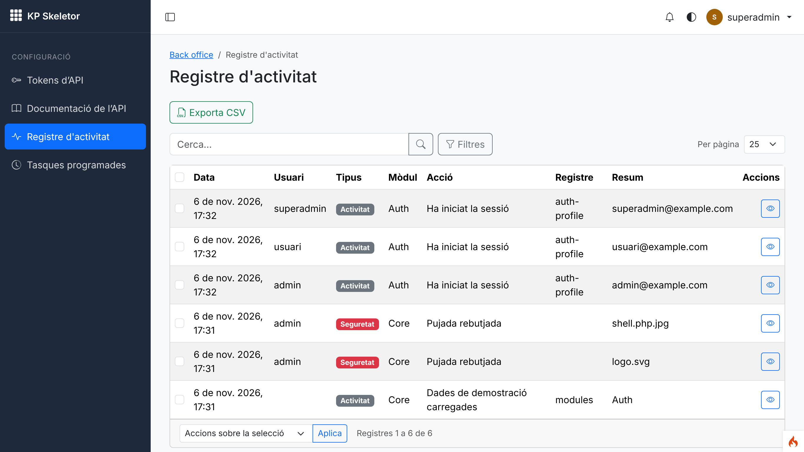

# Session 13 — Storage service and upload rules

Branch: `claude/gifted-newton-p029ve` · Pull request: [SIENSIS/kpskeletor#17](https://github.com/SIENSIS/kpskeletor/pull/17) · Date: 2026-11-06

## What was built

- A **Storage service** (`service('storage')`) over Flysystem with two disks: `public`
  (`public/uploads`, served by the web server) and `private` (`writable/storage`, served only
  through a permission-checking controller). Modules never use paths.
- **Upload rules** for every upload: extension allow-list (global setting, narrowed per field)
  **and** MIME type detected from the contents; size limit; random file names (the original name
  kept in the database); code, HTML and executables never accepted; **SVG refused by default**
  (sanitised when a setting allows it); **images re-encoded** by default (EXIF/GPS and hidden
  payloads dropped); HTML/XML/PHP disguised under another extension refused.
- **Private files** only through `GET files/private/{key}` (random 128-bit key): the uploader and
  superadmins until the folder permissions of session 22; everybody else gets a 404. Served with
  the stored MIME type, `nosniff`, `attachment` unless raster image or PDF, a sandboxing CSP and
  no caching.
- **No execution in upload folders**: `public/uploads/.htaccess` (PHP off, code/HTML/dotfiles
  denied, `nosniff`, sandbox CSP, SVG downloaded) and Apache/Nginx snippets in
  `docs/web-server.md`; private folders `0750`, files `0640`.
- **Refused uploads in the security log** (`Core` / `upload_refused`, with the reason).

## How it was built

- **Config:** `app/Config/Storage.php` — disks (root, URL, folder/file permissions: public
  `0755`/`0644`, private `0750`/`0640`), `$forbiddenExtensions`, `$imageExtensions`,
  `$extraMimes` (CSV as `text/plain`, OpenDocument), `$maxImagePixels` (40 MP), `$imageQuality`,
  `$accessRule`.
- **`modules/Core/Storage/`:**
  - `Storage` (service `storage`, `modules/Core/Config/Services.php`): `disk()`, `store()`
    (UploadedFile or File), `storeContents()`, `find()`, `findById()`, `delete()`, `url()`,
    `canView()`; logs refusals with `security_log()`.
  - `Disk`: Flysystem `LocalFilesystemAdapter` (links refused, lazy root), write/read/stream,
    exists, delete, move, copy, list, `url()` (public disk only), `localPath()` (internal, for the
    controller).
  - `PathNormalizer`: refuses `..`, `.`, absolute and drive paths, stream wrappers, backslashes,
    control characters, invalid UTF-8 and hidden segments (`.htaccess`, `.env`).
  - `UploadRules` (field rules), `UploadValidator` (global + field rules, finfo, image checks),
    `ValidatedUpload`, `UploadRefused` (reason codes, translated message), `ImageReencoder` (GD,
    EXIF orientation), `SvgSanitizer` (DOM allow-list, no DOCTYPE), `StoredFile`,
    `FileAccessRule` + `OwnerAccess`, `StorageException`.
- **Table:** `stored_files` (migration `2026-11-08-000001_CreateStoredFiles`: `file_key`, `disk`,
  `path`, `original_name`, `extension`, `mime`, `size`, `checksum`, `width`, `height`,
  `uploaded_by`, `created_at`).
- **Route:** `GET files/private/(:segment)` → `Modules\Core\Controllers\PrivateFiles::show`
  (no `can:`: the access rule decides per file; not under `backend/`).
- **Settings (Core manifest):** `Core.uploadTypes`, `Core.uploadMaxSize` (MB), `Core.uploadAllowSvg`.
- **Activity:** `Core.activity.upload_refused` label; `Core.storage.refused.*` messages (ca/es/en).
- **Dependencies:** `league/flysystem` ^3.29 and `league/flysystem-local` ^3.29 (pre-approved).
- **Docs:** `docs/storage.md` (new), `docs/web-server.md` (new), `docs/security.md`, `CLAUDE.md`.
- No permissions, menus or commands added.

## Decisions and deviations

- **D-13-01 (decide, Open):** private file URL `files/private/{key}` (random key, 404 for anything
  not allowed) and the interim rule "uploader + superadmins", replaceable by session 22 through
  `Config\Storage::$accessRule`.
- **D-13-02 (decide, Open):** settings names `Core.uploadTypes`, `Core.uploadMaxSize`,
  `Core.uploadAllowSvg`; re-encoding is a field option, not a global setting.
- **D-13-03 (accepted):** `stored_files` in the Core; the Files `files` table (22) references it.
- **D-13-04 (accepted):** served headers — SVG always as attachment, CSP sandbox (not for PDF),
  `X-Frame-Options: SAMEORIGIN`, `Cache-Control: private, no-store`, CORP same-origin.
- **D-13-05 (accepted):** check details — finfo, own `SvgSanitizer` (no new dependency), 40 MP
  limit, `<?php` scan of the first 64 KB, public disk `0755`/`0644`.
- Both (decide) entries are built so they can still change (route and setting names in one place each).
- Deviation: storing a file is not logged by the service (only refusals); modules log their own
  actions. One earlier test (`ModulesSyncTest`, Core migration count 12 → 13) updated.

## How to try it

```bash
php spark modules:sync
php spark modules:demo Auth     # demo users, password Demo-kpskeletor-2026
php spark serve
```

There is no upload screen yet (file manager: session 22, picker: 23). Store a file from module
code, e.g. in a seeder or controller:

```php
$file = service('storage')->storeContents($bytes, 'Foto privada.jpg', 'private', 'users/2');
echo service('storage')->url($file); // http://localhost:8080/files/private/<key>
```

Open the URL as the uploader (`admin@example.com` when stored in its session), as
`superadmin@example.com` (200) and as `usuari@example.com` or a guest (404). Refused uploads
appear in <http://localhost:8080/backend/activity> as red "Seguretat" entries.

The screenshots used two files stored by a temporary seeder (not committed) as
`admin@example.com`, plus two refused uploads (`logo.svg`, `shell.php.jpg`).

## Tests and checks

- `vendor/bin/phpunit`: **OK (619 tests, 3020 assertions)** (42 new; baseline 577).
- `vendor/bin/phpstan analyse`: **[OK] No errors**.
- `vendor/bin/php-cs-fixer fix --dry-run --diff`: **0 of 427 files** to fix.

- New tests: `modules/Core/Tests/UploadRulesTest.php` (23: 14 traversal cases, forbidden types,
  disguised HTML/PHP, SVG refused/sanitised/DOCTYPE, field narrowing, sizes, MIME from contents,
  EXIF and appended payload removed, decompression bomb), `StorageTest.php` (9: random names,
  original name, `0750`/`0640`/`0644`, traversal, URLs, delete, refusal logged with nothing
  written, settings defaults), `PrivateFilesTest.php` (9: inline image headers, download,
  CSV attachment, PDF without sandbox, other users/guests 404, superadmin, unknown/malformed/
  public/missing 404, misconfigured rule denies, private root outside `public/`),
  `SecurityDefaultsTest::testNothingRunsInThePublicUploadFolder`, migration up/down/up.
- `php spark modules:sync`: Core 13 migrations; `php spark permissions:check`: **Permissions OK: 30
  permission(s) in the catalogue, 91 route(s) checked.**
- `php spark csp:check`: no inline scripts, handlers or styles; `assets:publish --check`: up to date.
- `php spark security:check` does not exist yet (session 30).

Response headers captured by `screenshots.cjs` against `php spark serve`:

```
admin@example.com GET files/private/151ca80d…: HTTP 200
  content-type: image/jpeg
  content-disposition: inline; filename="Foto privada.jpg"; filename*=UTF-8''Foto%20privada.jpg
  x-content-type-options: nosniff
  content-security-policy: default-src 'none'; img-src 'self'; style-src 'self'; frame-ancestors 'self'; sandbox
  x-frame-options: SAMEORIGIN
  cross-origin-resource-policy: same-origin
  cache-control: private, no-transform, no-store, must-revalidate

admin@example.com GET files/private/a394665b… (llista.csv): HTTP 200
  content-type: text/csv; charset=UTF-8
  content-disposition: attachment; filename="llista.csv"; filename*=UTF-8''llista.csv
  x-content-type-options: nosniff

admin@example.com GET files/private/151ca80d…?download=1: HTTP 200
  content-disposition: attachment; filename="Foto privada.jpg"; …

usuari@example.com GET files/private/151ca80d…: HTTP 404
guest GET files/private/151ca80d…: HTTP 404
superadmin@example.com GET files/private/151ca80d…: HTTP 200
```

On disk (`writable/storage/users/2/`): folders `drwxr-x---`, files `-rw-r-----`, random names
(`422f65cb….jpg`); the uploaded JPEG's EXIF marker is gone after re-encoding. Refusals:
`logo.svg` → `svg`, `shell.php.jpg` → `content`.

## Screenshots

Taken with `node deploy-status/13-storage/screenshots.cjs <photo key> <csv key>` against
`php spark serve` with the Auth demo data (device scale factor 2).


*01 — `admin@example.com` opens its private photo: served inline (re-encoded, no EXIF).*


*02 — `usuari@example.com` opens the same URL: the themed 404 page (existence not revealed).*


*03 — A guest at phone width in dark mode: 404 (in English: guests get the default locale, known
issue of session 05).*


*04 — The activity log (superadmin): the two refused uploads as `security` entries "Pujada
rebutjada" with the file names.*

## Known issues and notes for the next session

- No upload UI yet: the file manager (22) and picker (23) call `Storage::store()` with
  `UploadRules` and must add `ratelimit:uploads` to their upload routes.
- Session 14: Settings › Security for `Core.uploadTypes`, `Core.uploadMaxSize`,
  `Core.uploadAllowSvg` (the size is also bounded by PHP's `upload_max_filesize`/`post_max_size`).
- Session 22: set `Config\Storage::$accessRule` to the folder ACL (via the Files module's
  registrar), reference `stored_files.id` from `files`, add thumbnails; `files.all` holders.
- Session 27 (backup): include `writable/storage` and `public/uploads`.
- Session 30 (`security:check`): check that `public/uploads/.htaccess` exists and that
  `writable/storage` is not world-readable.
- `Disk::localPath()` assumes the local adapter; another adapter needs streaming in
  `PrivateFiles`.
- No `ETag`/304 for private files (CodeIgniter's `DownloadResponse` cannot change the status).
- Composer: with `--prefer-source` the git checkout of `league/flysystem` also contains
  `src/Local`, so Composer prints an "Ambiguous class resolution" warning (harmless; dist installs
  do not have it). `phpstan/phpstan`'s zip had to be seeded again (known issue 04).
