# Session 15 — Users module and permission matrix

Branch: `claude/clever-feynman-qsy4k4` · Pull request: [SIENSIS/kpskeletor#19](https://github.com/SIENSIS/kpskeletor/pull/19) · Date: 2026-11-08

## What was built

- **Users** (`backend/users`, kpcrudy): list with email, groups, 2FA method, status and last
  activity; details; **add** (user name, email, initial password → Shield identity, default group,
  forced password change at the first login); **edit** (user name, email, active).
- **Row operations**: ban/unban (ends every session), force a password change, reset 2FA
  (re-authentication; the user is notified), log out everywhere, **impersonate** (superadmins
  only, re-authentication) and **groups and permissions** of the user.
- **Groups** (`backend/users/groups`, kpcrudy over the new Core `groups` table): name, title,
  description and **2FA policy** per group; mirrored into Shield; a new group receives the
  personal-screen grants every group has; reserved groups and groups with members cannot be
  deleted; changes need a re-authentication.
- **Permission matrix** (`backend/users/permissions`, hand-written): one card per module, one row
  per resource, one column per group, atomic operations and "All" (the resource wildcard), quick
  selections "Read"/"None"; atomic save of atomic names and wildcards only, implied permissions
  added, escalation rules, re-authentication.
- **Groups and permissions of a user** (`backend/users/access/<id>`): checkboxes, what the actor
  may not change is disabled and refused by the server.
- **Impersonation**: banner in the top bar with "Back to my account", time limit
  (`Users.impersonationMinutes`, 30), sensitive actions refused meanwhile, start/end logged.
- **Escalation**: an admin cannot grant a permission they do not hold, cannot touch a
  superadmin or an account stronger than their own, cannot change their own access;
  impersonating a superadmin is refused.

## How it was built

- **Core** (`modules/Core`):
  - Migration `Database/Migrations/2026-11-09-000001_CreateGroups.php` (table `groups`: name
    unique, title, description, reserved, `two_factor`).
  - `Groups/GroupRegistry.php`: reserved groups created by `modules:sync` (step 9), `mirror()`
    into `setting('AuthGroups.groups')` (2FA policy as `twoFactor`), `twoFactorPolicy()`,
    `nameError()`, `commonGrants()`, `created()/changed()/deleted()` hooks, `canDelete()`.
  - `Permissions/EscalationGuard.php`: new `canManageUser()` (D-15-04).
  - `Modules/ModuleSynchronizer.php` and `Tests/RbacFixtureTrait.php` call the registry before
    Shield's matrix is written.
- **Auth** (`modules/Auth`):
  - `Services/AuthPolicy::twoFactorPolicy()` reads the groups; the `Auth.twoFactorPolicy`
    setting, its `two_factor_policy` rule (`Validation/AuthRules.php`) and its Settings ›
    Security field are removed (D-15-02).
  - `Services/Impersonation.php` (state in the PHP session), `Controllers/ImpersonationController.php`
    (`POST auth/impersonation/stop`), `Views/impersonation_banner.php` (added to the `topbar`
    region by `Filters/AuthSession.php`, which also ends an expired impersonation).
  - Refusals while impersonating: `Filters/RequireReauth.php` (403), `ReauthController`,
    `ProfileController` (password and email), `LoginController::logout()` ends it.
- **Users** (`modules/Users`, new core module):
  - `Config/Module.php` (resources `users`, `groups`, `matrix`; admin grants; menu; setting
    `impersonationMinutes`), `Config/Routes.php`.
  - `Controllers/Users.php`, `Groups.php` (kpcrudy through `CrudFactory`), `Access.php`,
    `Matrix.php`; `Services/UserAccounts.php`, `UserAccess.php`, `PermissionMatrix.php`.
  - `Views/matrix.php`, `Views/access.php`, `Assets/js/matrix.js` (`users/matrix` component).
  - Languages `ca`, `es`, `en`; `CLAUDE.md`.
- **Routes** (every one with `can:`; the `backend` chain by pattern):

  | Route | Filters |
  |---|---|
  | `backend/users…` (CRUD + operations `ban`, `forcereset`, `reset2fa`, `logout`, `impersonate`, `access`) | `can:users-users.list` (+ each operation's permission by kpcrudy; `reset2fa`/`impersonate` call `requireReauth()`) |
  | `backend/users/groups…` | `can:users-groups.list` (+ re-authentication for add/edit/delete) |
  | `GET/POST backend/users/access/<id>` | `can:users-users.access`, `reauth` |
  | `GET backend/users/permissions` / `POST` | `can:users-matrix.view` / `can:users-matrix.edit`, `reauth` |
  | `POST auth/impersonation/stop` | CSRF (requires an impersonation) |

- **Permissions** (18 new, 50 in the catalogue): `users-users.{list,show,add,edit,ban,forcereset,reset2fa,logout,impersonate,access}`,
  `users-groups.{list,show,add,edit,delete}`, `users-matrix.{view,edit}`. Admin: all but
  `users-users.impersonate`.
- **Activity log**: `Users.user_created`, `email_changed`, `user_banned`, `user_unbanned`,
  `reset_forced`, `logged_out_everywhere`, `access_refused`; `Auth.impersonation_started`,
  `impersonation_ended` (`stopped`/`expired`/`logout`), `impersonation_refused`,
  `impersonation_blocked`; CRUD writes by `AuditedCrud`; grants by `GrantManager`.
- No new spark command. Documentation: `docs/users.md` (new), `docs/auth.md` (impersonation,
  group policy), `docs/rbac.md`, `docs/settings.md`.

## Decisions and deviations

- **D-15-01 (decide, Open):** permission names `users-users.*`, `users-groups.*`,
  `users-matrix.*`, the URLs and `Users.impersonationMinutes` — built this way, can still be
  renamed (alternatives: `users.*`/`groups.*`/`permissions.*` overrides, or `users-accounts.*`).
- D-15-02 (accepted): groups as data — names set once, reserved/with-members not deletable, new
  groups get the grants the reserved groups share, `Auth.twoFactorPolicy` replaced by the
  `two_factor` column (stored values not migrated).
- D-15-03 (accepted): add with initial password + forced change, edit email through Shield,
  administrators never set passwords, **no deletion** (ban instead).
- D-15-04 (accepted): `canManageUser()` — nobody but a superadmin manages an account stronger
  than their own.
- D-15-05 (accepted): impersonation mechanics (Auth service, session only, banner region,
  expiry without running the request, logout ends both) and the matrix save rules (read-only own
  and superadmin columns, empty marker per editable column, unknown names refuse the whole save,
  hidden grants kept, one transaction).
- Deviations: impersonation start/stop and expiry redirect to `backend/profile` (`backend` has no
  page until the Dashboard of session 16); the users list searches by user name only (the email
  is in `auth_identities`); updated counting tests (`CoreMigrationsTest`, `ModulesSyncTest`,
  `PermissionsCommandsTest`, `ShieldMatrixTest`, `CrudAuditorTest`) and the tests that used
  `Auth.twoFactorPolicy`.

## How to try it

```bash
composer install
cp env .env   # CI_ENVIRONMENT = development, app.maskKey, database (SQLite works), encryption.key
php spark modules:sync
php spark modules:demo Auth
php spark serve
```

- http://localhost:8080/login — `admin@example.com` / `Demo-kpskeletor-2026` → Settings ›
  Users, Groups, Permissions.
- `superadmin@example.com` (same password) → Users → the incognito button on `usuari` to
  impersonate; "Back to my account" in the top bar.
- Settings › Security › Impersonation: the time limit.

## Tests and checks

```
vendor/bin/phpunit                         OK (700 tests, 3547 assertions)   [04:28]
vendor/bin/phpunit modules/Users           OK (39 tests, 234 assertions)
vendor/bin/phpstan analyse                 [OK] No errors
vendor/bin/php-cs-fixer fix --dry-run      Found 0 of 466 files that can be fixed
php spark permissions:check                Permissions OK: 50 permission(s) in the catalogue, 115 route(s) checked.
php spark csp:check                        No inline scripts, handlers or styles in the project views.
php spark assets:publish --check           The published assets are up to date.
```

New tests: `modules/Users/Tests/UsersScreensTest.php` (12), `ImpersonationTest.php` (10),
`GroupsAndMatrixTest.php` (13), `UsersModuleTest.php` (4). `php spark security:check` arrives in
session 30.

## Screenshots

Taken with Playwright against `php spark serve` (SQLite, Auth demo data plus a "Teachers" group
created through the screen), device scale factor 2; no CSP violation and no horizontal page
scroll was reported.

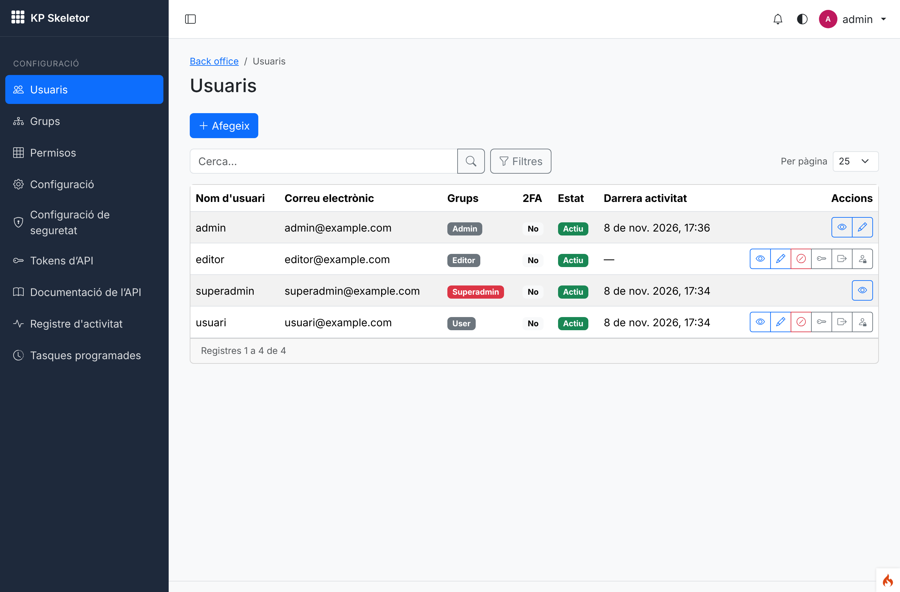
*01 — Users list as admin: email, groups, 2FA, status; no operations on their own row (only
view/edit) nor on the superadmin (only view).*

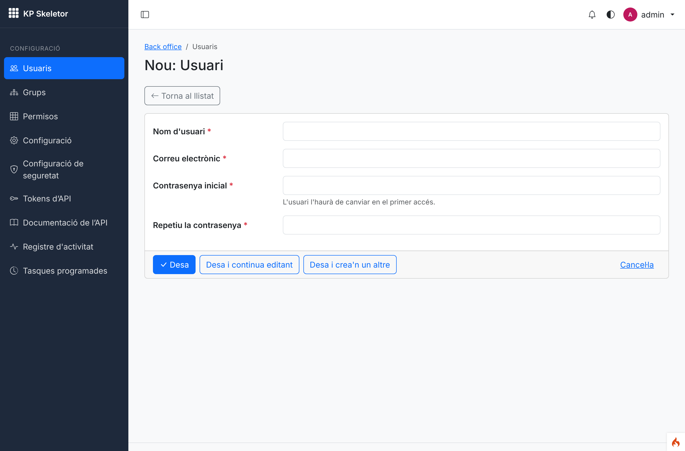
*02 — Adding a user: email and initial password go through Shield; the password must be changed at
the first login.*

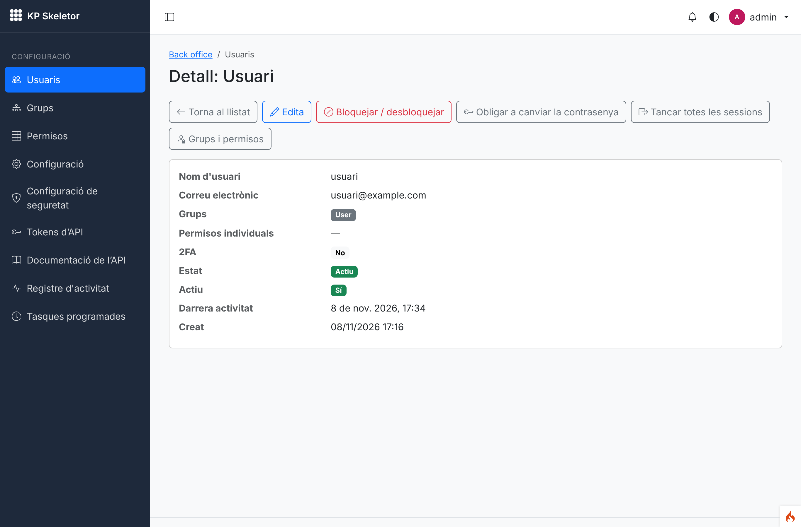
*03 — Details with the row operations (ban, force reset, log out everywhere, groups and
permissions).*

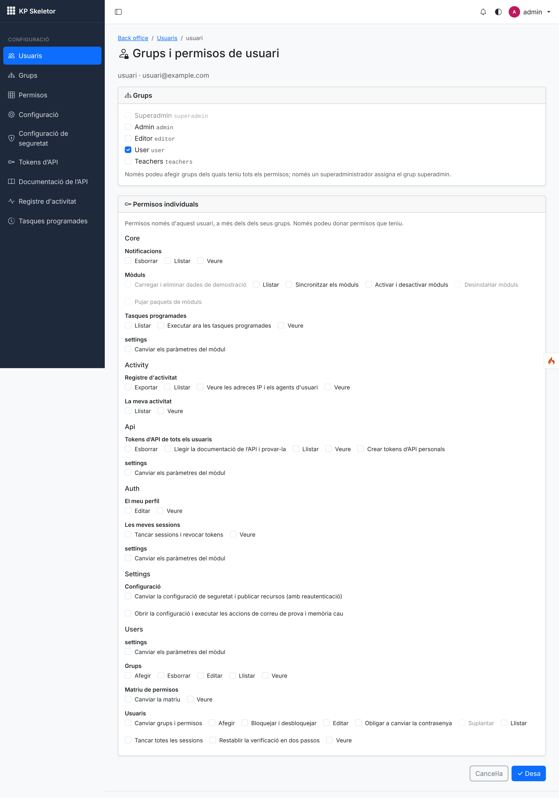
*04 — Groups and individual permissions of `usuari`; the superadmin group and permissions the
admin does not hold are disabled.*

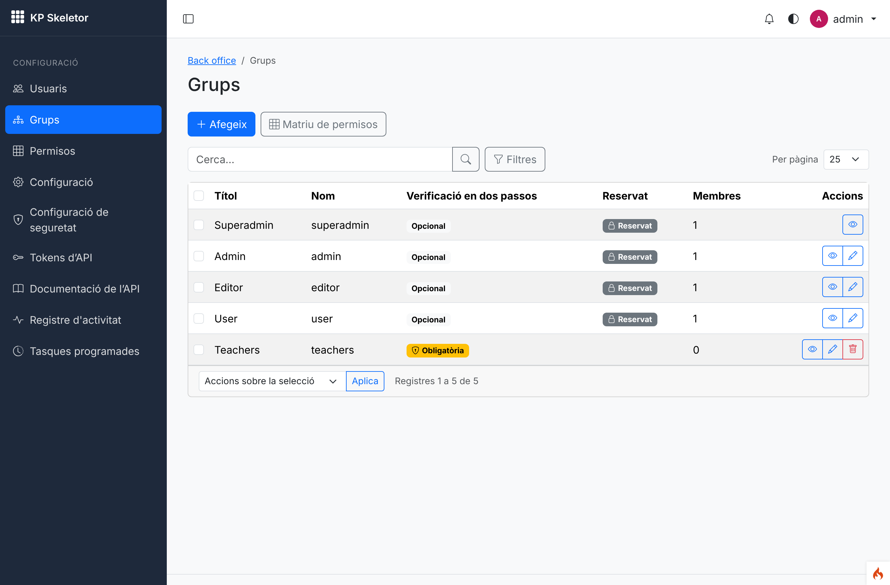
*05 — Groups with their 2FA policy, reserved flag and members; "Teachers" was created through
the form (2FA required).*

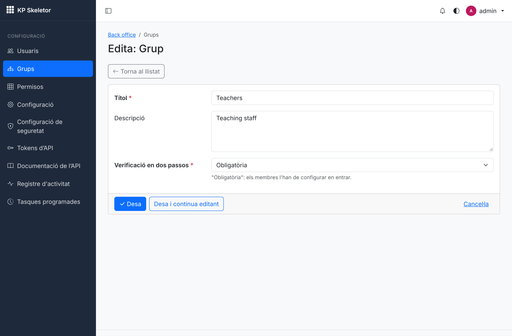
*06 — Editing a group: title, description and 2FA policy (the name is set once).*

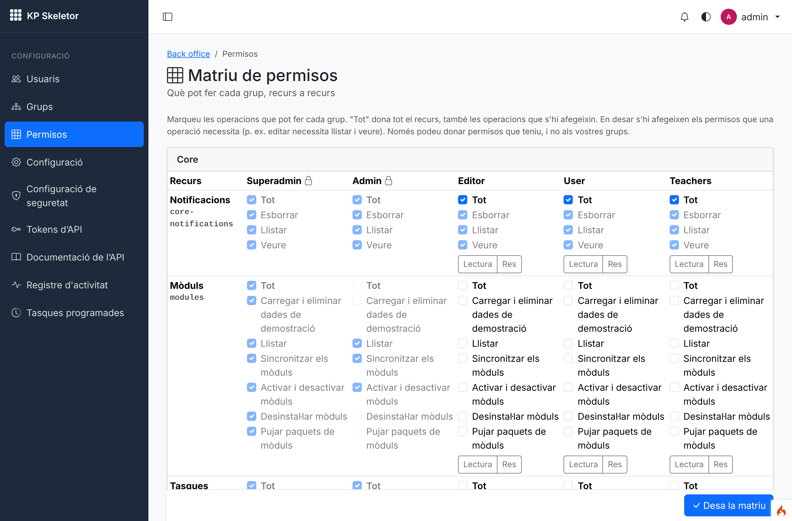
*07 — Permission matrix: the admin's own column and the superadmin's are read-only (lock);
"All" is the resource wildcard; "Read"/"None" are quick selections.*

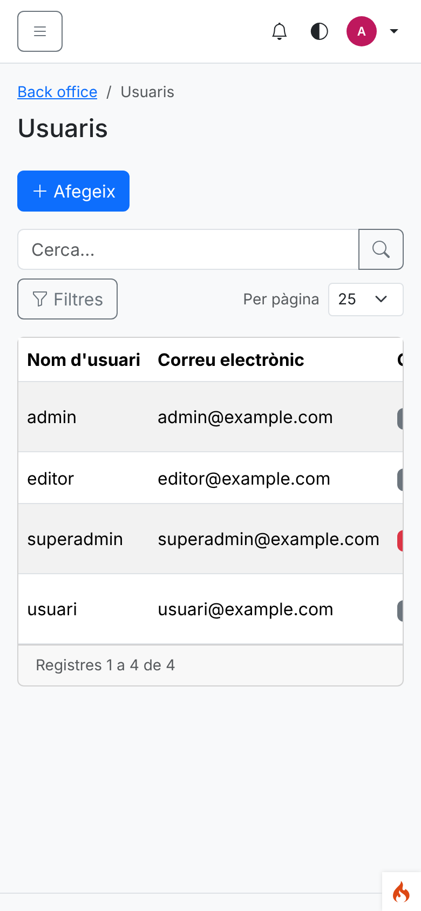
*08 — Users list at phone width.*

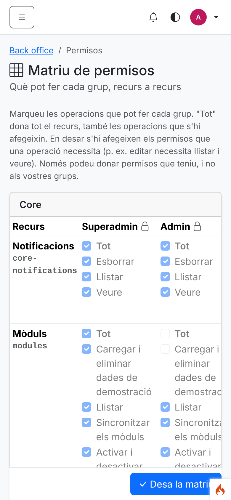
*09 — Permission matrix at phone width (the table scrolls inside its card).*

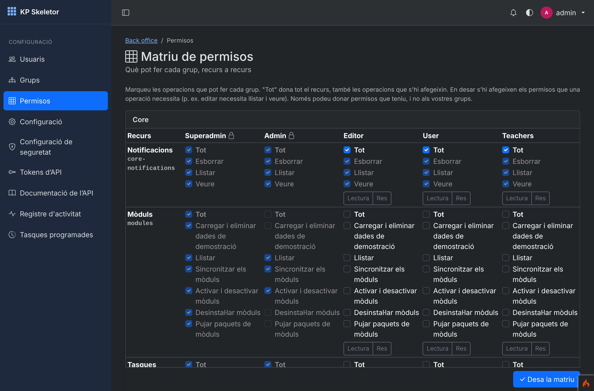
*10 — Permission matrix in dark mode.*

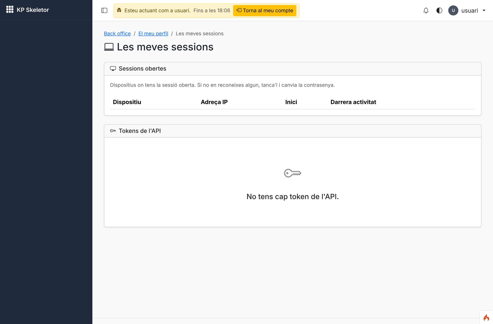
*11 — The superadmin impersonating `usuari`: banner with the end time and "Back to my account".*

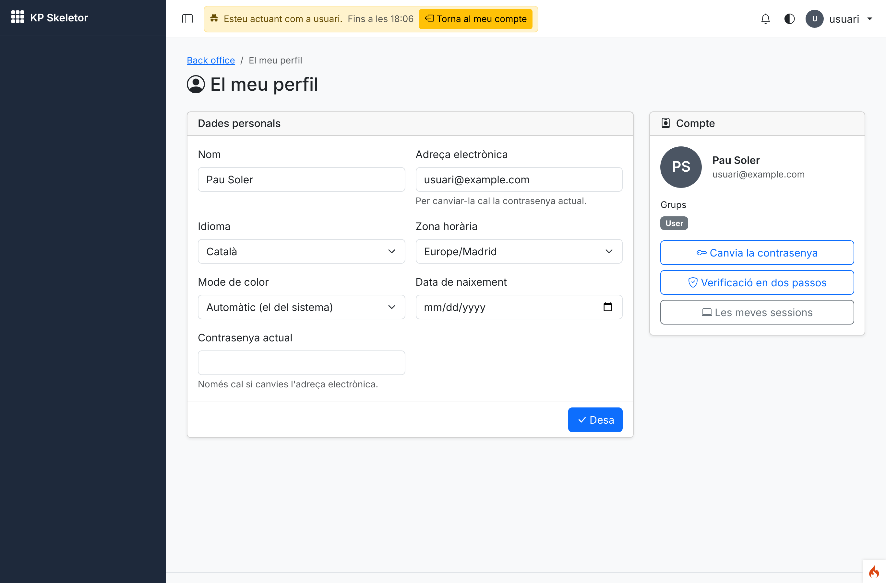
*12 — Opening the password change while impersonating sends back to the profile with an error.*

## Known issues

- The matrix is wide: at phone width the table scrolls horizontally inside its card.
- The users list cannot search by email (kpcrudy searches table columns; the email is in
  `auth_identities`).
- A custom group does not receive the "every group" default grants of modules installed after
  it was created (only the grants the reserved groups shared when it was created).
- "My sessions" of an impersonated user does not show the impersonation (the session stays the
  impersonator's tracked row).
- Composer needed `phpstan/phpstan`'s zip seeded again (known issue 04).

## Notes for the next session

- D-15-01 is Open (decide): run `deploy/decide.md` before relying on the Users permission names.
- Session 16: a users widget (`users-users.list`) and a security widget can read the
  `Users.*`/`Auth.impersonation_*` activity entries; once the Dashboard exists, impersonation can
  redirect to `backend` again.
- Change groups only through `GroupRegistry` (Core) and grants only through `GrantManager`;
  `EscalationGuard::canManageUser()` is the rule for any screen acting on another account.
- Sensitive routes keep using `reauth`: it is automatically refused while impersonating.
