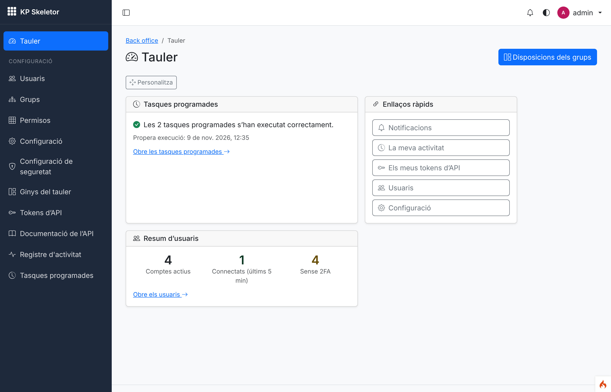
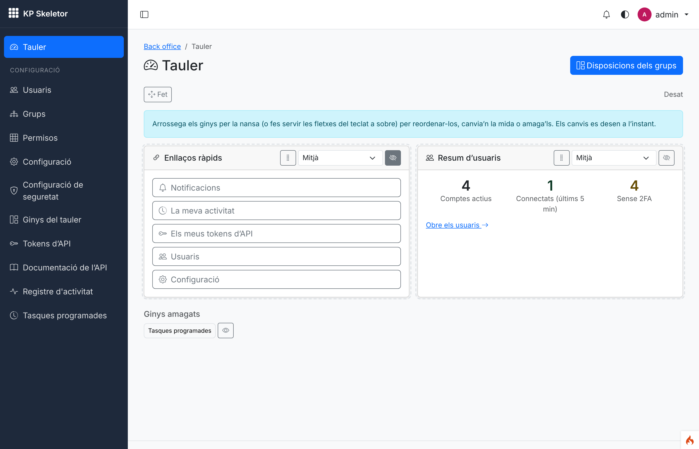
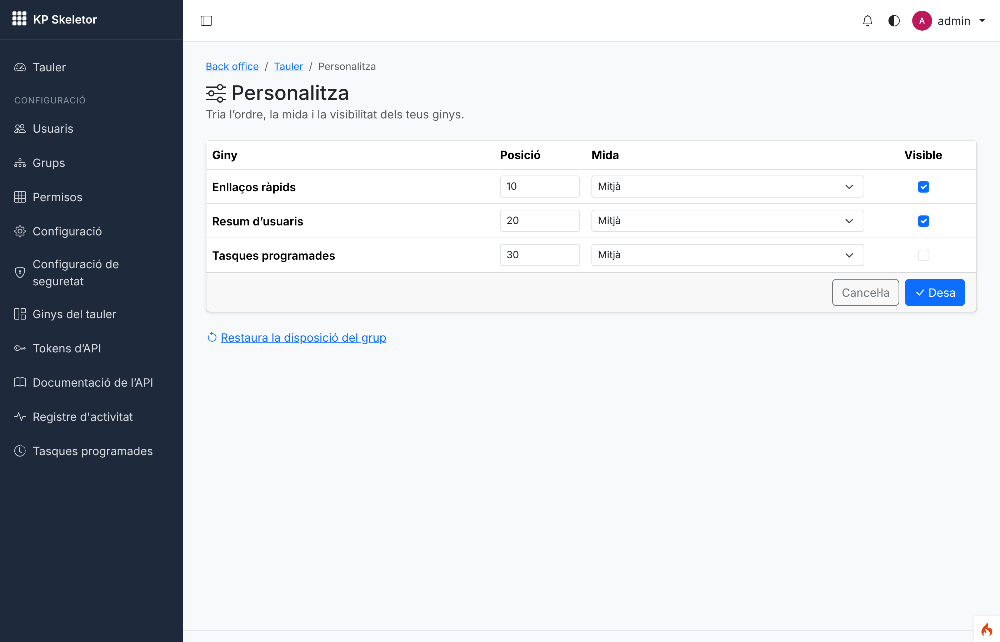
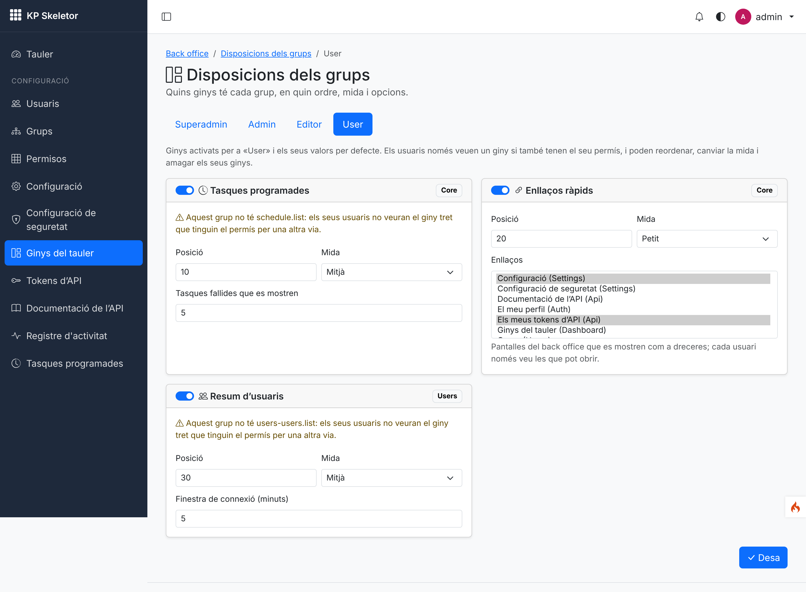
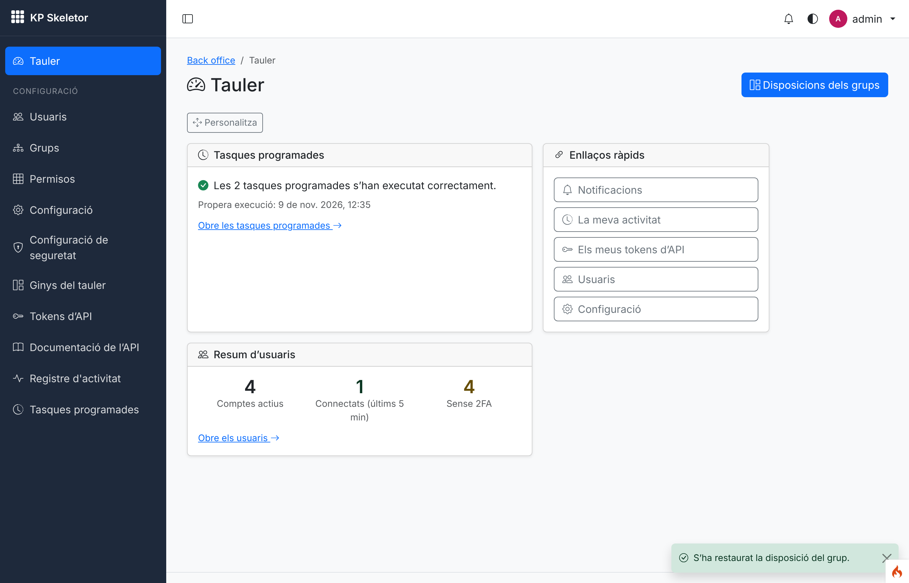
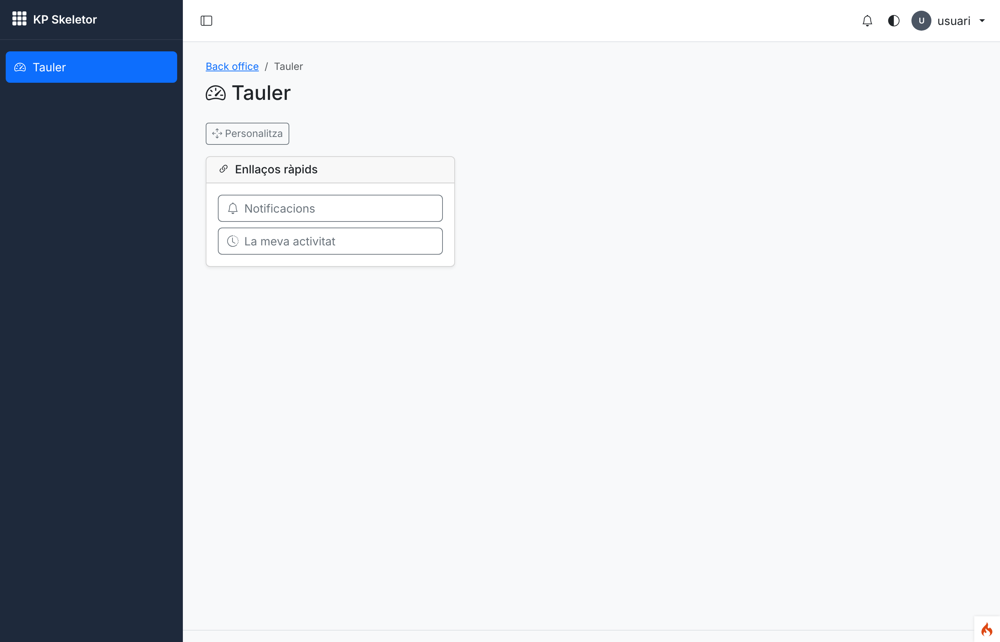
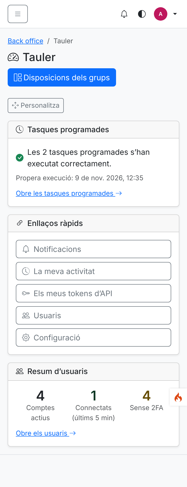
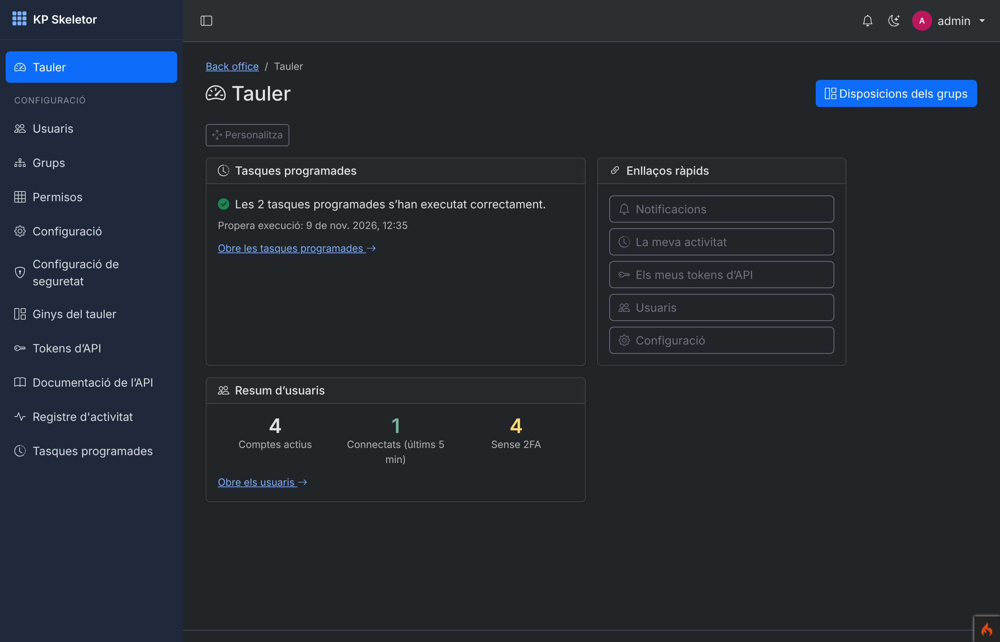
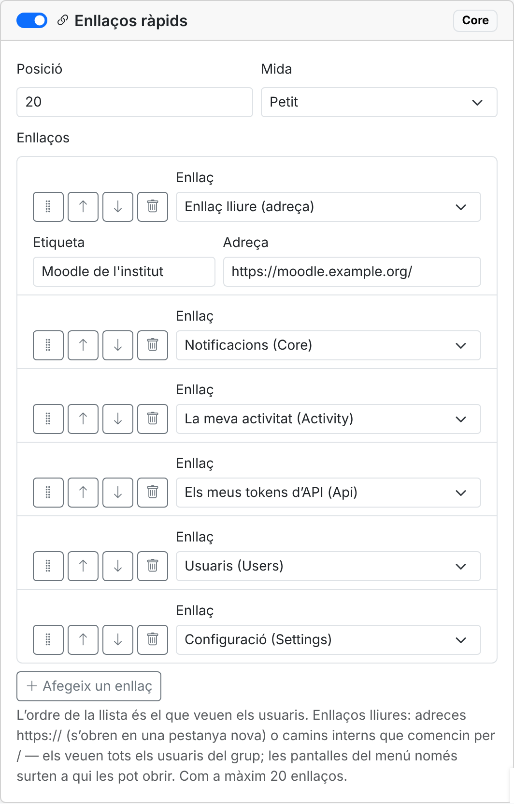
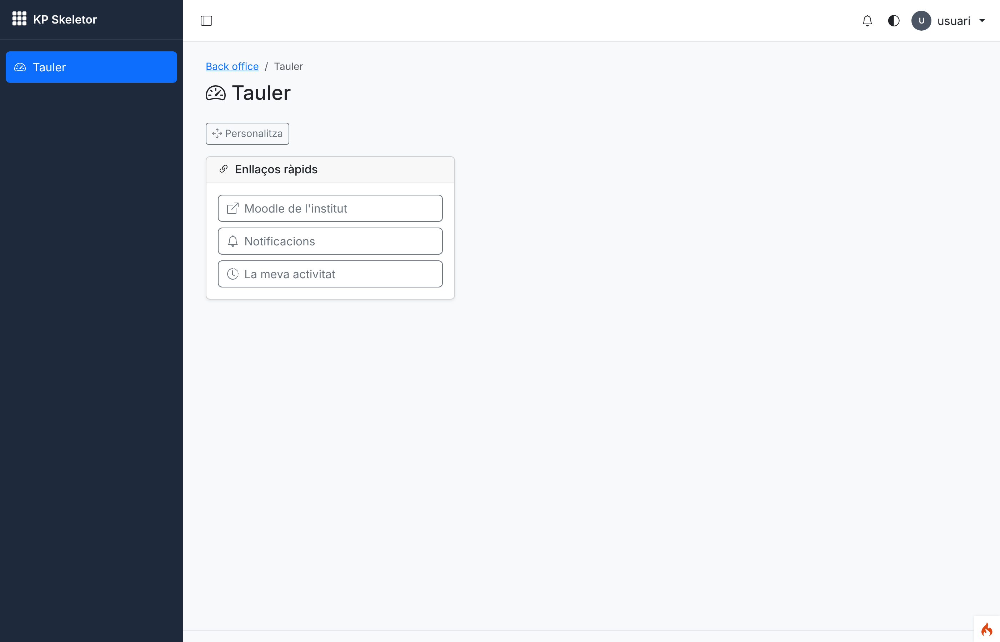

# Session 16 — Dashboard and widgets

Branch: `claude/vigilant-ritchie-b3pizn` (assigned by the environment) · Pull request: [SIENSIS/kpskeletor#20](https://github.com/SIENSIS/kpskeletor/pull/20) "Session 16: Dashboard and widgets" · Date: 2026-11-09

## What was built

- **Widget framework** in the Core: a module declares widgets in its manifest (`$widgets`); each
  widget has an id, title, icon, permission, allowed sizes, per-group options and a server-side
  `render()`, or loads asynchronously (`data()`), with failure isolation (a broken widget shows an
  error card; the page keeps working).
- **The back-office home** `backend` (Dashboard module, a core module that cannot be
  disabled): the user's widgets in a responsive grid.
  A widget is shown only when the user holds its permission **and** it is enabled for one of the
  user's groups (also enforced on its async URL: 403).
- **Per-user layout:** "Customise" turns on drag and drop (mouse, touch through pointer events,
  arrow keys on the handle), resizing within the widget's sizes and hiding; saved at once. Without
  JavaScript, a form page does the same. "Restore the group layout" forgets the user's own layout.
- **Per-group configuration** (Settings › *Dashboard widgets*, `dashboard.configure`): per group,
  which widgets are enabled, their default position and size and their options; warns when the
  group lacks a widget's permission; logged in the activity log.
- **Widgets:** *Scheduled tasks* (Core: failing tasks, next run), *Quick links* (Core: menu
  entries chosen per group, filtered by each user's access) and *Users summary* (Users, async:
  active accounts, users online, accounts without 2FA).
- A login and the start/end of an impersonation now land on the dashboard.

## How it was built

- **Core (`modules/Core/Widgets/`):** `WidgetInterface`, `AsyncWidgetInterface`, base classes
  `Widget` / `AsyncWidget`, `WidgetRegistry` (widgets of enabled modules from
  `DeclarationRegistry`, broken or duplicated declarations skipped and logged), `WidgetRenderer`
  (card, error card, async placeholder, data cached per user/language/options in the `widgets`
  cache scope), `WidgetOptions` (types `int`, `bool`, `string`, `select`, `menu`), `WidgetSizes`
  (`small|medium|large|full` → grid columns). Views `modules/Core/Views/widgets/*`, ES module
  `core/ui/widget.js` (loader with loading/error states and refresh; parses the server HTML with
  `DOMParser`, never `innerHTML`). `ManifestValidator` refuses `$widgets` classes that do not
  implement the interface; the `make:module` widget stub implements it.
- **Dashboard module (`modules/Dashboard/`):** manifest (resource `dashboard`, `name` override:
  `dashboard.view` for every group, `dashboard.configure` for admin; menu "Dashboard" in the
  sidebar and "Dashboard widgets" in the settings zone), `Services/DashboardLayout.php` (group
  layouts, available widgets, user layout), controllers `Dashboard` (home, customise form, save
  JSON/form, reset), `WidgetData` (async data), `GroupLayout`; views `dashboard`, `customize`,
  `groups`; `Assets/js/dashboard.js` (`dashboard/dashboard`).
- **Tables:** `dashboard_group_widgets` (`group_name`, `widget`, `enabled`, `position`, `size`,
  `options` JSON, unique group+widget), `dashboard_user_layouts` (`user_id` PK → `users`, `layout`
  JSON).
- **Routes:** `GET backend` (`dashboard`), `GET backend/dashboard/customize`,
  `POST backend/dashboard/layout`, `POST backend/dashboard/layout/reset` (all `can:dashboard.view`),
  `GET backend/dashboard/widgets/<id>/data` (`can:dashboard.view` + `ratelimit:widgets`),
  `GET backend/dashboard/groups[/<group>]`, `POST backend/dashboard/groups/<group>`
  (`can:dashboard.configure`).
- **Activity log:** `Dashboard.group_layout_saved` (before/after summary),
  `Dashboard.widget_forbidden` (security, refused async URL).
- **Users:** `modules/Users/Widgets/UsersSummary.php` + view; **Auth/Users:** redirects to
  `backend` (`Config\Auth::$redirects['login']`, impersonation start, stop and expiry).
- **Menu:** a one-segment entry (the home) is only active on itself (`MenuBuilder::score()`).
- **Theme:** dashboard rules in `themes/default/Assets/css/theme.css` (editing outline, dragging
  state, handle with `touch-action: none`, stat numbers); `empty_state` has a `compact` variant.
- Docs: new `docs/widgets.md`; `docs/menus.md`, `docs/frontend.md`, `CLAUDE.md` (widgets
  convention), `modules/Dashboard/CLAUDE.md`, `modules/Users/CLAUDE.md`.

## Decisions and deviations

- **D-16-01 (decided by the owner as proposed):** permission names `dashboard.view` / `dashboard.configure`, the URLs
  above, widget ids `<module>.<name>`, login landing on `backend`. Built as proposed; alternatives in `docs/decisions.md`.
- **D-16-02 (accepted):** a widget without a group row is enabled with its defaults; the first of
  the user's groups (reserved first) that enables a widget gives its position, size and options;
  users change only order, size and visibility.
- **D-16-03 (accepted):** the contract, the async protocol (`{widget, data, html}`, 403/500,
  `no-store`, cache read only after the checks) and failure handling.
- **D-16-04 (accepted):** the home is active in the menu only on itself.
- **D-16-06 (decided by the owner):** *Quick links* take free links too (one label, an `https://`
  address or an internal path; shown to every user of the group; external ones in a new tab)
  and the administrator sets the order, in one list edited with drag and drop or up/down
  buttons (option type `links`, `dashboard/links-editor`); at most `Core.widgetMaxLinks` links
  (setting in Settings › General › Dashboard, default 20, 1–100).
- **D-16-05 (decided by the owner):** the Dashboard is a core module and cannot be disabled
  (`ModuleToggler::CORE_MODULES`), so `backend` always exists; an empty home is obtained by
  hiding widgets.
- Deviations: `WidgetInterface::icon()` added; `CrudAuditor` now inspects with a GET request
  (an earlier, order-dependent gap: a POST left by a previous test made the groups CRUD ask for
  re-authentication); counting and redirect tests of earlier sessions updated.

## How to try it

```bash
composer install
cp env .env   # CI_ENVIRONMENT = development, app.maskKey, database, encryption.key
php spark modules:sync
php spark modules:demo Auth
php spark serve
```

- http://localhost:8080/login — `admin@example.com` / `Demo-kpskeletor-2026` → lands on the
  dashboard; **Personalitza** to drag, resize and hide; **Disposicions dels grups** (or Settings ›
  *Ginys del tauler*) to configure each group.
- `usuari@example.com` (same password): only *Quick links* (no `schedule.list` nor
  `users-users.list`); `http://localhost:8080/backend/dashboard/widgets/users.summary/data` → 403.

## Tests and checks

```
vendor/bin/phpunit                         OK (737 tests, 3767 assertions)
vendor/bin/phpunit modules/Dashboard       OK (28 tests, 153 assertions)
vendor/bin/phpunit modules/Core/Tests/WidgetsTest.php   OK (5 tests, 17 assertions)
vendor/bin/phpstan analyse                 [OK] No errors
vendor/bin/php-cs-fixer fix --dry-run      Found 0 of 495 files that can be fixed
php spark permissions:check                Permissions OK: 52 permission(s) in the catalogue, 123 route(s) checked.
php spark csp:check                        No inline scripts, handlers or styles in the project views.
```

New tests: `modules/Dashboard/Tests/DashboardTest.php` (18: permission and group enablement,
another group enabling, quick links filtered, failing widget card, async data, cache per user,
async 403 without permission / disabled for the group / unknown or server-side ids, generic 500,
reorder/resize/hide by form, JSON save with forged widgets dropped, restore, group order, menu
active entry), `GroupLayoutTest.php` (5: forged POSTs, criterion 6 "admin hides a widget for a
group", invalid sizes/positions/options, unknown groups, missing-permission warning),
`DashboardModuleTest.php` (3: core module, manifest, migrations up/down/up), `modules/Core/Tests/WidgetsTest.php`
(5). `php spark security:check` arrives in session 30.

## Screenshots

Taken with Playwright against `php spark serve` (MariaDB, Auth demo data), device scale factor 2,
Catalan; no console error and no horizontal page scroll was reported.


*01 — The dashboard of `admin`: Scheduled tasks, Quick links and the async Users summary.*


*02 — "Customise": drag handle, size menu and hide button on each card; *Scheduled tasks* hidden
and listed below with a "show" button; changes saved at once ("Desat").*


*03 — The same without JavaScript: position, size and visibility per widget.*


*04 — Dashboard › Group layouts for the `user` group: enabled switch, position, size, options and
the warning when the group lacks a widget's permission.*


*05 — After "Restore the group layout": the group's order and sizes again.*


*06 — `usuari` (group `user`): only the quick links it can open.*


*07 — Phone width (390 px): widgets stacked, full width.*


*08 — Dark mode.*


*09 — Group layouts › Quick links: one ordered list mixing a free link (label + https address)
and screens of the menu; drag handle, up/down and remove buttons, "add a link".*


*10 — The same list as `usuari` sees it: the external link first (new-tab icon), then the screens
it can open (Users and Settings are hidden).*

## Known issues

- Acceptance criterion 6 also needs the News *Notices* widget (session 17).
- Touch drag relies on pointer events and was not tested on a real device.
- Existing development databases need `php spark modules:sync` (new module and grants).
- Composer needed `phpstan/phpstan`'s zip seeded again (known issue 04).

## Notes for the next session

- Widgets: `docs/widgets.md`; copy tests from `modules/Dashboard/Tests/DashboardTestCase.php`
  (`addTestWidgets()`, `cards()`, `postJson()`).
- Session 17 (News): *Notices* (unread private notices with "mark as read"; can be an
  `AsyncWidget` with its own component) and *Latest news*.
- D-16-01 decided as proposed and D-16-05 (core module) decided by the owner: nothing open.
