# Session 17 — News module (reference module)

Branch: `claude/wonderful-pascal-rn7hdc` (assigned by the environment) · Pull request: [SIENSIS/kpskeletor#21](https://github.com/SIENSIS/kpskeletor/pull/21) "Session 17: News module (reference module)" · Date: 2026-11-09

## What was built

- **News module** (`modules/News`), the reference module every other module copies:
  - **posts**: articles and notices, title/summary/body in Catalan (required), Spanish and
    English; category, cover image, author, publication and expiry dates; notices with a
    priority (information, warning, critical) and a pin;
  - **visibility**: public (public site and RSS), private (signed-in users) or groups (chosen
    groups); drafts, scheduled, expired and deleted posts are never shown to readers;
  - **back office** (kpcrudy): *All posts* (publish/unpublish operations and bulk action,
    readers page, author hidden without `news-posts.author`, authors change only their own
    posts), *My posts* (the `where()` pattern), *Categories*;
  - **reader screen** for every user (`backend/news`): the posts they may read, filters (type,
    category, unread), details page, "mark as read";
  - **dashboard widgets** *Notices* (per audience, with "mark as read") and *Latest news*;
  - **public site**: `news`, `news/{slug}`, `news/category/{slug}` and the RSS feed
    `news/feed.xml` (public posts only);
  - **notifications**: publishing a private or group notice notifies its audience once;
  - **scheduled task**: releases scheduled posts and expires notices (every 5 minutes);
  - **API**: `GET api/v1/news` and `GET api/v1/news/{id}` with the same visibility rules;
  - menu link type "News category" (for the Menus module, session 21), two settings, demo data.
- HTMLPurifier installed (`ezyang/htmlpurifier` 4.19, pre-approved).

## How it was built

- **Manifest** `modules/News/Config/Module.php`: resources `posts` (crud − import; extras
  `publish`, `author`, `readers`), `categories` (crud − import/trash), `mine` (crud −
  import/export/trash; extra `publish`), `read` (page: `view` + `list`/`show` for the API);
  default grants (admin all; editor write own posts and publish; every group `news-read.*`);
  sidebar menu "Notícies" (reader) with "Totes les publicacions", "Les meves publicacions",
  "Categories" under it; settings `News.perPage`, `News.feedItems`; widgets, task, notification,
  `$menuLinks`, `$backup` (`modules/news` files), `$api` (`news`).
- **Tables** (one migration each, `down()` implemented): `news_categories`,
  `news_category_translations`, `news` (status, visibility, type, priority, pinned, dates,
  cover key, author, `notified_at`, soft deletes), `news_translations`, `news_groups` (junction,
  `setRelationNN()`), `news_reads`.
- **Services** (`modules/News/Services/`): `NewsVisibility` (the one visibility rule as Query
  Builder conditions, also used by kpapy's `where(Closure)`), `NewsRepository` (reader,
  widgets, public queries; texts in the user's language with Catalan fallback), `Publisher`
  (publish/schedule, notify once, release, expire), `ReadReceipts`, `BodySanitizer`
  (HTMLPurifier), `Slugger`, `FeedWriter` (RSS with XMLWriter).
- **Controllers**: `Posts` (`index` = `news-posts`, `mine` = `news-mine`; kpcrudy through
  `CrudFactory`, `setTranslations()` with fallbacks, `setRelationNN()`, `hideFields()`,
  `setPermission()` record rules, `addOperation()`/`addBulkAction()`, upload handler for the
  cover), `Categories`, `Reader`, `PublicNews`, `Api/Posts` (kpapy, read-only).
- **Routes** (`Config/Routes.php`): `backend/news` (route `news-read`, `can:news-read.view`),
  `backend/news/read/{id}`, `POST backend/news/read/{id}/mark`, `backend/news/posts`,
  `backend/news/mine`, `backend/news/categories` (`CrudFactory::routes()`), public `news…`, API
  `api/v1/news` (`kpapy` filter).
- **Other pieces**: `Widgets/Notices.php`, `Widgets/LatestNews.php`, `Tasks/ExpireNotices.php`,
  `Notifications/NewNotice.php`, `Menu/CategoryLink.php`, `Storage/CoverUploads.php` (kpcrudy
  1.1 upload handler → Storage service, public disk), `Database/Seeds/NewsDemoSeeder.php`,
  language files `ca`/`es`/`en` (119 keys each), `CLAUDE.md`.
- **Core fix**: `Widget::empty()` passed only some variables of `empty_state`; CodeIgniter keeps
  view data during a request, so a `$message` left by an earlier view (a `NotificationMessage`)
  made the News widgets fail. It now passes every variable (test
  `WidgetsAndTaskTest::testAnEmptyWidgetDoesNotPickUpDataOfEarlierViews`).
- Docs: new `docs/news.md`; `docs/decisions.md` (D-17-01 … D-17-08), `docs/library-requests.md`
  (two kpcrudy/kpapy requests), `docs/cruds.md` (upload handler exception), `docs/widgets.md`.

## Decisions and deviations

- **D-17-01 (decided by the owner, «Recurs API separat»):** the API has its own resource
  `news-api` (`list`, `show`, every group); `news-read` is only the reader screen (`view`); the
  other names, URLs and settings as built.
- **D-17-02 (accepted):** the body is sanitised before kpcrudy reads the form (its hooks do not
  receive translations) and again on output.
- **D-17-03 (accepted):** statuses draft/scheduled/published/expired; only the `publish`
  operation publishes; readers check the dates themselves.
- **D-17-04 (accepted):** visibility rules (superadmins follow them on the reader screen; the
  public site shows only public posts) and the notice audience.
- **D-17-05 (accepted):** the menu link type is a module class until session 21.
- **D-17-06 (accepted):** the cover uses kpcrudy's `image` field with an upload handler on the
  Storage service (TODO: file picker in session 23).
- **D-17-07 (applied):** the API's visibility goes through kpapy 1.2's `where(Closure)` (first a
  correlated `RawSql` subquery; replaced once kpapy 1.2.0 was released).
- **D-17-08 (decided by the owner, as proposed):** session 23 adds "Insert image" to the editor
  (file picker, the site's own images only).
- Deviations: tests of earlier sessions updated for the real News module (permission counts 52 →
  80, admin's grants, CRUD count 9 → 12, a fixture permission in `RbacTestCase`, the menu cache
  test uses the `user` group); `DashboardTestCase` declares only the widgets of
  `$widgetModules`.

## How to try it

```bash
composer install            # see "Known issues" for phpstan/phpstan
cp env .env                 # CI_ENVIRONMENT = development, app.maskKey, encryption.key, database
php spark modules:sync
php spark modules:demo Auth
php spark modules:demo News
php spark serve
```

Demo users (password `Demo-kpskeletor-2026`):

- `usuari@example.com`: http://localhost:8080/backend (Notices and Latest news),
  http://localhost:8080/backend/news (reader); the editors' notice is not shown.
- `editor@example.com`: the "Revisió dels continguts del web" notice; *My posts*; edits only
  their own posts in *All posts*.
- `admin@example.com`: http://localhost:8080/backend/news/posts (publish, readers, author),
  `backend/news/categories`, Settings › News.
- Guests: http://localhost:8080/news, http://localhost:8080/news/feed.xml.
- API: create a token in Profile › My API tokens, then
  `curl -H "Authorization: Bearer $TOKEN" http://localhost:8080/api/v1/news`.

## Tests and checks

```
vendor/bin/phpunit                          OK (770 tests, 4015 assertions)
vendor/bin/phpunit modules/News             OK (33 tests, 240 assertions)
vendor/bin/phpstan analyse                  [OK] No errors
vendor/bin/php-cs-fixer fix --dry-run       Found 0 of 533 files that can be fixed
php spark permissions:check                 Permissions OK: 80 permission(s) in the catalogue, 154 route(s) checked.
php spark csp:check                         No inline scripts, handlers or styles in the project views.
php spark assets:publish --check            The published assets are up to date.
php spark modules:sync                      Nothing to do: every module is up to date.
```

News tests: `PostsCrudTest` (11: read-only user without write buttons, forged POSTs of add,
edit, delete, publish, bulk and readers refused, 403/login, own posts only, `author` hidden and
forged author ignored, sanitised body and unique slug, private notice notified once, group notice
and scheduling, "My posts" with a forged id, readers page, category slug), `ReaderTest` (5:
visibility, 404 for unreadable/real ids, mark as read with an external `return` refused,
permission, filters), `WidgetsAndTaskTest` (5: notices per audience, widget "mark as read", no
widgets without `news-read.view`, the task, empty widget data leak), `PublicSiteTest` (3),
`NewsApiTest` (4: list/details with visibility, read-only and 401, scopes), `NewsModuleTest` (5:
manifest, migrations up/down/up, sanitiser, slugs, link type). `php spark security:check`
arrives in session 30.

## Screenshots

Taken with Playwright (`node deploy-status/17-news/screenshots.mjs`) against `php spark serve`
(MariaDB, Auth and News demo data), device scale factor 2, Catalan; no console error, CSP
violation or horizontal page scroll.

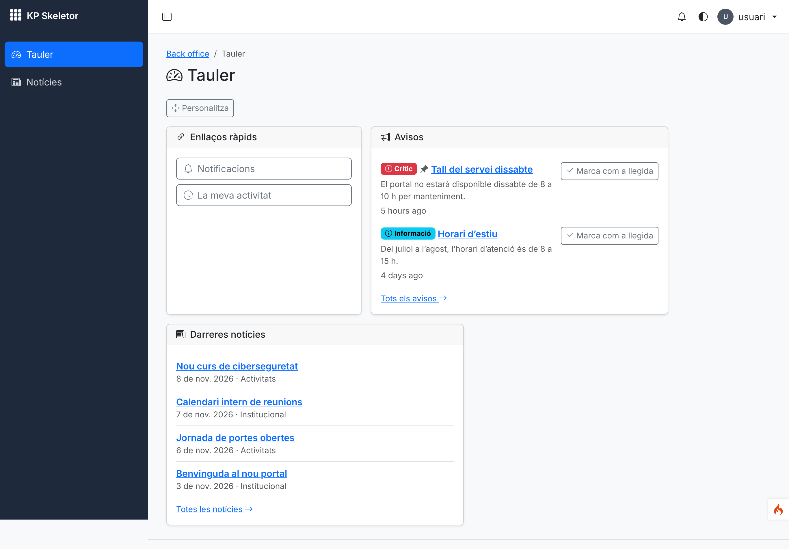
*01 — `usuari`'s dashboard: *Avisos* (pinned critical notice first, "mark as read") and *Darreres notícies*.*

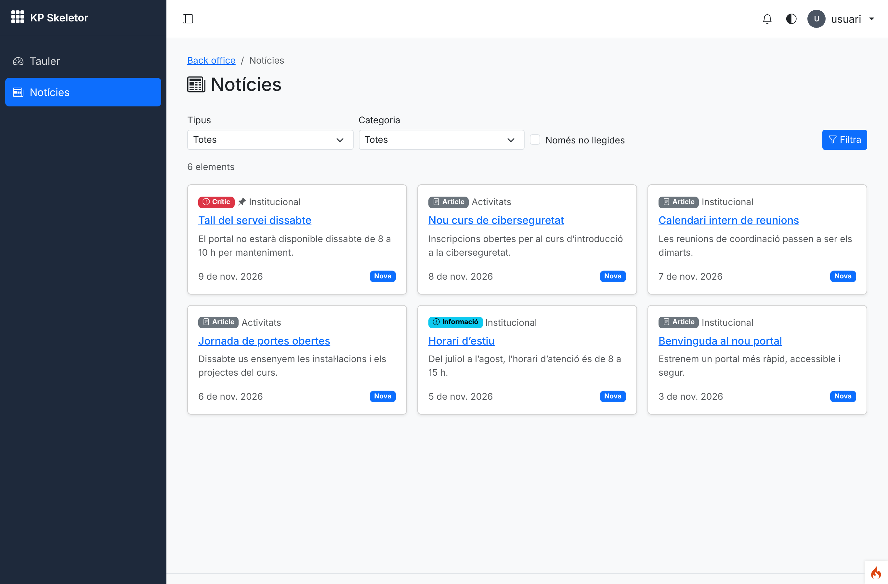
*02 — The reader screen: filters and the six posts `usuari` may read (no editors' notice, draft or scheduled post).*

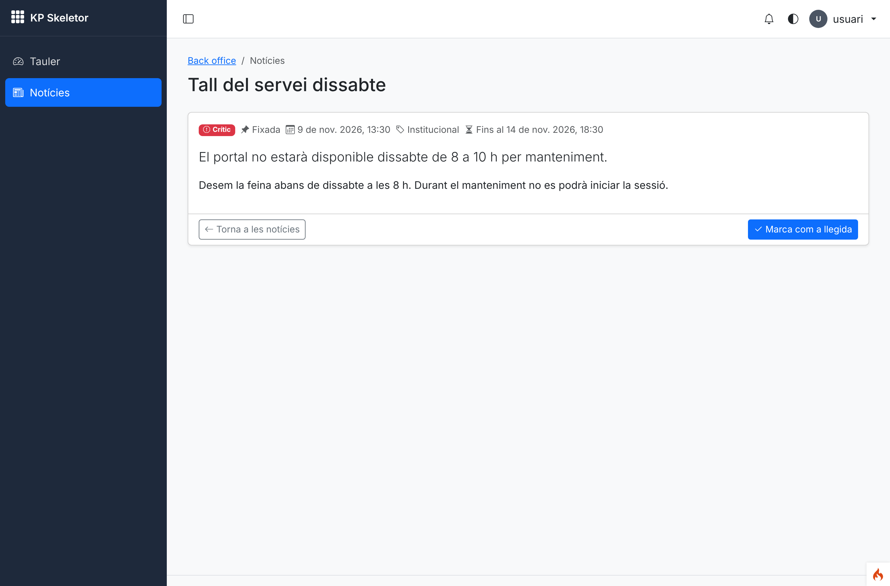
*03 — A notice on the reader screen (priority, pin, expiry, sanitised body, "mark as read").*

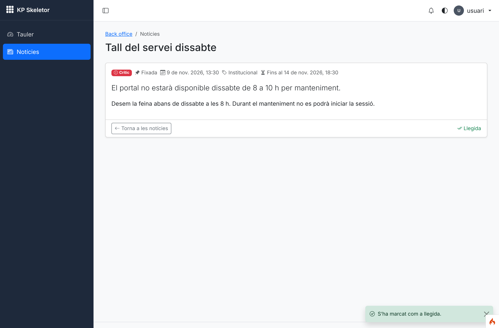
*04 — After "Marca com a llegida": toast and read state.*

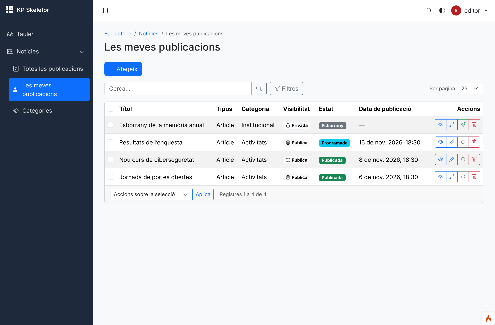
*05 — `editor`'s *My posts*: only their posts (`where()`), no author column.*

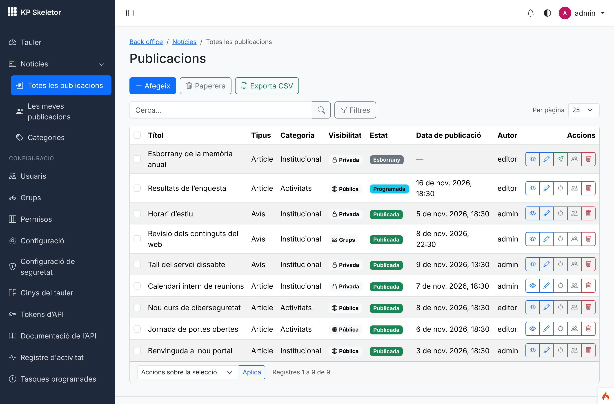
*06 — `admin`'s *All posts*: status and visibility badges, publish/unpublish and readers actions.*

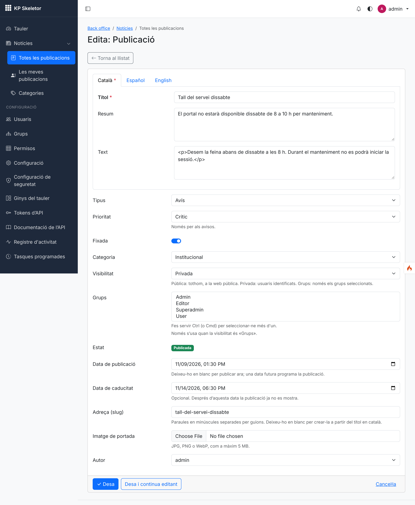
*07 — The post form: language tabs (Catalan required), type, priority, pin, category, visibility, groups, dates, slug, cover (Storage service), author.*

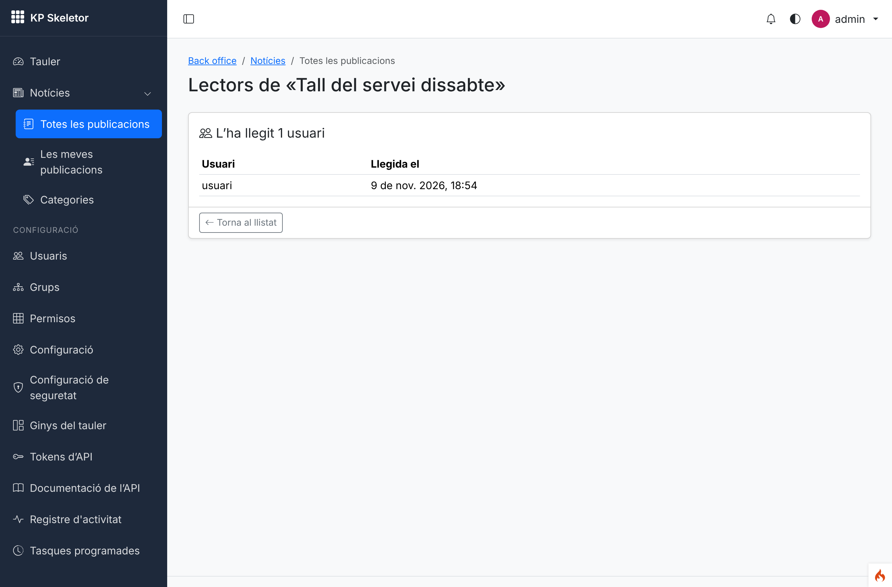
*08 — Readers of a notice (`news-posts.readers`).*

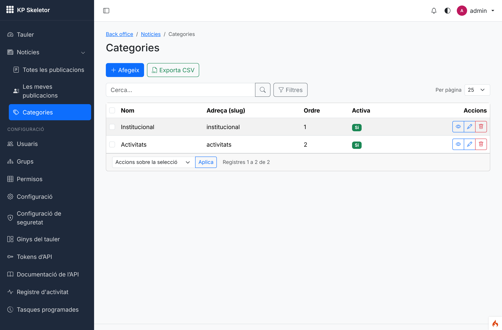
*09 — Categories (translated name, slug, order, active).*

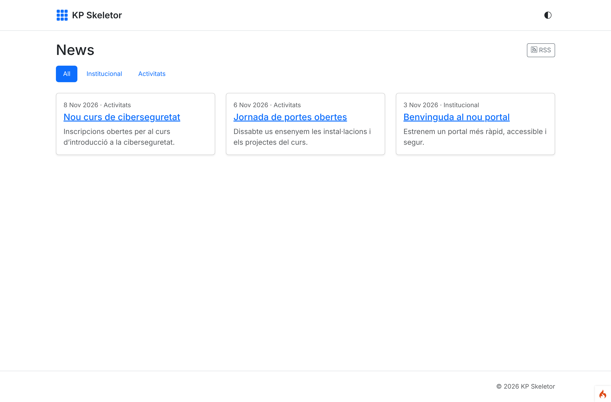
*10 — The public site for a guest: public posts only, categories and RSS (English: guests get the default locale until session 31).*

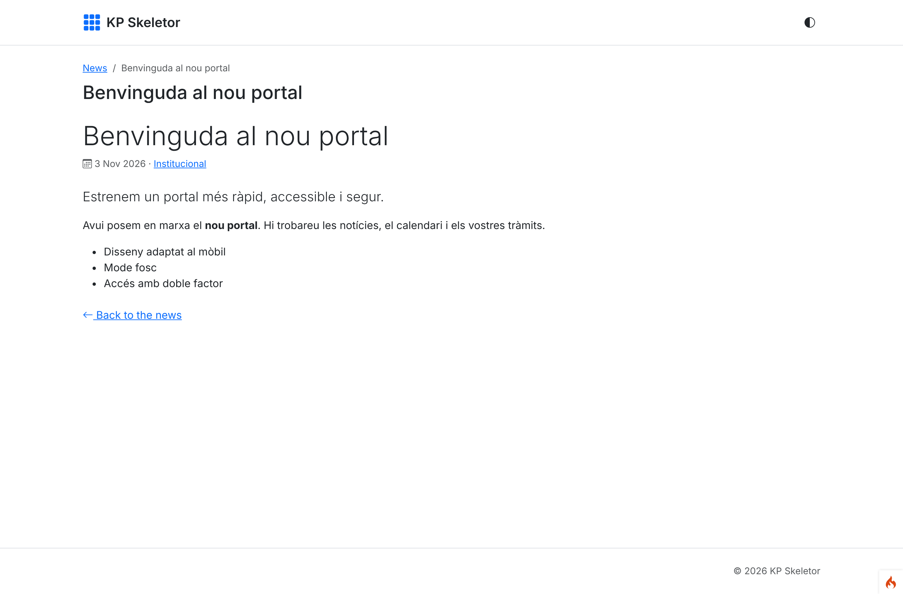
*11 — A public post.*

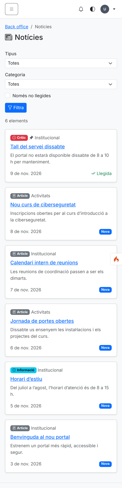
*12 — The reader at phone width (390 px).*

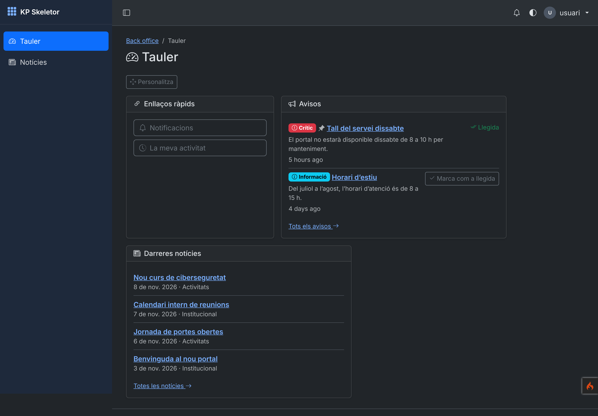
*13 — Dark mode, after one notice was marked as read.*

## Follow-ups after the review

- The API cleans the body on output too (`transform()`, also with `?lang=*`); a test keeps the CSV
  import disabled on `news-posts`/`news-mine`.
- `theme_component()` renders on a new renderer that sees only its own data (the root cause of the
  widget failure); test `UiComponentsTest::testComponentsSeeOnlyTheirOwnData`.
- Relative dates in Catalan (`app/Language/ca/Time.php`, "fa 5 hores").
- `news_groups` has an `id`: demo data records its rows and removes them exactly (test
  `testDemoDataLoadsAndIsRemovedCompletely`).
- kpcrudy 1.2.0 and kpapy 1.2.0 (released by the owner, `composer.json` requires `^1.2`):
  `CrudFactory` sets the site's time zone on every CRUD (dates edited in `Core.timezone`, stored
  in UTC; test `PostsCrudTest::testDatesAreEditedInTheSiteTimeZoneAndStoredInUtc`), and the News
  API uses `where(Closure)` instead of the `RawSql` subquery.

## Known issues

- Guests see the default locale `en` (session 31).
- The body is a plain textarea of HTML until the rich-text editor (session 20); the cover is a
  plain upload field until the file picker (session 23).
- Composer could not download `phpstan/phpstan` again (known issue 04): its zip was built from a
  shallow fetch of the release commit and seeded into Composer's cache; a full clone of that
  repository is >10 GB, fetch only the commit.

## What the next session must know

- Session 18 (installer): `php spark app:install --demo=News` should load News after Auth
  (authors are the Auth demo users).
- Copy `modules/News` for new modules: visibility rules in one service, CRUDs through
  `CrudFactory`, record rules with `setPermission()`, `where()` for personal screens, upload
  handlers on the Storage service until the file picker, tests from `modules/News/Tests`.
- New modules' tests that extend `DashboardTestCase` add their module to `$widgetModules`.
