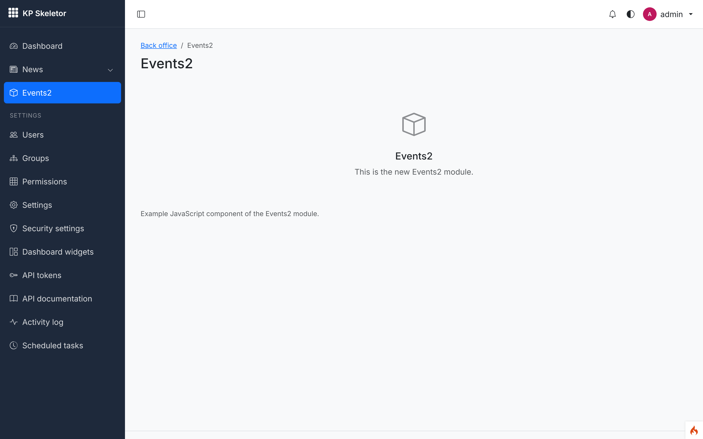
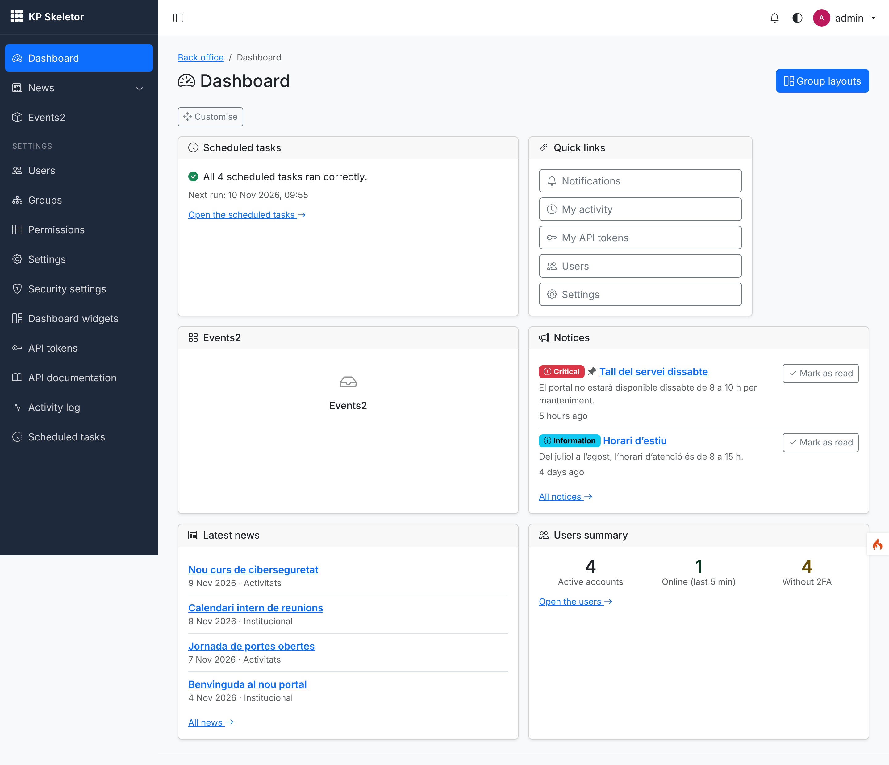
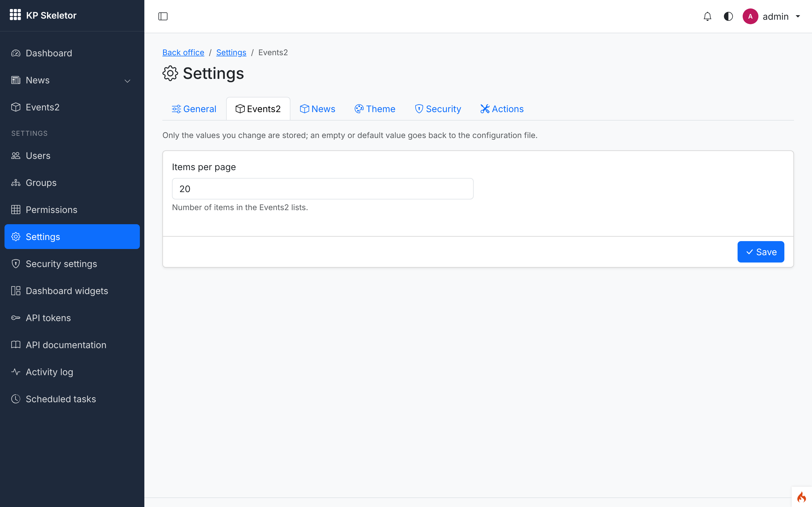
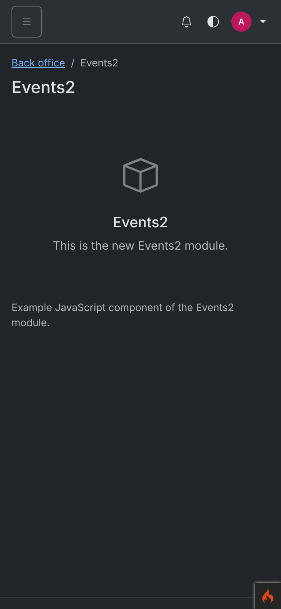
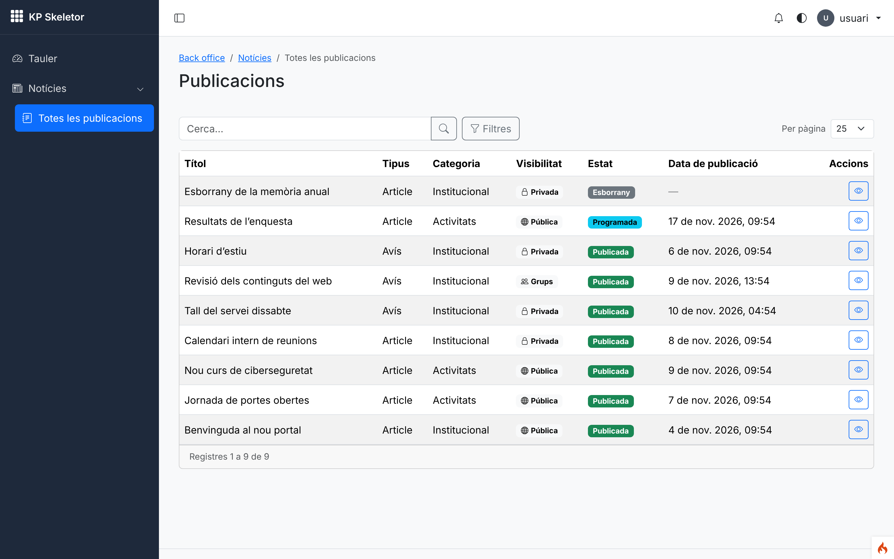
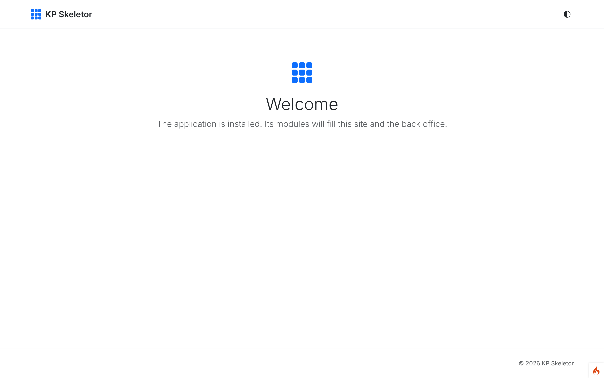
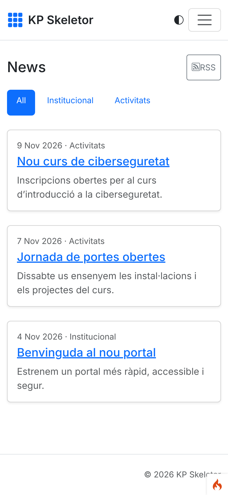

# Session 19 — Checkpoint: MVP review

Branch: `claude/wizardly-bell-3a9yne` · Pull request: [SIENSIS/kpskeletor#23](https://github.com/SIENSIS/kpskeletor/pull/23) · Date: 2026-11-10

## What was built

No new features: a review of sessions 00–18 against acceptance criteria 1, 2, 4, 5, 6 and 7,
the module checklist on News and the security baseline, and fixes for every gap found. The
full table (criterion, state before, state now, evidence) is in `docs/progress.md`,
"MVP review (session 19)".

| # | Criterion | Before | Now |
|---|---|---|---|
| 1 | Fresh install, back office and public site | pass (partly checked) | **pass** |
| 2 | `make:module Events2` works without touching the Core | **fail** | **pass** (CLAUDE.md, `/check-module`: session 32) |
| 4 | News permissions, forged POSTs, author hidden | code pass, tests weak | **pass** |
| 5 | 2FA | pass | **pass** |
| 6 | Dashboard | pass | **pass** |
| 7 | Child theme, no inline scripts | pass (weak test) | **pass** |
| — | Module checklist on News | **fail** (2 items) | **pass** |
| — | Security review | **4 gaps** | **pass** |

Gaps found and fixed:

- **Demo users had a fixed password** (`Demo-kpskeletor-2026`); the spec asks for random
  passwords shown once. Each demo user now gets its own random password, printed once by
  `modules:demo`, `modules:sync --demo` and `app:install --demo` and shown on the web
  installer's last page; never stored in clear or logged (D-19-01).
- **`make:module` did not give criterion 2**: no setting, no asset, a test that only validated the
  manifest. It now generates a setting, an ES-module component mounted by `data-component`, the
  empty `$backup`/`$api`/`$csp`/`$outboundHosts` declarations and feature tests (permission,
  forged POST, migrations down/up). Checked by generating `Events2`, syncing and running its tests.
- **Criterion 4 tests**: the forged-POST test accepted any redirect (kpcrudy also redirects after a
  success) and skipped unpublish, trash, restore, purge, empty trash, export and most bulk actions;
  the export without `news-posts.author` was untested. Now every write route is forged and must
  answer kpcrudy's "not allowed", with a snapshot proving nothing changed.
- **Security**: routes under `api/` outside `api/v1/` were not audited (no CSRF/session there;
  now refused, D-19-02); the current password typed for an email change had no attempt limit (now
  `LoginThrottle`); the News RSS had no rate limit (`ratelimit:feeds`); the Honeypot container had
  an inline style; the `reauth` routes are now listed in a test.
- **Activity log**: Users' row operations were logged twice, and `reset2fa`/`impersonate` were
  logged as done when they only redirected to re-authentication (now `skipActivity()`; the
  services log what happens); News' `publish`/`unpublish` had no labels (added, and a test scans
  every module for missing labels).
- **Forced 2FA** test extended to the dashboard, a module screen and the JSON 403; **criterion 7**
  now has a real-request test (a child theme overrides one News view and one colour).
- "Back office" was not translated in Catalan and Spanish.

## How it was built

| Piece | Where |
|---|---|
| Random demo passwords shown once | `modules/Core/Demo/DemoData.php` (`randomPassword()`, `secret()`), `DemoDataManager::takeSecrets()`, `modules/Auth/Database/Seeds/AuthDemoSeeder.php`, `ModulesDemo::writeSecrets()`, `InstallResult::$demoSecrets`, `modules/Core/Views/install/done.php` |
| Module generator | `modules/Core/Modules/Templates/{Module.php,view.php,component.js,Test.php,Language.*.php}.tpl`, `ModuleGenerator` |
| Route audit | `modules/Core/Permissions/RouteSecurityAuditor.php`; `tests/feature/Security/RoutesSecurityTest.php` |
| Email-change throttle | `modules/Auth/Controllers/ProfileController.php` (`checkEmailChange()`) |
| Activity labels guard | `tests/feature/Crud/ActivityLabelsTest.php`; `modules/Users/Controllers/Users.php` (`skipActivity()`) |
| Shared Core helpers (D-19-04) | `modules/Core/Text/Slugger.php`, `modules/Core/Security/HtmlSanitizer.php` (was `News\Services\BodySanitizer`), `BackendController::currentUser()` / `currentUserOrNobody()` |
| Shared test helpers | `modules/Auth/Tests/AuthTestCase.php`: `loginWith()`, `assertNotFound()`, `assertCrudRefused()` |
| CI | `.github/workflows/ci.yml`: the fresh-install smoke test also checks `/`, `/news`, `news/feed.xml` and the back-office redirect |

No new tables, permissions, settings, routes or commands (besides the `ratelimit:feeds` filter on
`news/feed.xml`). Docs: `docs/activity.md`, `docs/rbac.md`, `docs/security.md`,
`docs/development.md` ("Writing feature tests"), `docs/commands.md`, `docs/news.md`,
`docs/plan.md` ("From session 19" notes), `docs/decisions.md` (D-19-01 … D-19-04).

## Decisions and deviations

D-19-01 (demo passwords), D-19-02 (`api/` outside `api/v1/`), D-19-03 (`make:module --api` in
session 26), D-19-04 (helpers moved to the Core): all accepted proposals; no open decisions. No
public convention changed. Deviations: the fixes above touch the work of sessions 00–18 (that is
this session's goal); `deploy/23-files-picker.md` still names
`modules/News/Services/BodySanitizer.php`, now `Modules\Core\Security\HtmlSanitizer`.

## How to try it

```bash
php spark app:install --env=development --db=sqlite --demo --email=you@example.com
# … prints "Demo users' passwords (shown only once; save them now):" and one line per user
php spark make:module Events2 && php spark modules:sync && vendor/bin/phpunit modules/Events2
php spark serve
```

- http://localhost:8080/backend/events2 — the generated module (menu, screen, JS component);
  Settings › Events2 — its setting; the dashboard — its widget.
- Log in as `usuari@example.com` (password from the install output), grant it only
  `news-posts.list` and `news-posts.show` (Users › Permissions), then `backend/news/posts`: no
  write buttons, no author column; every write URL answers "not allowed".
- Remove the trial module afterwards: `rm -r modules/Events2 public/assets/modules/events2 && php spark modules:sync --prune`.

Console output of the install (passwords replaced by X):

```
Demo data loaded: Auth, News.
Demo users' passwords (shown only once; save them now):
  superadmin@example.com  XXXXX-XXXXX-XXXXX-XXXXX
  editor@example.com  XXXXX-XXXXX-XXXXX-XXXXX
  usuari@example.com  XXXXX-XXXXX-XXXXX-XXXXX
First superadmin: admin <owner@example.com>.
```

(`admin@example.com` is skipped because the installer's superadmin already uses the username
`admin`.)

Generated module:

```
$ php spark make:module Events2
Module Events2 created in ROOTPATH/modules/Events2.
$ php spark modules:sync
Modules\Events2: 1 migration(s) run.
Events2: initial data loaded.
Events2 0.1.0 installed.
2 permission(s) added to the catalogue.
Events2: default grants applied (1 added).
Settings, widgets, tasks and other declarations updated.
events2: assets published (1 file(s) changed).
Modules synchronised.
$ php spark permissions:check
Permissions OK: 82 permission(s) in the catalogue, 157 route(s) checked.
$ vendor/bin/phpunit modules/Events2
OK (5 tests, 12 assertions)
```

## Tests and checks

- `vendor/bin/phpunit`: **OK (817 tests, 4364 assertions)** (809 before the session).
- `vendor/bin/phpstan analyse`: **[OK] No errors**.
- `vendor/bin/php-cs-fixer fix --dry-run --diff`: **Found 0 of 561 files that can be fixed**.
- `php spark csp:check`: *No inline scripts, handlers or styles in the project views.*
- `php spark assets:publish --check`: *The published assets are up to date.*
- `php spark permissions:check` (development install with demo data): *Permissions OK: 80 permission(s) in the catalogue, 156 route(s) checked.*

New or extended tests: `InstallerTest::testDemoUsersGetRandomPasswordsShownOnce`,
`DemoDataTest::testRandomPasswordsAreLongAndDifferent`, `ModuleGeneratorTest` (setting, asset,
widget, task, test stub), `RoutesSecurityTest` (`api/` outside `api/v1/`, 12 `reauth` routes),
`ProfileTest::testWrongPasswordForAnEmailChangeIsThrottled`, `TwoFactorSettingsTest` (forced
setup everywhere, JSON 403), `GroupsAndMatrixTest` (group edit/delete need re-authentication),
`UsersScreensTest` (one entry per ban, nothing logged on a re-authentication redirect),
`PostsCrudTest` (every forged write route, categories, export without author, unpublish of
another editor's post), `ChildThemeTest` (criterion 7 over HTTP), `ActivityLabelsTest`,
`NewsModuleTest::testSlugs` (scope, rules).

## Screenshots

Playwright (`deploy-status/screenshot.mjs`, config `screenshots.json` with the passwords left out)
against `php spark serve` after `app:install --env=development --db=sqlite --demo` and
`make:module Events2`, device scale 2. They were taken before the "Back office" breadcrumb was
translated (05 still shows it in English on a Catalan page).


*01 — `backend/events2`: the module generated by `make:module Events2` with its menu entry, screen and mounted JavaScript component (the last line).*


*02 — The dashboard with the generated module's widget next to the Core and News widgets.*


*03 — Settings › Events2: the generated `Events2.perPage` setting.*


*04 — The generated module at phone width in dark mode.*


*05 — Criterion 4: a user with only `news-posts.list` and `news-posts.show` sees the posts with only the "show" action: no add, edit, publish, delete, trash, export or bulk selection, no author column.*


*06 — Criterion 1: the public home of the fresh installation.*


*07 — Criterion 1: the public news list at phone width.*

## Known issues

- `make:module` still lacks `modules/<Name>/CLAUDE.md`, `--standalone`, `--api` and
  `/check-module` (sessions 26 and 32); `docs/creating-a-module.md` and `modules/Tasks`, named in
  `CLAUDE.md`, arrive in sessions 32–33.
- `csp:check` does not scan HTML built in PHP (helpers, kpcrudy callbacks, widgets' `render()`);
  the rendered-page tests cover the main screens.
- Shield's login redirect keeps `index.php/` in the URL (`Config\App::$indexPage` default; both
  forms work).
- The captcha image has no rate limit (shown with each login form; the login is throttled).
- Composer in this environment: `env -u COMPOSER_AUTH composer install --prefer-source` and
  `phpstan/phpstan`'s zip seeded into Composer's cache again (known issue 04).

## Notes for the next session

- Session 20 (Pages): read the "From session 19" notes in `docs/plan.md`. Use
  `Modules\Core\Text\Slugger::unique($table, $text, $id, ['parent_id' => …, 'locale' => …])` and
  `Modules\Core\Security\HtmlSanitizer`; extract the translation fallback, the group audience and
  the publish workflow from News into the Core instead of copying them.
- Controllers: `$this->currentUser()`. Tests: extend `AuthTestCase` (or a module base on it) and
  use `loginWith()` and `assertCrudRefused()`; a plain "is a redirect" proves nothing with kpcrudy.
- Logged custom operations need `<Module>.activity.<key>` labels; operations that can return
  without acting (re-authentication) are `skipActivity()`'d and logged by the service.
- New `reauth` routes: add them to `RoutesSecurityTest::testSensitiveRoutesRequireReauthentication`.
- Demo users have random passwords printed once; screenshot scripts take them from the output.
