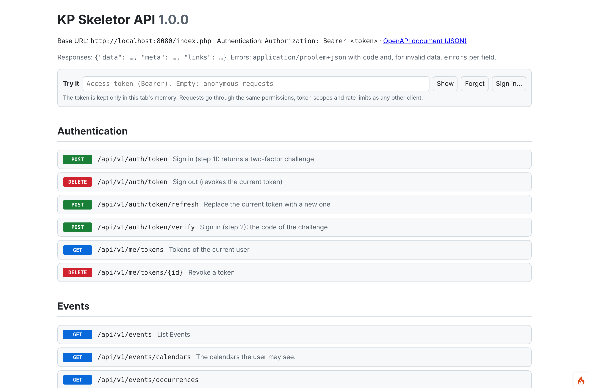
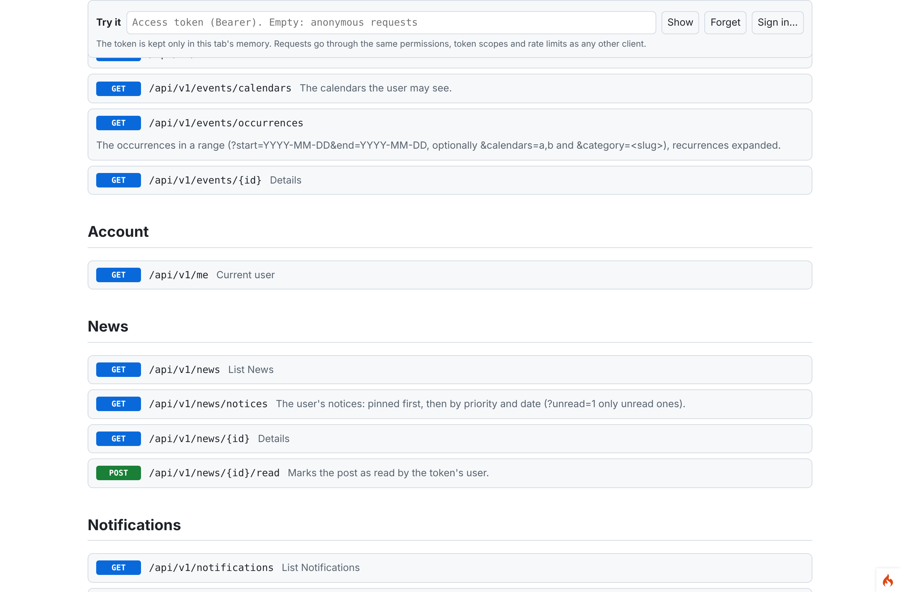
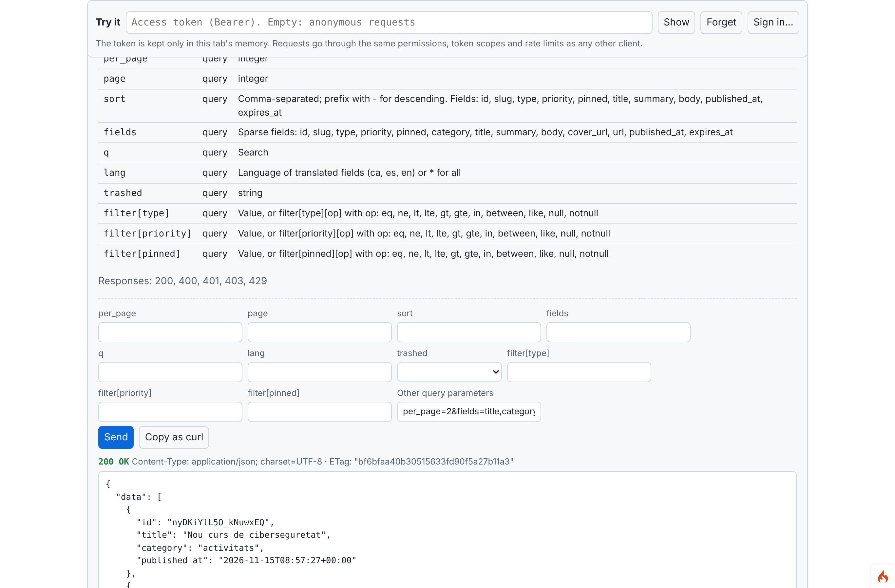
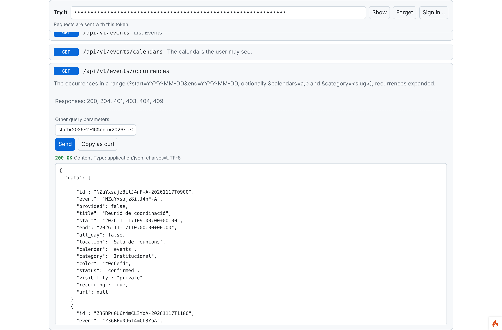
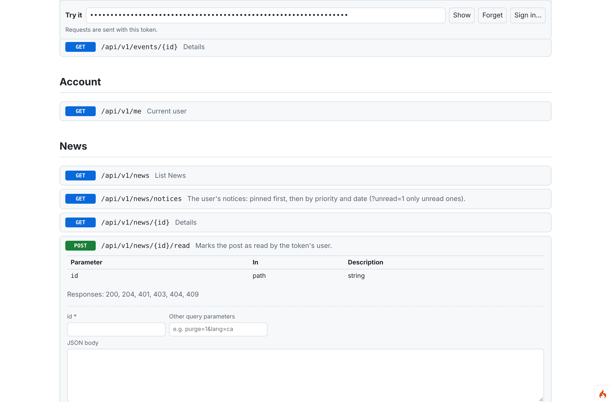
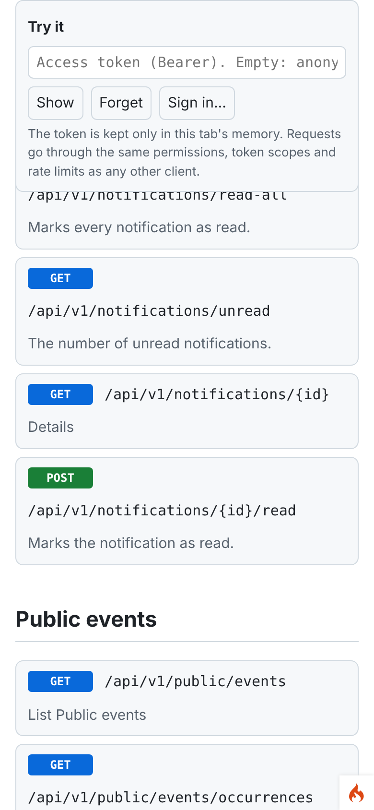
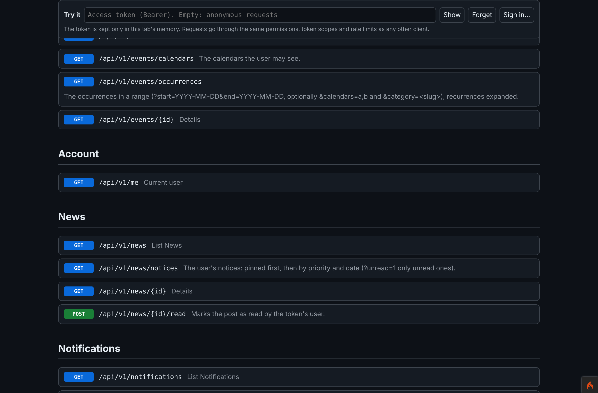
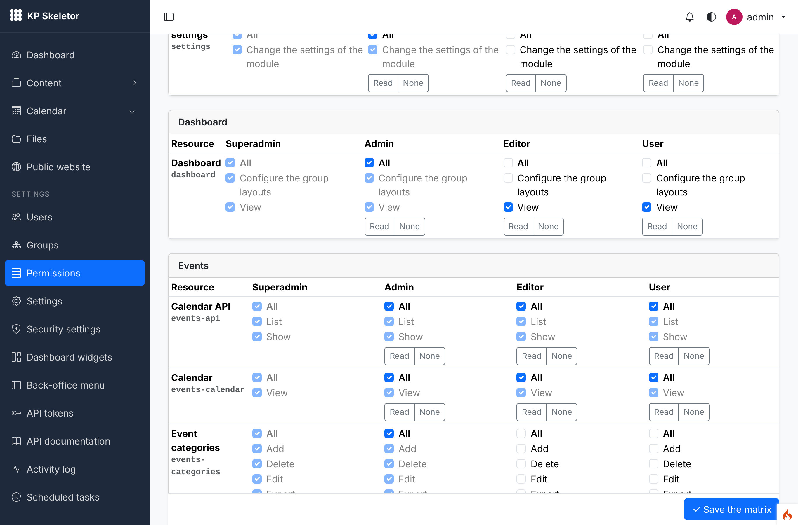

# Session 26 — Core API endpoints

Branch: `claude/keen-allen-cq2rvw` · Pull request: [SIENSIS/kpskeletor#34](https://github.com/SIENSIS/kpskeletor/pull/34) · Date: 2026-11-16

## What was built

- **News in the API:** `POST api/v1/news/{id}/read` (mark a post as read) and
  `GET api/v1/news/notices` (the user's notices like the dashboard widget, `?unread=1`), next to
  the list and details of session 17.
- **Events in the API:** `GET api/v1/events[/{id}]` (the events the user sees, the recurrence as
  a rule), `GET api/v1/events/occurrences?start=&end=` (a date range with recurrences expanded,
  other modules' calendars and the providers' events, e.g. birthdays; `?calendars=` and
  `?category=` narrow it) and `GET api/v1/events/calendars`. `restricted` audiences, calendar
  permissions, disabled modules and access policies are respected, exactly as in the calendar.
- **Notifications in the API:** `GET api/v1/notifications[/{id}]` (the user's own, in the
  request's language), `GET api/v1/notifications/unread`, `POST api/v1/notifications/{id}/read`,
  `POST api/v1/notifications/read-all`.
- **Public endpoints without a token:** `GET api/v1/public/news[/{id}]` and
  `GET api/v1/public/events[/{id}|/occurrences]`: public records only, `GET` only, rate-limited
  per IP.
- **Checks:** `permissions:check` now audits every kpapy resource (declared in a manifest's
  `$api`, renders a `Kpapy\Resource`, asks only about declared operations) and the runtime check
  (an undeclared API operation fails outside production) has its own test.
- **OpenAPI on `modules:sync`:** the `api/v1` document is written to `writable/api/openapi.json`
  when it changes (24 paths; `GET me` is now described too).
- **`make:module <Name> --crud=<table> --api`** (D-19-03): the kpapy resource of the CRUD's table,
  its route, its `$api` entry and a scope test.
- Every endpoint appears in the API documentation page (`backend/api/docs`) with **Try it**.

## How it was built

- **One visibility rule per content type**, reused through kpapy's `where(Closure)`:
  `NewsVisibility::apply()` (News), `EventVisibility::apply()` + the ids an `EventAccessPolicy`
  refuses (`EventsApi::refusedByPolicy()`), `where('user_id', me)` (notifications). List,
  details, counts, search, filters and custom operations are all limited by it, so an
  unreadable id is a 404.
- **Custom operations** (`addOperation()`): `read` (row, POST), `notices`, `occurrences`,
  `calendars`, `unread` (no row, GET, permission `list`), `read-all` (no row, POST, permission
  `read`).
- **Files:**
  - `modules/News/Controllers/Api/Posts.php` (+ `read`, `notices`), `PublicNews.php` (new);
  - `modules/Events/Services/EventsApi.php` (the resource for the user and the public one),
    `modules/Events/Controllers/Api/{Events,PublicEvents}.php`;
  - `modules/Core/Controllers/Api/Notifications.php`;
  - `modules/Core/Permissions/ApiAuditor.php` (in `PermissionAudit`), `CrudPermissions::missing()`;
  - `modules/Core/Registry/OpenApiDocument.php` (step 10 of `ModuleSynchronizer`, `SyncReport`
    lines);
  - `modules/Core/Modules/ApiScaffold.php`, `Templates/ApiTest.php.tpl`, `ModuleGenerator`,
    `Commands/MakeModule.php` (`--api`).
- **Permissions** (133, +4): `news-api.read`, `core-notifications.read`, `events-api.list`,
  `events-api.show`; all granted to every group (`news-api.*`, `core-notifications.*` and the new
  `events-api.*`). Public endpoints have no permission.
- **Routes:** `Resource::routes()` for `api/v1/events` and `api/v1/notifications` (`kpapy`);
  `GET`/`OPTIONS` only for `api/v1/public/news` and `api/v1/public/events` (`kpapy:public`, the
  `kpapy` route option marks them as resources for the OpenAPI document and the audit).
  `permissions:check`: 261 routes.
- **Manifests:** `$api` entries `news`, `public-news` (News), `events`, `public-events` (Events),
  `notifications` (Core).
- **No new tables, settings or migrations.** Texts in ca/es/en (permission labels, OpenAPI
  descriptions, sync lines, `make:module` messages).
- **Fixed on the way:** the News API's `pinned` came out as `"0"`/`"1"` (kpapy's type is `bool`,
  session 17 used kpcrudy's `boolean`); `ActivityLabelsTest` scanned kpapy resources as if they
  were kpcrudy CRUDs.
- **Docs:** `docs/api.md` ("Core endpoints", public resources, audit, OpenAPI copy,
  `make:module --api`), `docs/commands.md`, `docs/news.md`, `docs/events.md`,
  `docs/notifications.md`, `docs/decisions.md`; `CLAUDE.md` of News, Events and Api.

## Decisions and deviations

| ID | Title | Status |
|---|---|---|
| D-26-01 | Core API permission names and URLs **(decide)** | Decided as built (owner, 2026-11-16) |
| D-26-02 | Public endpoints: GET only, no resolver, public records only | Accepted |
| D-26-03 | Read markers in the API are not written to the activity log | Accepted |
| D-26-04 | The OpenAPI document written by `modules:sync` | Accepted |
| D-26-05 | Calendar access policies and providers in the events API | Accepted |
| D-26-06 | `make:module --api` needs `--crud` | Accepted (D-19-03 now applied) |

- Acceptance criterion 10 talks about a token limited to `news-posts.list`; since D-17-01 the
  News API's resource is `news-api`, so the test uses `news-api.list` (same rule: it lists and
  gets 403 on every write).
- The spec's "every write in the activity log": read markers are personal state and are not
  logged, like in the back office (D-26-03).
- **Existing installations:** default grants are applied once per module, so `events-api.*` must
  be granted in the permission matrix after updating (`news-api.read` and
  `core-notifications.read` are covered by the existing wildcards).

## How to try it

```bash
INSTALL_ADMIN_PASSWORD='…' php spark app:install --env=development --db=sqlite --demo --email=you@example.com
php spark serve
php spark kpapy:token usuari@example.com --name Demo --scopes '*' --days 1        # prints the token once
php spark kpapy:token usuari@example.com --name Llista --scopes news-api.list --days 1
```

Then (`$TOKEN` = the full token, `$LIST` = the list-only one), against the demo data:

```
$ GET news (scope news-api.list)                           → 200
$ POST news/{id}/read (scope news-api.list)                → {"type":"about:blank","title":"Not allowed","status":403,"code":"forbidden"}
$ GET news/notices?unread=1                                → {"data":[{"id":"4bLV…","slug":"tall-del-servei-dissabte","priority":"critical","pinned":true,"title":"Tall del servei dissabte",…,"read":false},…]}
$ POST news/{id}/read                                      → {"data":{"read":true,"marked":true}}
$ GET events/calendars                                     → {"data":[{"id":"events",…},{"id":"news.notices","module":"News","label":"Notices","color":"#dc3545","hidden":false},{"id":"users.birthdays",…}]}
$ GET events/occurrences?start=2026-11-16&end=2026-12-01   (start, calendar, title)
2026-11-17T09:00:00+00:00 events Reunió de coordinació
2026-11-17T11:00:00+00:00 events Entrevista personal
2026-11-19T08:00:00+00:00 news.notices Tall del servei dissabte
2026-11-19T10:00:00+00:00 events Jornada de portes obertes
2026-11-21T09:30:00+00:00 events Sortida al museu (anul·lada)
2026-11-24T09:00:00+00:00 events Reunió de coordinació
2026-11-24T16:00:00+00:00 events Curs d’introducció a la ciberseguretat
2026-11-28 events Festa major
$ GET notifications/unread                                 → {"data":{"unread":0}}
$ GET public/news?per_page=2 (no token)                    → 200, the 2 latest public posts with their public URL
$ GET public/events/occurrences?start=…&end=… (no token)   → only public events ("Jornada de portes obertes", …)
```

- `backend/api/docs` (as the superadmin): every endpoint with **Try it**; paste a token in the
  token field to call the user endpoints.
- `php spark modules:sync` → "OpenAPI document written to writable/api/openapi.json (24 path(s))"
  the first time, nothing afterwards.
- `php spark make:module Library --crud=library_books --api`, `php spark modules:sync`,
  `php spark permissions:check`, `vendor/bin/phpunit modules/Library` (checked by hand with a
  throwaway module: 8 tests and PHPStan pass; the module was removed afterwards).

## Tests and checks

New tests (36) and updated ones:

- `modules/News/Tests/NewsApiTest.php` (+4): mark as read (twice, unreadable → 404, nothing
  written), **acceptance criterion 10** (a list-only token gets 403 on `read`, `POST`, `PATCH`,
  `DELETE`), the superadmin's token limited by its scopes, notices with their read state and
  `?unread=1`.
- `modules/News/Tests/PublicNewsApiTest.php` (5): public posts only, a token does not widen it,
  details of a private post → 404, no write routes, per-IP rate limit (429 + `Retry-After`).
- `modules/Events/Tests/EventsApiTest.php` (9): restricted audiences (group, one user, deleted),
  admins follow the same rule, details with the back-office id and the recurrence, occurrences of
  a range (expanded, calendar filter, 422 for missing/too long ranges), calendars, scopes,
  read-only, public events (list, details, occurrences, no POST), per-IP limit and the public
  calendar switch.
- `modules/Core/Tests/NotificationsApiTest.php` (4): only one's own notifications in the
  request's language, someone else's → 404, unread/read/read-all, a list-only token cannot mark.
- `modules/Core/Tests/ApiAuditorTest.php` (3): shipped resources pass; an undeclared resource and
  undeclared operations fail; a handler that renders no resource fails.
- `CrudPermissionsTest::testUndeclaredApiOperationsFailLoudlyOutsideProduction`,
  `CrudScaffoldTest::testWithApiTheTemplatesDeclareTheResourceAndItsScopeTest`,
  `ModulesSyncTest` (OpenAPI document written, second sync unchanged).
- Updated: `PermissionsCommandsTest` (133), `ShieldMatrixTest` (`events-api.*`),
  `CatalogueBuilderTest` (`core-notifications.read`), `ActivityLabelsTest` (skips kpapy
  resources).

Results:

- `vendor/bin/phpunit`: **OK (1086 tests, 6418 assertions)** in 10 min (one order-dependent failure found on the way and fixed: `ApiTestCase` now resets CodeIgniter's shared negotiator per request, so `Accept-Language` is the current request's; `NotificationsApiTest` checks a Catalan and then an English request).
- `vendor/bin/phpstan analyse`: **[OK] No errors**.
- `vendor/bin/php-cs-fixer fix --dry-run --diff`: **0 files** to fix.
- `php spark permissions:check`: **Permissions OK: 133 permission(s) in the catalogue, 261 route(s) checked.**
- `php spark csp:check`: **No inline scripts, handlers or styles in the project views.** `php spark assets:publish --check`: up to date.
- `php spark modules:sync`: OpenAPI document written once, then "Nothing to do".
- `php spark security:check`: does not exist yet (session 30).
- Screenshot script: no CSP violation, no page error, no horizontal scroll.

## Screenshots

Taken with `deploy-status/26-core-api/screenshots.mjs` against `php spark serve` with the demo
data, as the superadmin; the token of usuari@example.com is typed into the masked field.


*01 — The API documentation page (`backend/api/docs`, `api.docs`).*


*02 — The new endpoints listed: events, occurrences, calendars.*


*03 — "Try it" on `GET api/v1/public/news` without a token: public posts only.*


*04 — `GET api/v1/events/occurrences` with usuari@'s token: the next two weeks, recurrences expanded.*


*05 — `POST api/v1/news/{id}/read` in the documentation (`news-api.read`).*


*06 — The documentation at phone width (390 px): the notifications endpoints.*


*07 — The documentation in dark mode.*


*08 — The permission matrix: the new resource "Calendar API" (`events-api`) granted to every group.*

## Known issues

- The documentation page shows kpapy's generic response codes for custom operations (e.g. 204,
  409 on `occurrences`).
- Provider events (birthdays) are in `occurrences` only, never in `GET events` (they are not
  rows); public endpoints never include them.
- Calendar labels follow the request's language (`Accept-Language`), English without it.
- Composer (known issue 04): `phpstan/phpstan` is only downloadable as a GitHub zip, which this
  environment's proxy refuses (the proxy replaces any GitHub token with its own and only serves
  git clones of public repositories), so a stored `COMPOSER_AUTH` token is never used. Installed
  with the owner's authorisation: a scratch copy whose lock points phpstan at a shallow clone of
  the official tag `2.3.5` (same commit as the lock), `vendor/` moved in; project
  `composer.json`/`composer.lock` unchanged.

## What the next session must know

- D-26-01 was decided as built (Decisions 26): the permission names and URLs are final.
- A module's API resource: `make:module --crud=<table> --api`, or copy `Controllers/Api/Posts.php`
  (private) / `PublicNews.php` (public). `permissions:check` now refuses a kpapy resource route
  without its `$api` entry.
- Session 27 (Backup): nothing to back up from the API (`writable/api/openapi.json` is generated).
- Session 30 (`security:check`): public API endpoints are GET only and rate-limited per IP; the
  OpenAPI copy is in `writable/`.
