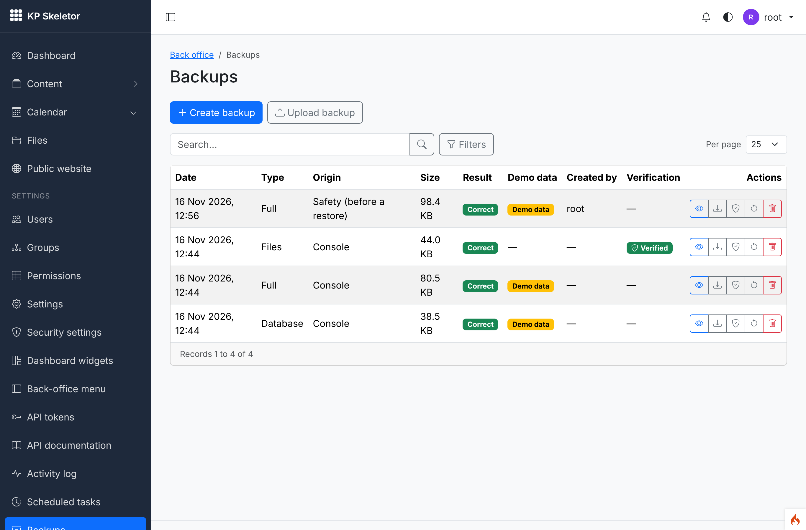
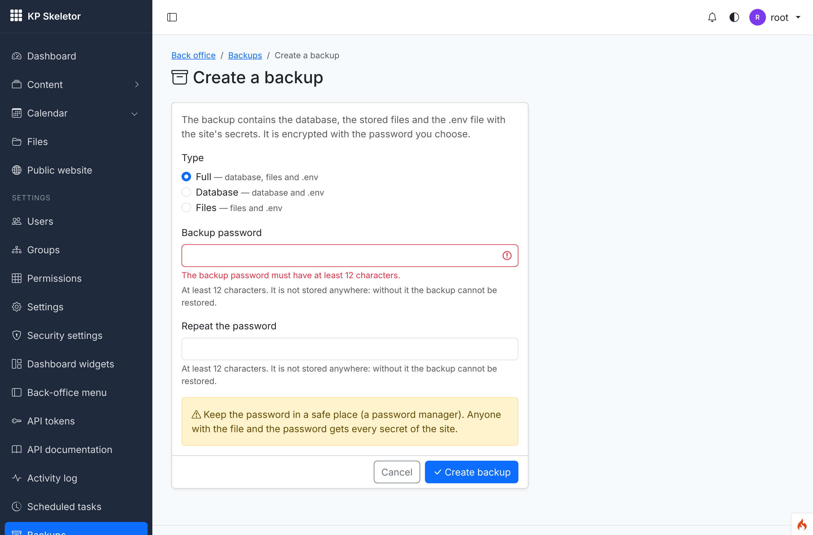
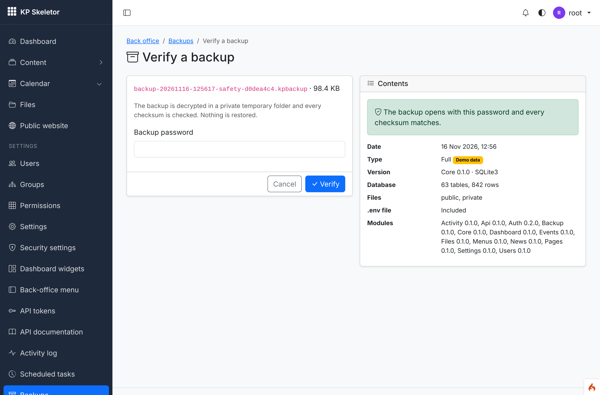
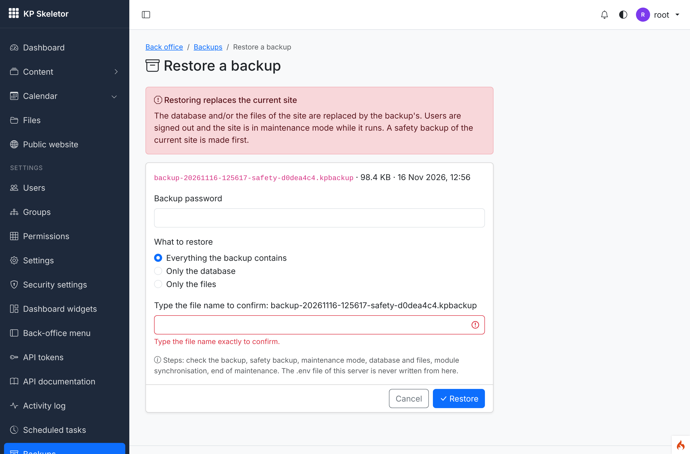
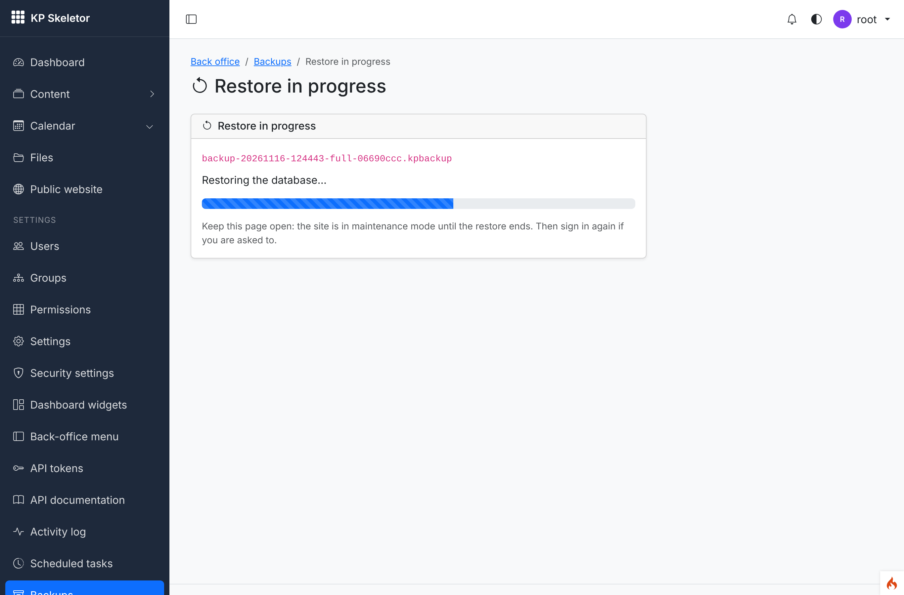
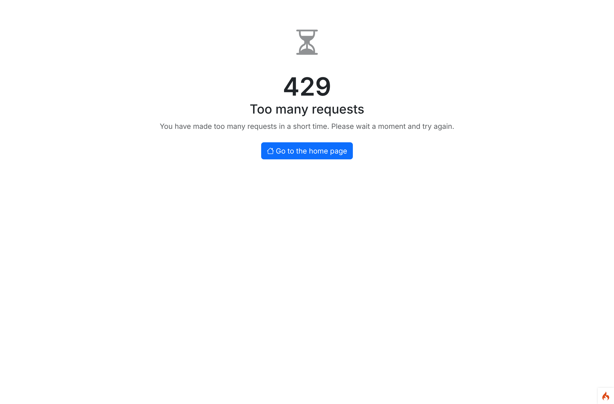
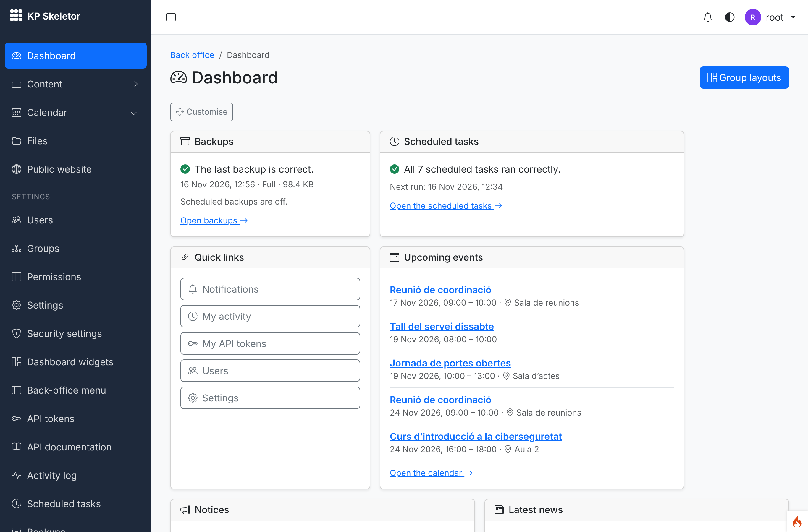
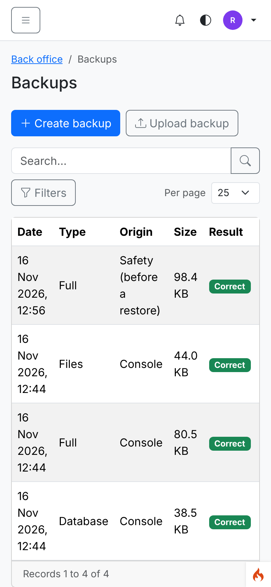
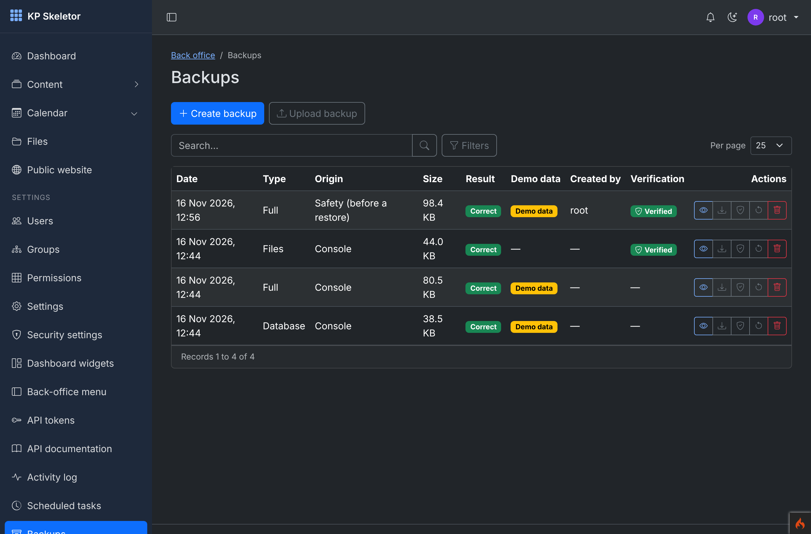

# Session 27 — Backup module

Branch `claude/blissful-feynman-0ypdap` · pull request [SIENSIS/kpskeletor#35](https://github.com/SIENSIS/kpskeletor/pull/35) "Session 27: Backup module".

## What was built

- **Backup module** (`modules/Backup`): encrypted backups of the whole application and restores,
  from the console and the back office, with one service.
  - Contents: portable database dump (every table, Query Builder in chunks, JSON lines), both
    Storage disks, `writable/uploads` when not empty, `.env`, and a `manifest.json` with the Core
    and module versions, date, type, origin, demo-data flag and the SHA-256 of every entry.
  - Encryption: Argon2id + libsodium `crypto_secretstream_xchacha20poly1305` in 1 MiB chunks,
    header as additional data, FINAL tag, format version 1; password mandatory (≥ 12), never
    stored; files `0640` in `writable/backups`.
  - Restore: decrypt and check everything first, compatibility (newer Core/module, missing module,
    unknown migration refused), **safety backup**, **maintenance mode**, database (the backup's own
    migrations, then the rows) and/or files, `modules:sync`, maintenance off. Keeps the current
    `.env`; secrets merged after confirmation (console) or shown once to copy (back office).
  - Commands `backup:create [--only=db|files] [--password]`, `backup:list`,
    `backup:verify <file>`, `backup:restore <file> [--only] [--with-env] [--password] [--yes]`,
    `backup:prune`; `--password` only triggers a hidden prompt, otherwise `backup.password` /
    `BACKUP_PASSWORD`.
  - Back office `backend/backups`: list (kpcrudy), create, verify, download (re-auth), delete,
    upload a backup file (re-auth), restore (re-auth, password, parts, typed file name) as a job
    with a progress bar.
  - Scheduled backup (setting, nightly) with a notification, retention task (keep last N
    daily/weekly/monthly), dashboard widget *Backups*.
- **Core:** maintenance mode (`MaintenanceMode` + global `maintenance` filter, 503 with
  `Retry-After`, allowed paths, scheduler skips) and `SafeZip` (zip-slip and zip-bomb checks,
  for backups now and module packages in session 29).

## How it was built

| Piece | Files |
|---|---|
| Manifest, routes, config | `modules/Backup/Config/{Module,Routes,Backup}.php` |
| File format | `Services/ArchiveCrypto.php` |
| Create / open / verify | `Services/BackupService.php`, `OpenedBackup.php`, `BackupRepository.php` (files + table `backups`) |
| Database | `Services/DatabaseDumper.php` (dump, migration plan, restore) |
| Restore | `Services/RestoreService.php`, `RestoreResult.php`, `EnvFile.php` |
| Back-office job | `Services/RestoreJob.php`, `JobStore.php`, `Controllers/Jobs.php`, `Assets/js/restore-progress.js` |
| Passwords | `Services/BackupPassword.php`, `ConsolePassword.php` |
| Retention | `Services/Retention.php`, `Tasks/PruneBackups.php` |
| Scheduled backup | `Tasks/ScheduledBackup.php`, `Notifications/BackupResult.php` |
| Back office | `Controllers/Backups.php`, `Views/{create,verify,restore,upload,job,_field,_manifest,widget}.php` |
| Widget | `Widgets/Backups.php` (`backup.backups`) |
| Commands | `Commands/Backup{Create,List,Verify,Restore,Prune}.php` |
| Table | `Database/Migrations/2026-11-16-100001_CreateBackups.php` (`backups`) |
| Core | `Core/Maintenance/MaintenanceMode.php`, `Core/Filters/Maintenance.php`, `Core/Views/errors/maintenance.php`, `Core/Archive/{SafeZip,ArchiveRefused}.php` |

Routes (`backend` chain + `can:`): `backend/backups` (CRUD, `backup.list`), `create`
(`backup.create`), `verify/<id>` (`backup.list`), `download/<id>` (`backup.download` + `reauth`),
`recover/<id>` and `upload` (`backup.restore` + `reauth`), `jobs/<job>` (`backup.restore`, own
job only); `progress/backup/<job>` (JSON progress, no session or database).

Permissions: `backup.list`, `backup.show`, `backup.delete`, `backup.create`, `backup.download`,
`backup.restore` (+ `settings.backup`). Default grants: admin `list`, `show`, `create`; the rest
superadmin only.

Settings: `Backup.scheduled` (off), `Backup.scheduledType` (`full`), `Backup.keepDaily` 7,
`keepWeekly` 4, `keepMonthly` 6.

Full documentation: `docs/backup-restore.md`; `docs/security.md` (maintenance mode, archives,
backups); `docs/commands.md`.

## Decisions and deviations

- **Open (decide):** D-27-01 (permission names, URLs, settings, default grants), D-27-02
  (maintenance mode built now in the Core as a file + global filter; new `progress/*` path
  convention), D-27-05 (uploaded backup files go to `writable/backups`, not through the Storage
  service). Built so they can still change.
- Accepted: D-27-03 (Query Builder dump only, no `mysqldump`; schema rebuilt with the backup's own
  migrations), D-27-04 (job after the response, progress in files, no `background_jobs` table),
  D-27-06 (safety backup with the same password; failure after maintenance keeps it on; `.env`
  never written by the back office), D-27-07 (`SafeZip` in the Core; never server code into a
  public disk), D-27-08 (`$backup` paths listed in the manifest; the disks are backed up whole),
  D-27-09 (fix in `AuthSession`: a session row started on the fly has no `ended_at` → 500 after a
  restore; earlier-session gap fixed because it blocked the back-office restore).
- The restore URL is `backend/backups/recover/<id>`: `restore/<id>` is kpcrudy's own trash URL
  (its development route check refused it). For the same reason the restore/upload buttons are
  decided with `can('backup.restore')` in the controller (the routes check it again).
- Plan deviation: no `background_jobs` table (D-27-04).

## How to try it

```bash
INSTALL_ADMIN_PASSWORD='…' php spark app:install --env=development --db=sqlite --demo --email=you@example.com
export BACKUP_PASSWORD='a-long-backup-password'
php spark backup:create
php spark backup:list
php spark backup:verify <file>
php spark backup:restore <file>            # type the file name to confirm
php spark serve                            # then backend/backups as the superadmin
```

Console output (this session, SQLite with the demo data):

```
$ php spark backup:create
Creating the backup…
Backup created: backup-20261116-124443-full-06690ccc.kpbackup (80.5 KB).

$ php spark backup:verify backup-20261116-122719-full-6772e505.kpbackup
The backup opens with this password and every checksum matches.
Date 2026-11-16 12:27:19 · type Full · Core 0.1.0 · 63 tables · files: public, private

$ php spark backup:restore backup-20261116-122719-full-6772e505.kpbackup --yes
[  5%] Decrypting and checking the backup…
[ 15%] Preparing the database…
[ 30%] Making a safety backup of the current site…
[ 45%] Restoring the database…
[ 75%] Restoring the database…
[ 78%] Restoring the files…
[ 90%] Synchronising the modules…
[100%] Restore finished.
The backup has been restored.
Safety backup of the previous site: backup-20261116-122735-safety-ad8e3fc3.kpbackup.

$ BACKUP_PASSWORD='wrong-password-123' php spark backup:verify backup-20261116-122835-db-9ee14db7.kpbackup
Wrong password, or the file is not this backup.
```

## Tests and checks

New tests (all in the suite):

- `modules/Backup/Tests/ArchiveCryptoTest.php` (6): round trip over several chunks and empty
  files, wrong password, a changed byte, a changed header, truncated / extra bytes, not a backup,
  a crafted Argon2id cost.
- `BackupServiceTest.php` (8): contents and checksums, 0640, `writable/uploads` only when not
  empty, password ≥ 12, verify (right / wrong password / modified file), full restore of database
  and files with safety backup and maintenance off, `--only`, `.env` never written but secrets
  reported and merged, refusals before anything changes (newer Core, newer module, unknown module,
  zip-slip, extra entry, checksum, unknown migration, wrong password), no server code into the
  public disk.
- `BackupScreensTest.php` (7): permissions of every screen and forged POSTs (user and admin),
  create/verify in the back office, download with re-authentication and its security log,
  console backup → back-office restore (typed confirmation, wrong password, merged `.env` shown
  once, progress endpoint, other users' jobs 404), back-office backup → console restore, delete,
  files found in the folder.
- `BackupModuleTest.php` (8): manifest and grants, migration up/down/up, retention, prune task,
  scheduled backup (off / no password / success + notifications), widget, job files, commands.
- `modules/Core/Tests/SafeZipTest.php` (5), `MaintenanceModeTest.php` (2).
- Updated expectations: `PermissionsCommandsTest` (140 permissions), `RoutesSecurityTest`
  (5 new `reauth` routes), `ShieldMatrixTest`, `RegistrySyncTest`, `CrudAuditorTest`,
  `AuthConfigTest` (`progress/*`).

Checks:

```
vendor/bin/phpunit                    OK (1122 tests, 6727 assertions), 9 min (1086 before this session)
vendor/bin/phpstan analyse            [OK] No errors
vendor/bin/php-cs-fixer fix --dry-run Found 0 of 824 files that can be fixed
php spark permissions:check           Permissions OK: 140 permission(s) in the catalogue, 276 route(s) checked.
php spark csp:check                   No inline scripts, handlers or styles in the project views.
php spark modules:sync                Nothing to do: every module is up to date.
```

Acceptance criterion 8 (backup from the console restores from the UI and the other way round,
with the password; a wrong password or a tampered file is refused): **pass** —
`BackupScreensTest::testRestoreFromTheBackOffice`,
`BackupScreensTest::testABackupCreatedInTheBackOfficeRestoresFromTheConsole`,
`BackupServiceTest::testVerifyAcceptsTheRightPasswordAndRefusesAWrongOneOrAModifiedFile`,
`ArchiveCryptoTest`. "Clean installation": a restore drops every table and rebuilds the schema
from the backup's migrations, so the target's previous contents do not matter; a restore onto
another server was not tried in this environment.

## Screenshots

Taken with Playwright against `php spark serve` (SQLite, demo data, superadmin), device scale
factor 2, script `deploy-status/27-backup/screenshots.mjs` (fails on CSP violations, page errors
or horizontal scroll: none).


*01 — The backups list: console backups (full, database, files), the demo-data flag, actions (show, download, verify, restore, delete), create and upload.*


*02 — Create a backup: type, password typed twice, refused because it is shorter than 12 characters.*


*03 — Verify with the password: the backup opens, every checksum matches, its contents.*


*04 — Restore: warning, password, parts and the typed file name (wrong name refused).*


*05 — A restore in progress (a job file set to "running" by hand: under `php spark serve` the job runs inside the request, so the bar cannot be caught live); the bar is driven by `progress/backup/<job>`.*


*06 — The result of a real restore from the back office, with the safety backup made first.*


*07 — The dashboard widget "Backups": last backup, result, size; scheduled backups off.*


*08 — The list at phone width (390 px).*


*09 — The list in dark mode, with the safety backup of the restore.*

## Known issues

- The merged `.env` shown after a back-office restore is not covered by a screenshot (it holds the
  development keys); it is covered by `BackupScreensTest::testRestoreFromTheBackOffice`.
- "Upload a backup file" is not covered by a feature test: CodeIgniter's uploaded-file check
  (`is_uploaded_file()`) cannot be satisfied from PHPUnit; the header check it relies on
  (`ArchiveCrypto::isBackup()`) is tested.
- Under `php spark serve`, `mod_php` or CLI servers the back-office restore runs inside the request
  (no FastCGI): the page appears when the restore ends. Large sites: use the console.
- A backup's own index row is created after its file, so the backup does not list itself after
  being restored (it appears as "found in the folder").
- `kpcrudy`'s route check (development only) is not run by the test suite; the restore route was
  renamed after it refused `restore/<id>`.
- Composer (known issue 04): same workaround as session 26 (scratch copy with phpstan from a
  shallow clone of tag `2.3.5`, `vendor/` moved in; project files unchanged).

## What the next session must know

- Session 28 (Updates): turn maintenance mode on/off with `Modules\Core\Maintenance\MaintenanceMode`
  (add the setting/screen and a superadmin bypass on top of it, D-27-02); make the pre-update
  backup with `(new BackupService())->create($password, 'full', …)` and name it in the failure
  message; `schedule:run` already skips during maintenance.
- Session 29 (packages): read ZIPs only through `Modules\Core\Archive\SafeZip`.
- Session 30 (`security:check`): `backup.password` set when `Backup.scheduled` is on; permissions
  of `writable/backups` (0750/0640) and `writable/maintenance.json`; `progress/*` routes return no
  secrets.
- New convention: `progress/*` paths skip the filters that read the database or the session.
- Decisions D-27-01, D-27-02 and D-27-05 were decided as built (Decisions 27) and applied to the
  specification, `CLAUDE.md` and `deploy/28`–`30`.
