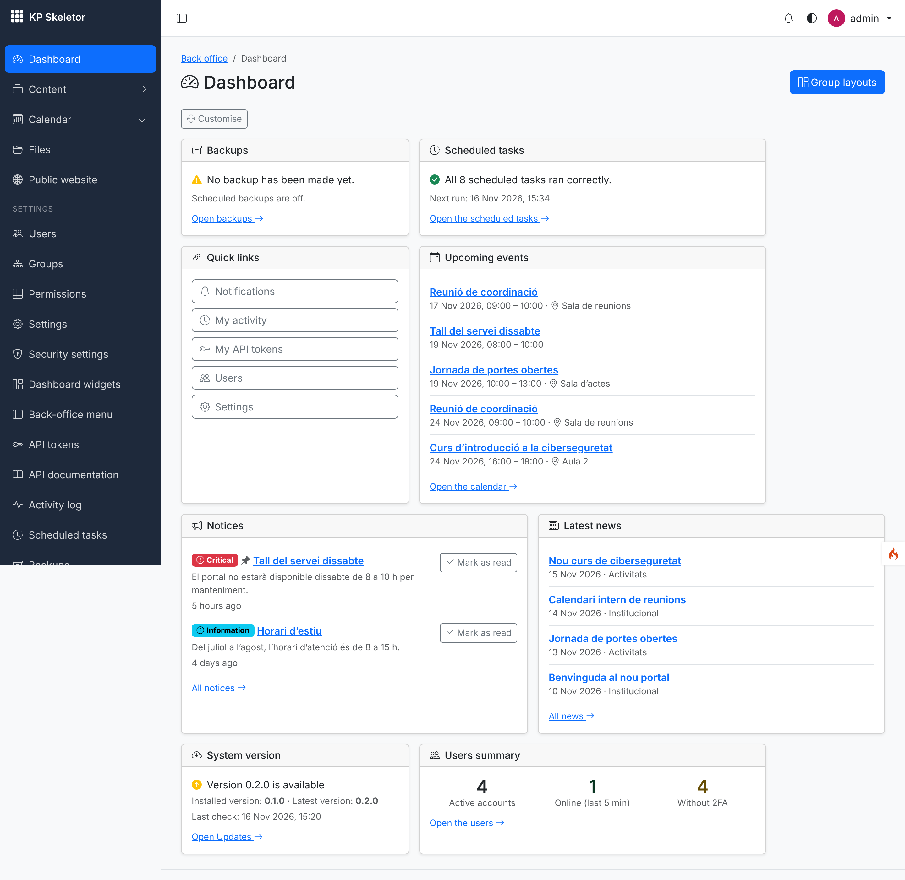
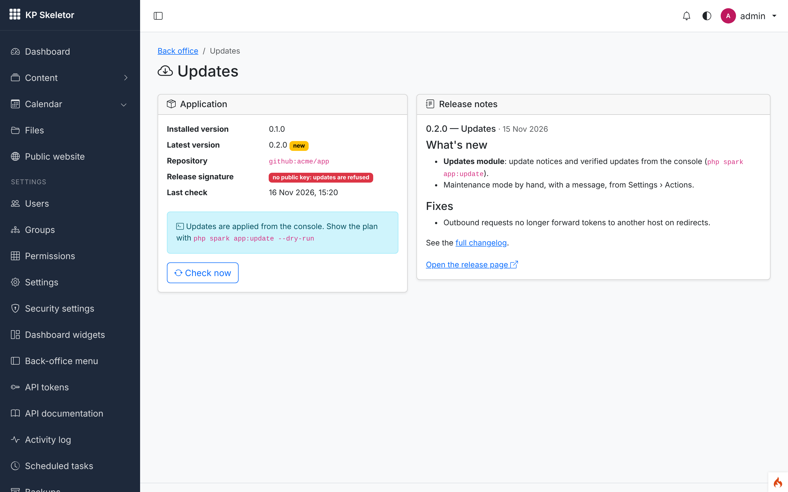
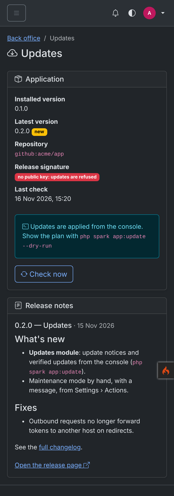
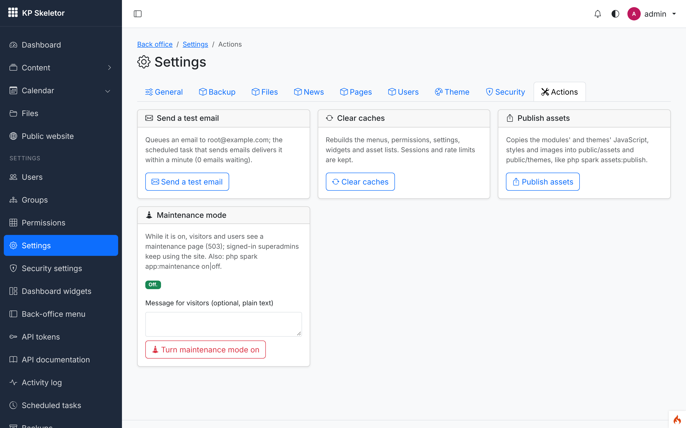
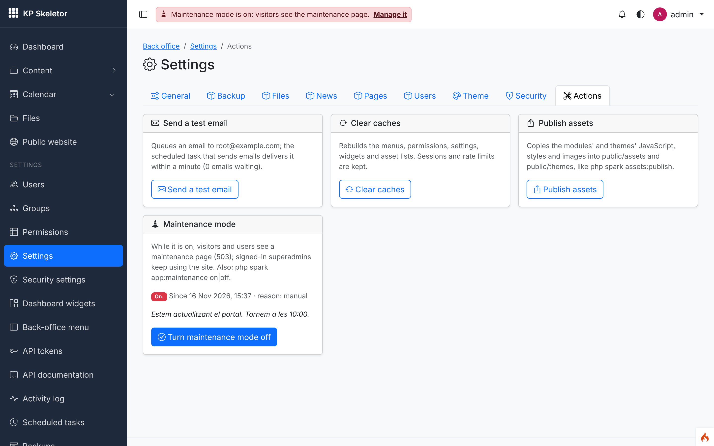
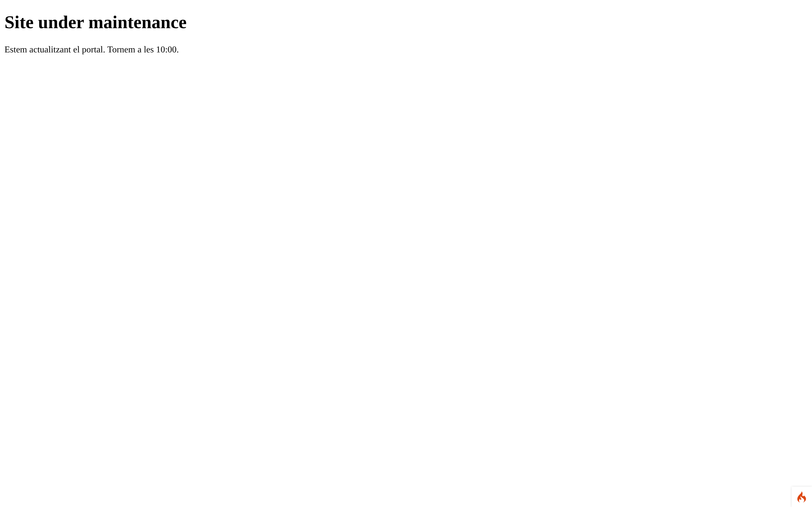
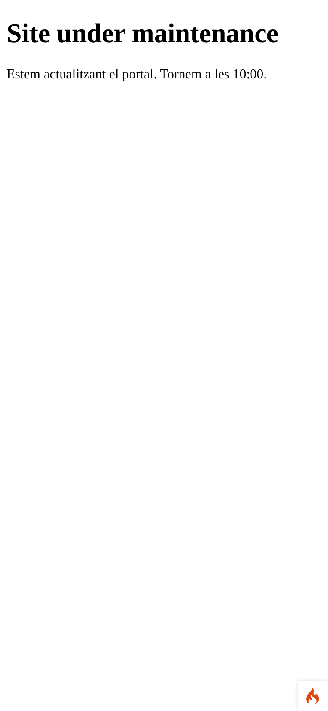
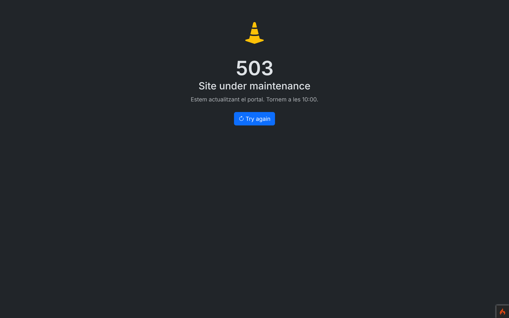
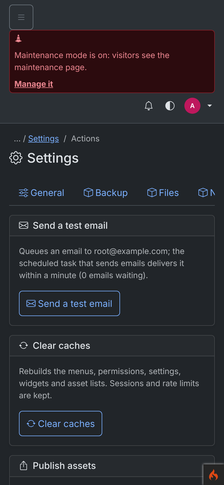

# Session 28 — Updates module and app:update

Branch: `ccr-a5d307ea-vyzp92` · Pull request: [SIENSIS/kpskeletor#36](https://github.com/SIENSIS/kpskeletor/pull/36) · Date: 2026-11-16

## What was built

- **Update notices in the back office** (the UI shows, never applies): the *System version*
  dashboard widget, a *New version available* notification (once per version, to holders of
  `updates.view`) and the page **Settings › Updates** (`backend/updates`) with the installed
  version, the latest version, the repository, whether a signing key is configured and the
  release notes (a safe Markdown subset). **Check now** (`updates.check`) runs the check on
  demand; a daily task and `php spark updates:check` do the same. Modules that declare
  `$repository` in their manifest are checked and listed too.
- **Verified updates from the console:** `php spark app:update [--dry-run] [--yes] [--password]`
  checks local changes, downloads the release archive and **verifies its SHA-256 and its Ed25519
  signature (minisign format, libsodium)** before anything changes, or verifies the signed git
  tag (`git verify-tag`) for git checkouts; then maintenance mode, a full backup (Backup module),
  the new code, `composer install --no-dev`, `modules:sync`, caches, maintenance off. A failure
  keeps maintenance mode on and names the backup. `--dry-run` shows the plan.
- **Maintenance mode by hand** on top of the Core's `MaintenanceMode` (D-27-02): a card in
  **Settings › Actions** (`settings.security` + re-authentication) and `php spark app:maintenance
  on|off|status [--message="…"]`; an optional message on the 503 page, the login still open and a
  **bypass for holders of the new permission `maintenance.manage`** (superadmins always; no
  default grant; only for a mode turned on by hand) with a banner.
- **Earlier gap fixed:** `OutboundClient` forwarded `Authorization` and other credential headers
  to the host a redirect pointed to; they are now dropped on cross-origin redirects (D-28-06).

## How it was built

| Piece | Files |
|---|---|
| Manifest, routes, config, service | `modules/Updates/Config/{Module,Routes,Updates,Services}.php` |
| Releases (GitHub / GitLab through `OutboundClient`) | `Services/{ReleaseSource,Release,VersionComparator}.php` |
| Check and its stored result | `Services/{ReleaseChecker,UpdateStatus}.php` → `writable/updates/status.json` (0640) |
| Verification | `Services/SignatureVerifier.php` (SHA-256 + minisign `ED`/`Ed`, key id, trusted-comment signature) |
| Update procedure | `Services/{Updater,CommandRunner,ProcessRunner}.php`, `Commands/{AppUpdate,UpdatesCheck}.php` |
| UI | `Controllers/Updates.php`, `Views/{index,widget}.php`, `Widgets/SystemVersion.php`, `Notifications/NewVersion.php`, `Services/ReleaseNotes.php` |
| Task | `Tasks/CheckUpdates.php` (daily 05:17) |
| Maintenance by hand | `modules/Core/Maintenance/MaintenanceMode.php` (`enableByHand()`, message, `bypass`), `modules/Core/Filters/Maintenance.php` (superadmin bypass + banner), `modules/Core/Views/maintenance_banner.php`, `modules/Core/Commands/AppMaintenance.php`, `modules/Settings/{Controllers/Actions,Views/actions,Config/Routes}.php` |
| Outbound fix | `modules/Core/Http/OutboundClient.php` |

- **Tables:** none (D-28-01: the check result is a file).
- **Routes:** `GET backend/updates` (`can:updates.view`), `POST backend/updates/check`
  (`can:updates.check`, `ratelimit:forms`), `POST backend/settings/actions/maintenance`
  (`can:settings.security`, `reauth`).
- **Permissions:** `updates.view`, `updates.check` (default grant: admin both).
- **Commands:** `updates:check`, `app:update`, `app:maintenance`.
- **Configuration (`.env`):** `updates.repository`, `updates.token`, `updates.publicKeys`,
  `updates.prereleases`, `updates.method`, … (`docs/updates.md`).
- **Activity:** `Updates/checked`, `updated`; security entries `release_refused`,
  `update_failed`, `Settings/maintenance_on|off`, `Core/maintenance_on|off` (console).
- Docs: `docs/updates.md` (new: configuration, checking, `app:update`, **signing procedure with
  minisign and key rotation**), `docs/commands.md`, `docs/security.md`, `docs/settings.md`,
  `docs/outbound-requests.md`, `env`, module `CLAUDE.md` files.

## Decisions and deviations

- **D-28-01 (decided as built, Decisions 28):** URLs `backend/updates` and `backend/updates/check`, admin gets
  `updates.view` + `updates.check`, `.env` keys `updates.*`, default repository empty, result in
  `writable/updates/status.json`, Updates requires Backup.
- **D-28-02 (decided, Decisions 28):** maintenance mode by hand in Settings › Actions (not a
  stored setting) and `app:maintenance`; one Core permission **`maintenance.manage`** turns it on
  and off (+ re-authentication) and lets its holders keep using the site; no default grant
  (superadmins always pass; administrators do not get it through `settings.*`), assignable in the
  permission matrix; plain-text message (≤ 500 characters); login paths open; restores and
  updates are never bypassed nor turned off from the screen.
- D-28-03 (accepted): release assets `<name>.zip` + `.zip.sha256` + `.zip.minisig`, one
  top-level folder; minisign `ED` and `Ed`; several keys for rotation; no key = refused.
- D-28-04 (accepted): **download and verify before maintenance mode** (the spec lists
  maintenance first; a refused release now changes nothing); protected paths; replaced files kept
  in `writable/updates/previous/<version>/`; local changes of archive installs from
  `writable/updates/files.json` (the first archive update can only warn); git: `merge --ff-only`.
- D-28-05 (accepted): installed version = `Version::CORE`; highest semver tag; pre-releases off.
- D-28-07 (accepted, owner's request): the maintenance page is the theme's `errors/maintenance`
  view (overridable by a theme) drawn with the file configuration only, no database; plain HTML
  if the theme fails.
- D-28-06 (accepted): credentials dropped on cross-origin redirects; the archive download uses a
  larger size limit and timeout.
- Backup: new backup origin `update` (column fits, labels in ca/es/en).

## How to try it

```bash
# Configure (development): the repository, and the minisign public key of the release signer
echo 'updates.repository = github:owner/repo' >> .env
echo 'updates.publicKeys = RW…' >> .env
php spark updates:check
php spark app:update --dry-run
php spark app:maintenance on --message "Back at 10:00"   # then: php spark app:maintenance off
```

URLs: `/backend/updates`, `/backend` (widget *System version*), `/backend/settings/actions`
(maintenance card). Install used for the screenshots: `php spark app:install --env=development
--db=sqlite --demo` (demo users and passwords are printed once by the installer). The
screenshots' `status.json` was written by hand (a release `v0.2.0` of a fictitious
`github:acme/app`): this environment cannot reach a real repository.

Console output (from the test suite's fake repository, real `OutboundClient`, `TestSigner`):

```text
$ php spark app:update --dry-run
Installed 0.1.0, available 0.2.0 (method: archive).
Plan:
  1. Check: newer version, maintenance mode off, no local changes, signed release.
  2. Download app-0.2.0.zip, its .sha256 and .minisig
  3. Verify the SHA-256 and the Ed25519 signature (refused unless both are valid)
  4. Turn maintenance mode on
  5. Make a full backup (Backup module)
  6. Copy the new files (never: .env, .git/, writable/, vendor/, public/uploads/, public/assets/modules/, node_modules/); replaced files kept in writable/updates/previous
  7. composer install --no-dev
  8. php spark modules:sync (migrations, permissions, assets)
  9. php spark app:cache-clear
  10. Turn maintenance mode off
Local changes cannot be checked: this installation was not updated with app:update before.
Dry run: nothing changed. The update can run.

$ php spark app:update --yes
…
Downloading app-0.2.0.zip…
Verifying the checksum and the signature…
Release verified.
Maintenance mode on.
Making a backup…
Backup backup-update.kpb created.
Copying the new files…
Installing the dependencies…
Synchronising the modules…
Clearing the caches…
Updated to 0.2.0. Maintenance mode off.

$ php spark updates:check
+-------------+-------------------+----------------+-----+
| Module      | Installed version | Latest version |     |
+-------------+-------------------+----------------+-----+
| Application | 0.1.0             | 0.2.0          | new |
+-------------+-------------------+----------------+-----+
New versions available: Core 0.2.0.
```

## Tests and checks

New tests (all pass): `modules/Updates/Tests/` — `VersionComparatorTest` (semver precedence),
`SignatureVerifierTest` (an archive signed with a test key pair verifies in both minisign modes;
a modified archive, another key, an impostor key with the same id, a forged trusted comment, a
bad checksum and no key are refused), `ReleaseSourceTest` (repository syntax, newest tag,
drafts/pre-releases, private repositories and the token not sent to the storage host, GitLab,
errors), `UpdatesScreensTest` (permissions and forged POSTs, **acceptance criterion 9**, safe
release notes, one notification per version, network error does not break the dashboard,
modules' repositories, the task), `AppUpdateTest` (dry-run plan, unverified releases refused
before anything changes, verified archive applied with protected paths untouched, local changes,
a failure keeps maintenance mode on and names the backup, git tags verified);
`modules/Settings/Tests/MaintenanceScreenTest.php` (permissions, message, login open,
bypass for holders of `maintenance.manage` only with a session and only for a mode turned on by
hand, no default grant, the command);
`OutboundClientTest::testCredentialsAreNotSentToAnotherOrigin`.

```text
vendor/bin/phpunit                    OK (1164 tests, 7005 assertions)   [baseline: 1122 tests]
vendor/bin/phpstan analyse            [OK] No errors (level 6)
vendor/bin/php-cs-fixer fix --dry-run Found 0 of 859 files that can be fixed
php spark permissions:check           Permissions OK: 142 permission(s) in the catalogue, 279 route(s) checked.
php spark csp:check                   No inline scripts, handlers or styles in the project views.
php spark modules:sync                (run by app:install) Updates: default grants applied (2 added).
```

The suite was run without the development `.env` (with it, `ThemeModeTest` sees the debug
toolbar's view comments; not related to this session). Core tests that list every module's
permissions, widgets and tasks now include Updates' (`PermissionsCommandsTest`,
`RegistrySyncTest`, `ShieldMatrixTest`).

## Screenshots


*01 — Dashboard (superadmin): the new *System version* widget after a check found 0.2.0.*


*02 — Settings › Updates: installed and latest versions, repository, signing key state (no key
configured here: updates would be refused), last check, "Check now" and the release notes.*


*03 — The same page at phone width in dark mode.*


*04 — Settings › Actions: the new *Maintenance mode* card (off), with the optional message.*


*05 — Maintenance mode on: the superadmin keeps using the back office with a banner; the card
shows since when, the reason and the message, and turns it off.*


*06 — What a visitor (or an administrator) gets meanwhile: the 503 page with the message, drawn
by the theme like the 404/500 pages without reading the database (D-28-07; guests see English
until session 31).*


*07 — The 503 page at phone width.*


*09 — The 503 page in dark mode.*


*08 — The banner and the back office at phone width in dark mode.*

## Known issues

- Real interoperability with the `minisign` CLI was not exercised here (the tool could not be
  installed in this environment); the format follows minisign's specification and the tests sign
  with libsodium exactly as minisign does (`ED` pre-hashed and `Ed`). Check it once with a real
  `minisign -S` signature before the first release (session 36).
- No real repository could be reached from this environment; GitHub/GitLab are exercised through
  the real `OutboundClient` with a fake transport.
- The first archive update of an installation cannot check local changes (no file list yet); it
  warns (D-28-04).
- The maintenance banner is large at phone width (it wraps in the top bar).
- Composer (known issue 04): `phpstan/phpstan` installed from a shallow clone of tag `2.3.5` in a
  scratch copy whose lock pointed at it, `vendor/` moved in (project files unchanged).

## Notes for the next session

- Session 29 (packages): `SafeZip` for ZIPs; `Modules\Updates\Services\SignatureVerifier` can
  verify signed packages; `ReleaseSource` reads a module's `$repository`.
- Session 30 (`security:check`): warn when `updates.repository` is set without
  `updates.publicKeys`; permissions of `writable/updates` (0750/0640) and
  `writable/maintenance.json`; maintenance mode left on.
- Session 36: document the release procedure (archive with one top-level folder, `.sha256`,
  `.minisig` from `minisign -S`, signed tag) — first draft in `docs/updates.md`.
- D-28-01 and D-28-02 decided and applied (Decisions 28): `maintenance.manage` (143 permissions).
