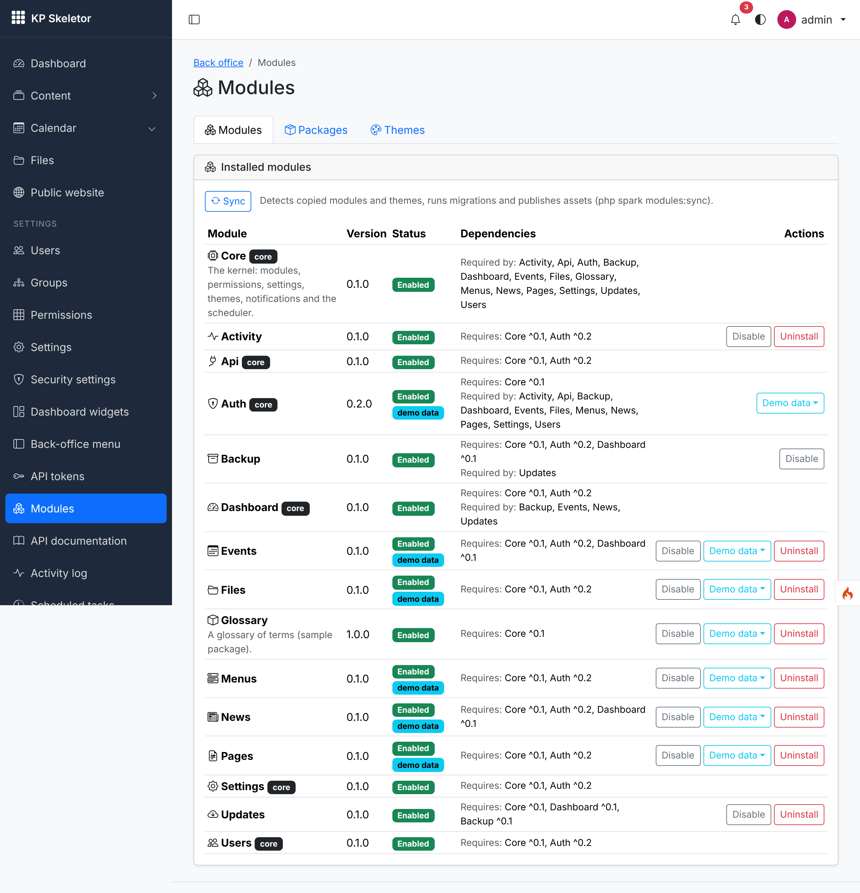
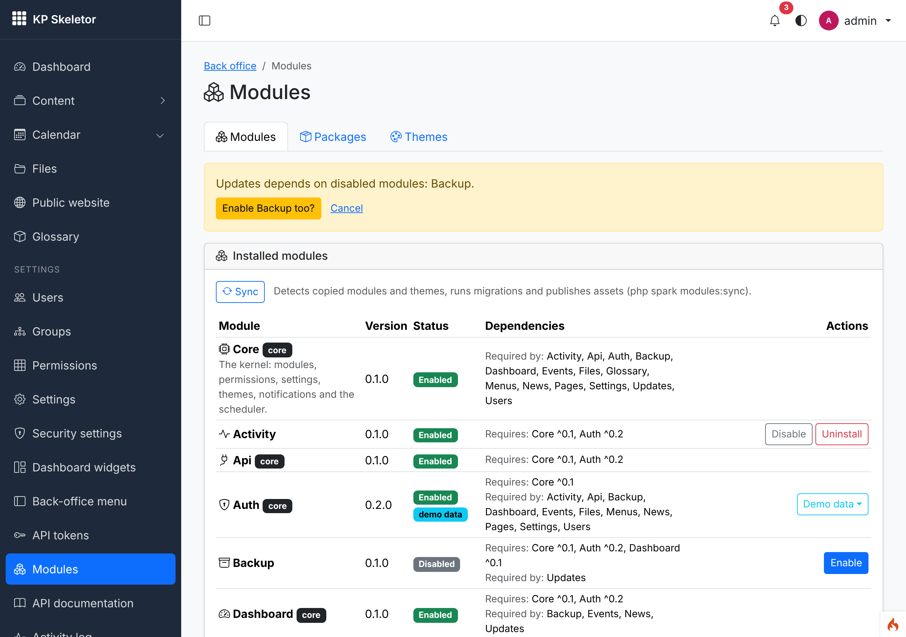
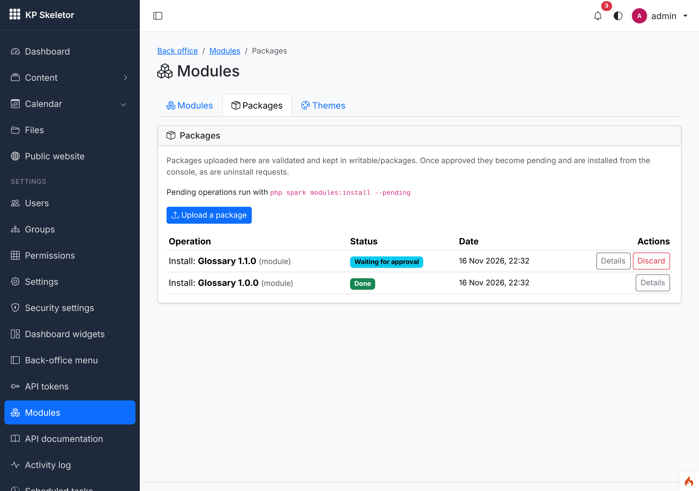
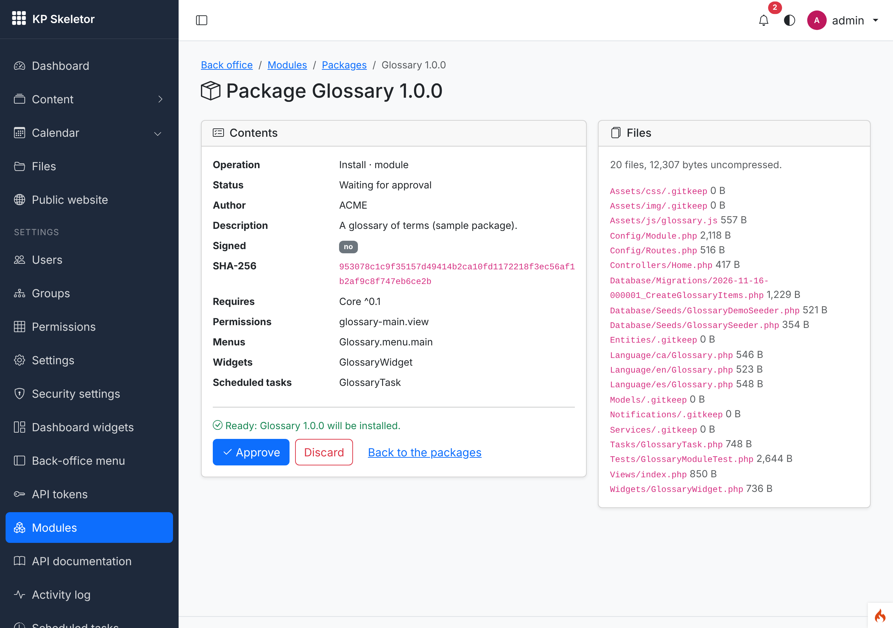
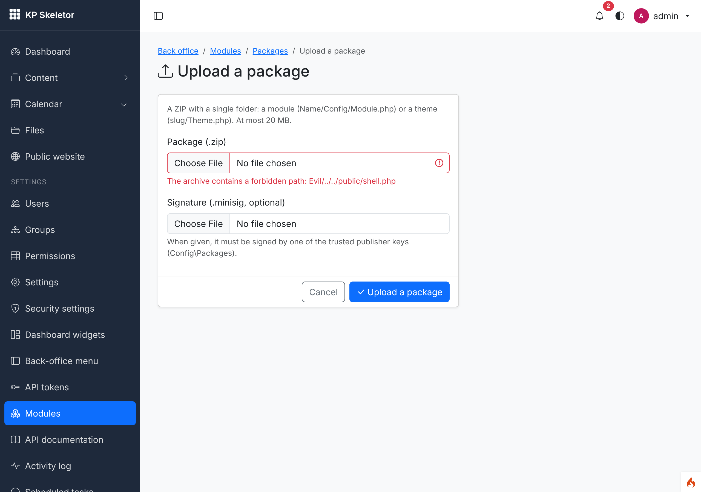
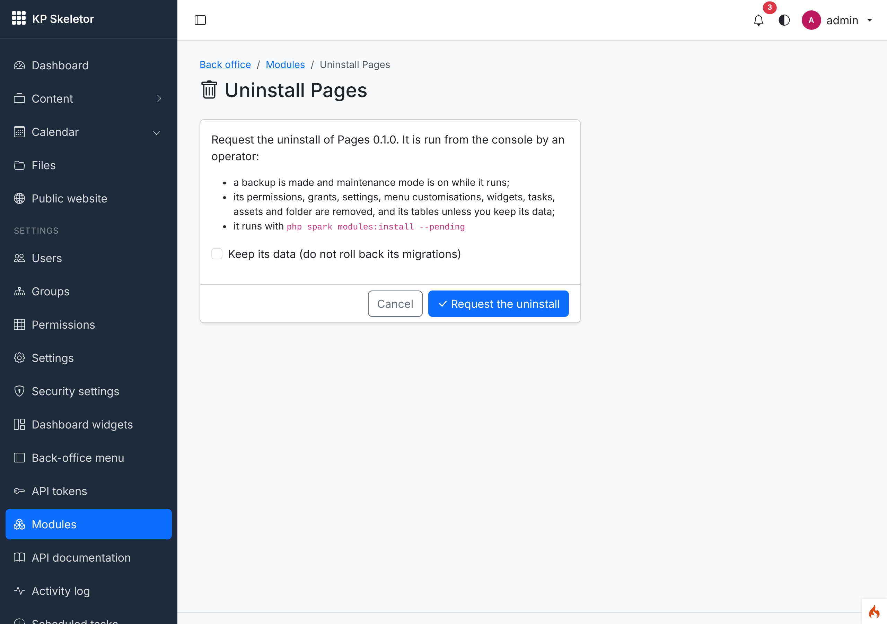
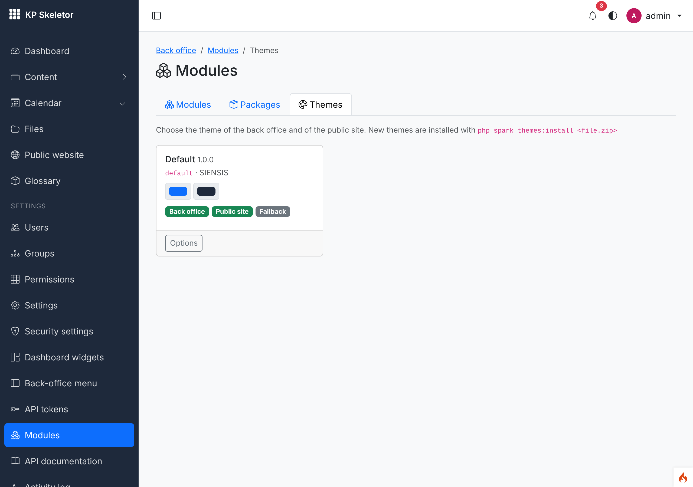
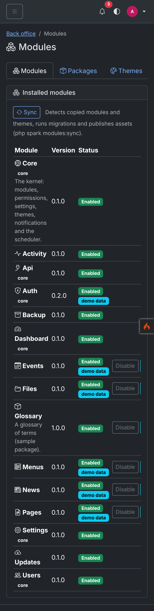
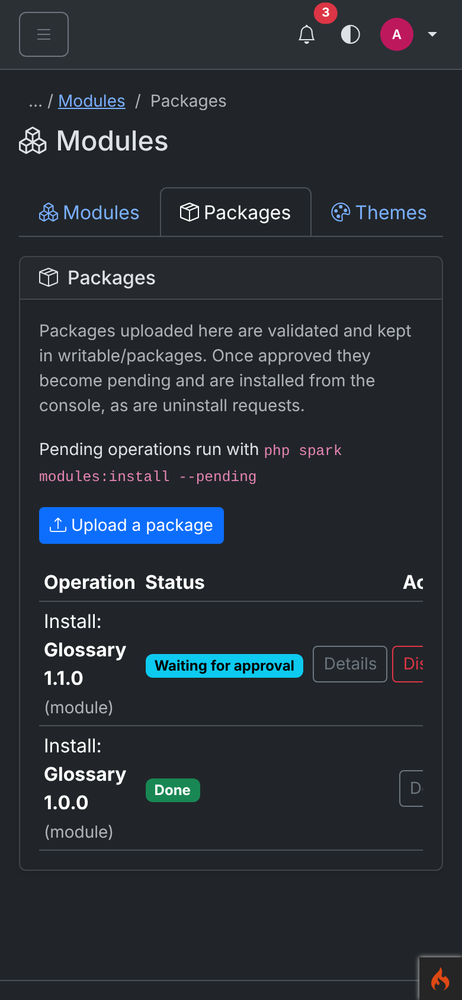

# Session 29 — Modules screen, ZIP installs and uninstall

Branch: `ccr-562a7c0f-4i8vha` · Pull request: [SIENSIS/kpskeletor#37](https://github.com/SIENSIS/kpskeletor/pull/37) · Date: 2026-11-16

## What was built

- **Modules screen** (`backend/modules`, menu *Settings › Modules*) with three tabs:
  - **Modules:** every module on disk or in the registry with its description, core badge,
    installed version (the files' version when they differ, and the latest version when the
    Updates module found one), status (*enabled*, *disabled*, *not synchronised*, *pending
    install/uninstall*, *error*), dependencies and dependants and demo data; **enable/disable**
    (offers to enable disabled dependencies; core modules and modules others need stay enabled),
    **demo data** load/reload/remove (passwords of demo users shown once), **Sync**, **Uninstall**
    (creates a pending request).
  - **Packages:** upload a module or theme ZIP (with an optional `.minisig`), see what it contains
    (author, description, dependencies, the permissions, menus, widgets and tasks it adds, its
    files, whether it can be installed), **approve** or **discard** it; the list of staged
    operations with their status and log.
  - **Themes:** installed themes with screenshot and colours, the active theme of each area
    (switch with one click), a link to the options, uninstall requests.
- **`modules:install <zip|url>`** (and `themes:install`): validation without running the
  package, dependency/version/author checks, backup, maintenance mode, `php -l`, atomic move,
  `modules:sync` in a new process, rollback on failure; `--enable`, `--force`, `--demo`,
  `--yes`, `--no-backup`, `--password`, `--signature`. **`modules:install --pending`** runs the
  operations approved in the screen and notifies the approver.
- **`modules:uninstall <Name> [--keep-data]`** (and `themes:uninstall`): backup, disable,
  roll back migrations, remove permissions, grants, settings, tasks, declarations, menu
  customisations, dashboard widgets, calendar entries, assets and the folder.
- **Refused packages** (acceptance criterion 3): zip-slip paths, symbolic links, invalid
  manifests, zip bombs, too many files, forbidden extensions, PHP syntax errors, missing or bad
  signatures, reserved and core module names, another author, downgrades without `--force`;
  every refusal is a security log entry.
- In production a module found by `modules:sync` stays **installed, disabled** until an
  administrator enables it (`packages.autoEnable`; D-29-02, Open).

## How it was built

| Piece | Files |
|---|---|
| Static manifest reader (literal values only, no code run) | `modules/Core/Packages/ManifestReader.php` |
| Validation (SafeZip, extensions, manifest, signature, `php -l`) | `Packages/PackageValidator.php`, `PackageInfo.php`, `SignatureCheck.php`, `PhpLint.php`, `PackageRefused.php` |
| Install / upgrade / rollback | `Packages/PackageInstaller.php`, `Safeguards.php` (backup + maintenance), `SparkSync.php` (`modules:sync` in a new process), `PackageDownloader.php` (`OutboundClient`) |
| Uninstall | `Packages/Uninstaller.php`, event `ModuleUninstalling` |
| Staged operations | `Packages/StagedPackages.php`, table `module_packages` (`Database/Migrations/2026-11-16-000001_CreateModulePackages.php`), notification `Notifications/Types/PackageProcessed.php` |
| Screen | `Controllers/Modules.php`, `Controllers/Themes.php`, `Modules/ModuleOverview.php`, `Views/modules/*.php`, routes in `Config/Routes.php`, menu entry in `Config/Module.php` |
| Commands | `Commands/ModulesInstall.php`, `ModulesUninstall.php`, `ThemesInstall.php`, `ThemesUninstall.php`, `PackageConsole.php` |
| Extension points | events `packageBackup` (`PackageBackup`), `moduleUninstalling`, `moduleVersions`; listeners in `modules/{Backup,Menus,Dashboard,Updates}/Config/Events.php`; calendar entries through `CalendarPublisher::purgeModule()` (new contract method) |
| Configuration | `Modules\Core\Config\Packages` (`autoEnable`, `publicKeys`, `requireSignature`, limits, `extensions`, `pendingDays`…), manifest keys `$description`, `$author` |
| Sync | `ModuleSynchronizer`: new modules enabled on the first sync, outside production or with `autoEnable` |

Routes (all under the `backend` chain): `backend/modules` (`modules.list`), `POST enable|disable/<Name>`
(`modules.toggle`), `POST demo/<Name>` (`modules.demo`), `POST sync` (`modules.sync`), `packages`,
`packages/<id>` (`modules.list`), `packages/upload` and `POST packages/<id>/approve`
(`modules.upload` + `reauth`), `POST packages/<id>/discard` (`modules.upload` or `modules.uninstall`),
`uninstall/<Name>` (`modules.uninstall` + `reauth`), `themes`, `POST themes/activate`
(`modules.toggle`), `themes/uninstall/<slug>` (`modules.uninstall` + `reauth`). Heavy actions add
`ratelimit:forms`/`ratelimit:uploads`. Full description: `docs/packages.md`.

## Decisions and deviations

- **Open (decide):** D-29-01 (URLs, which permission each action needs, manifest `description`
  and `author`, `Config\Packages` keys, command options, Core events) and D-29-02 (new modules
  disabled in production unless `packages.autoEnable`; enabled on the first sync and outside
  production). Built so both can still change.
- Accepted: D-29-03 (packages read without running them; sync in a new process), D-29-04 (one
  table `module_packages`), D-29-05 (what the web server does), D-29-06 (Core events instead of
  naming modules), D-29-07 (themes tab: screenshot + colours, `modules.toggle`), D-29-08 (what an
  uninstall removes, `--keep-data`), D-29-09 (minisign signatures, allowed files).
- Deviations: one table instead of two; `modules:install --pending` also runs uninstall
  requests; no live theme preview; the web Sync stops when `app/Config/ModuleNamespaces.php` is not
  writable. Small listeners added to Backup, Menus, Dashboard and Updates; `purgeModule()` added to the Core's `CalendarPublisher` (the Events module cannot have a `Config/Events.php`, D-00-04) (the Core
  contracts they answer); `SemVer::compare()` added; `BackupRepository::SOURCES` gains `package`.

## How to try it

```bash
php spark app:install --env=development --db=sqlite --demo    # or an existing dev database + php spark modules:sync
php spark serve
```

Sign in as a superadmin, open **Settings › Modules**. Build a package from a generated module:

```bash
php spark make:module Glossary && (cd modules && zip -qr /tmp/Glossary-1.0.0.zip Glossary)
rm -rf modules/Glossary && git checkout app/Config/ModuleNamespaces.php
```

Upload `/tmp/Glossary-1.0.0.zip` in *Packages*, approve it, then run the console step.

Console runs on the development install (`BACKUP_PASSWORD` set):

```
$ php spark modules:install Glossary-1.0.0.zip --yes
Package: module Glossary 1.0.0
  Author:          ACME
  Description:     A glossary of terms (sample package).
  Signed:          no
  Files:           20 (12,307 B)
  SHA-256:         953078c1c9f35157d49414b2ca10fd1172218f3ec56af1b2af9c8f747eb6ce2b
  Requires:        Core ^0.1
  Permissions:     glossary-main.view
  Menus:           Glossary.menu.main
  Widgets:         GlossaryWidget
  Scheduled tasks: GlossaryTask
Making a backup…
Backup: backup-20261116-222320-full-fb3a5897.kpbackup
Maintenance mode on.
Extracting and checking the PHP files…
Running modules:sync…
  Module namespaces file updated.
  Modules\Glossary: 1 migration(s) run.
  Glossary: initial data loaded.
  Glossary 1.0.0 installed.
  2 permission(s) added to the catalogue.
  Glossary: default grants applied (1 added).
  Settings, widgets, tasks and other declarations updated.
  glossary: assets published (1 file(s) changed).
  Modules synchronised.
Glossary 1.0.0 installed.
```

```
$ php spark modules:install Glossary-1.1.0.zip --yes
…
  Scheduled tasks: GlossaryTask
Making a backup…
Backup: backup-20261116-222329-full-5266a7ad.kpbackup
Maintenance mode on.
Extracting and checking the PHP files…
Running modules:sync…
  Glossary upgraded from 1.0.0 to 1.1.0.
  Modules synchronised.
Glossary 1.1.0 installed.
```

```
$ php spark modules:uninstall Glossary --yes
Making a backup…
Backup: backup-20261116-222329-full-0f982649.kpbackup
Maintenance mode on.
Disabling the module…
Rolling back its migrations…
1 migration(s) rolled back.
Removing permissions, grants, settings and tasks…
Deleting modules/Glossary…
Running modules:sync…
Glossary uninstalled.
```

```
$ php spark modules:install --pending          (after approving the upload in the screen)
Install Glossary 1.0.0…
Making a backup…
Backup: backup-20261116-223240-full-2a587056.kpbackup
Maintenance mode on.
Extracting and checking the PHP files…
Running modules:sync…
  Module namespaces file updated.
  Modules\Glossary: 1 migration(s) run.
  Glossary: initial data loaded.
  Glossary 1.0.0 installed.
  2 permission(s) added to the catalogue.
  Glossary: default grants applied (1 added).
  Settings, widgets, tasks and other declarations updated.
  glossary: assets published (1 file(s) changed).
  Modules synchronised.
Glossary 1.0.0 installed.
Pending operations: 1 done, 0 failed.
```

Refused packages:

```
$ php spark modules:install Evil-slip.zip
The archive contains a forbidden path: Evil/../../public/shell.php
$ php spark modules:install Evil-link.zip
The archive contains a symbolic link (Evil/link).
$ php spark modules:install Evil-manifest.zip
The manifest name "News" does not match the folder "Evil".
```

After the uninstall no row is left in `permissions`, `module_declarations` or `modules`, the
table `glossary_items` is dropped and `app/Config/ModuleNamespaces.php` is back to its original
content.

## Tests and checks

| Check | Result |
|---|---|
| `vendor/bin/phpunit` | **OK (1188 tests, 7212 assertions)**, 8:45 (start of session: 1164 tests) |
| `vendor/bin/phpstan analyse` (level 6) | **[OK] No errors** |
| `vendor/bin/php-cs-fixer fix --dry-run --diff` | **0 of 889 files** to fix |
| `php spark permissions:check` | Permissions OK: 143 permission(s), 296 route(s) checked |
| `php spark csp:check` | No inline scripts, handlers or styles |
| `php spark assets:publish --check` | Up to date |
| `php spark modules:sync` (twice) | Nothing to do (idempotent) |

New tests: `modules/Core/Tests/PackagesTest.php` (17: manifest read without running it, valid
package described, refusals — zip-slip, two folders, no manifest, wrong class, no version,
`phtml`, `.htaccess`, reserved and core names — logged as security entries, symbolic links, zip
bombs, too many files, `php -l`, signatures (good, other key, unknown key, required), theme
packages, install with backup and maintenance, same version/downgrade/upgrade keeping the state,
another author, missing dependencies and Core version, rollback when sync fails, no backup, the
auto-enable rule, uninstall with and without data (calendar purged through the contract), core/required modules, staged install and
uninstall with notification, discard/expiry/tampered file) and
`modules/Core/Tests/ModulesScreenTest.php` (7: every action refused without its permission,
including forged POSTs; administrators without upload/uninstall; disabling answers 404 and hides
the menu, enabling restores it and offers the disabled dependencies; re-authentication for
uploads, approvals and uninstall requests; pending uninstall without touching code; approval of an
uploaded package; themes tab). `CoreMigrationsTest` covers the new migration up/down/up.

## Screenshots

Taken with Playwright against `php spark serve` (development, demo data), device scale factor 2;
the flow (upload, approve, console, uninstall request, enable with dependencies) was driven
through the real UI (`screenshots.mjs`).


*01 — The Modules tab: versions, status, dependencies and dependants; core modules have no disable/uninstall buttons; demo data actions in a menu.*


*02 — Enabling Updates while Backup is disabled: the screen offers to enable Backup too.*


*03 — Packages: a staged upload waiting for approval and one installed by `modules:install --pending`.*


*04 — An uploaded package, read without running it: author, description, permissions, menus, widgets, tasks, files, and the install check.*


*05 — A ZIP with a `..` path is refused at upload (and logged).*


*06 — Uninstall request with "keep its data": it becomes a pending operation run from the console.*


*07 — Themes tab: the active theme of each area, colours and the options link.*


*08 — The Modules tab at phone width in dark mode (the table scrolls inside its card).*


*09 — Packages at phone width in dark mode.*

## Known issues

- A package's widget/task classes are shown as written in the manifest (not resolved through
  `use` imports) and its menu labels as language keys (its language files are not loaded before
  it is installed).
- The Core has its own minisign verifier (`SignatureCheck`), a copy of the Updates module's
  `SignatureVerifier` (the Core cannot depend on a module): merge them in session 35.
- `--keep-data` keeps the migration history: a later install does not create the tables again,
  but its seeder runs again (D-29-08).
- The upload controller is not exercised by a feature test (`is_uploaded_file()`); the service is,
  and the UI upload was checked with Playwright (screenshots 03–05).
- In development the debug toolbar reports a CSP violation of its own on the themes tab (not in
  production).
- Composer still needs the known issue 04 workaround (scratch copy, phpstan from a shallow clone of
  tag 2.3.5).

## Notes for the next session

- Session 30 (`security:check`): check that `modules/`, `themes/` and `app/Config/` are not
  writable by the web user and `writable/packages` is not served; warn when `packages.requireSignature`
  is off or `packages.publicKeys` is empty in production, and report `packages.autoEnable`.
- D-29-01 and D-29-02 are **Open (decide)**: run `deploy/decide.md`.
- A module that keeps data about other modules answers `moduleUninstalling` in its
  `Config/Events.php` (see Menus, Dashboard); calendar entries go through `service('calendar')->purgeModule()`.
