# Session 32 — Tasks tutorial module and AI tooling

Branch: `ccr-c5a1782e-jvbm6w` · Pull request: [SIENSIS/kpskeletor#40](https://github.com/SIENSIS/kpskeletor/pull/40) · Date: 2026-11-17

## What was built

- **`Tasks` tutorial module** (`modules/Tasks`, installed **disabled**): projects, to-do tasks,
  assignees, due dates and labels, holding the finished code of the 14 tutorials (texts in
  session 34). `modules/Tasks/CLAUDE.md` maps every tutorial to its files; `docs/tasks.md`
  describes it.
  - **Back office:** CRUD of to-do tasks (project 1-N, assignees N-N, filters, custom operation
    *Complete* with its own permission, labels as a `multiselect`, the estimate hidden without
    `tasks-tasks.estimates`, an `afterWrite()` hook, the bulk action *Complete*, private
    attachments with the file picker); CRUD of projects with a **translated** name and
    description; requests from the public form with *Accept* (creates a to-do task) and *Reject*.
  - **Board** (`backend/tasks`): three columns drawn on the server (works without JavaScript);
    the ES module `tasks/board` adds drag and drop, JSON moves and redraws from a JSON endpoint.
    Users see their own to-do tasks; `tasks-tasks.list` sees all; assignees or `tasks-tasks.edit`
    move them.
  - **Dashboard widgets:** *My pending to-do tasks* (server-side) and *To-do task activity*
    (asynchronous SVG chart).
  - **Notifications:** to-do task assigned, overdue, new request. **Scheduled task:** daily overdue
    reminder (`withoutOverlapping()`, once a day per to-do task) with the setting
    `Tasks.reminderGraceDays`.
  - **Calendar:** due dates pushed to `tasks.due` (assignees and creator); project deadlines pulled
    by a `CalendarProvider` (`tasks.projects`).
  - **Other modules:** a `FileAccessPolicy` for `modules/tasks` (the first real one: files follow
    the to-do task's visibility), a listener of the Core's `privilegesChanged` (users who lose the
    board leave the open to-do tasks).
  - **Public site:** `tasks` and `tasks/project/{slug}` (public to-do tasks only, SEO metadata), a
    menu link type, and the form *Request a to-do task* with an always-on captcha, rate limit,
    validation, a notification to reviewers and a confirmation email in the visitor's language
    (setting `Tasks.publicRequests`).
  - **API (kpapy):** `api/v1/tasks/tasks` and `api/v1/tasks/projects` with the CRUDs' permissions,
    scopes, filters, includes and the operation `complete`.
  - **Child theme** `themes/tasks-demo` (child of `default`): purple primary colour, logo, its own
    CSS and an override of the Tasks public page.
- **AI tooling:**
  - `make:module` writes `modules/<Name>/CLAUDE.md` (purpose, resources and permissions,
    decisions, open tasks, how to test);
  - `make:module --standalone`: also `composer.json`, `README.md` and a `CLAUDE.md` with the
    skeleton's rules for a module kept in its own repository;
  - Claude Code commands `.claude/commands/new-module.md` (`/new-module`) and
    `.claude/commands/check-module.md` (`/check-module`);
  - `docs/creating-a-module.md` (first version; session 33 completes it).
- **Core:** manifest key `$enabledByDefault` (**D-32-01, Open (decide)**): `modules:sync` installs
  such a module disabled, also on the first sync.

## How it was built

- **Tables** (one migration each, `down()`): `task_projects`, `task_project_translations`,
  `tasks` (`labels` JSON multiselect, `attachments` picker keys, `reminded_on`, soft deletes),
  `task_assignees`, `task_attachments` (file → to-do task index), `task_requests`.
- **Resources and permissions:** `tasks-tasks` (crud − import; extras `complete`, `estimates`),
  `tasks-projects` (crud − import, trash), `tasks-board` (page), `tasks-requests` (crud − add, edit,
  import, trash; extras `accept`, `reject`). 25 new permissions (catalogue: 169).
- **Routes:** `backend/tasks/{tasks,projects,requests}` (`CrudFactory::routes()`),
  `backend/tasks` + `board/data` + `POST board/{code}/move` (`can:tasks-board.view`), public
  `tasks`, `tasks/project/(:segment)`, `tasks/request` (POST `ratelimit:forms`),
  `tasks/request/captcha`; API `api/v1/tasks/tasks`, `api/v1/tasks/projects` (`kpapy`).
- **Main classes:** `Services/TaskRepository.php` (reads and the shared rules), `Assignees.php`,
  `TaskRequests.php`; `Calendar/DueDates.php` (push + `CalendarSource`),
  `Calendar/ProjectDeadlines.php` (`CalendarProvider`); `Storage/AttachmentUploads.php`
  (`CrudUploadHandler`, private disk, 5 files), `Storage/AttachmentPolicy.php`;
  `Controllers/{Tasks,Projects,Requests,Board,PublicTasks,RequestForm}.php`,
  `Controllers/Api/{Tasks,Projects}.php`; `Widgets/{MyPendingTasks,TaskActivityChart}.php`;
  `Tasks/OverdueReminder.php`; `Notifications/{TaskAssigned,TaskOverdue,TaskRequested}.php`;
  `Menu/ProjectLink.php`; `Config/Events.php`; `Assets/js/board.js`, `Assets/css/tasks.css`.
- **Generator:** `modules/Core/Modules/Templates/CLAUDE.md.tpl`,
  `Templates/standalone/{composer.json,README.md,CLAUDE.md}.tpl`; `ModuleGenerator::generate(...,
  bool $standalone)`; option `--standalone` of `make:module`.
- **Core change (D-32-01):** `ModuleManifest::$enabledByDefault`, used by `ModuleSynchronizer`.

## Decisions and deviations

- **D-32-01 (decide, Open):** manifest key `$enabledByDefault` (built so it can still be replaced
  by a config list).
- D-32-02 (accepted): the API reuses the CRUD resources; paths `tasks/tasks`, `tasks/projects`.
- D-32-03 (accepted): the public form always asks for a captcha (own image URL), whatever
  `Auth.captcha` says.
- D-32-04 (accepted): attachments as a picker field (5 keys) mirrored in `task_attachments`.
- D-32-05 (accepted): the generator templates stay in `modules/Core/Modules/Templates`; no
  packager exists yet to exclude `CLAUDE.md` from ZIPs (tutorial 13, session 34).
- Deviation: tutorial 13 (releasing a new version) has no code yet: it needs a schema change and
  a packager, written with the tutorial text in session 34.
- `deploy-status/screenshot.mjs` now ignores the CSP reports of CodeIgniter's **development**
  debug toolbar (`?debugbar` script), which applies inline styles of its own on some pages.

## How to try it

```bash
INSTALL_ADMIN_PASSWORD=<a password> php spark app:install --env=development --db=sqlite \
  --url=http://localhost:8080/ --email=<you> --2fa=none --demo --no-interaction
php spark modules:enable Tasks
php spark modules:demo Tasks
php spark serve
```

Demo users are printed (random passwords) by the install. URLs: `/backend/tasks` (board),
`/backend/tasks/tasks`, `/backend/tasks/projects`, `/backend/tasks/requests`, `/backend` (widgets),
`/backend/calendar`, `/backend/settings/tasks`, `/tasks`, `/tasks/project/nou-web`,
`/tasks/request`, `/backend/api/docs`. Child theme: `theme.public = tasks-demo` in `.env`.

Generator: `php spark make:module Books` (writes `modules/Books/CLAUDE.md`),
`php spark make:module Books --standalone`. In Claude Code: `/new-module Books "…"`,
`/check-module Tasks`.

## Tests and checks

- `vendor/bin/phpunit`: **OK (1288 tests, 17229 assertions)** (baseline at the start: 1236 tests).
- `vendor/bin/phpunit modules/Tasks`: **OK (49 tests, 397 assertions)** — `TasksModuleTest`, `BoardTest`,
  `WidgetsAndReminderTest`, `PublicSiteTest`, `AttachmentsTest`, `CalendarAndEventsTest`,
  `TasksApiTest`, `ChildThemeTest`; plus `ModuleGeneratorTest` (CLAUDE.md, `--standalone`) and
  `PackagesTest::testAModuleDisabledByDefaultIsInstalledDisabledEvenOnTheFirstSync`.
- `vendor/bin/phpstan analyse`: **[OK] No errors**.
- `vendor/bin/php-cs-fixer fix --dry-run --diff`: **0 of 993 files** to fix.
- `php spark modules:sync` (via `app:install` and after each change): Tasks installed **disabled**
  (6 migrations, 14 default grants), enabled with `modules:enable Tasks`.
- `php spark permissions:check`: *Permisos correctes: 169 permís(os) al catàleg, 344 ruta(es) comprovades.*
- `php spark csp:check`: no inline scripts, handlers or styles.
- `php spark security:check` (development checkout): the errors and warnings are about the
  environment (development mode, HTTP, demo data, 2FA of the demo superadmins, permissions of
  `writable/`) plus the example password of session 31's report (see Known issues); nothing from
  the Tasks module.

### `/check-module Tasks`

| Item | Result |
|---|---|
| 1. `CLAUDE.md` current | pass (`modules/Tasks/CLAUDE.md`, tutorial → files table) |
| 2. Manifest complete | pass (resources with every extra operation, menu, grants, settings with rules, `$requires`, `$backup`, `$csp`, `$outboundHosts`, `$api`, widgets, scheduled task, notifications, calendars, link type) |
| 3. Database | pass (6 migrations with `down()`, up/down/up test, demo data only in `TasksDemoSeeder`) |
| 4. CRUDs and API | pass (`CrudFactory`, kpapy with `setResource()` = the CRUDs) |
| 5. Routes | pass (`permissions:check`) |
| 6. Texts | pass (`LanguageKeysTest`, `ActivityLabelsTest`) |
| 7. Front end | pass (`csp:check`; `board.js` ES module; CSS loaded by the script) |
| 8. Security | pass (record rules on the server, forged POSTs, private files by policy, captcha + rate limit, redirects only to fixed internal paths) |
| 9. Tests | pass (permissions with forged POSTs, migrations, API scopes, the module's rules) |
| 10. Docs | pass (`docs/tasks.md`, `docs/creating-a-module.md`, `docs/commands.md`) |

**Module Tasks complete.**

### Acceptance criterion 2 (`make:module Events2`)

`php spark make:module Events2` wrote `modules/Events2/CLAUDE.md` (with the module's permission,
setting, widget, scheduled task and table); `modules:sync` installed it (1 migration, grants,
assets); `permissions:check` OK (171 permissions); its 5 generated tests, PHPStan, php-cs-fixer
and `csp:check` passed. With the purpose written in its `CLAUDE.md`, every item of `/check-module
Events2` passes. The scratch module was then removed with `php spark modules:uninstall Events2
--no-backup` (not committed).

## Screenshots

Taken with Playwright (`deploy-status/screenshot.mjs`) against `php spark serve` with the demo data, device scale factor 2.

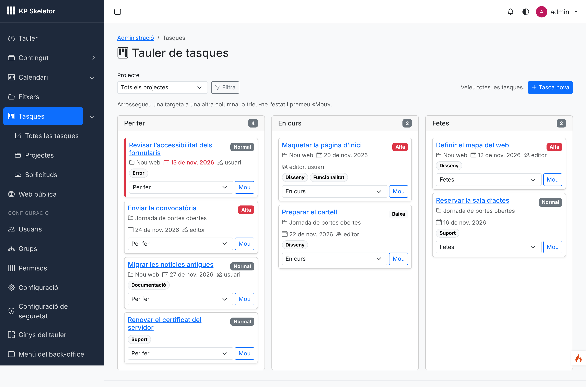
*01 — The board as an administrator (sees every to-do task): three columns, overdue card in red, a move form on each card; drag and drop with JavaScript.*

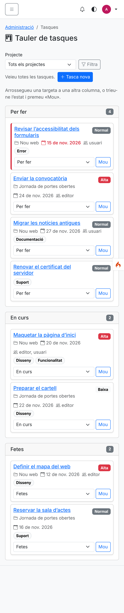
*02 — The board at phone width: the columns stack, no horizontal scroll.*

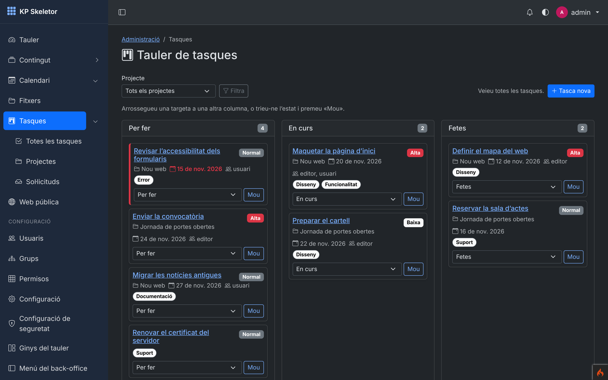
*03 — The board in dark mode.*


*04 — The board of `usuari` (group `user`): only the to-do tasks assigned to them.*

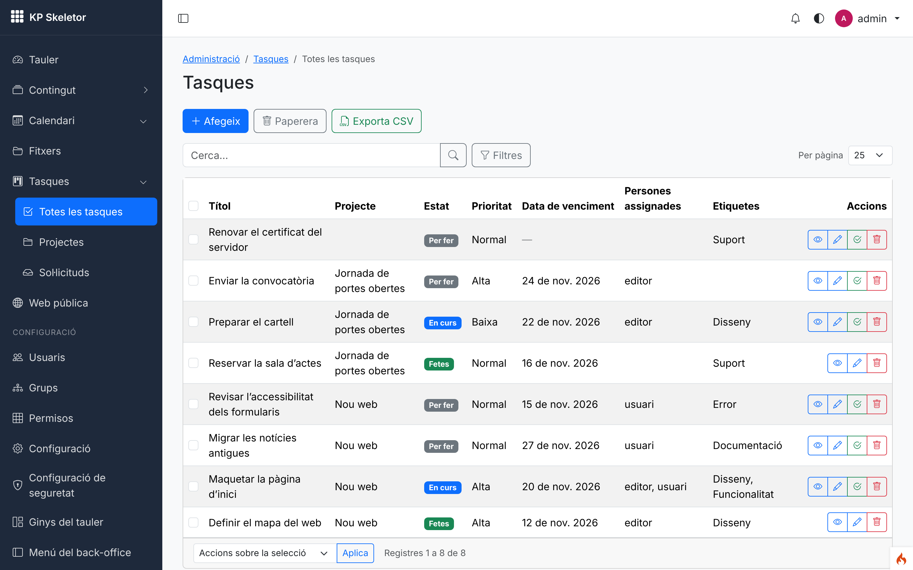
*05 — CRUD of to-do tasks (kpcrudy): project, status badges, due date, assignees (N-N), labels (multiselect); operation *Complete* and bulk action.*


*06 — Form of a to-do task: project, status, priority, labels, due date, assignees, estimate (with `tasks-tasks.estimates`), visibility and the attachments file picker (private disk).*


*07 — Form of a project: name and description in Catalan, Spanish and English (`setTranslations()`), slug, colour, deadline.*

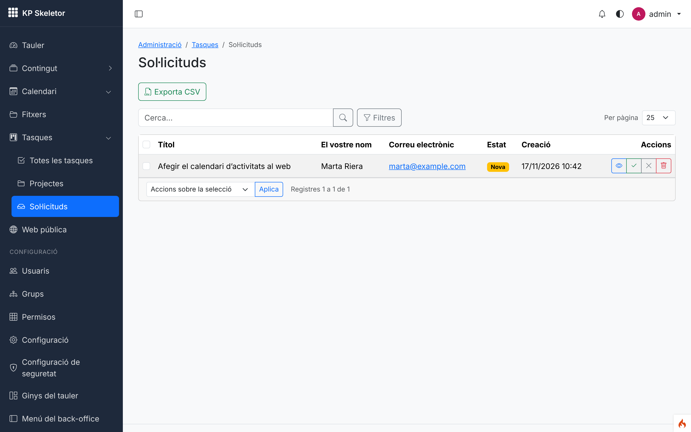
*08 — Requests from the public form with *Accept* and *Reject*.*

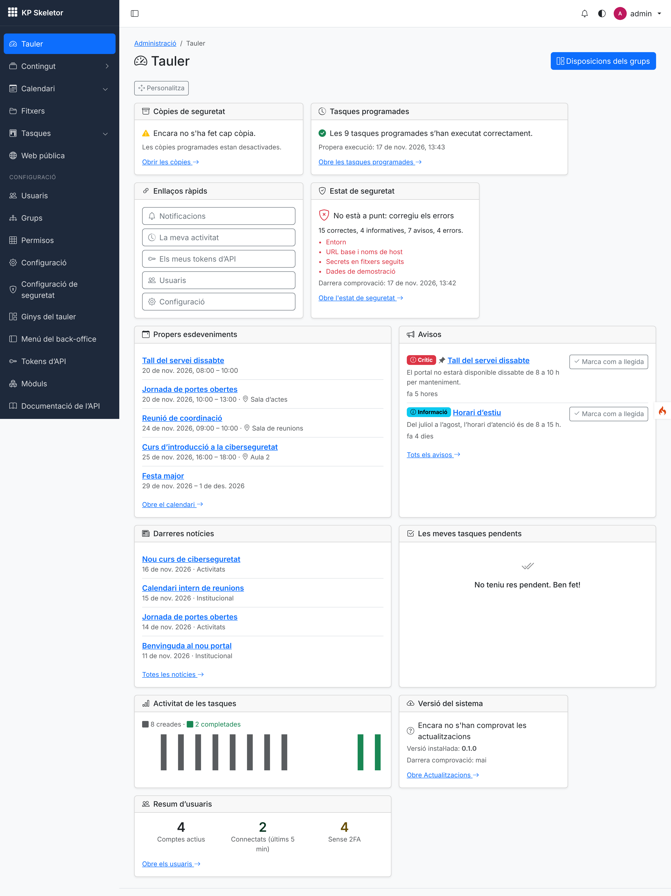
*09 — Dashboard with *My pending to-do tasks* and the asynchronous *To-do task activity* chart (SVG, no inline styles).*


*10 — The CRUD as `editor`: no estimate column or field (`hideFields()`), no delete.*


*11 — Public page `tasks`: only public to-do tasks, by status, with project filters and the request button.*

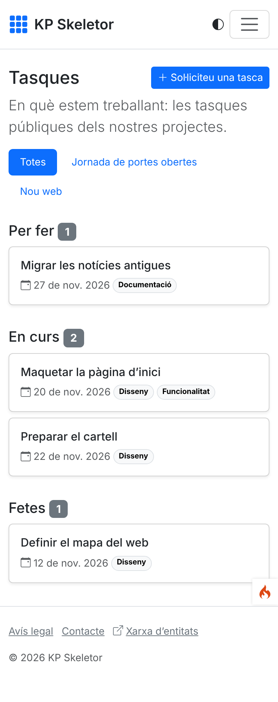
*12 — Public page at phone width.*

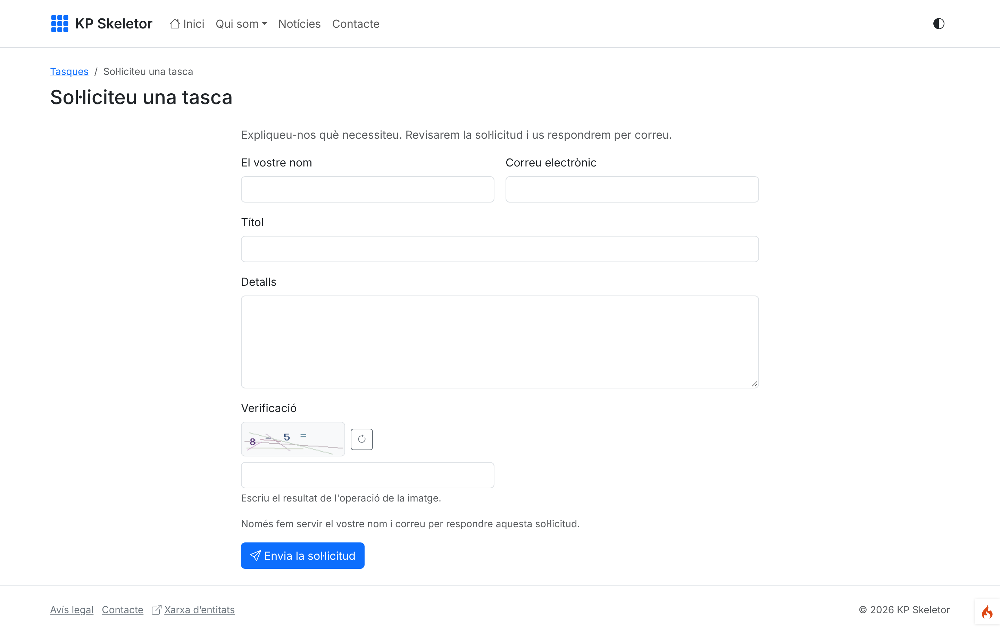
*13 — Form *Request a to-do task* with the always-on captcha.*

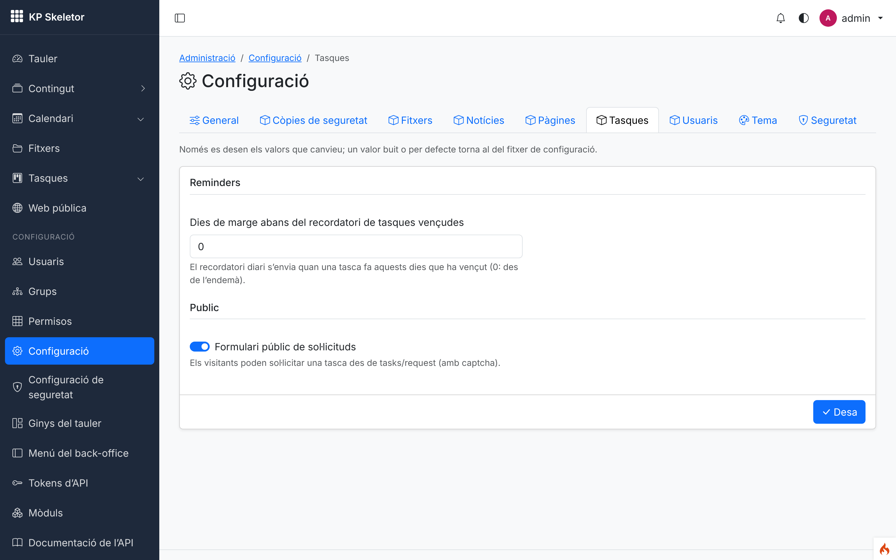
*14 — Settings › Tasks: reminder grace days and the public form switch.*

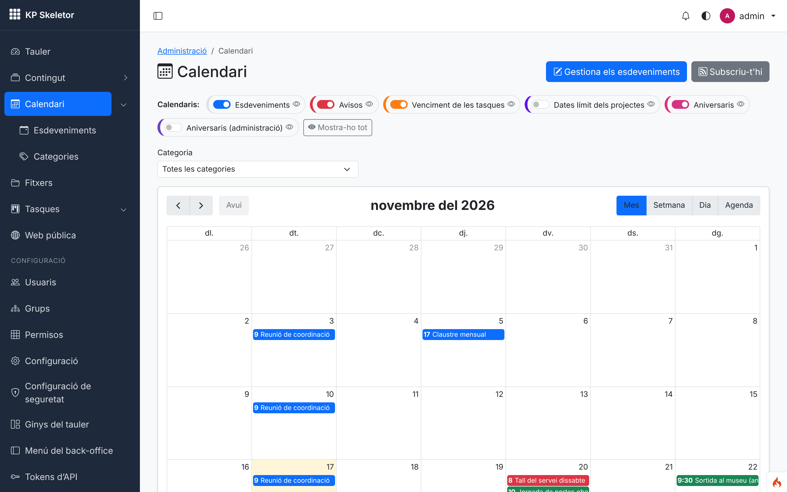
*15 — The calendar with the calendar *To-do task due dates* (push) and *Project deadlines* (pull) in the list of calendars.*


*16 — Public page of one project (`tasks/project/nou-web`) with breadcrumbs.*

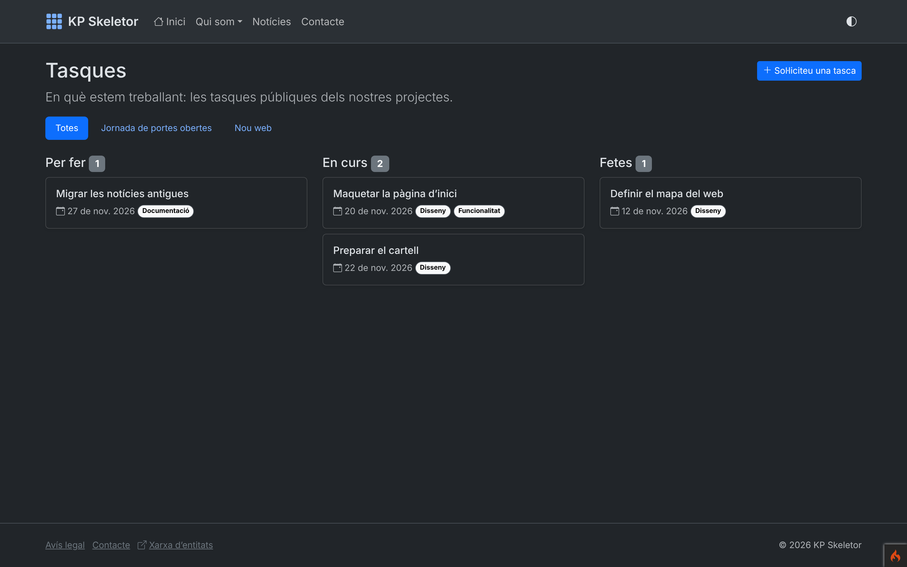
*17 — Public page in dark mode.*


*18 — The child theme `tasks-demo`: its own view of the Tasks public page, purple primary colour, logo, inside the parent's layout.*

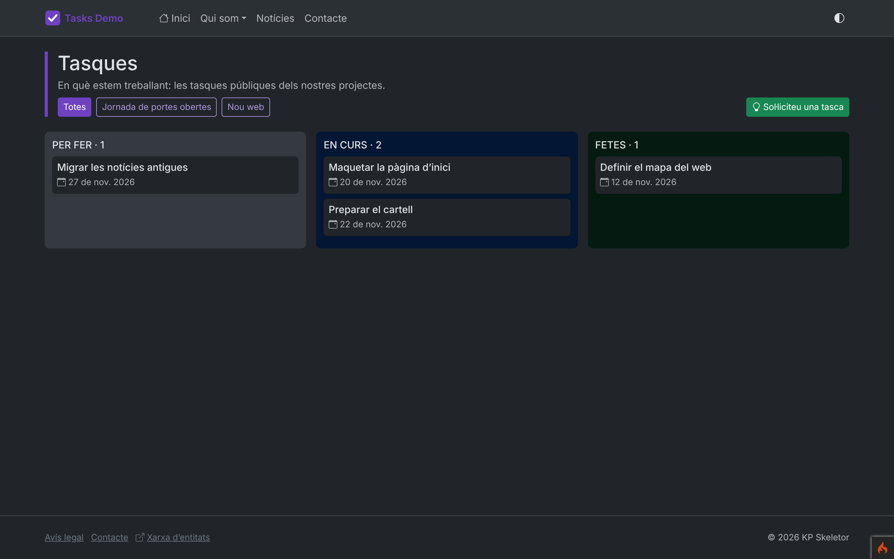
*19 — The child theme in dark mode.*

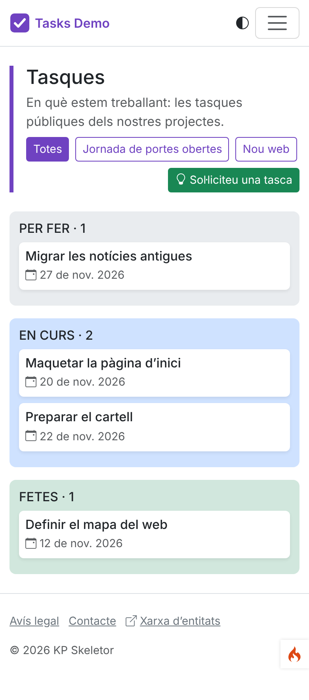
*20 — The child theme at phone width.*

## Known issues

- D-32-01 is open: if the owner prefers a config list, `Tasks` and `ModuleSynchronizer` change.
- Removing the Tasks demo data leaves the calendar events of the demo to-do tasks until
  `php spark calendar:resync Tasks`.
- The board's JavaScript redraw shows due dates as `YYYY-MM-DD` (the server-drawn page uses
  `ui_date()`).
- `security:check` flags `deploy-status/31-i18n/README.md:88` (an example password in a command of
  session 31's report) as a possible secret: not a real secret.
- Composer still needs the known issue 04 workaround (scratch copy, `phpstan/phpstan` from a
  shallow clone of tag 2.3.5, `env -u COMPOSER_AUTH composer install --prefer-source`).

## Notes for the next session

- Session 33 (docs): `docs/creating-a-module.md` exists (first version, the module checklist);
  `docs/tasks.md` describes the module; `docs/commands.md` lists `make:module --standalone`.
- Session 34 (tutorials): copy patterns from `modules/Tasks` (see its `CLAUDE.md` table); tutorial
  13 still needs its code (a schema-change migration, version bump, ZIP; the packager's option to
  leave out `CLAUDE.md`, D-32-05). Steps of tutorials 1 and 11 must work on a scratch copy
  (`Tasks2`).
- New modules: `make:module` writes `CLAUDE.md`; `/check-module <Name>` reviews the checklist.
