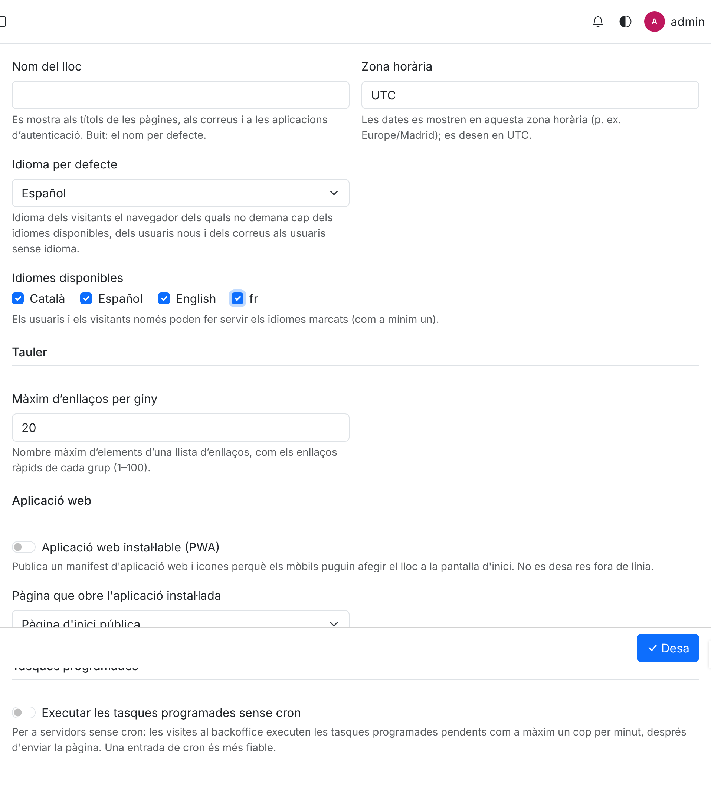
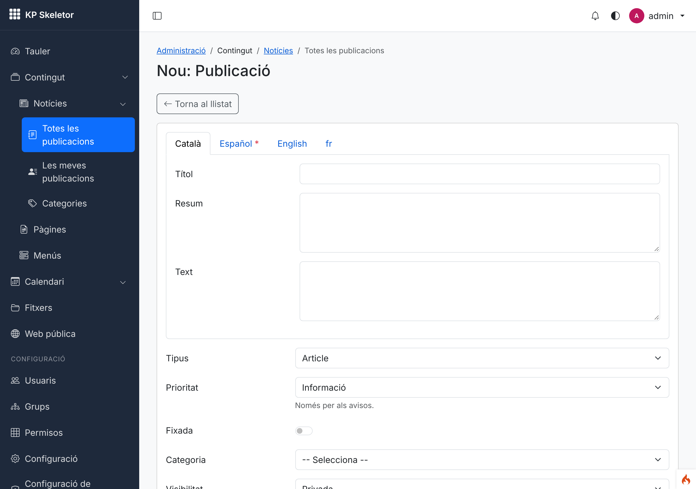
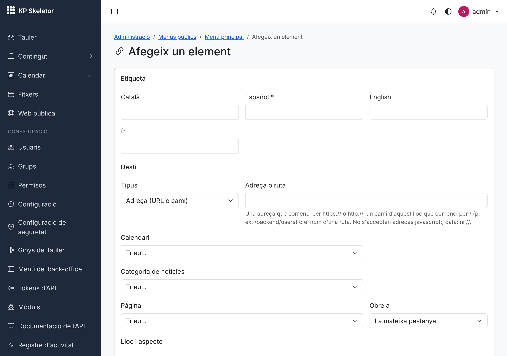
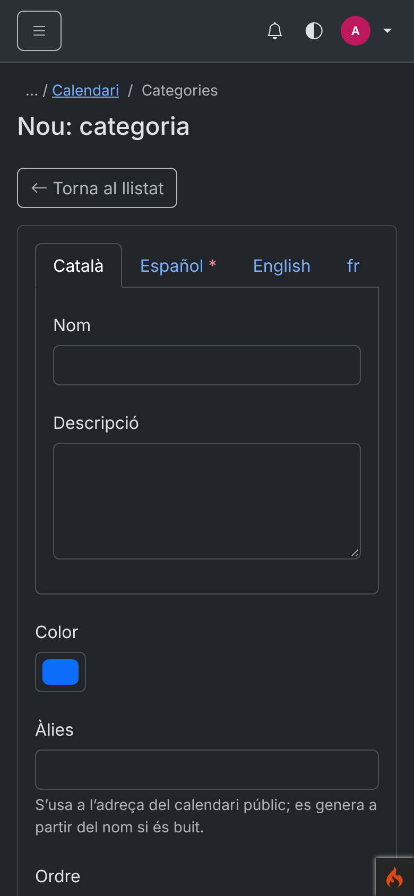
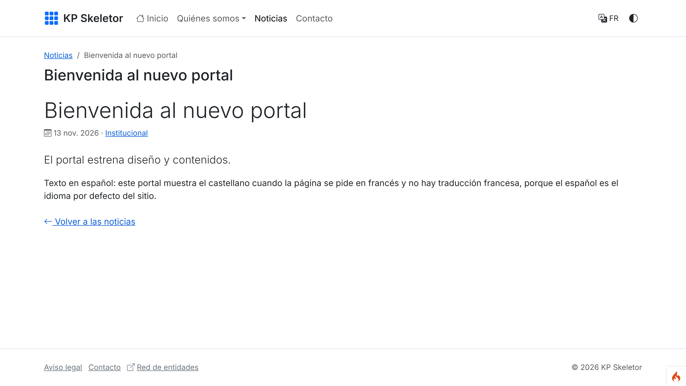
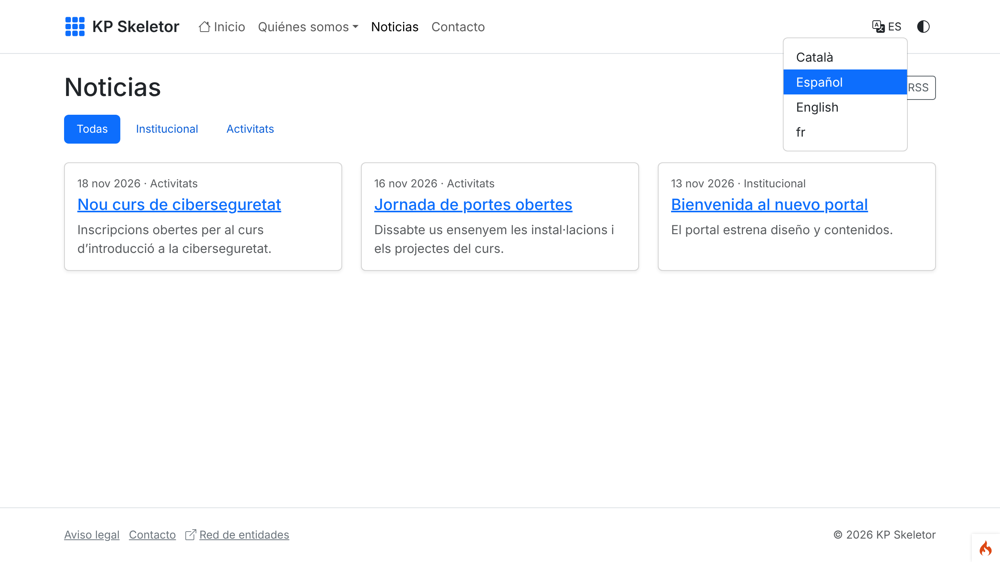
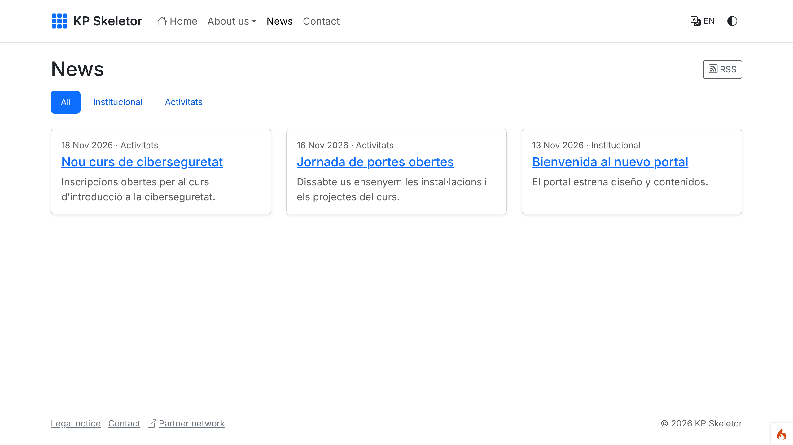
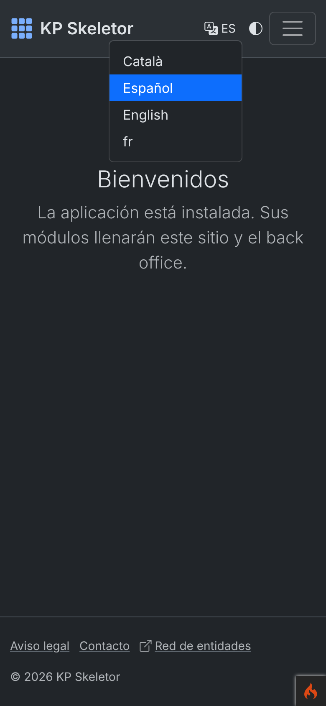

# Session 37 — Content languages from the site's locales

Branch: `claude/tender-pasteur-75mv6z` · Pull request: [SIENSIS/kpskeletor#51](https://github.com/SIENSIS/kpskeletor/pull/51) · Date: 2026-11-19

## What was built

- Every translated content form, reader and API (News posts and categories, Pages, Events and
  their categories, Menus items and custom links, Tasks projects) takes its languages from the
  site's locales (`Core.locales`) and requires the site's **default language**
  (`Core.defaultLocale`), not always Catalan.
- A language added by configuration (`Config\App::$supportedLocales`) can be ticked in
  Settings › General and appears at once as an empty tab in every content form; readers and the
  API fall back to the default language until it is filled in.
- A language removed from `Core.locales` keeps its texts (not shown, not edited, kept on save);
  a new default language is required on the next edit, existing records stay readable.
- Slugs, activity summaries and notification titles use the default language's text (else the
  first one filled in); help texts and the Menus "label required" message name that language.
- **The language in public URLs** (added at the owner's request during the session, D-37-02):
  `/qui-som` is in the site's default language, `/es/quienes-somos` in Spanish, `/en/news/…` in
  English; internal links keep the prefix; the public header shows a language switch (globe + the
  current code, next to the light/dark switch) that links to the same page in every language (each
  page's own slugs for Pages); `hreflang` alternates and a sitemap with every translation. The back
  office, the API and the sign-in pages are unchanged. Hidden with a single language or with the
  theme option `languageSwitch` off.
- Calendar titles of birthdays and to-do task due dates are written in every site language;
  FullCalendar loads its locale file for any vendored language.

## How it was built

- **One source in the Core:** `modules/Core/Content/ContentTranslations.php` now reads
  `Modules\Core\I18n\Locales`: `locales()` (code => own name), `codes()`, `defaultLocale()`,
  `defaultName()`, `crudOptions([...])` (kpcrudy: `required` = [default], `fallbacks` =
  `['*' => [default]]`), `apiOptions([...])` (kpapy: `required` = [default]),
  `defaultText($texts, $field)` (source text), `keepUnavailable($edited, $stored)`; `texts()` /
  `pick()` fall back to the default language and ignore languages no longer offered. The
  constants `ContentTranslations::LOCALES`, `FALLBACK_LOCALE`, `NewsRepository::FALLBACK_LOCALE`,
  `News\Controllers\Posts::LOCALES` and `TranslatedText::FALLBACK_LOCALE` were **removed**
  (D-37-01; upgrade notes in `docs/i18n.md` and `CHANGELOG.md`).
- **kpapy:** its chain (requested → `localeFallbacks` → `Config\App::$defaultLocale` → others)
  ignored the setting; `app/Config/Kpapy.php` sets `localeFallbacks = [Locales::default()]`.
- **Modules:** `setTranslations(..., ContentTranslations::locales(), ContentTranslations::crudOptions([...]))`
  in `News/Controllers/{Posts,Categories}.php`, `Pages/Controllers/Pages.php`,
  `Events/Controllers/{Events,Categories}.php`, `Tasks/Controllers/Projects.php`; `codes()` +
  `apiOptions()` in `News/Controllers/Api/{Posts,PublicNews}.php`, `Events/Services/EventsApi.php`,
  `Tasks/Controllers/Api/Projects.php`. Menus: labels per `codes()`, the default required
  (validation, `*` marker and `required` from `$required` in `Views/{item_form,custom_form}.php`,
  activity summaries); `MenuRepository::saveItem()` only replaces labels of available languages;
  custom links and back-office retouches keep labels of removed languages (`keepUnavailable()`).
  Pages: `PageSlugs`, `PageResolver` and `Revisions` (a restore only replaces available
  languages). Calendar: `CalendarEvent::translated($key, $args)` and the default-language
  fallback (`Core/Calendar/CalendarEvent.php`, `Users/Calendar/Birthdays.php`,
  `Tasks/Calendar/DueDates.php`); `Events/Services/CalendarComponent.php` loads any vendored
  FullCalendar locale. `Core/Settings/TranslatedText.php` falls back to the default language.
- **Settings:** `Core.defaultLocale` and `Core.locales` take their choices from the supported
  locales through `optionsProvider` (`Core/I18n/DefaultLocaleOptions.php`, `LocaleOptions.php`).
- **Language in the URL:** `modules/Core/I18n/LocaleRouter.php` (the `router` service in
  `app/Config/Services.php`) reads the prefix before routing, so module routes are unchanged;
  `modules/Core/I18n/LocaleUrls.php` (service `localeurls`: split, public paths, redirects of
  `/ca/…`, unavailable languages and `/es/<non-public>`, `localize()`, `url()`, alternates, links,
  `hreflang`); `app/Config/LocaleUrls.php` (`$enabled`, `$excluded`); the application's
  `site_url()` in `app/Helpers/url_helper.php` keeps the prefix; the `locale` filter applies the
  URL's language and `authsession` keeps the profile's for non-public paths only;
  `themes/default/Views/partials/language_switch.php` (links) and `partials/head.php`
  (`hreflang`); Pages: `PublicPages` (alternates, redirect of another language's slug),
  `PageTree::translatedPaths()`, `SitemapBuilder` (every translation), language codes reserved
  in `PageSlugs`.
- **No tables, permissions, routes or commands changed;** no migration (one translation row per
  locale already).

## Decisions and deviations

- **D-37-01** (Accepted, proposal): the helpers above, the removal of the constants (no
  deprecated alias: a constant cannot follow a setting), and the behaviour when languages are
  added, removed or the default changes. The specification's "Catalan as the required language"
  now reads "the site's default language".
- **D-37-02** (decided by the owner on 2026-11-19): the language is part of public URLs (no prefix
  = the default language). A first version (a cookie + the profile language, `POST language`) was
  built and decided first, then replaced the same day at the owner's request (Pages has one slug per
  language; better for SEO and usability).
- Earlier gaps fixed because they blocked the goal: the language settings only offered ca/es/en;
  help texts and a Menus message named Catalan; translated settings fell back to Catalan.
- Tests: the suite runs with `app.defaultLocale=en` (English assertions), which would make English
  the required content language, so the News, Pages, Events, Menus and Tasks test cases call
  `useShippedContentLocales()` (Catalan default, an English-speaking browser); the translated
  settings tests pin `Core.defaultLocale = ca` and also check another default.

## How to try it

```bash
php spark app:install --env=development --db=sqlite --demo
php spark serve
```

1. Add a language to `Config\App::$supportedLocales` (e.g. `'fr'`) and run `php spark modules:sync`.
2. Settings › General: tick it in **Available languages** and choose **Spanish** as the default.
3. `backend/news/posts/add`, `backend/pages/add`, `backend/events/add`,
   `backend/events/categories/add`, `backend/tasks/projects/add` (Tasks enabled),
   `backend/menus/items/1/new`, `backend/menus/backend/link/new`: four tabs/labels, Spanish `*`;
   saving without Spanish is refused, without Catalan accepted.
4. Give a public post a Spanish text and open it with a French browser (`/news/<slug>`), or
   `api/v1/public/news/<id>?lang=fr`: the Spanish text (the default), not the Catalan one.

## Tests and checks

New tests (all in the suite):

- `modules/Core/Tests/ContentLocalesTrait.php`: `useContentLocales('fr', 'es')`,
  `useShippedContentLocales()`, `assertTranslationTabs()`.
- `modules/{News,Pages,Events,Tasks,Menus}/Tests/ContentLocalesTest.php`: four tabs with `es`
  required; saving without `es` refused and without `ca` accepted; slugs from the `es` title
  (News posts and categories, Pages, Events categories, Tasks projects); readers in `fr` fall back
  to `es`; News and Menus keep the rows/labels of a language no longer offered.
- `modules/{News,Events,Tasks}/Tests/ContentLocalesApiTest.php`: the APIs answer in `fr` with the
  `es` fallback (fails without the `Config\Kpapy` change, checked); the projects API refuses a
  project without `es`.
- `tests/unit/I18n/ContentLanguagesTest.php`: no literal `'ca'`/`'es'`/`'en'` in module or theme
  code (allow-list: language files, `Database/`, `Config/`, tests, `Locales`, `Language`); the
  removed constants are not used.
- `modules/Core/Tests/I18nTest.php::testTheLanguageSettingsOfferEverySupportedLocale`.
- `modules/Core/Tests/LocaleUrlsTest.php`: no prefix = the default language whatever the browser;
  the prefix gives the language and internal links keep it; the switch links to the same page in
  every language and `hreflang`/`x-default` are listed; hidden with one language or the option
  off; redirects of `/ca/…`, `/es/login`, `/es/backend` and unavailable languages; back office and
  sign-in keep negotiating (profile, browser); it can be turned off.
- `modules/Pages/Tests/PublicPagesTest.php`: `/es/quienes-somos`, the redirect of another
  language's slug, canonical and `hreflang` per translation, the home page per language, the
  sitemap with every translation.

Results:

```
vendor/bin/phpunit                         OK (1361 tests, 18012 assertions)
vendor/bin/phpstan analyse                 [OK] No errors
vendor/bin/php-cs-fixer fix --dry-run      Found 0 of 1015 files that can be fixed
php spark modules:sync                     Mòduls sincronitzats.
php spark permissions:check                Permisos correctes: 169 permís(os) al catàleg, 345 ruta(es) comprovades.
php spark csp:check                        No hi ha scripts, gestors ni estils en línia a les vistes del projecte.
```

## Screenshots

Taken with Playwright against `php spark serve` with the demo data, device scale factor 2, after
adding `fr` to `Config\App::$supportedLocales` (local change, not committed) and saving
Settings › General through the browser. No CSP violation was reported.


*01 — Settings › General: "Available languages" now lists every supported locale (the added
`fr` shows its code until `Core.locales.fr` is in the language files); Spanish chosen as the
default.*


*02 — The News post form: one tab per site language, Spanish (the default) marked required,
Catalan optional.*


*03 — Menus › add an item: one label per site language, `Español *` required.*


*04 — The Events category form at phone width in dark mode: the same four tabs.*


*05 — A public post at `/fr/news/…`: no French text, so the Spanish one (the site's default)
is shown instead of the Catalan one; the interface texts follow the language chain (fr → es).*


*06 — The public language switch open on the news list (`/news`, the default language; Spanish in this demo, Settings › General): links
to `/ca/…` → `/news`, `/en/news`… (globe + current code, next to the light/dark switch).*


*07 — After choosing English: the same page at `/en/news`, interface in English, content falls
back to the default language where there is no English text; its links stay under `/en/`.*


*08 — The switch at phone width in dark mode, next to the colour-mode switch and the menu button.*

## Known issues

- News, Events and Tasks have one slug per record (from the default language), so their URLs differ
  only by the prefix (`/news/x`, `/es/news/x`); Pages has one slug per language.
- Page caching (`pagecache`, unused today) keys pages by the routed path: it would mix the
  languages of one page if turned on.
- A new language shows its code (`fr`) on tabs and checkboxes until `Core.locales.<code>` and its
  language files exist (`docs/i18n.md`, "Adding a language", step 2).
- Composer needed the known issue 04 workaround again: `phpstan/phpstan` (zip only) installed
  from a shallow clone of tag 2.3.5 through a scratch copy's lock, `vendor/` moved in; seeding
  Composer's cache was refused by the session's permission checks. Project files unchanged.
- The full PHPUnit suite takes about 13 minutes here.

## Notes for the next session

- Translated content only through `ContentTranslations` (`locales()` + `crudOptions()` for
  kpcrudy, `codes()` + `apiOptions()` for kpapy, `defaultText()` for source texts); the static
  test fails on a literal language code. Module tests with other languages:
  `Modules\Core\Tests\ContentLocalesTrait`.
- Sites upgraded from 1.0.0: `php spark modules:sync` (the language settings' options). Modules
  outside the skeleton that used the removed constants must follow the upgrade notes
  (`docs/i18n.md`, "Upgrading a module written for 1.0.0").
