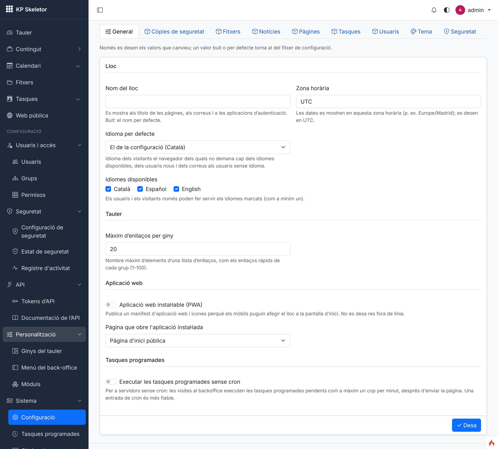
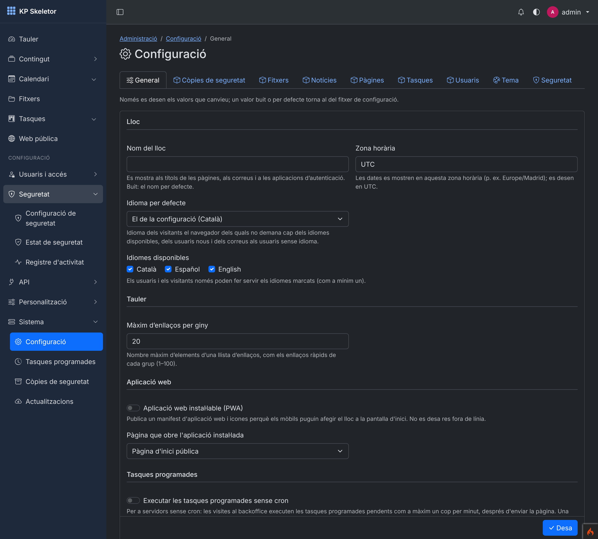
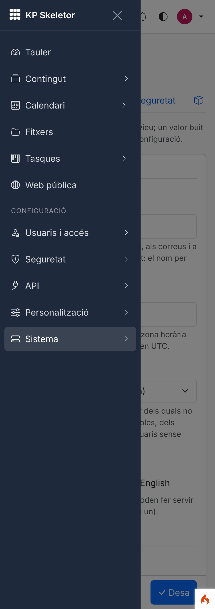
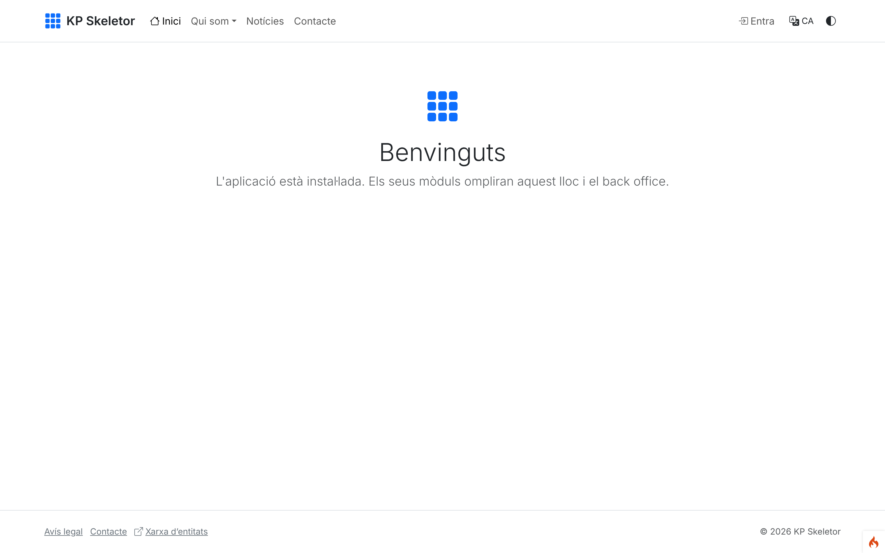
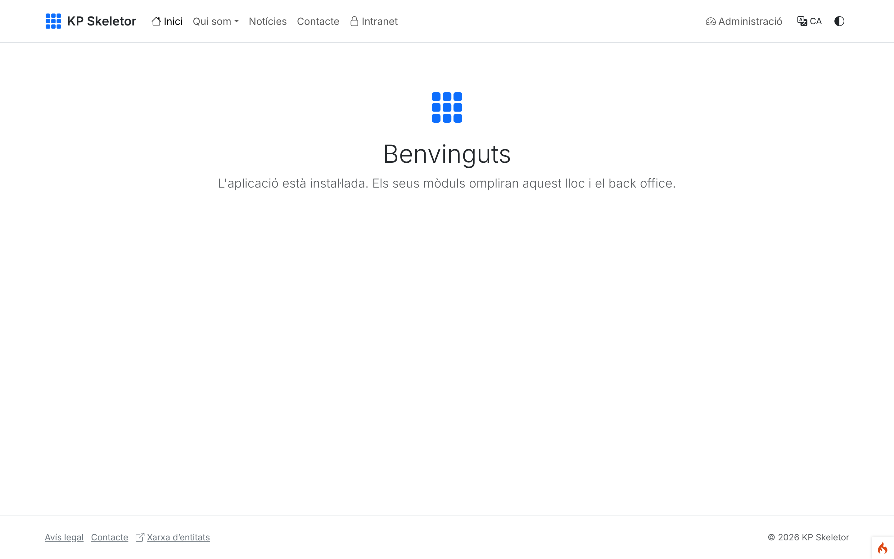
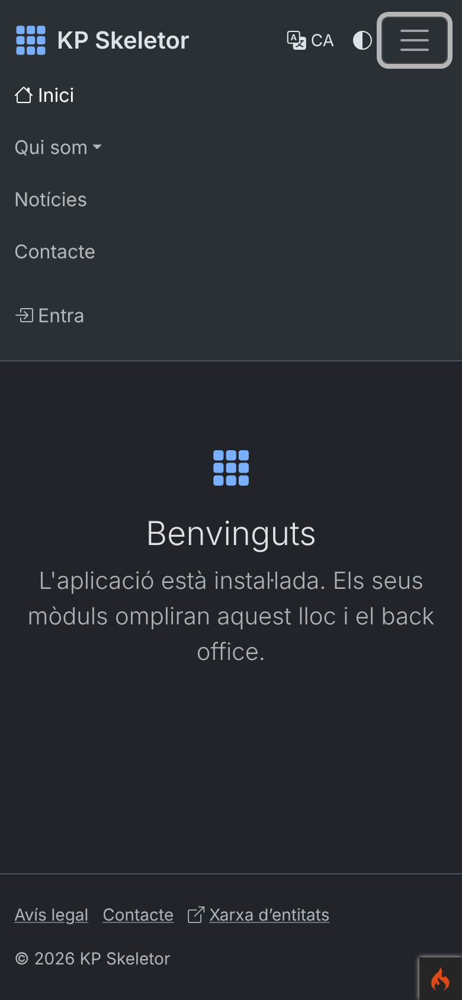
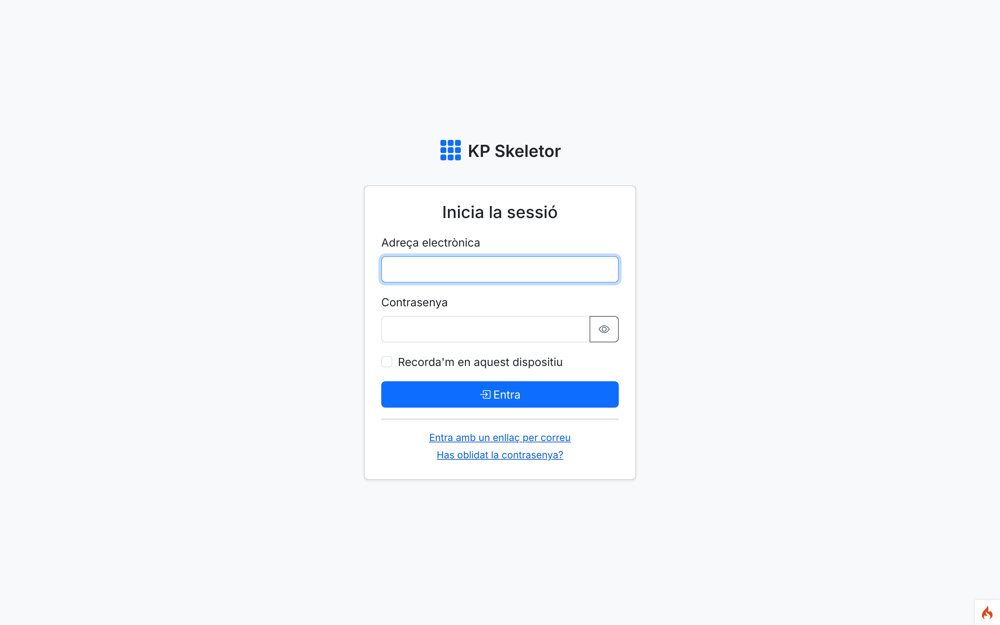
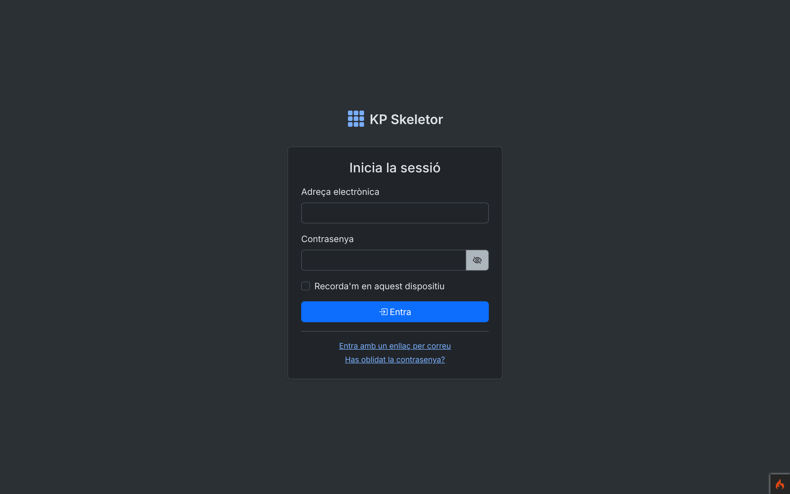
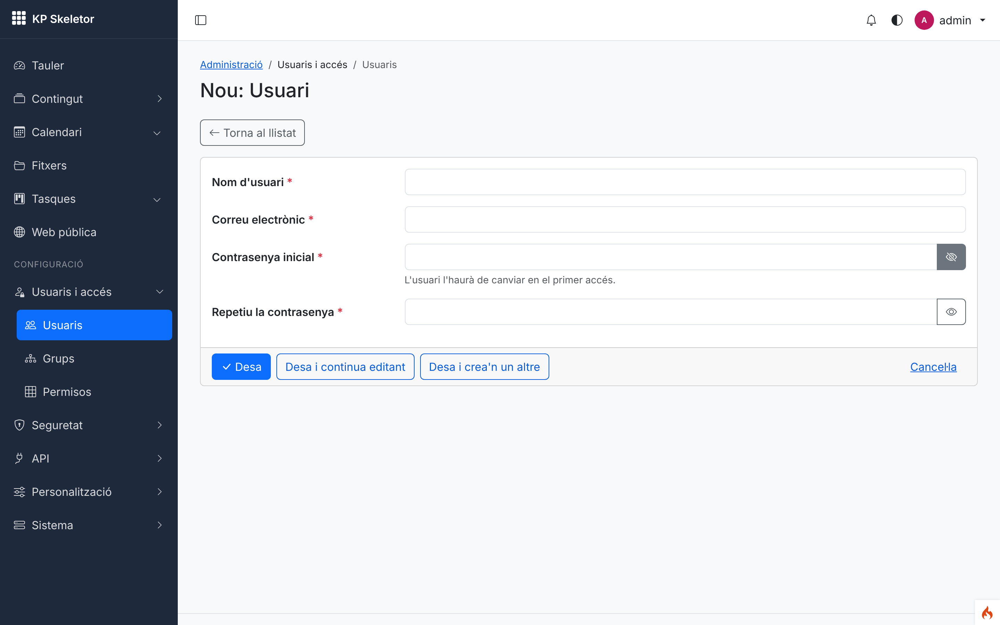
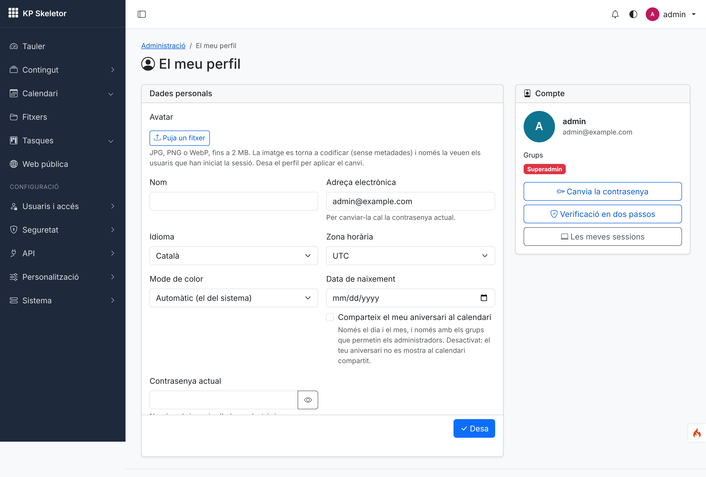

# Session 38 — Settings menu groups, the public sign-in link and password reveal

Branch: `ccr-9a87a802-7fo7kt` · Pull request: PR_LINK · Date: 2026-11-19

## What was built

- **Settings menu groups (D-38-01).** The *Configuració* part of the back-office sidebar shows
  five groups instead of fifteen loose entries: **Usuaris i accés** (Users, Groups, Permissions),
  **Seguretat** (Security settings, Security status, Activity log), **API** (API tokens, API
  documentation), **Personalització** (Dashboard widgets, Back-office menu, Modules) and
  **Sistema** (Settings, Scheduled tasks, Backups, Updates). A group shows only while one of its
  entries is visible to the user; breadcrumbs include the group ("Administració / Usuaris i
  accés / Usuaris").
- **Public account link.** The public navbar ends with **Entra** for visitors, **Administració**
  for users who can open the back office and **El meu compte** for the rest (theme option
  `showAccountLink`, on by default; inside the collapsed menu at phone width; inherited by the
  `tasks-demo` child theme).
- **Show/hide button on every password field.** An eye button next to every password input
  (login, re-authentication, lock, profile, reset, password page, Backup forms, kpcrudy forms such
  as Users › new user, and any future module), opt-out with `data-no-reveal`.

## How it was built

**Menu groups**

- `MenuDefinitions` accepts a new manifest menu key `group` (D-38-02, **Open**):
  `['group' => 'group.system', 'label' => …, 'icon' => …, 'order' => …, 'zone' => 'settings']` is a
  definition of kind `group` (no route, no permission) whose key is the given value; constants
  `MenuDefinitions::GROUP_ACCESS|SECURITY|API|CUSTOMISATION|SYSTEM` and the pattern `GROUP_KEY`
  (`group.<name>`).
- `ManifestValidator` accepts `group` (pattern checked, and refused together with `resource`,
  `route` or `permission`; messages `Core.manifest.menuGroup|menuGroupLink` in ca/es/en). An
  unknown `parent` still puts the entry at the root (existing rule, tested).
- `modules/Core/Config/Module.php` declares the five groups; the `settings` entries of Users,
  Settings, Core, Activity, Api, Menus, Dashboard, Backup and Updates got `'parent' => 'group.…'`.
  **No entry key changed**, so the Menus module's stored customisations (`backend_menu_customisations`)
  and the demo seeder's still apply; the back-office menu editor lists the groups like any entry
  (rename, move, hide).
- `MenuBuilder` already rendered parents without a route as collapsible headings (kind `group`,
  hidden without visible children); the theme partials needed no change.
- `WidgetOptions` (the Quick links widget) no longer offers group headings as links.

**Account link** — `Modules\Core\Frontend\AccountLink::for(?User)` (D-38-03): guests → route
`login`; a user whose generated menu has an entry in the `sidebar` or `settings` zone →
"Administració", the first such entry (the dashboard); otherwise the first entry of the `user`
zone (the profile) → "El meu compte". No `backend` string or module name in the Core. Theme:
option `showAccountLink` (`themes/default/Theme.php`), partial `partials/account_link.php`,
included at the end of `#site-menu` in `layouts/public.php`. Texts `Core.account.*`,
`ThemeDefault.options.showAccountLink*`.

**Password reveal** — `modules/Core/Assets/js/forms/password-reveal.js`, started by
`core/app.js` (`initPasswordReveal(document)`) and by a `MutationObserver` for fields added later.
It wraps the input (or its `.form-floating`) in an `.input-group` (or reuses one), adds a
`type="button"` toggle with `aria-controls`, `aria-pressed`, a changing accessible name
(`Core.js.password.show|hide` through `core/config.js`) and a `bi-eye`/`bi-eye-slash` icon
(`aria-hidden`), moves following `.invalid-feedback` into the group (`.has-validation`), keeps the
focus in the field, and turns the field back to `password` on submit (capture phase) and on
`pagehide`. No server change, no inline code.

No new tables, routes, permissions or commands.

## Decisions and deviations

- **D-38-01** (decided by the owner) applied.
- **D-38-02 (decide, Open):** group entries declared with a new manifest key `group` and keys
  `group.<name>`; built so the key and names can still change (one constant each).
- **D-38-03 (accepted):** who sees "Administració" and where it links (from the generated menu).
- **D-38-04 (accepted):** the web installer loads no JavaScript before the assets are published, so
  its three password fields get the button in session 39 (which adds the installer's JavaScript).
  **Deviation** from the session's list of fields.
- **D-38-05 (accepted):** Activity log `order` 85 (was 84) so the Security group follows the listed
  order; group icons and orders.

## How to try it

```bash
INSTALL_ADMIN_PASSWORD='…' php spark app:install --env=development --url=http://localhost:8089/ \
    --db=sqlite --db-name=e2e.db --email=admin@example.com --demo --2fa=none --no-interaction
php spark serve --port 8089
```

- `http://localhost:8089/` as a guest: **Entra** at the end of the navbar → `/login`, with the eye
  button on the password field.
- Sign in as `admin@example.com`: the public navbar shows **Administració**; the sidebar's
  *Configuració* shows the five groups (`/backend/settings`, `/backend/users/add` for the button on
  a kpcrudy form).
- Settings › Tema: "Mostra l'enllaç d'accés a la web pública" turns the link off.
- Personalització › Menú del back-office: the groups appear as entries of the `settings` zone.

## Tests and checks

New tests:

- `modules/Menus/Tests/SettingsGroupsTest.php` (5): the zone is exactly the five groups with their
  children (superadmin), a user holding only `users-users.list` sees only "Usuaris i accés" with
  Users, customisations saved before (moved to the sidebar, renamed, hidden, a group moved) still
  apply, the editor shows the groups, manifest validation of `group` and of a Core/unknown `parent`.
- `modules/Core/Tests/AccountLinkTest.php` (4): guest → "Entra" (inside the collapsible menu),
  back-office user → "Administració", user without back-office screens → "El meu compte" (never
  "Administració"), option off → nothing.
- `tests/e2e/password-reveal.spec.mjs`: login page and Users › new user (kpcrudy) — accessible
  name and `aria-pressed`, keyboard, focus kept, value sent normally, `type="password"` again on
  submit and on `pagehide`, a field added later is enhanced and `data-no-reveal` is skipped; axe in
  every project (light and dark).

Results:

```
PHPUNIT_RESULT
vendor/bin/phpstan analyse            [OK] No errors
vendor/bin/php-cs-fixer --dry-run     Found 0 of 1021 files that can be fixed
php spark modules:sync                No cal fer res: tots els mòduls estan al dia.
php spark permissions:check           Permisos correctes: 169 permís(os) al catàleg, 344 ruta(es) comprovades.
php spark csp:check                   No hi ha scripts, gestors ni estils en línia a les vistes del projecte.
npm run e2e                           E2E_RESULT
```

## Screenshots

Taken with Playwright against `php spark serve` with the demo data, device scale factor 2.


*01 — The settings zone in five groups (four of them opened), desktop.*


*02 — The same in dark mode.*


*03 — Phone width: the offcanvas sidebar with the five groups.*


*04 — Public navbar for a visitor: "Entra" at the end.*


*05 — Public navbar for the administrator: "Administració".*


*06 — Phone width, dark mode: the link inside the collapsed menu.*


*07 — Login page: the eye button, password hidden.*


*08 — Dark mode after pressing the button ("Amaga la contrasenya", `bi-eye-slash`).*


*09 — A kpcrudy form (Users › new user) with the button on both password fields, no change to the
view; breadcrumbs include the group.*


*10 — Profile: the current-password field with the button.*

## Known issues

- The web installer's password fields have no button yet (D-38-04, session 39).
- A module's own `settings` entries without `parent` show at the root of the settings zone, below
  the groups (CHANGELOG explains how to add a `parent`).
- Composer needed the known issue 04 workaround again (dist downloads refused; `phpstan/phpstan`
  from a zip of a shallow clone of tag 2.3.5 through a scratch copy of the lock file, then
  `env -u COMPOSER_AUTH composer install --prefer-source`), approved by the owner in the session.

## Notes for the next session

- Session 39: when the installer loads the Core's JavaScript, call `initPasswordReveal()`
  (`core/forms/password-reveal.js`) or load `core/app.js`; its password fields need no change.
- New `settings` menu entries take `'parent' => 'group.<…>'` (`docs/menus.md`, "Groups of the
  settings zone"). D-38-02 is Open (decide): run `deploy/decide.md` before relying on the key name.
- Session 40: `AccountLink` builds its URLs from the menu and the route `login`, never from
  `backend`.
