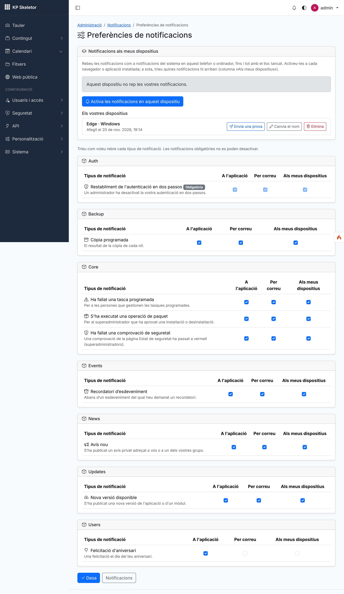
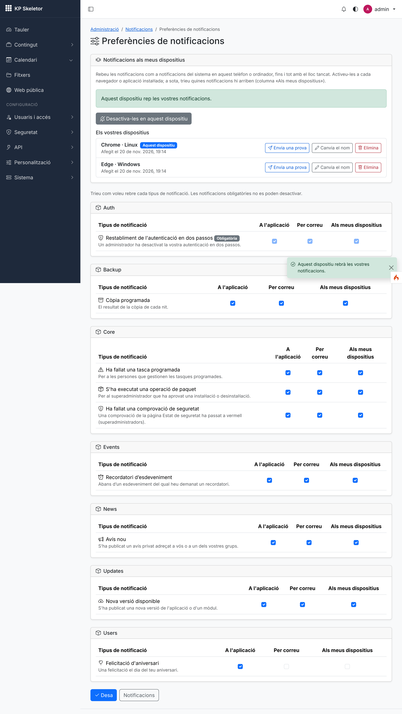
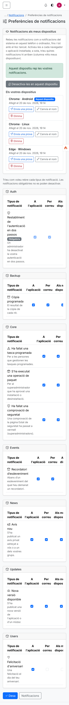
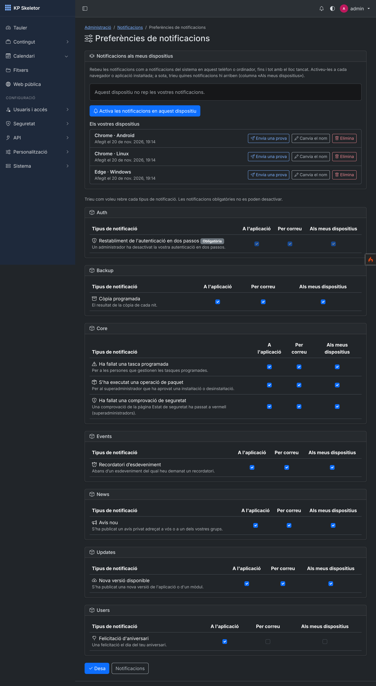
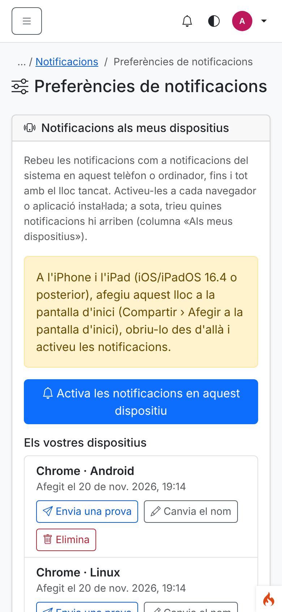
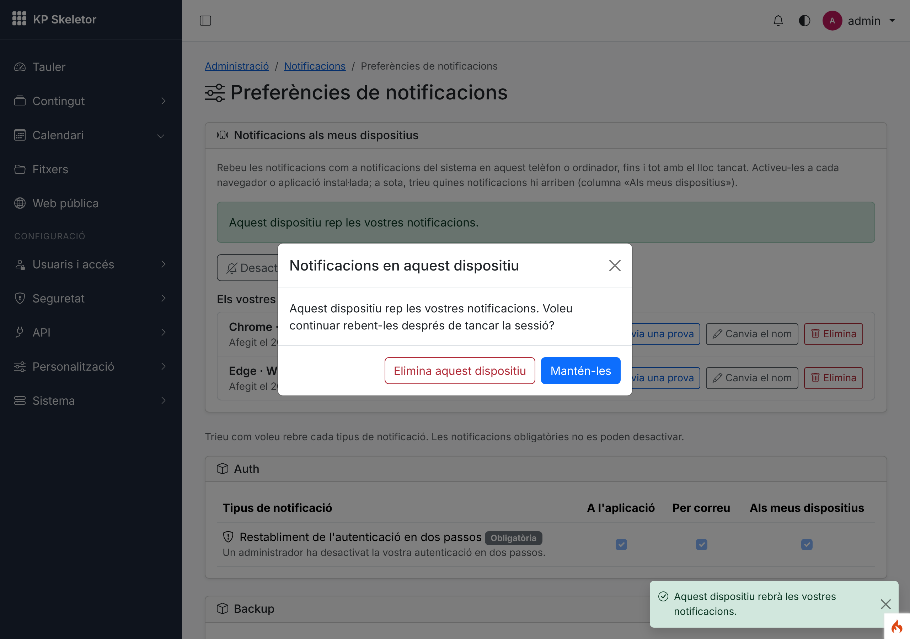
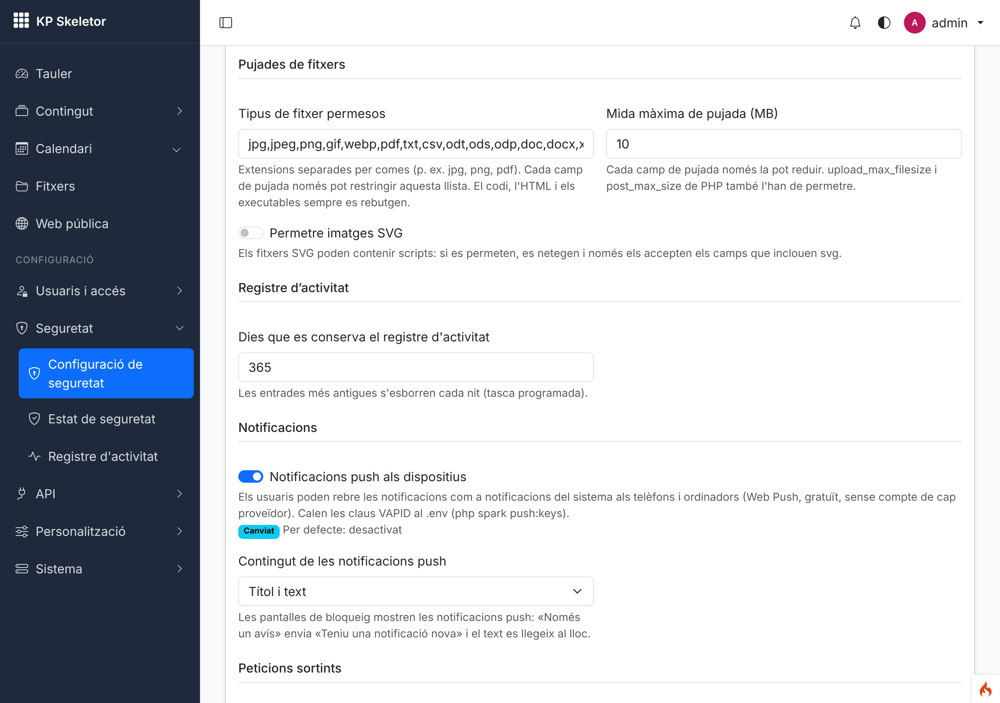

# Session 44 — Web Push notifications

Branch: `ccr-28ba7acf-il6cdh` · Pull request: (pending) · Date: 2026-11-20

## What was built

- A third notification channel, **`push`**: users turn it on in each browser or installed PWA
  (phone or desktop) from Profile › Notifications and receive the notifications they chose as
  system notifications, even with the site closed. Free: standard Web Push with VAPID, no provider
  account, no new dependency (D-44-01).
- Profile › Notifications: "Activate notifications on this device" (the browser's permission is
  asked only on that click), the user's devices ("This device" marked) with **Send a test**,
  **Rename** and **Remove**, and clear messages when push is unsupported, blocked, or on
  iPhone/iPad outside the home-screen PWA. A third column, **On my devices**, chooses which types
  go there. Logging out on a subscribed device asks whether to keep the notifications or remove
  the device.
- Settings › Security › Notifications: `Core.pushEnabled` (off by default) and `Core.pushContent`
  (`full` or `generic` — "You have a new notification" only, for lock screens).
- `php spark push:keys [--force] [--yes]`; `app:install` writes the keys; `security:check` warns
  when push is on without valid keys.

## How it was built

- **Cryptography** (`modules/Core/Push/`, OpenSSL only): `PayloadEncryption` (RFC 8291
  `aes128gcm`: ECDH P-256 with the browser's `p256dh`, HKDF-SHA256 with its `auth`, AES-128-GCM,
  one record, header `salt || rs || idlen || as_public`), `Vapid` (RFC 8292 JWT ES256, DER ↔
  R‖S, `aud` = endpoint origin, `exp` 12 h), `EcKey` (raw P-256 keys ↔ PEM, ECDH), `Base64Url`.
  Verified against the RFC 8291 appendix A vectors (every intermediate value and the final body)
  and the RFC 8292 example token, plus a decrypting round trip.
- **State:** `WebPush` (switch, key validation incl. pair match, subject, content mode, the push
  hosts for the allow-list), `PushEndpoint` (SSRF rules), `PushSubscriptions` (every read/change
  takes the user id), `DeviceLabel`, `PushKeyWriter`.
- **Delivery:** `Notifications/Channels/PushChannel` renders `{title, body, url, icon, tag}` in the
  recipient's language and queues one `push_queue` row per device (`Urgency: high` for mandatory
  types); `Tasks/SendQueuedPush` (every minute) → `PushQueue::sendPending()` → `PushSender`
  (re-checks the endpoint, encrypts, VAPID, `TTL`, `Urgency`) → `OutboundClient`. 2xx sent;
  404/410 device deleted; 429/5xx/network retried with backoff (5 attempts); other answers fail and
  count a device failure (10 in a row remove it). Nothing is sent inside a web request; nothing is
  queued or sent while push is off.
- **Notifier:** `NotificationType::PUSH` in `CHANNELS`; the preferences form shows the push column
  only while push works and keeps the stored push choice otherwise
  (`savePreferences(..., $editable)`).
- **Tables (one migration each):** `push_subscriptions` (user, endpoint + unique SHA-256, `p256dh`,
  `auth`, label, failures, created, last used), `push_queue` (subscription, JSON payload before
  encryption, urgency, status, attempts, next attempt, last error); a third migration adds `push`
  to stored preferences that had at least one channel.
- **Routes** (`modules/Core/Config/Routes.php`, controller `Controllers/PushDevices.php`): `GET
  backend/profile/push` (JSON state, never endpoints or keys), `POST …/subscribe`, `…/delete/{id}`,
  `…/test/{id}`, `…/label/{id}` — `can:core-notifications.list` (every group), CSRF,
  `ratelimit:forms` on the POSTs. No new permission.
- **Config:** `app/Config/Push.php` (`.env` keys `push.vapidPublicKey`, `push.vapidPrivateKey`,
  `push.subject`; `$serviceHosts`: `fcm.googleapis.com`, `updates.push.services.mozilla.com`,
  `*.notify.windows.com`, `web.push.apple.com`; TTL 1 day; limits). The hosts join
  `OutboundAllowList` only while push is on.
- **Front end:** `modules/Core/Assets/pwa/sw.js` (`push`, `notificationclick`, same-origin URLs
  only, still caches nothing); `core/pwa.js` keeps the worker while push is on (`push: true` in the
  page configuration) even with the PWA off; `/sw.js` and the icons are served then too;
  `core/push.js` (`data-component="core/push"`, device section and logout mode);
  `push_logout_attributes()` on the default theme's logout form. Texts in `Language/*/Push.php`
  and `Core.js.push.*` (ca, es, en).
- **Security check:** `Security/Check/Checks/PushCheck.php` (`secrets.pushKeys`).
- **Activity:** `push_subscribed`, `push_unsubscribed`; security log `push_subscription_refused`,
  `push_keys`.

## Decisions and deviations

- D-44-01 and D-44-02 (decided) applied as written.
- **D-44-03 (accepted):** push is in the base `defaultChannels()` (opt-in per device anyway) and
  the migration adds it to stored preferences with at least one channel; one more personal route
  to rename a device; the logout question through a theme helper; limits and TTL in
  `Config\Push`; endpoints not resolved at subscription time (IP literals and local names refused,
  `OutboundClient` checks addresses at delivery); a browser already subscribed by another account
  moves to the new user and its queued messages are dropped; deleted users' devices are removed
  when the queue meets them.
- **Earlier gap fixed:** the permission matrix's lock icon (`modules/Users/Views/matrix.php`) had
  an `aria-label` without a role (axe `aria-prohibited-attr` in the e2e run as an administrator):
  `role="img"` added.
- **Earlier gap fixed:** `core/ui/scroll-regions.js` counted hidden and disabled inputs as
  focusable (a scrolled table of disabled checkboxes got no `tabindex`).
- e2e: no real push service is reachable here and Chromium has no Push API in incognito contexts,
  so the spec replaces `PushManager.subscribe()` by a subscription with real keys (the server
  stores it like a real one) and delivers the queued payload to the service worker through the
  DevTools protocol; the task's encrypted delivery is covered by PHPUnit (decrypted with the fake
  browser's keys).

## How to try it

```bash
php spark push:keys                      # only on installations made before this session
# Settings › Security › Notifications: turn on "Push notifications on devices"
php spark serve                          # then Profile › Notifications (backend/profile/notifications)
php spark schedule:run                   # sends the queue (cron runs it every minute)
```

Demo users are created by `php spark app:install --demo` (random passwords printed once). A real
phone needs the site on HTTPS; for iPhone/iPad turn the PWA on and add the site to the home screen.

## Tests and checks

- New tests: `PushCryptoTest` (7), `PushDeliveryTest` (11), `PushSubscriptionsTest` (23 with the
  data provider: forged endpoints — other host, look-alike, `http:`, other port, private and
  loopback IPs, metadata IP, `localhost`, credentials, `javascript:`), `PushKeysTest` (4); updated
  `CoreMigrationsTest`, `ModulesSyncTest`, `RegistrySyncTest`, `InstallerTest`,
  `NotificationScreensTest`, `RateLimitTest` (three push routes); e2e `tests/e2e/push.spec.mjs`.
- Results (2026-11-20):

```
vendor/bin/phpunit                  OK (1590 tests, 82588 assertions)  12:12
vendor/bin/phpstan analyse          [OK] No errors
vendor/bin/php-cs-fixer --dry-run   Found 0 of 1140 files that can be fixed
php spark modules:sync              Mòduls sincronitzats.
php spark permissions:check         Permisos correctes: 171 permís(os) al catàleg, 367 ruta(es) comprovades.
php spark csp:check                 No hi ha scripts, gestors ni estils en línia a les vistes del projecte.
php spark assets:publish --check    Els recursos publicats estan al dia.
php spark security:check            13 ok, 7 info, 7 warnings, 6 errors — all expected on the development
                                    demo site (development, debug, HTTP, cookies, base URL, demo data);
                                    secrets.pushKeys: info "push on with a valid VAPID key pair"
npm run e2e (demo site, push on)    195 passed, 27 skipped (the push flow, the generator and the menu
                                    walk run in one project each)
```

## Screenshots


*01 — Profile › Notifications on a desktop browser that has not turned push on: the device section
(another browser of the user already listed) and the new "Als meus dispositius" column.*


*02 — After "Activa les notificacions en aquest dispositiu": this browser is marked "Aquest
dispositiu", with Envia una prova / Canvia el nom / Elimina, and the confirmation toast.*


*03 — Phone width (390 px), Android Chrome, after activating; the preference tables scroll
horizontally inside their cards.*


*04 — Dark mode, a browser without a subscription.*


*05 — iPhone outside the home-screen PWA: the message explains how to add the site to the home
screen (iOS/iPadOS 16.4+).*


*06 — Logging out on a subscribed device: keep the notifications or remove this device.*


*07 — Settings › Security › Notifications: the switch and the content of push notifications.*

## Known issues

- Delivery to the real push services was not tried from this environment (no access to FCM,
  Mozilla, WNS or Apple); the format follows the RFCs and the vectors pass.
- The preference tables need horizontal scrolling at phone width with three channel columns.
- Composer again needed the known issue 04 workaround.

## Notes for the next session

- A notification type that must never reach a lock screen returns only `database`/`email` from
  `defaultChannels()`.
- Tests: `PushFixturesTrait` + `FakePushTransport` for anything that sends push.
- Session 45 (pages from sections) is next.
