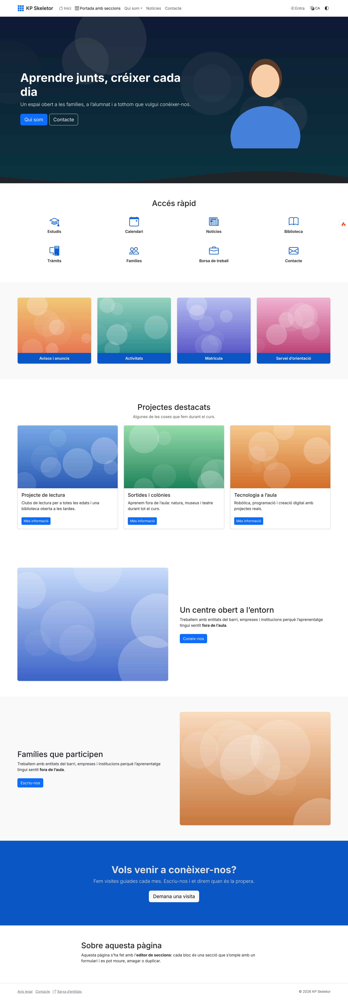
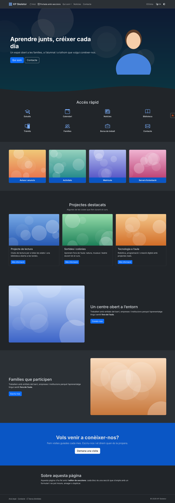
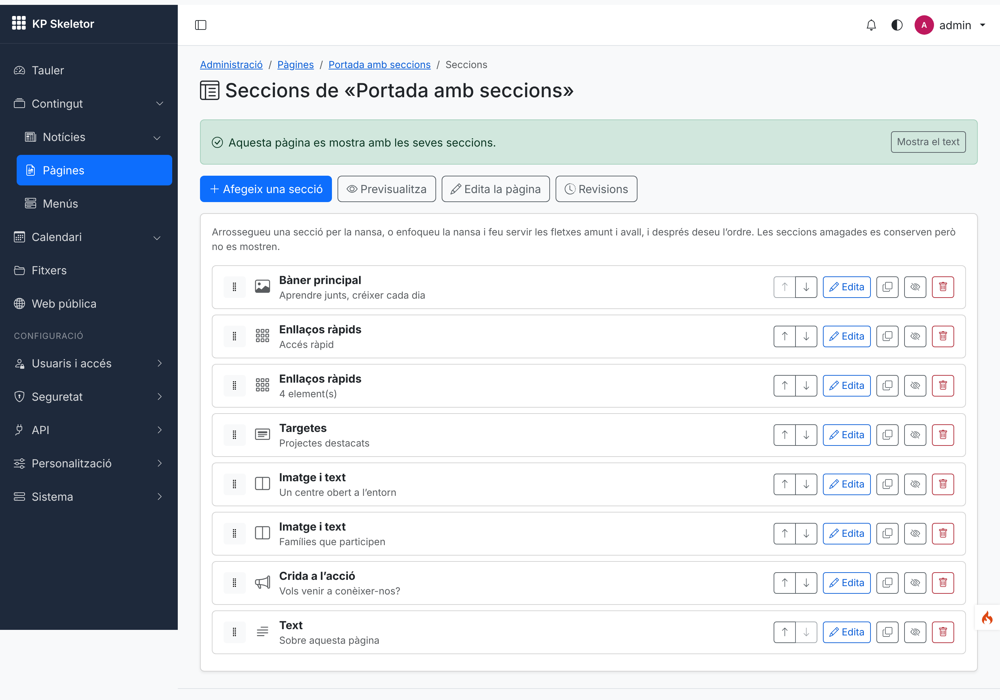
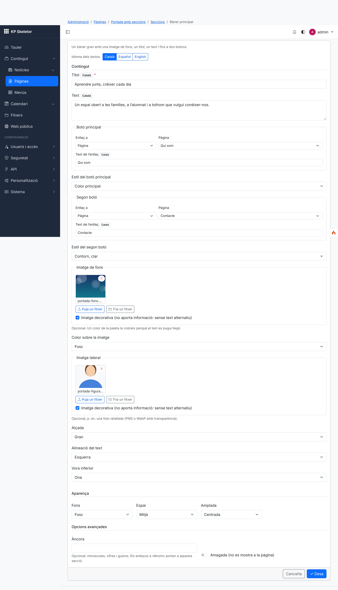
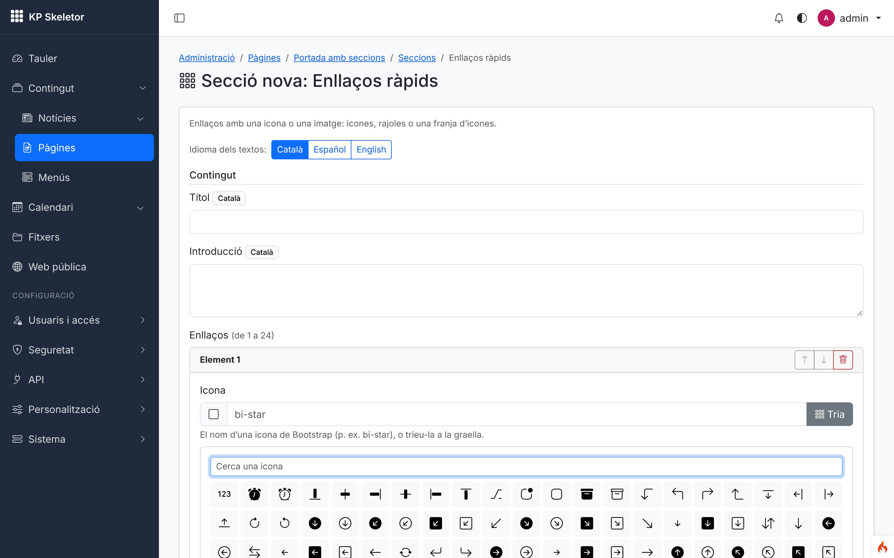

# Session 45 — Pages built from sections: registry, editor and the first section types

Branch: `ccr-79cc038d-az4wo5` · Pull request: (opened at the end of the session) · Date: 2026-11-21

## What was built

- A page can now be built from **sections** instead of a single rich-text body: a page's
  **layout** is *Article* (its text, as before) or *Sections*. Switching keeps the other content.
- **Section editor** (row operation **Sections** in Pages, `backend/pages/<id>/sections`): the
  list of sections with drag and drop and keyboard reordering (handle + arrow keys; up/down
  buttons also without JavaScript), **Add section** with a gallery of types (thumbnail and a
  sentence each), a form per section generated from its type's schema, **duplicate**, **hide**,
  **delete**, **Preview**; language buttons on the forms (default language required, the others
  fall back to it); unsaved-changes guard. Every change is a **page revision**, and restoring a
  revision brings its sections back.
- **Six section types** (module Pages): **Hero banner** (background image with an overlay colour,
  title, text, two buttons, side cut-out image, height S/M/L/full, alignment, straight or wave
  bottom edge), **Quick links** (icon or image + label + link; styles *icons*, *tiles*, *band*;
  2–6 columns), **Cards** (heading, intro, cards with image, title, text, button; 2–4 columns),
  **Image and text** (image left/right, title, rich text, button), **Call to action**, **Text**.
- Every section has the common options: background from the theme's palette (none, light, dark,
  primary, image), spacing S/M/L, width contained/full, an anchor and hidden.
- The public layout has a **full-width mode**: banners reach the edges, each section brings its
  own container. Responsive (phone, tablet, desktop), light and dark mode, AA contrast, no inline
  code.
- Modules can add their own types: new manifest key **`$sectionTypes`** (sessions 46–48 add more).
- Demo: a published page **"Portada amb seccions"** (`/portada-seccions`, in the main demo menu)
  built with every type and placeholder illustrations drawn for the demo.

## How it was built

**Core (`modules/Core/Sections/`)**

- `SectionType` (abstract): `key()` `<module>.<name>`, `label()`, `description()`, `icon()`,
  `thumbnail()`, `schema()` (list of fields), `styles()`, `backgrounds()`, `defaultOptions()`,
  `view()` (default `Modules\<Module>\Views\sections\<name>`, overridable in
  `themes/<slug>/Views/overrides/<Module>/sections/<name>.php`), `resolve()`, `render()`,
  `summary()`, `fileKeys()`.
- `SectionRegistry`: types of enabled modules from `DeclarationRegistry` (new kind
  `sectionType`, stored by `modules:sync`); a type with a foreign, invalid or repeated key or a
  missing class is skipped and logged. `ModuleManifest::$sectionTypes`, checked by
  `ManifestValidator`.
- Field types (`Fields/`): `TextField`, `TextareaField`, `RichTextField` (HtmlSanitizer on save
  and on output), `ImageField` (file picker, only images the editor may use, alt text per
  language unless decorative), `LinkField` (`SectionLinks`: module link types, GET routes,
  `https://` or internal paths, checked like menu items), `IconField` (vendored Bootstrap Icons,
  `Icons`), `SelectField`, `NumberField`, `BooleanField`, `ListField` (min/max items,
  reorderable, no nesting). Each field splits a posted value into a non-translated part and a
  part per language; `SectionValidationException` names the field path.
- `SectionForm` (validates a whole post: unknown fields and options refused), `SectionOptions`,
  `SectionFormView` + views `Modules\Core\Views\sections\{form,field,fields/*}`,
  `SectionRenderer` (wraps each visible section in `<section class="kp-section …">`, background
  images as decorative ``), `SectionData`, `RenderContext`, `FieldContext`.
- JavaScript: `core/sections/form` (language tabs, list items, link kinds, background image,
  decorative images) and `core/sections/icon-field` (searchable grid, keyboard).
- Texts: `Language/*/Sections.php` and `Core.js.sections.*` (ca, es, en).

**Pages (`modules/Pages/`)**

- Migrations: `AddPageLayout` (`pages.layout`), `CreatePageSections`,
  `CreatePageSectionTranslations` (one per table, `down()` implemented).
- `Services/PageSections.php` (save, reorder, move, duplicate, hide, delete, snapshot/replace),
  `Revisions` (snapshots include layout and sections; restore replaces them), `PageCopier`
  (copies them), `PageRenderer` (template `templates/sections`, `fullWidth`).
- `Controllers/Sections.php` + routes (`can:pages.edit`, declared before the CRUD catch-all; the
  CRUD's resolver/record rules checked for the page; trashed pages and other pages' sections
  answer 404). Views `Views/editor/{list,gallery,form}.php`, `Views/sections/*.php`; JS
  `pages/section-list`; thumbnails `Assets/img/sections/*.svg`. CRUD: field **Layout**, operation
  **Sections** (`pages.edit`).
- Activity: `section_added`, `section_edited`, `sections_reordered`, `section_duplicated`,
  `section_hidden`, `section_shown`, `section_deleted`, `layout_changed`; security
  `sections_denied`.

**Theme:** `themes/default/Views/layouts/public.php` (full-width mode),
`Assets/css/theme.css` (section backgrounds, spacing, hero, wave edge as an SVG mask, quick-link
styles, cards, the editor and icon grid), all from CSS variables.

**Routes** (under the back-office prefix): `GET pages/<id>/sections`, `…/add`, `…/new/<type>`,
`…/<section>`; `POST …/save`, `…/order`, `…/layout`, `…/<section>/{duplicate,hide,delete}`. No new
permission, setting or command.

## Decisions and deviations

- **D-45-01** (decided) applied as written.
- **D-45-02** (accepted): one screen per step (list, gallery, one form per section) like the Menus
  item editor; numeric page ids in the editor URL; translated parts of composite fields stored
  per language (image alt texts, link labels, list items aligned by position); links checked in
  the Core with the Menus rules (`http:` refused too) so Pages does not depend on Menus; images on
  the public disk folder `modules/<module>` and shared folders; the page title is a visually
  hidden `<h1>` and section titles `<h2>`; background images as decorative `` (strict CSP);
  the layout field optional in a CRUD post; at most 60 sections per page; demo images drawn with
  GD.
- The icon field is written so session 49 can move it to `core/forms/icon-picker.js`.
- `deploy-status/screenshot.mjs`: full-page shots now scroll through the page first (lazy images).

## How to try it

```bash
php spark app:install --env=development --db=sqlite --demo     # or: php spark modules:demo Pages && php spark modules:demo Menus
php spark serve
```

- Public: `/portada-seccions` (also `/es/portada-secciones`, `/en/sections-home`); main menu
  "Portada amb seccions".
- Back office as `admin@example.com` or `editor@example.com` (random demo passwords printed by
  the installer): Pages › row menu of "Portada amb seccions" › **Sections**.

## Tests and checks

New tests: `modules/Core/Tests/SectionsTest.php` (12: registry and disabled modules, foreign and
repeated keys, manifest validation, forged posts — unknown fields and options, wrong shapes, too
many items, bad icons, anchors, `javascript:`/`http:`/`//`/credentials links, unknown routes and
link types, images the editor may not use, private files never shown — escaping, rich-text
sanitising, fallbacks, list order, the renderer's wrapper, a theme override) and
`modules/Pages/Tests/PageSectionsTest.php` (10: permissions and forged POSTs, add/edit/422,
type not changeable, sections belong to their page, order/move/hide/duplicate/delete, revisions
restore sections, layout switch keeps content and uses full width, markup of each type, audience
rules, translations fallback, page duplicate); `PagesModuleTest` (7 migrations up/down/up);
e2e `tests/e2e/sections.spec.mjs`.

RESULTS_PLACEHOLDER

## Screenshots


*01 — "Portada amb seccions" at desktop width: hero with a wave edge and a cut-out figure, quick
links (icons), tiles, cards, image and text twice, call to action and text.*


*02 — The same page on a phone (390 px): columns stack, no horizontal scroll.*


*03 — Dark mode: palette backgrounds and text colours adapt.*


*04 — The section editor: layout notice, toolbar, sections with handle, move, edit, duplicate,
hide and delete.*


*05 — "Add section": the gallery of the six types with thumbnails and descriptions.*


*06 — The hero banner's form, generated from its schema: language buttons, links, image pickers
with "decorative", appearance and advanced options.*


*07 — A new quick-links section: an item added and the searchable icon grid open.*


*08 — The quick-links form on a phone in dark mode.*


*09 — `/es/portada-secciones` on a tablet: the Spanish texts.*

## Known issues

- `modules:demo Pages --remove` deletes the demo images' rows but leaves their files in
  `public/uploads/modules/pages` (demo removal only deletes files under `writable/`).
- The order of sections is saved with "Save the order"; duplicate/hide/delete buttons pressed
  before saving a new order act on the saved order.
- Composer again needed the known issue 04 workaround (phpstan from a shallow clone of tag 2.3.5
  in a scratch copy's lock, `env -u COMPOSER_AUTH composer install --prefer-source`).

## Notes for the next session

- Session 46 adds section types from other modules: declare them in `$sectionTypes` with keys
  `<module>.<name>`, views in `Views/sections/<name>.php`, see `docs/sections.md`. A type that
  needs data (latest news, events) overrides `render()` and must respect the reader
  (`RenderContext::$user`).
- Embeds (D-46-01) and the carousel (D-46-02) need new field types or options; add them to
  `modules/Core/Sections/Fields` and the form views (`Modules\Core\Views\sections\fields\…`).
- Session 49 moves `core/sections/icon-field.js` to `core/forms/icon-picker.js`.
