# Session 46 — Section types from modules: news, calendar, gallery, carousel, logos and embeds

Branch: `ccr-e82442c9-gplsu5` · Pull request: PR_LINK · Date: 2026-11-21

## What was built

Pages built from sections (session 45) can now show the data of other modules and more kinds of
content, all filled in with forms (no code, no shortcodes):

- **News list** `news.list` (News): the newest N news (cards or a compact list, optional "more"
  link) or the **full list** with pages and an optional search box; one or several categories;
  2–4 columns; date, summary and image optional. It shows exactly what the public news list shows
  to the same visitor. Two lists on one page page independently (`page-<section id>`,
  `q-<section id>`).
- **Category banners** (News): a category gets an optional banner (new migration) shown as a hero
  on its page (`news/category/<slug>`, where it becomes the page's only `<h1>`) and above its
  articles.
- **Main news list** (D-46-03): setting `News.listPage` (Settings › News). When a published page is
  chosen, `/news` answers a 301 redirect to it; categories and articles keep their URLs; with no
  page chosen nothing changes.
- **Calendar** `events.calendar` and **Upcoming events** `events.list` (Events): the public
  calendar component with chosen categories, first view and an optional filter; the next N public
  events as a list or cards with a date badge. Public events only; nothing (and an editor warning)
  while the public calendar is off.
- **Gallery** `files.gallery` (Files): the images of a shared folder as a grid or a masonry, with
  captions and a lightbox (`<dialog>`, arrows, Escape, focus back). Public-disk folders for
  everyone; private-disk folders only for signed-in visitors with the folder ACL's `view` right,
  never for guests; SVG never shown.
- **Carousel** `pages.carousel` (D-46-02): slides like the hero; arrows, dots, keyboard. **No
  rotation by default**; when turned on (6–30 s) a pause button is always shown, it stops on hover
  and focus and never rotates with `prefers-reduced-motion`. Without JavaScript the slides stack.
- **Testimonials** `pages.testimonials` (photo, quote, name, role; a dark band by default) and
  **Logos** `pages.logos` (alternative text required, optional link, grayscale option).
- **Embedded content** `pages.embed` (D-46-01): an `https://` address on a host allowed in
  Settings › Security › *Sites that may be embedded* (`Pages.embedHosts`, **empty by default**).
  Another host is refused with a message that names it and says an administrator must add it,
  with a direct link to the setting for holders of `settings.security`. A saved section whose host
  was later removed shows the same warning in the section list, its form and the preview, and
  renders nothing on the public page. The page's CSP gets `frame-src` for exactly the origins it
  shows; the iframe has a required title, `loading="lazy"`, a minimal `sandbox` and
  `referrerpolicy`; **click to load** is on by default (nothing is requested from the other site
  before the click).
- Demo: "Notícies" and "Sortides" (banner + news of their categories), "Agenda" (banner, upcoming
  events and calendar) and "Més seccions" (carousel, testimonials, logos, gallery and the embed,
  hidden until its host is allowed); a News category "Sortides" with five outings and covers, two
  category banners, eight images in the public folder "Imatges web".

## How it was built

**Core (`modules/Core/Sections/`)**

- `SectionType::check(SectionData, FieldContext)` — rules of a whole section, run by
  `SectionForm::validate()`; `SectionValidationException` can carry a link
  (`['url', 'label']`, `toArray()`), shown after the message in the form.
- `SectionType::warnings(SectionData, ?User)` — problems only editors see: the section list
  (`Pages/Views/editor/list.php`), the form (`SectionFormView` `$warnings`) and the preview
  (`SectionRenderer` prepends `Views/sections/warnings.php` when `RenderContext::$preview`).
- `SectionType::cspSources(SectionData)` — applied by `SectionRenderer` to the response's CSP
  (`ContentSecurity::apply(service('csp'), …)`) only for sections that are shown. A section whose
  view renders nothing is left out with its `<section>`.
- Fields: `ChoicesField` (checkboxes, list of keys in the options' order; view
  `sections/fields/choices.php`), `SelectField::optionsFrom(Closure)` (options read once, labels
  are names), `BooleanField::default(bool)`, `ImageField::withoutDecorative()`.
- `SectionQuery` (`page-<id>`, `q-<id>`, links that keep the rest of the query string and jump to
  `#kp-s<id>`), views `sections/pager.php` and `sections/heading.php` for any module's sections.
- Texts `Sections.form.noChoices`, `Sections.pager.*` (ca, es, en).

**News**: `Sections/NewsListSection.php` + `Views/sections/list.php`; `NewsRepository::page()`
filters `categories` (list) and `q` (title or summary, any language) and `categories()` returns
`banner`; migration `2026-11-21-100001_AddBannerToNewsCategories` (`news_categories.banner`,
`down()` implemented); `Controllers/Categories.php` (field `banner` with the cover's picker,
`CoverUploads::accepts()` refuses forged keys); `Views/public/_banner.php`, `index.php`, `show.php`;
`Services/ListPage.php` (page through the Core link type `pages.page`, so News does not depend on
Pages) and `Settings/ListPageOptions.php`; `PublicNews::index()` redirects (301).

**Events**: base `Sections/EventsSectionType.php`, `CalendarSection.php`, `EventsListSection.php`,
views `Views/sections/{calendar,list}.php`; the public feed accepts `categories=<id>,<id>`
(`PublicCalendar::categories()`, at most 50); `CalendarComponent::options()` takes the first view;
`calendar/_filter.php` takes a `filterId` (two calendars on one page); `events/calendar` sends
the section's categories.

**Files**: `Sections/GallerySection.php` (`check()`, `warnings()`, `images()`),
`Sections/FolderField.php` (shared folders of both disks, `<disk>:<path>`; the form offers only
the folders the editor may view), `Views/sections/gallery.php`, `Assets/js/gallery.js`
(`files/gallery`).

**Pages**: `Sections/{CarouselSection,TestimonialsSection,LogosSection,EmbedSection}.php`, views
`Views/sections/{carousel,testimonials,logos,embed}.php`, `Assets/js/{carousel,embed}.js`,
`Embeds/EmbedHosts.php` (hosts, `origin()`, `settingLink()`), setting `Pages.embedHosts` (type
`list`, rule `outbound_hosts`, group `security.embeds`), thumbnails `Assets/img/sections/*.svg`;
`Controllers/Sections.php` passes the warnings and the error link.

**Theme**: `themes/default/Assets/css/theme.css` (news rows, event date badge, gallery grid and
masonry, lightbox, carousel controls, testimonials, logos, embed placeholder), all from CSS
variables; the hero's wave edge now takes the page's background (`--kp-page-bg`, resolved on the
root) instead of the dark section's `--bs-body-bg` (it showed a dark band under every dark hero
since session 45).

**Tables, routes, permissions**: one new column (`news_categories.banner`); no new route or
permission; new settings `Pages.embedHosts` (Settings › Security) and `News.listPage`
(Settings › News); no new command.

## Decisions and deviations

- D-46-01, D-46-02, D-46-03 (decided) applied as written.
- **D-46-04** (accepted, `docs/decisions.md`): galleries of shared folders only, public disk for
  everyone and private disk only with the ACL's `view` right; embed hosts are host names checked
  with `outbound_hosts`; `frame-src` per page (not every allowed host on every page); the Core
  hooks above; `News.listPage` through the link type `pages.page`; the events sections render
  nothing while the public calendar is off; the carousel's pause button is hidden under reduced
  motion (it never rotates then).
- The sitemap already lists pages only (never `/news`), so with a main list page it lists only that
  page: no change needed.
- Fixed in passing: the hero's wave edge colour (session 45).

## How to try it

```bash
php spark app:install --env=development --db=sqlite --demo     # or: php spark modules:demo News && php spark modules:demo Files && php spark modules:demo Pages
php spark serve
```

- Public: `/noticies`, `/sortides` (page 2: `?page-<id>=2`), `/agenda`, `/mes-seccions`,
  `/news/category/sortides`, `/news/sortida-al-delta`.
- Back office as the administrator: Pages › "Més seccions" › **Sections** (the embed shows the
  warning until Settings › Security › *Sites that may be embedded* lists
  `www.youtube-nocookie.com`); Settings › News › *Page of the main news list* (choose "Notícies":
  `/news` then redirects there).

## Tests and checks

New tests: `modules/Pages/Tests/ModuleSectionsTest.php` (11: embeds refused with the host named,
the settings link only for `settings.security`, http/credentials/`javascript:`/`//`/spaces
refused, allowed embeds with click to load and `frame-src` only on their page, the sandboxed
iframe, a removed host: nothing public + warnings in list, form and preview; the carousel without
rotation, minimum interval and the pause button; testimonials escaped and logos with required alt
text; the news list shows only public posts — private, group, future, expired, drafts and other
categories never — forged categories refused; two paged lists and a search on one page; the
events sections show public events only and nothing with the public calendar off; the feed's
`categories`), `modules/News/Tests/CategoryBannerTest.php` (3: banner on the category page with a
single `<h1>` and on its articles, forged banner keys refused, `/news` 301 only with a published
page), `modules/Files/Tests/GallerySectionTest.php` (2: public folders for guests, private folders
never for guests nor users without `view`; only viewable folders offered and accepted),
`modules/Core/Tests/SectionFieldsTest.php` (6: choices, provider options, boolean defaults,
query parameters, embed host matching, the embed hooks); `NewsModuleTest` (the banner migration
up/down/up); updated counts in the demo tests and the registry test. E2E:
`tests/e2e/module-sections.spec.mjs` (the four demo pages at every width and colour mode with axe
and CSP checks, the paged list, the carousel with arrows, dots and keyboard and no rotation, the
lightbox, and click to load with no request to the other site before the click).

Results (2026-11-21):

```
RESULTS
```

## Screenshots

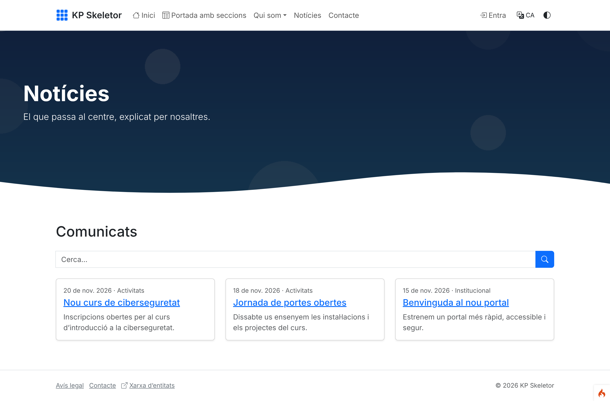
*01 — "Notícies": a banner and the full news list of two categories with a search box.*

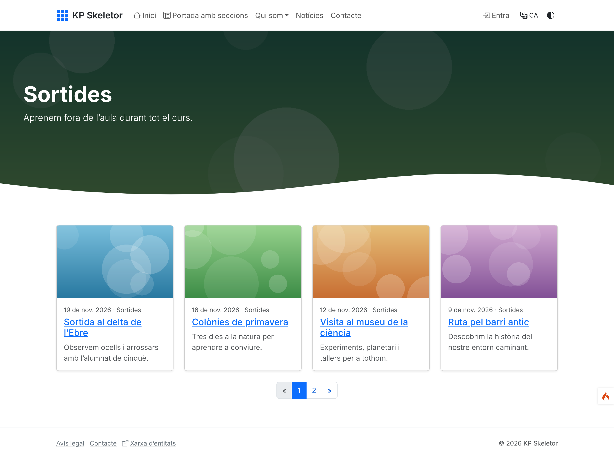
*02 — "Sortides": a banner and the outings (one category), four per page, with pages.*

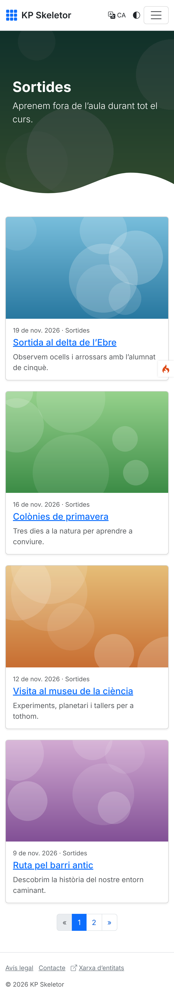
*03 — The same page on a phone (390 px).*

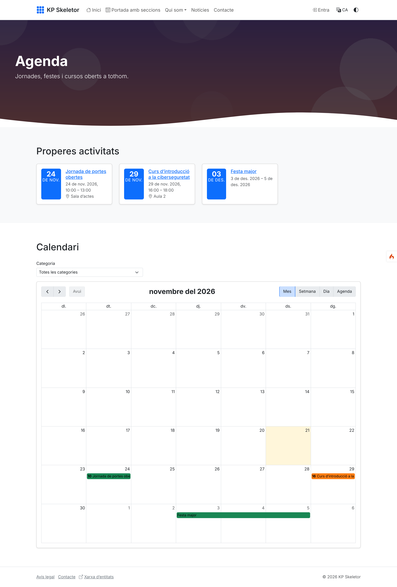
*04 — "Agenda": a banner, the upcoming public events as cards and the calendar with its filter.*

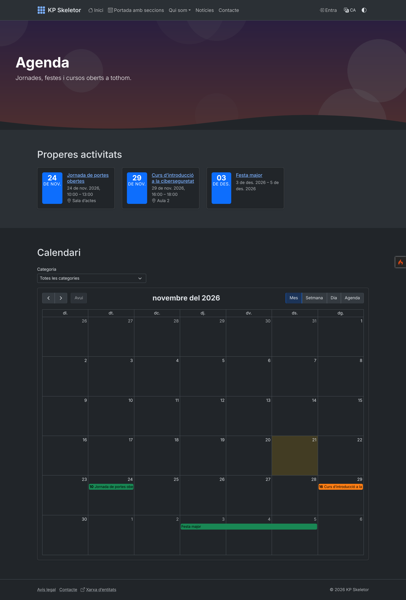
*05 — "Agenda" in dark mode.*

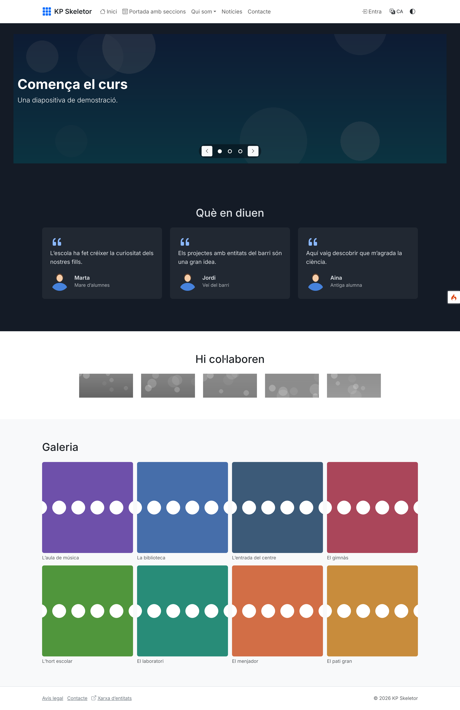
*06 — "Més seccions": the carousel (no rotation, arrows and dots), testimonials, logos in grey and
the gallery (the embed is hidden until its host is allowed).*

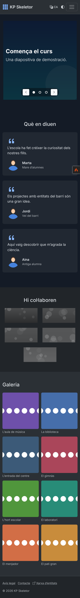
*07 — The same page on a phone in dark mode.*

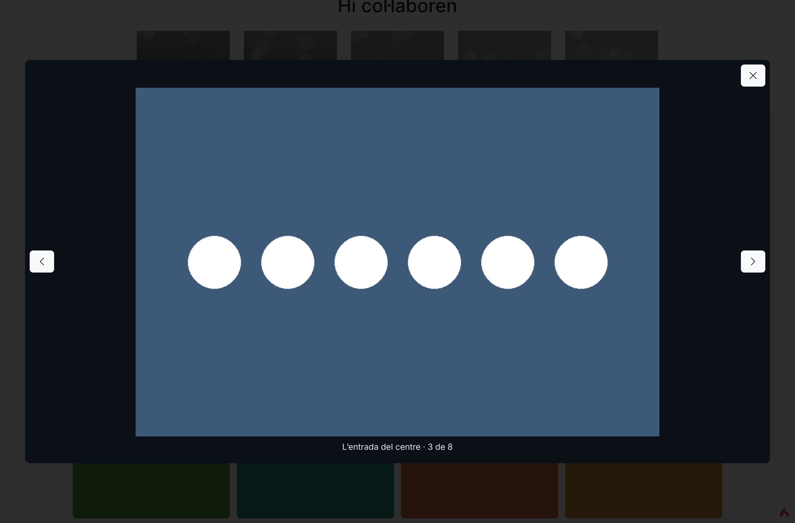
*08 — The gallery's lightbox: the image, its caption and position, previous, next and close.*

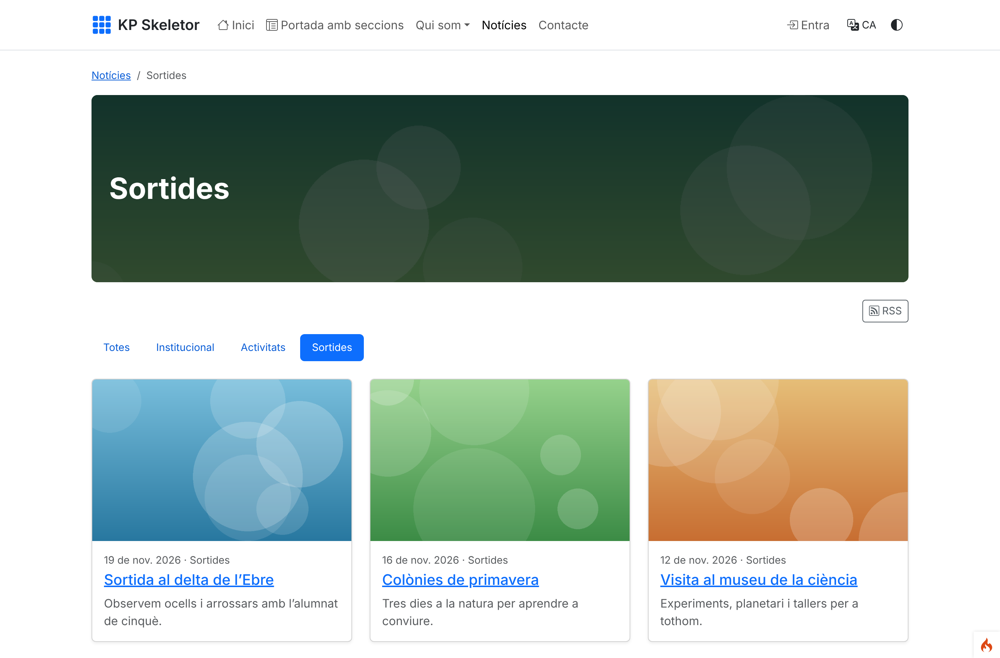
*09 — The category page with its banner as the hero (the only `<h1>`).*

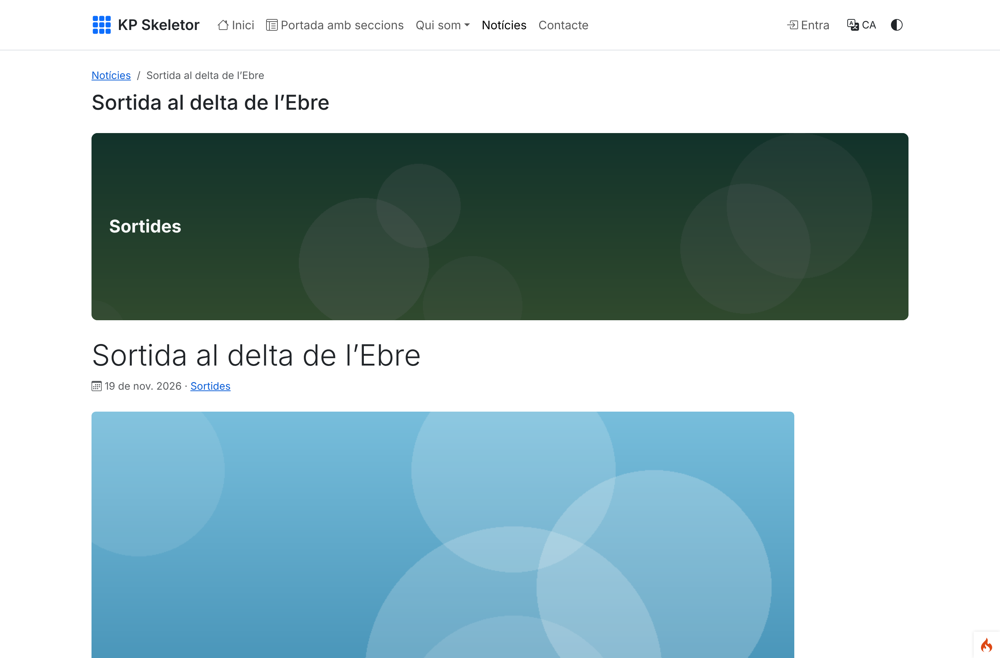
*10 — An article shows its category's banner, linking to the category.*

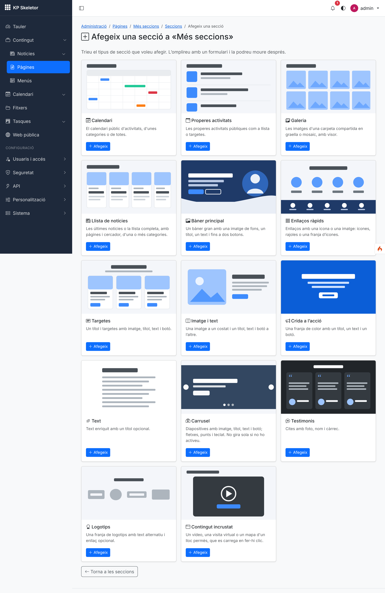
*11 — "Add section": the fourteen types of the enabled modules.*

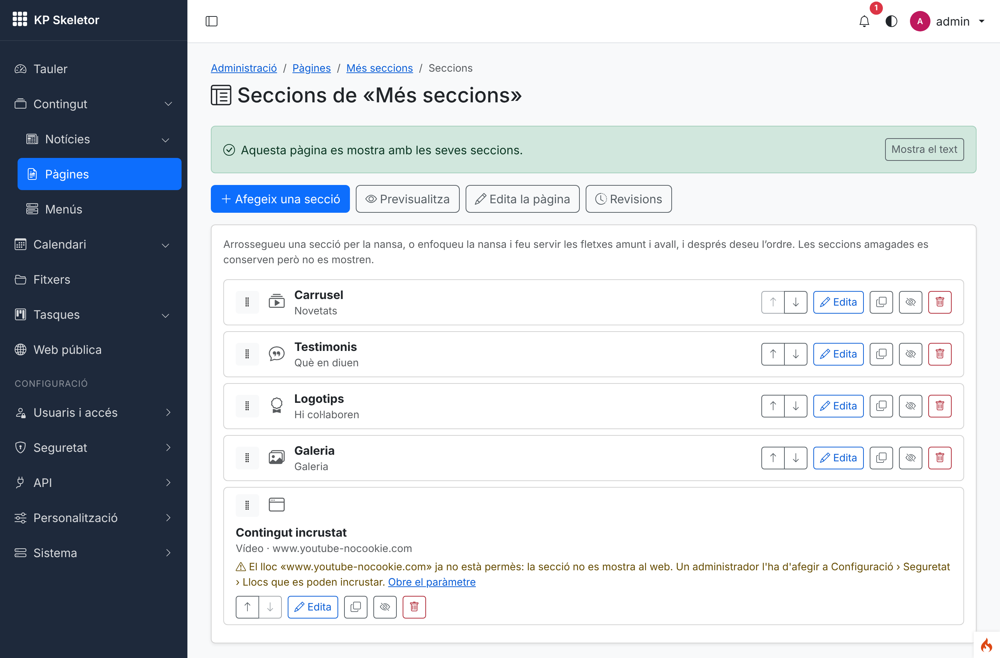
*12 — The section list: the embed whose host is not allowed shows the warning and the link to the
setting (administrator).*

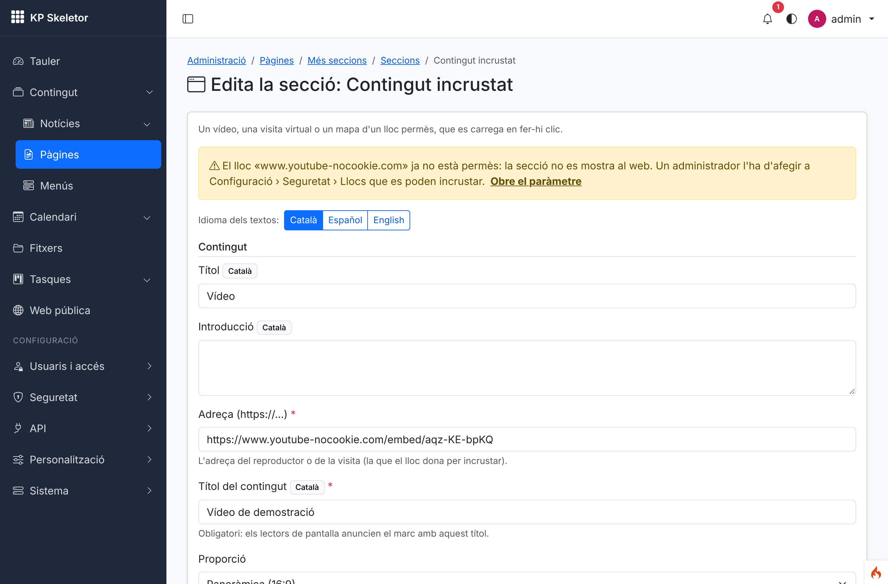
*13 — The same warning in the embed's form.*

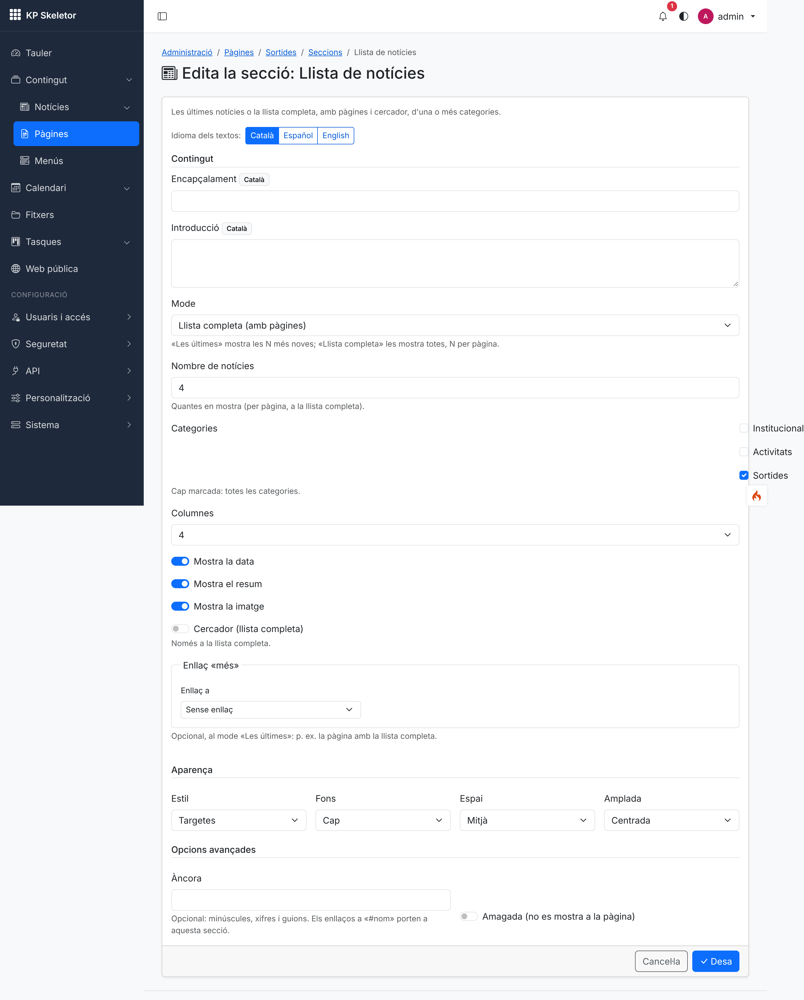
*14 — The form of a news list: mode, number, categories (checkboxes), columns and options.*

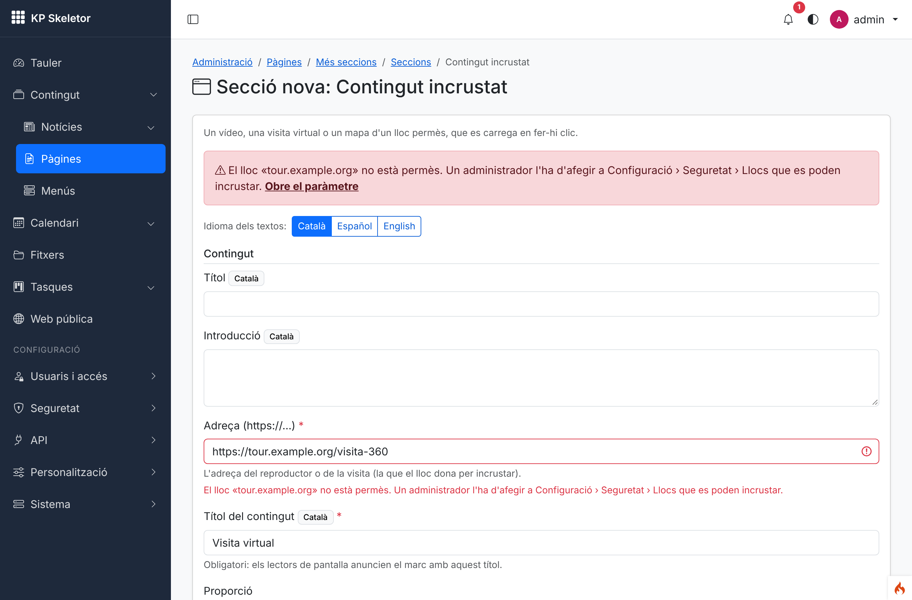
*15 — A new embed of `tour.example.org` is refused: the message names the host and links to
Settings › Security.*

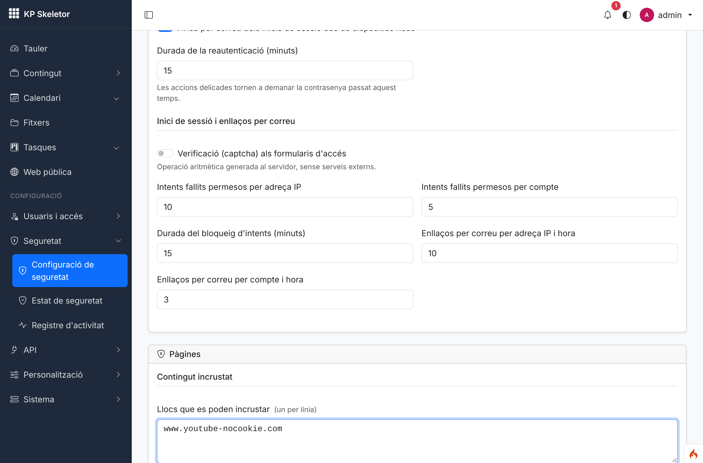
*16 — Settings › Security › *Sites that may be embedded* (empty by default), with the demo
video's host typed in before saving.*

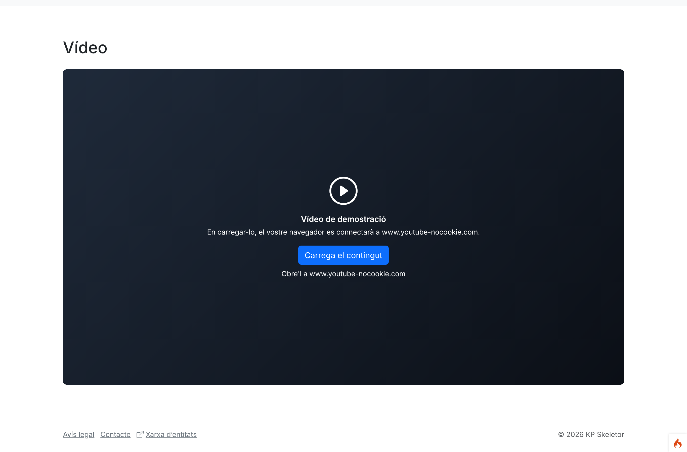
*17 — Once the host is allowed: the placeholder names the other site; nothing is loaded from it
before "Load the content".*

## Known issues

- The public layout adds its own `<h1>` to pages with breadcrumbs, so the category page **without**
  a banner and the article page still have two `<h1>` (the view's and the layout's), as before
  this session; with a banner the category page has one. To fix in a later session (theme / News
  views).
- The hero's wave takes the page's background; when the next section has a light background
  (`kp-bg-light`) a thin colour step remains at the edge.
- Images the demo stores on the public disk (category banners, covers, the gallery's images,
  section images) are not deleted by `modules:demo … --remove` (demo removal only deletes files
  under `writable/`), as in session 45.
- The e2e suite expects the Tasks tutorial module enabled with its demo (`php spark modules:enable
  Tasks && php spark modules:demo Tasks`); a fresh `app:install --demo` leaves it disabled
  (D-32-01).
- The carousel's rotation (pause button, reduced motion) is covered by the PHP tests (markup,
  minimum interval) and the code; the demo carousel does not rotate, so the e2e checks the default
  (no rotation) and the controls.
- Composer again needed the known issue 04 workaround (phpstan from a shallow clone of tag 2.3.5
  in a scratch copy's lock, `env -u COMPOSER_AUTH composer install --prefer-source`).

## Notes for the next session

- Session 47 (reusable blocks, theme zones): blocks can reuse every section type; a type that needs
  CSP sources declares them with `cspSources()` (applied per response); problems an editor must fix
  go in `warnings()`; per-section query parameters with `SectionQuery`.
- New field and type hooks are documented in `docs/sections.md`.
- Session 49 moves `core/sections/icon-field.js` to `core/forms/icon-picker.js` (unchanged here).
