# Session 47 — Reusable blocks, theme zones, footer columns and home page models

Branch: `ccr-f7b57744-2ahzoo` (the work started on `ccr-e8cb6c4c-zykzfx`, whose container stopped
answering; its commits are merged here) · Pull request: "Session 47: Reusable blocks, theme zones,
footer columns and home page models" · Date: 2026-11-21

## What was built

- **Reusable blocks** (Pages › Reusable blocks, `backend/pages/blocks`): a named list of sections
  edited once, with the same section editor, section types, translations and revisions as pages.
  A block is shown:
  - **inside a page** with the new section **"Reusable block"** (`pages.block`): changing the block
    changes every page that shows it;
  - **on many pages** from a **theme zone** ("Where it is shown"): after the header or before the
    footer, on every page, only the home page, only some pages or every page except some, with an
    order.
  A draft block is shown nowhere. Deleting a block that is used somewhere goes through **"Delete
  with its uses"** (confirmation; it is removed from the zones and pages that show it).
- **Theme zones**: themes declare `$zones` in `Theme.php`; the default theme prints
  `public.after_header` and `public.before_footer` inside `<main>`.
- **Footer in columns**: the default theme shows the footer menu in columns when its top-level
  items have children (heading + links), with the options **footer columns** (2–6) and a
  translated **contact column**; a footer menu without children looks as before.
- **New page from a model**: two **generic** ready-made pages, **"Centre educatiu"** (carousel,
  band of icon links, illustrated quick links, latest news, a place for a virtual tour, logos,
  image and text) and **"Empresa"** (hero with a wave and a cut-out image, icon links, cards,
  testimonials, image and text, call to action), created as drafts with placeholder texts in every
  language and placeholder images drawn for the skeleton. Modules and themes can add models.
- **Demo data**: a neutral "partner logos" block before the footer of every page and a footer
  menu in three columns.

## How it was built

- **Core** (`modules/Core`):
  - `Theme/ThemeManifest::$zones` and `$pageModels`, checked by `ThemeValidator`;
    `ThemeManager::zones()`, `zone()` (fires the event `themeZone` with a `Theme/ZoneContent`; a
    failing listener is logged and leaves the zone empty) and `pageModels()`; helper `theme_zone()`.
  - `Sections/PageModel`, `PageModelContext` (texts per site language, placeholder images),
    `PageModelRegistry` (enabled modules + public theme chain; bad keys skipped and logged),
    `PlaceholderImage` (GD: gradient, figure, logo). Manifest key `$pageModels` (`ModuleManifest`,
    `ManifestValidator`, declaration kind `pageModel`).
  - `ManifestValidator`: a module with several resources may name one resource after itself (Pages
    keeps `pages.*` beside `pages-blocks.*`; message `Core.manifest.resourceName` updated, D-47-02).
- **Pages module** (`modules/Pages`):
  - Tables (one migration each): `page_blocks` (name, status), `page_block_zones` (block, zone,
    rule `all|home|only|except`, pages JSON, position), `page_block_sections`,
    `page_block_section_translations`, `page_block_revisions` (same columns as the page tables).
  - Services: `PageSections` takes an owner (`PageSections::forBlocks()`); `PageBlocks`
    (repository, uses, "delete with uses"), `BlockZones` (placements and rules), `BlockRenderer`
    (expands `pages.block` sections into the block's visible sections before the page's
    `SectionRenderer`; fills zones), `CurrentPage` (set by `PageRenderer`), `BlockRevisions`,
    `PageModelBuilder` (draft page, every section through `SectionForm::validate()`, PNGs on the
    public disk `modules/pages` with an explicit `png` allow-list).
  - Section type `Sections/BlockSection.php` (`pages.block`; warns about draft or deleted blocks);
    page models `Models/SchoolModel.php` (`pages.school`), `Models/CompanyModel.php`
    (`pages.company`), base `PagesPageModel`; thumbnails `Assets/img/models/`.
  - Controllers: `SectionEditor` (the list, gallery and forms shared by `Sections` for pages and
    `BlockSections` for blocks), `Blocks` (kpcrudy CRUD; operations Sections, Where it is shown,
    Revisions, Delete with its uses), `BlockPlacements`, `PageModels`; views `blocks/zones.php`,
    `editor/models.php`; `editor/list.php` now takes toolbar links.
  - Event `themeZone` in `Config/Events.php`.
- **Routes**: `backend/pages/blocks` (CRUD, `can:pages-blocks.list`), `backend/pages/blocks/<id>/sections[/…]`
  and `backend/pages/blocks/<id>/zones[/…]` (`can:pages-blocks.edit` + the CRUD's resolver in the
  controller), `backend/pages/models` (`can:pages.add`), all declared before the pages CRUD.
- **Permissions**: resource `pages-blocks` (`list`, `add`, `edit`, `delete`); admin all, editor
  `list`, `add`, `edit` (like pages: no delete). Menu entry "Reusable blocks" (sidebar, 26).
- **Default theme**: `$zones`, partial `partials/footer.php` (columns), options `footerColumns`
  and `footerContact`, CSS for the zone at the bottom of `<main>` and the footer headings.
- **Demo**: `PagesDemoSeeder::partnerLogos()`, `MenusDemoSeeder` footer in columns.
- Texts in ca/es/en (`Pages.blocks.*`, `Pages.models.*`, `ThemeDefault.zones.*`, …). No new
  commands or settings outside the theme options.

## Decisions and deviations

- **D-47-01** (decided) applied as proposed, with generic content only.
- **D-47-02** (accepted, proposal): (1) block sections and revisions in **tables of their own**
  with the same columns instead of an owner column in `page_sections`/`page_revisions` — on
  SQLite, making `page_id` nullable rebuilds the table and CodeIgniter 4.7's rebuild drops every
  `ON DELETE` action (purging a page then failed; found while running the tests); (2) the `pages`
  prefix beside `pages-blocks`; (3) `$pageModels` and sections validated by their forms;
  (4) zones through the event `themeZone`, `CurrentPage`; (5) "Delete with its uses"; (6) footer
  options.
- The school model has a **text placeholder** where the reference shows a 360° tour: an embed
  section needs its host allowed by an administrator (D-46-01), so the text says how to replace it.
- The `revisions` operation of blocks needs `edit` (the resource has no `show`).

## How to try it

```bash
INSTALL_ADMIN_PASSWORD='…' php spark app:install --env=development --db=sqlite --demo
php spark serve
```

- Public: `/qui-som` (the partner-logos block before the footer, the footer in columns).
- `backend/pages/blocks` as `admin@example.com` (or `editor@example.com`): row menu › Sections,
  Where it is shown, Revisions.
- `backend/pages` › **New page from a model** › "Centre educatiu" or "Empresa": a draft page opens
  in the section editor; Preview.
- Settings › Theme › options of "Default": footer columns and the contact column (lines with `|`).

## Tests and checks

New tests: `modules/Pages/Tests/BlocksTest.php` (10: permissions and forged posts, editor, no
nested blocks, revisions, block section in a page, language fallback, drafts and hidden sections,
zones and every rule, placements validated, delete with uses, editors cannot delete),
`PageModelsTest.php` (5: permission, gallery, both models create valid translated pages, forbidden
words in models and demo data), `modules/Menus/Tests/FooterColumnsTest.php` (4),
`modules/Core/Tests/ThemeZonesTest.php` (3), additions to `ManifestValidatorTest`,
`ThemeValidatorTest`, `PagesModuleTest` (migrations up/down/up). E2E: `tests/e2e/blocks.spec.mjs`
(public page with a zone and the footer at three widths, light and dark, with axe; the blocks
screens; both models previewed and checked).

RESULTS

## Screenshots

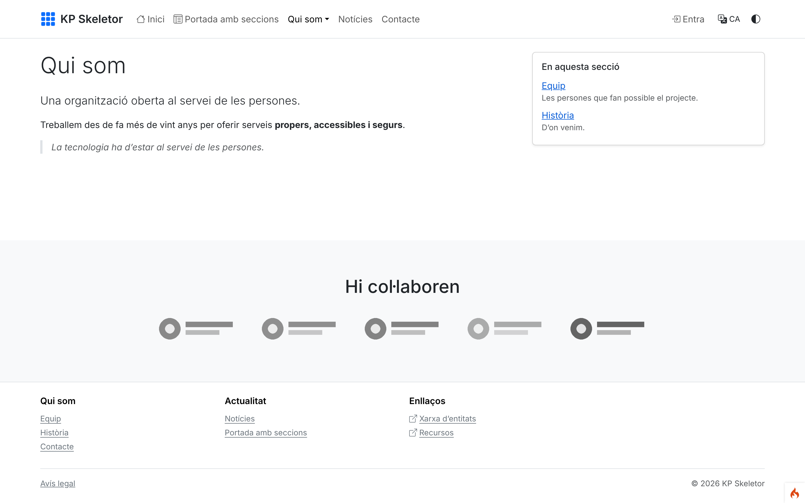
*01 — "Qui som" as a guest: the demo "partner logos" block in the zone before the footer and the footer menu in three columns, with the legal notice below.*

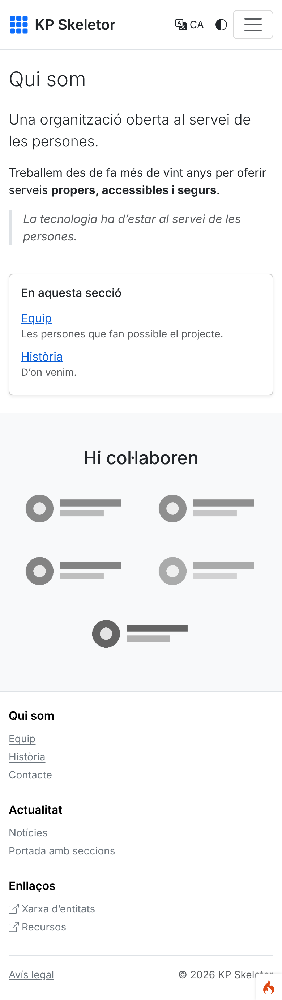
*02 — The same page at phone width: logos wrap and the footer columns stack.*

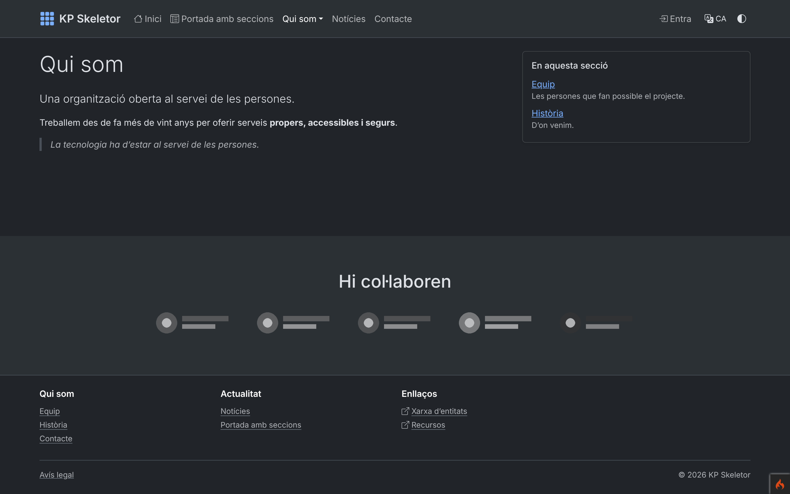
*03 — The same page in dark mode.*

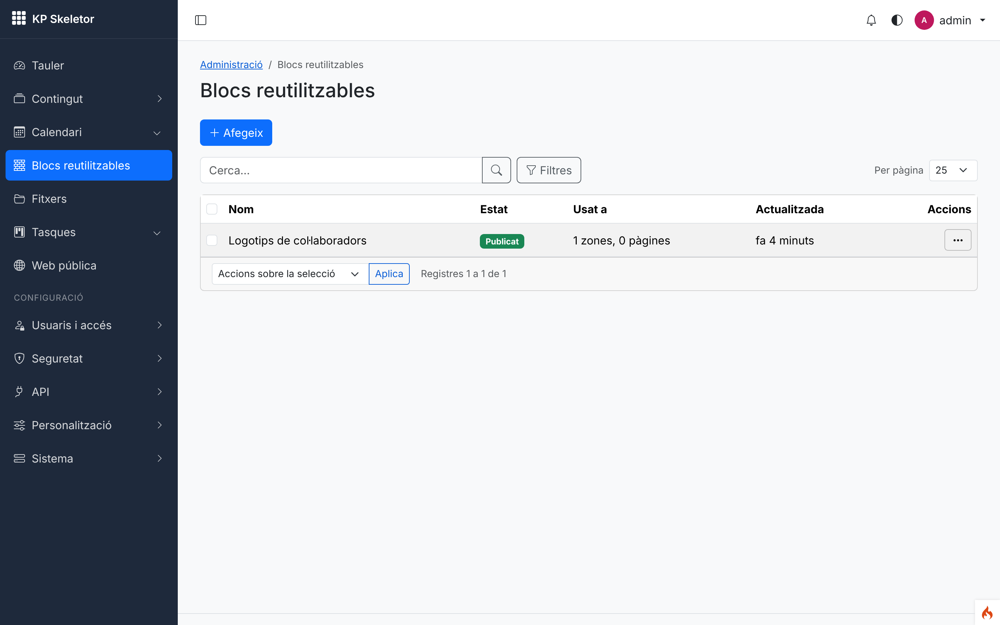
*04 — Pages › Reusable blocks: name, status and where each block is used.*

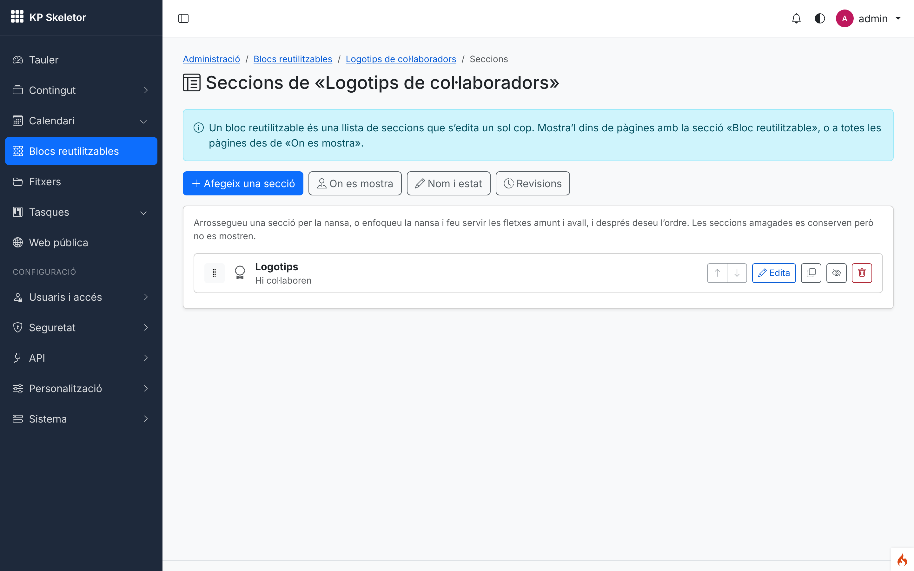
*05 — The section editor of a block (the same editor as pages) with its toolbar: where it is shown, name and status, revisions.*

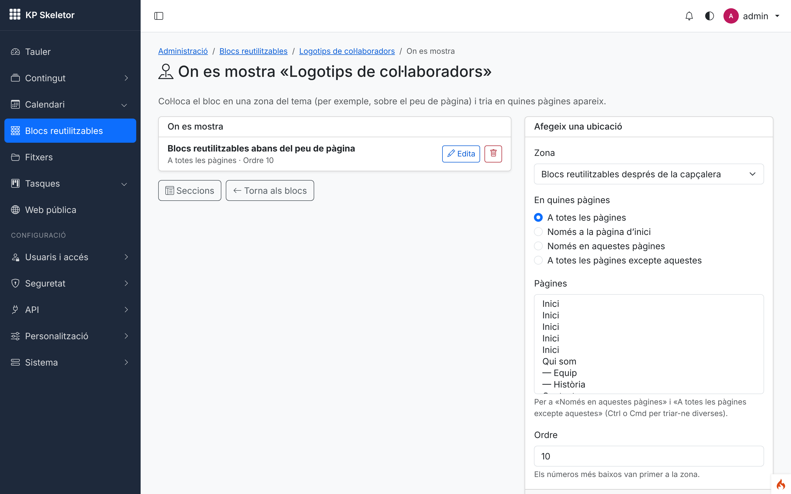
*06 — "Where it is shown": the block's placements and the form (zone, rule, pages, order).*

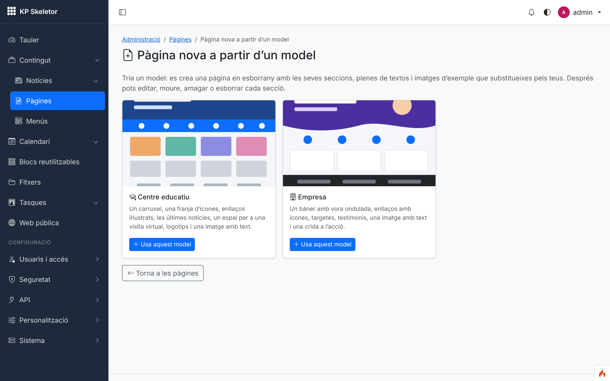
*07 — New page from a model: the generic models "Centre educatiu" and "Empresa".*

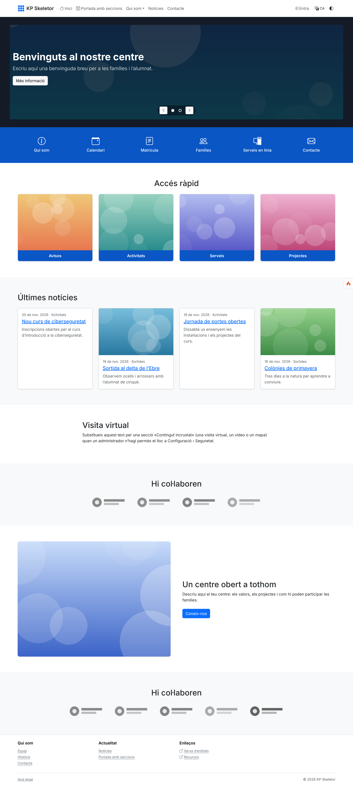
*08 — A page made from "Centre educatiu" (published for the screenshot): carousel, icon band, quick links, latest news, the place for a virtual tour, logos, image and text; then the zone block and the footer.*

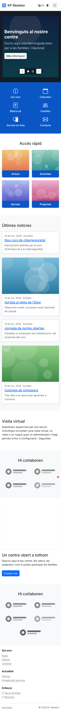
*09 — The same page at phone width.*

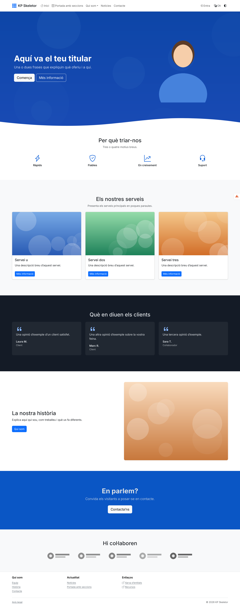
*10 — A page made from "Empresa": hero with a wave and a cut-out figure, icon links, cards, testimonials, image and text, call to action.*

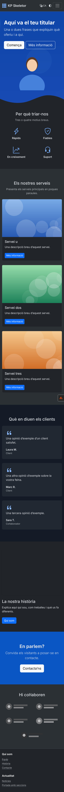
*11 — The same page at phone width in dark mode.*

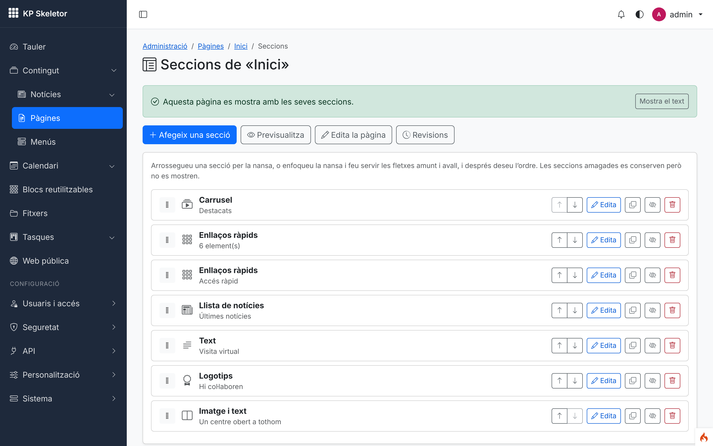
*12 — The page made from a model in the section editor, ready to replace the placeholders.*

## Known issues

- Placeholder images of a page made from a model stay in the media folder if the page is deleted.
- Theme options of type `translated` are one-line inputs: the footer contact column uses `|` as
  the line separator.
- The e2e model tests create two draft pages on the demo site at each run (desktop light only).
- Composer again needed the known issue 04 workaround (phpstan from a shallow clone of tag 2.3.5
  through a scratch copy's lock, `env -u COMPOSER_AUTH composer install --prefer-source`).

## Notes for the next session

- Content shown on many pages is a reusable block in a theme zone (`$zones`, `theme_zone()`,
  event `themeZone`); never hard-code it in a layout.
- The section editor is shared: `Modules\Pages\Controllers\SectionEditor` (owner, storage, URLs).
- A module may ship page models (`$pageModels`; keys `<module>.<name>`; sections are validated by
  their forms, sections of disabled modules are dropped). Session 48's contact form section could
  be added to the models.
