# Session 48 — Contact module: a contact form protected against spam

Branch: `ccr-f7ba62ed-ukdx9g` · Pull request: PR_LINK · Date: 2026-11-21

## What was built

- A **public contact form** at `/contact` (`/es/contact`, `/en/contact`: the language prefix of
  `LocaleUrls`) and a section **"Contact form"** (`contact.form`) for pages built from sections,
  which may offer only some recipients. Fields: name, email, **recipient** (chosen from a list;
  the real addresses never appear on the site), subject, message, a required **privacy** checkbox
  (linked to the privacy page when set) and the site's own arithmetic captcha.
- **Back office**: *Contact messages* (`backend/contact/messages`: list, details, **Reply by
  email** through the user's mail program, **Mark answered**, **Archive**, delete) and
  *Recipients* (`backend/contact/recipients`: name per language, up to five addresses, a group
  to notify, order, active). A recipient's group reads only that recipient's messages; holders
  of `contact-messages.all` (admin) read everything.
- **Notification** "New contact message" (bell / email / push per preferences, queued), a
  **dashboard widget** of new messages, and a **scheduled task** that deletes messages after one
  year (setting, minimum 30 days).
- **Spam layers**: signed time trap, honeypot, captcha (always by default, or only when
  suspicious), recipients checked against the signed list, content rules (header injection,
  links, blocked words, optional Latin-only), rate limits per IP and per email. Each refusal is a
  security-log entry with its reason; the visitor sees a generic message.
- **No mail relay**: emails go from the site's address with the visitor only in `Reply-To`; no
  automatic reply to the visitor; no attachments.
- Demo data: three recipients, three messages, and a Pages demo page **"Escriu-nos"** with the
  form section.

## How it was built

- **Module** `modules/Contact` (manifest `Config/Module.php`, version 0.1.0, requires Core, Auth,
  Dashboard; `modules/Contact/CLAUDE.md`).
  - Public: `Controllers/ContactPage.php` (`GET contact`, `POST contact` with CSRF and
    `ratelimit:forms`, `GET contact/captcha`); views `Views/form.php` (shared),
    `Views/public/contact.php`, `Views/sections/form.php`; section
    `Sections/ContactFormSection.php` (field `recipients`, a `ChoicesField` of the active
    recipients; thumbnail `Assets/img/sections/form.svg`).
  - Spam layers: `Services/FormToken.php` (HMAC with `SigningKey::derive('contact.form')`:
    time, recipients offered, return path; < 3 s or > 2 h refused), the honeypot input `website`
    (Bootstrap `visually-hidden`, `aria-hidden`, `tabindex="-1"`; no inline style), Auth's
    `Captcha`, `Services/ContactForm.php` (captcha mode, form data),
    `Services/ContentRules.php`, `Services/SenderHistory.php` (Core `RateLimiter::attemptCustom()`
    per IP and per email; hashed cache keys for the "suspicious" history, one hour).
  - `Services/ContactMessages.php` (store; notify the members of the recipient's group holding
    `contact-messages.show`; queue an email per recipient address with `Reply-To`; a recipient
    with neither notifies `contact-messages.all`), `Services/Recipients.php`,
    `Services/MessageAccess.php` (the record rule, used by the CRUD's `where(Closure)` and the
    widget), `Notifications/MessageReceived.php`, `Tasks/PurgeMessages.php` (daily 03:40),
    `Widgets/NewMessages.php` (`contact.new`).
  - Back office: `Controllers/Messages.php`, `Controllers/Recipients.php` (kpcrudy through
    `CrudFactory`).
- **Tables**: `contact_recipients`, `contact_recipient_translations`, `contact_messages` (no IP).
- **Core**: `MailQueue::push(..., ?string $replyTo)`, `MailQueue::validAddress()`, migration
  `AddReplyToToMailQueue` (`mail_queue.reply_to`); the queue sends `Reply-To` only for a valid
  single address without control characters.
- **Permissions**: `contact-messages.{list,show,delete,answer,archive,all}`,
  `contact-recipients.{list,show,add,edit,delete}`; admin all, editor
  `contact-messages.{list,show,answer,archive}`. Menu "Contact messages" (sidebar, 45) with
  "Recipients".
- **Settings**: Settings › Contact: `Contact.privacyPage`, `Contact.retentionDays`; Settings ›
  Security › Contact form (spam): `Contact.captcha`, `Contact.rateLimit`, `Contact.maxLinks`,
  `Contact.blockedWords`, `Contact.latinScriptOnly`.
- No new commands, events or API resources.
- Docs: `docs/contact.md` (new), `docs/security.md` ("Public forms: the contact form"),
  `docs/sections.md`, `docs/user-guide.md` (+ `ca`, `es`), `CHANGELOG.md`, `docs/decisions.md`
  (D-48-03), `docs/progress.md`.

## Decisions and deviations

- **D-48-01, D-48-02** (decided) applied as decided.
- **D-48-03 (decide) — Open**, built as proposed so it can still change: the extra permission
  `contact-messages.all` (who reads every recipient's messages, instead of naming a group in
  code), the setting names `Contact.captcha`, `Contact.retentionDays`, `Contact.latinScriptOnly`,
  the Core's `Reply-To` in the mail queue, and the section's recipients carried in the signed
  token.
- A form sent from a section that needs correcting is shown again on the `contact` page (with
  its values and the section's recipients), not on the page that holds the section; after a
  successful message the visitor goes back to that page.
- The Pages demo seeder adds the page "Escriu-nos" with the section (as session 46 did for the
  News and Events sections).

## How to try it

```bash
INSTALL_ADMIN_PASSWORD='…' php spark app:install --env=development --db=sqlite --demo --no-interaction
php spark serve
```

- Public: `/contact`, `/es/contact`, `/escriu-nos`. Messages sent appear in the back office
  (the captcha answer is the sum or difference in the image).
- `backend/contact/messages` as `admin@example.com` (everything) or `editor@example.com` (only
  "Secretaria", the recipient of the `editor` group); `backend/contact/recipients` as admin.
- Settings › Security › "Contact form (spam)" and Settings › Contact.
- The queued emails: table `mail_queue` (`reply_to` = the visitor).

## Tests and checks

New tests: `modules/Contact/Tests/ContactFormTest.php` (14: the page without addresses, a valid
message reaching only its recipient with `Reply-To` and nothing to the visitor, the fallback to
`all`, honeypot, too fast / expired / missing / forged token, captcha required and single use,
the "suspicious" mode, validation errors, forged recipients (inactive, unknown, outside the
section's list), header injection, links / blocked words / script, rate limit per IP and per
email, CSRF and `ratelimit:forms`, the captcha image), `MessagesTest.php` (10: manifest,
permissions, the record rule with forged ids, operations and their permissions, escaping in the
back office and the email, recipients' addresses, widget, retention task, migrations
up/down/up), `ContactSectionTest.php` (2); `modules/Core/Tests/NotifierTest.php`
(`testAQueuedEmailMayAnswerToAReplyToAddress`), `CoreMigrationsTest` (the new migration). E2E:
`tests/e2e/contact.spec.mjs`.

```
vendor/bin/phpunit                         OK (1686 tests, 98154 assertions), 12 min 0 s
vendor/bin/phpstan analyse                 [OK] No errors
vendor/bin/php-cs-fixer fix --dry-run      0 of 1257 files to fix
php spark modules:sync                     Mòduls sincronitzats.
php spark permissions:check                Permisos correctes: 187 permisos, 406 rutes comprovades
php spark csp:check                        No hi ha scripts, gestors ni estils en línia
php spark assets:publish --check           Els recursos publicats estan al dia
php spark security:check                   13 correctes, 7 informatives, 7 avisos, 6 errors (all of a
                                           development demo site: CI_ENVIRONMENT, CI_DEBUG, HTTP base URL,
                                           forceGlobalSecureRequests, Secure cookies, demo data)
npm run e2e (demo site, Tasks enabled)     276 passed, 60 skipped, 0 failed (10.2 min)
```

The first full PHPUnit run found 6 failures, all counts or lists that grow with a new module
(CRUD routes 21 → 23, Core migrations 18 → 19, permissions 175 → 187, the Contact widget and
task in the registry, `contact-*` in the admin's Shield matrix) and one documentation link
written while the run was going; they were updated.

## Screenshots

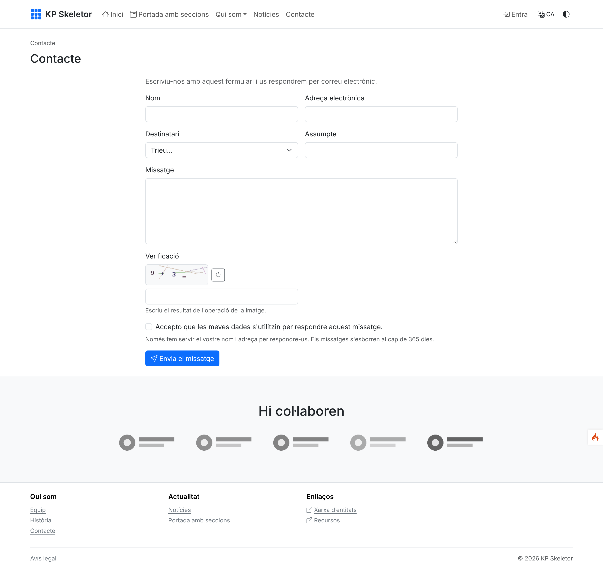
*01 — The contact page `/contact` as a guest: recipients to choose, the captcha, the privacy checkbox and the retention notice (the demo "partner logos" block and the footer below).*

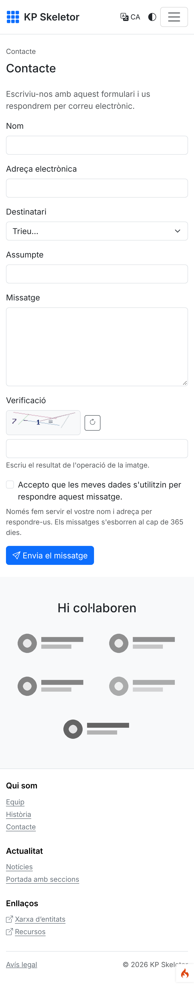
*02 — The same page at phone width.*

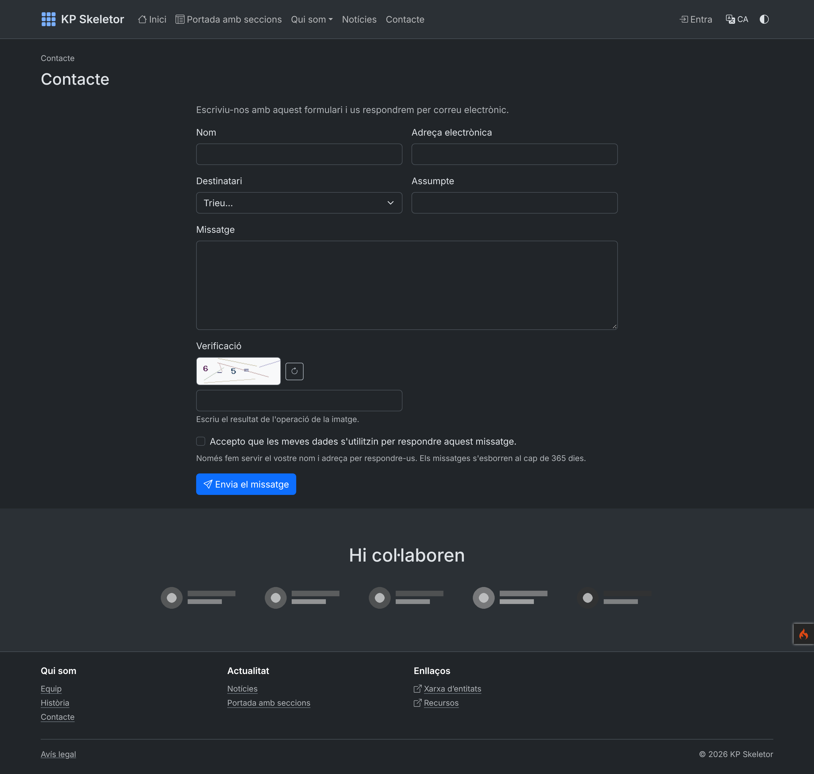
*03 — The same page in dark mode.*

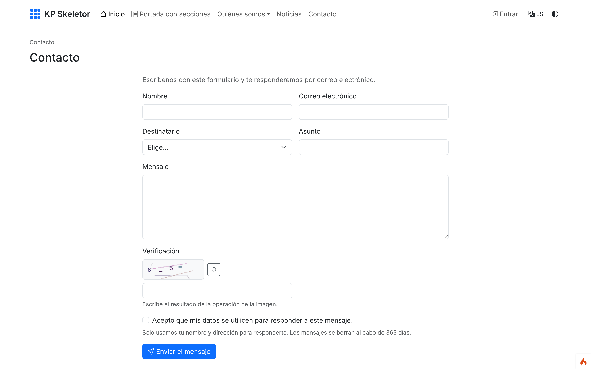
*04 — `/es/contact`: the page and the recipients' names in Spanish.*

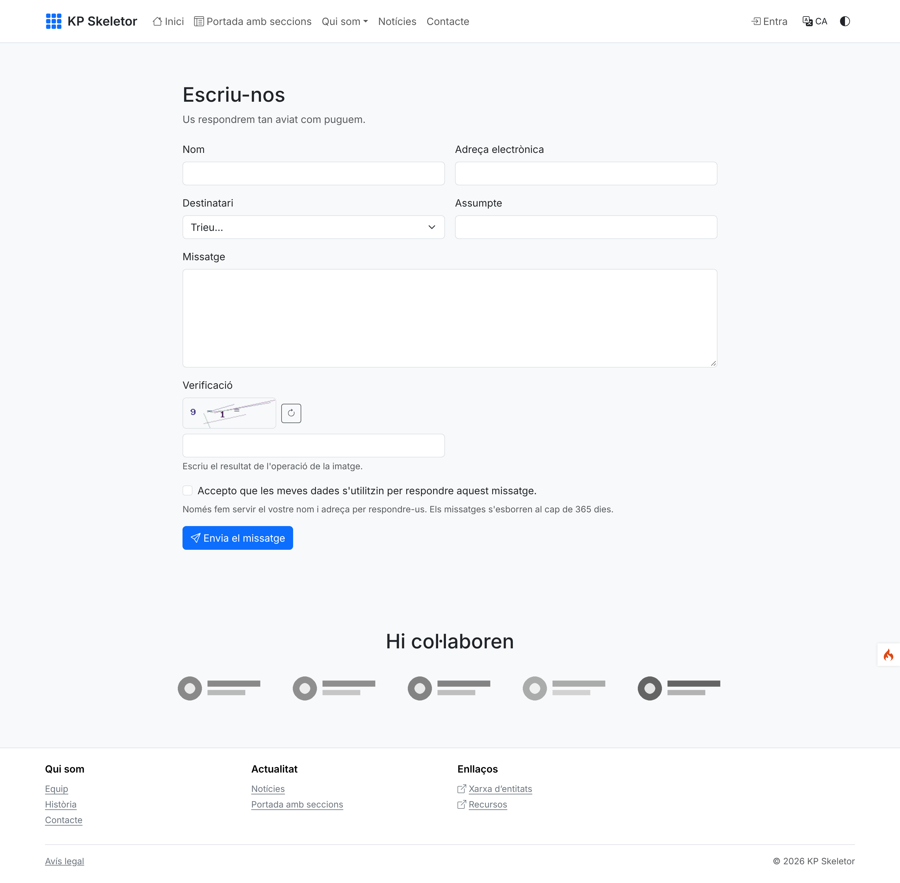
*05 — The Pages demo page "Escriu-nos" with the section `contact.form` (heading, introduction, the form).*

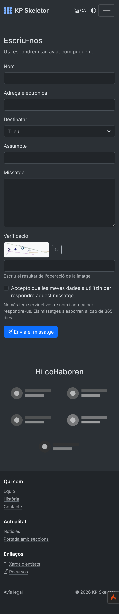
*06 — The same page at phone width in dark mode.*

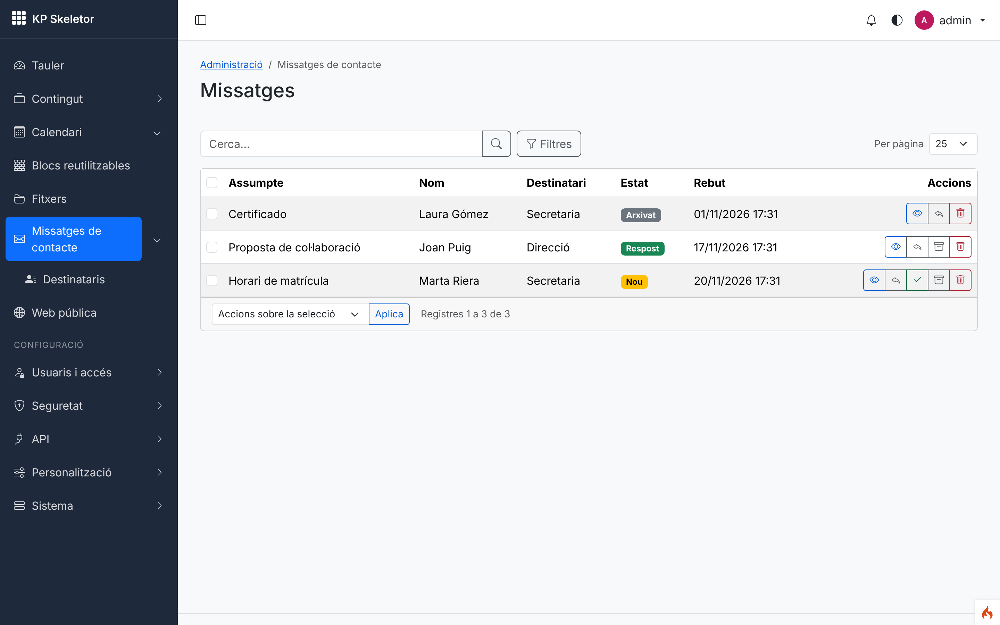
*07 — Contact messages as the administrator: subject, name, recipient, status, date.*

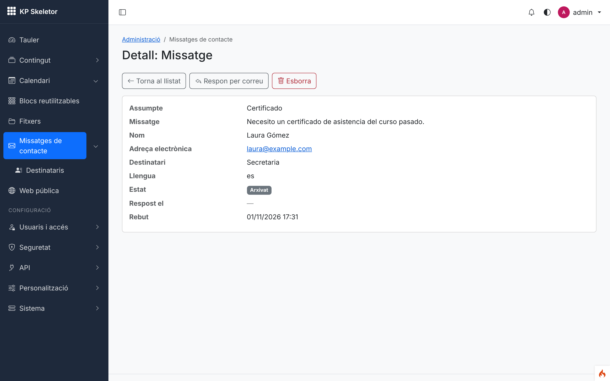
*08 — A message's details with **Reply by email** (the user's mail program) and Delete.*

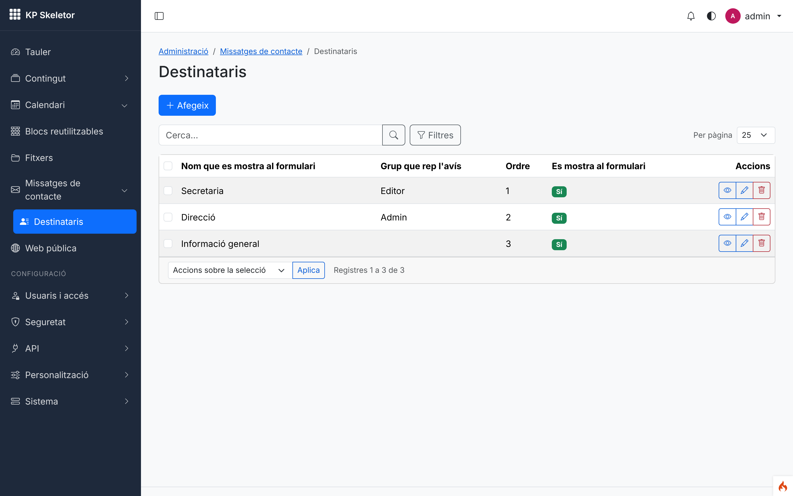
*09 — Recipients: name, group notified, order, offered on the form.*

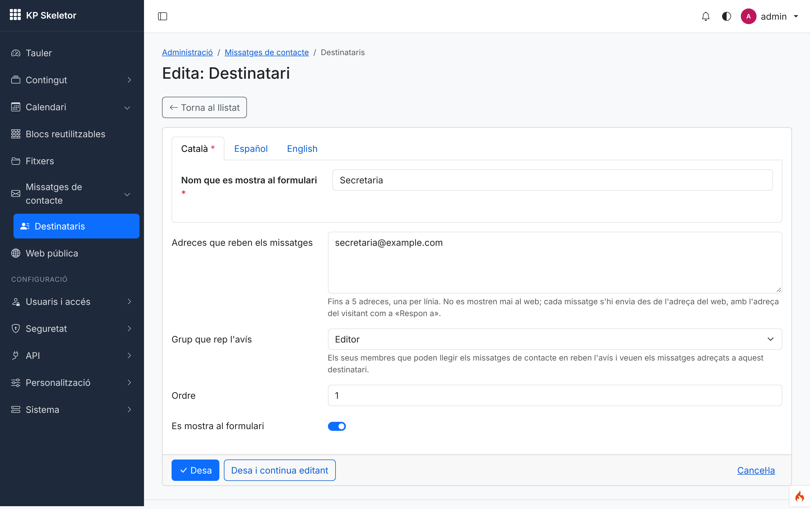
*10 — A recipient's form: name per language, addresses (never shown on the site), group, order, active.*


*11 — Settings › Security, including the group "Contact form (spam)": captcha mode, messages per hour, links allowed, blocked words, Latin script only.*

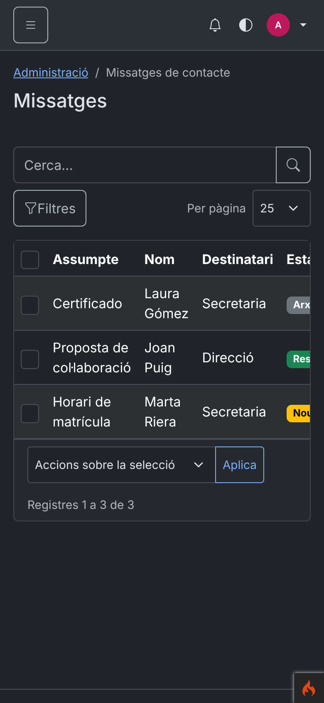
*12 — Contact messages at phone width in dark mode.*

## Known issues

- One captcha challenge per session: two forms with a captcha open in two tabs invalidate each
  other's (as with the Auth and Tasks forms).
- In the captcha mode "suspicious", visitors behind one shared IP (a school network) all get the
  captcha after the first message within the hour.
- The e2e suite must not run while PHPUnit runs: the tests toggle maintenance mode in the shared
  `writable/` folder and the demo site answers 503 meanwhile.
- Composer again needed the known issue 04 workaround (the lock's `phpstan/phpstan` dist pointed
  at a zip of a shallow clone of tag 2.3.5, `env -u COMPOSER_AUTH composer install
  --prefer-source`, then the lock restored).

## Notes for the next session

- **D-48-03 is Open (decide)**: run `deploy/decide.md` before or after session 49.
- A public form that accepts text follows the Contact layers (`FormToken`, honeypot, Auth's
  `Captcha`, choices checked against the signed list, `ContentRules`, `RateLimiter`,
  `security_log()` per refusal with a generic message). Emails that answer a visitor go through
  `MailQueue::push(..., $replyTo)`, never an auto-reply.
- The chat assistant (session 51) can offer `site_url('contact')` when the Contact module is
  enabled.
